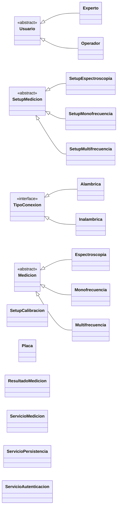
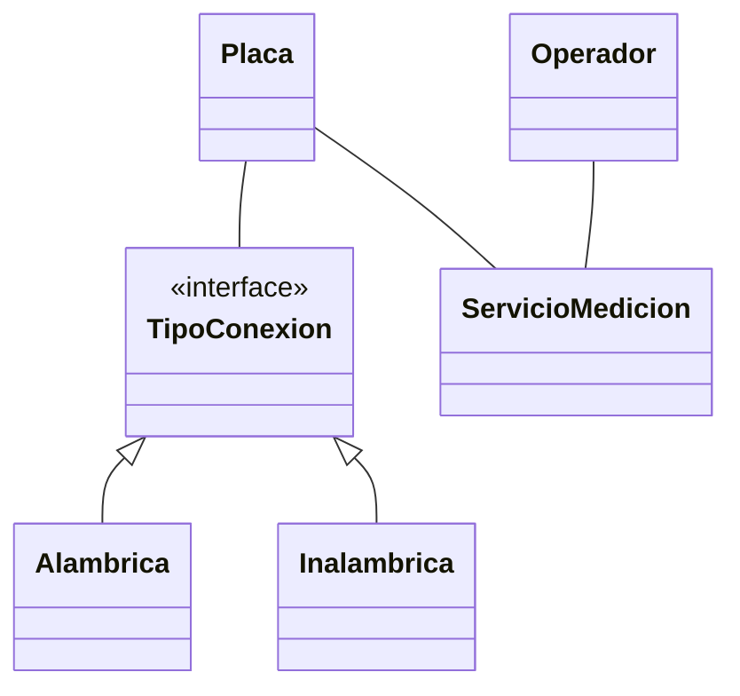
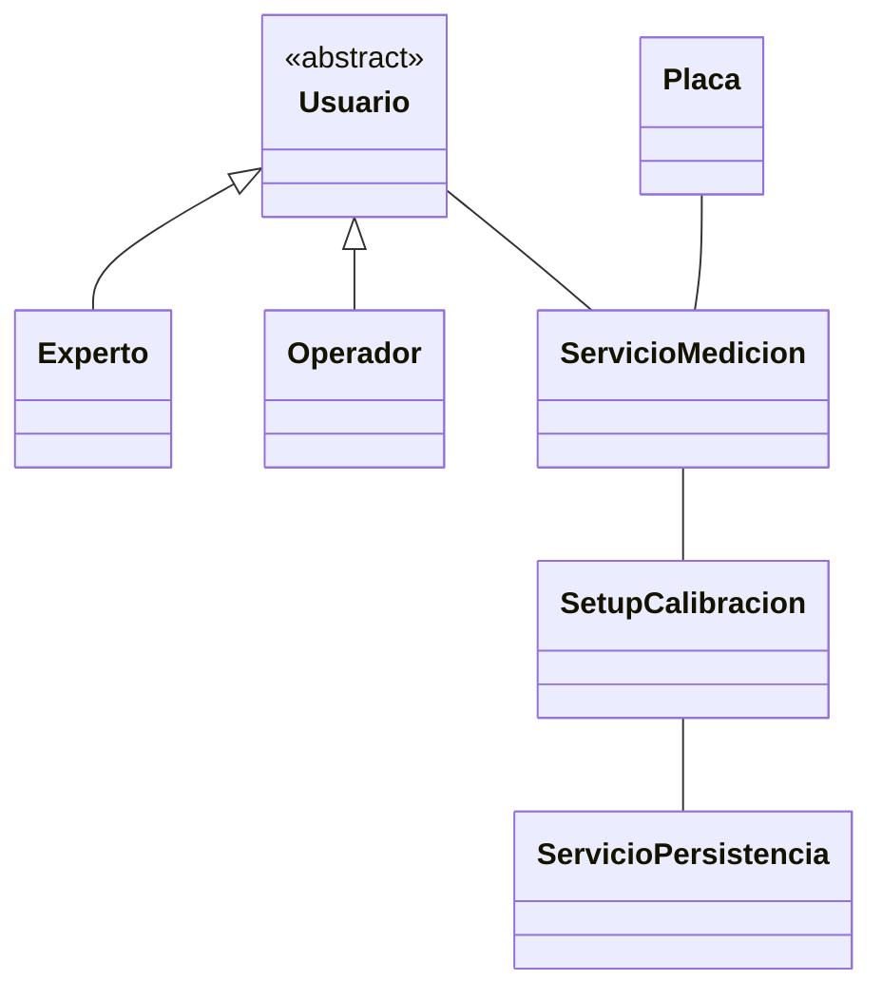
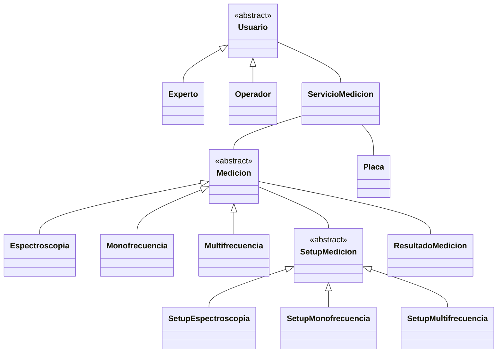
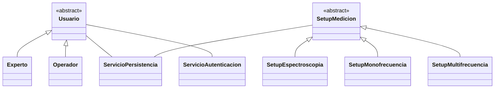
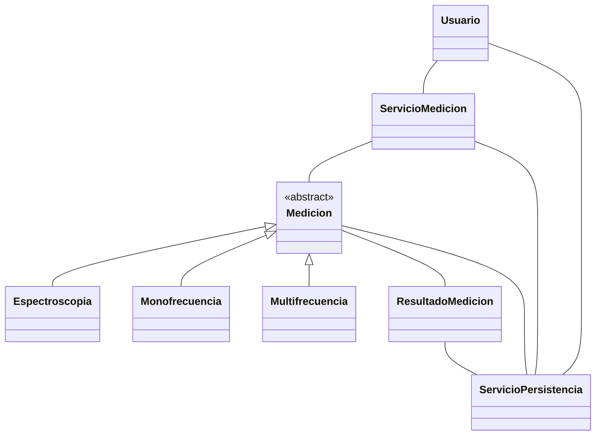

NOTA: hay una regla de seguridad inquebrantable para aplicaciones locales: las contraseñas nunca deben guardarse en texto plano en la base de datos. Debés aplicar una función de hash (como _bcrypt_) antes de guardarlas en SQLite. De esta forma, si el archivo `.db` de la aplicación se copia o transfiere, las credenciales de los miembros del laboratorio permanecen protegidas.
# Patrones a mirar
- Builder
- Strategy
- Decorator
- Facade
- Proxy
- Memento
- Template
# Clases Identificadas

+ Usuario (Abstracto)
	+ Operador
	+ Experto
+ Medicion (Abstracto) la `Medicion` representa la acción de medir
	+ Espectroscopia
	+ Monofrecuencia
	+ Multifrecuencia
+ SetupMedicion (Abstracto) El `SetupMedicion` tiene los parámetros (frecuencias, retardos)
	+ SetupEspectroscopia
	+ SetupMonofrecuencia
	+ SetupMultifrecuencia
+ SetupCalibracion
+ Placa
+ ResultadoMedicion `ResultadosMedicion` tiene los números crudos.
+ TipoConexion (Interfaz)
	+ Alambrica
	+ Inalambrica
+ ServicioMedicion
+ ServicioPersistencia
+ ServicioAutenticacion

##### Subsistema 1: Comunicación e Interacción con el Hardware

##### Módulo 1: Conectividad y Estado

##### Módulo 2: Calibración del Dispositivo

#### Subsistema 2: Configuración y Toma de Mediciones
##### Módulo 1: Tipos y Estrategias de Medición

#### Subsistema 3: Configuración y Gestión de Perfiles (Setups)

##### Módulo 1: Perfiles de Usuario y Gestión de Setups de Medición

#### Subsistema 5: Persistencia

##### Módulo 1: Almacenamiento y Estructura de Datos

