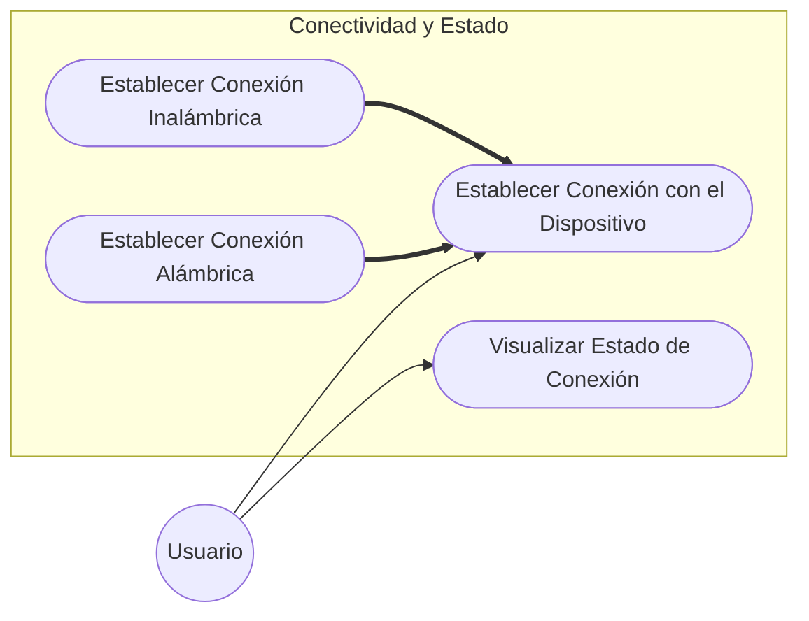
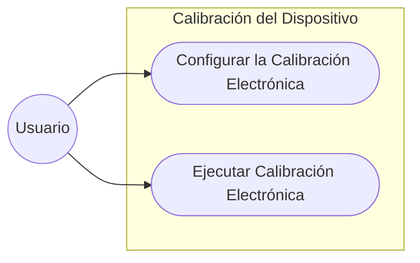
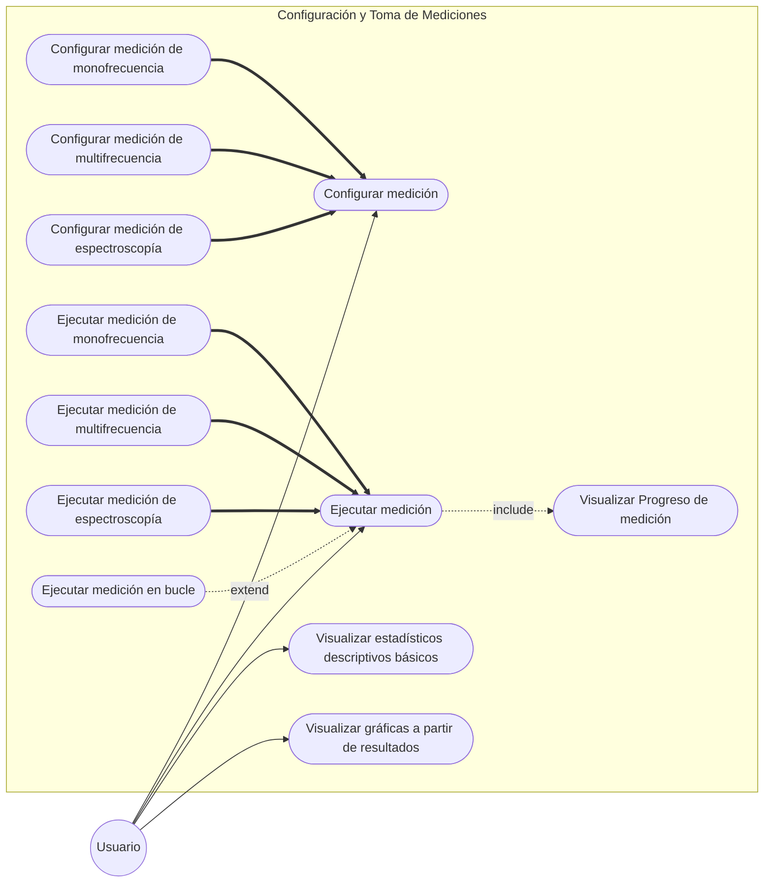
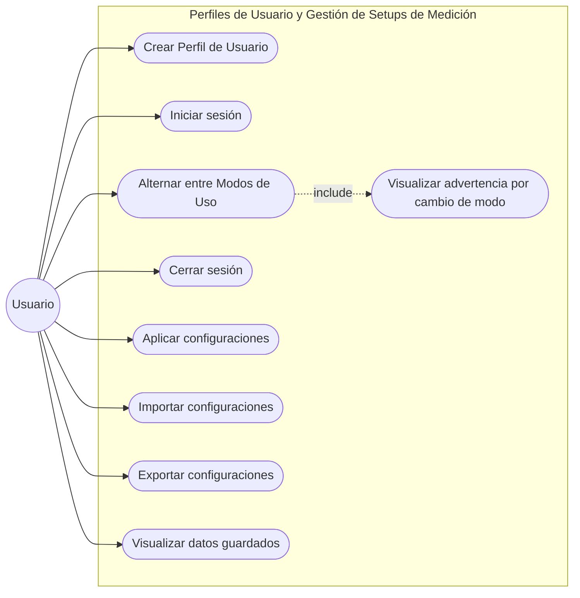
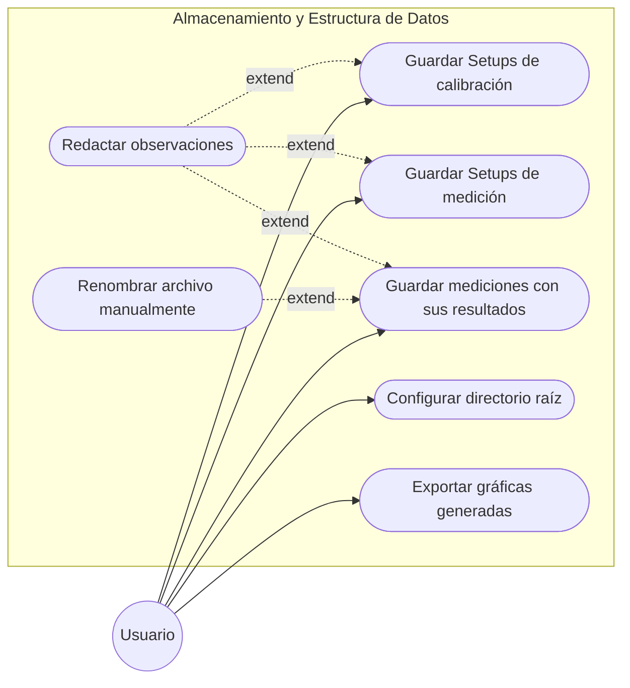

### Diagramas de Casos de Uso
#### Subsistema 1: Comunicación e Interacción con el Hardware

##### Módulo 1: Conectividad y Estado

##### Módulo 2: Calibración del Dispositivo

#### Subsistema 2: Configuración y Toma de Mediciones
##### Módulo 1: Tipos y Estrategias de Medición

#### Subsistema 3: Configuración y Gestión de Perfiles (Setups)

##### Módulo 1: Perfiles de Usuario y Gestión de Setups de Medición

#### Subsistema 5: Persistencia

##### Módulo 1: Almacenamiento y Estructura de Datos

