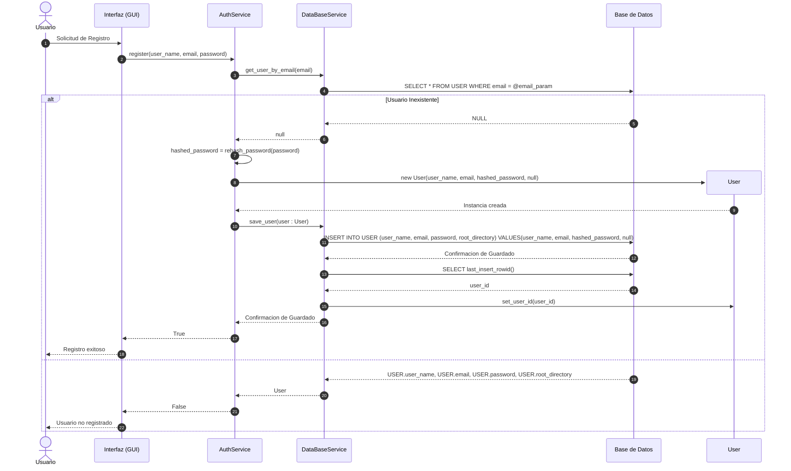
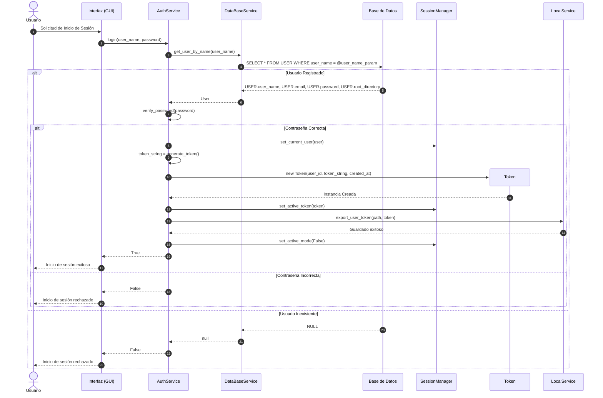
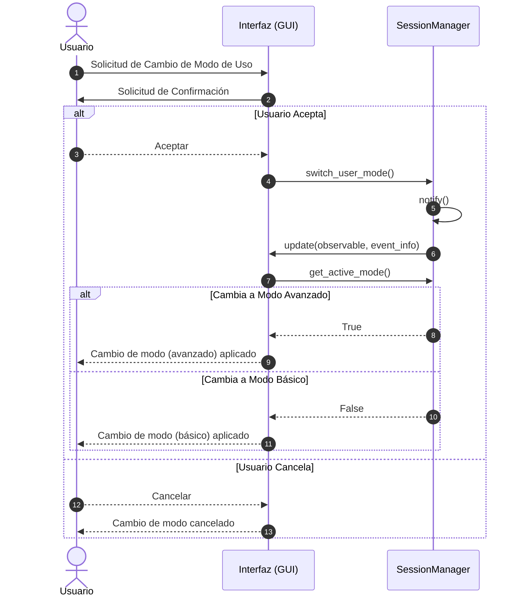
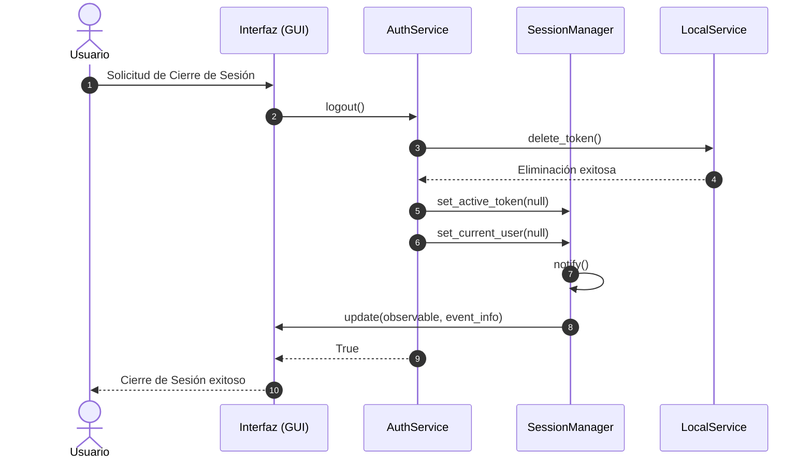
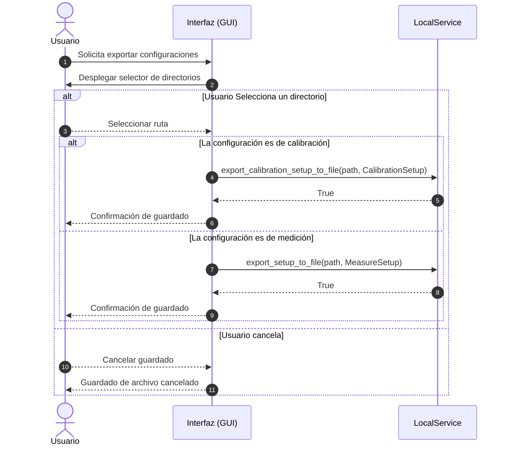
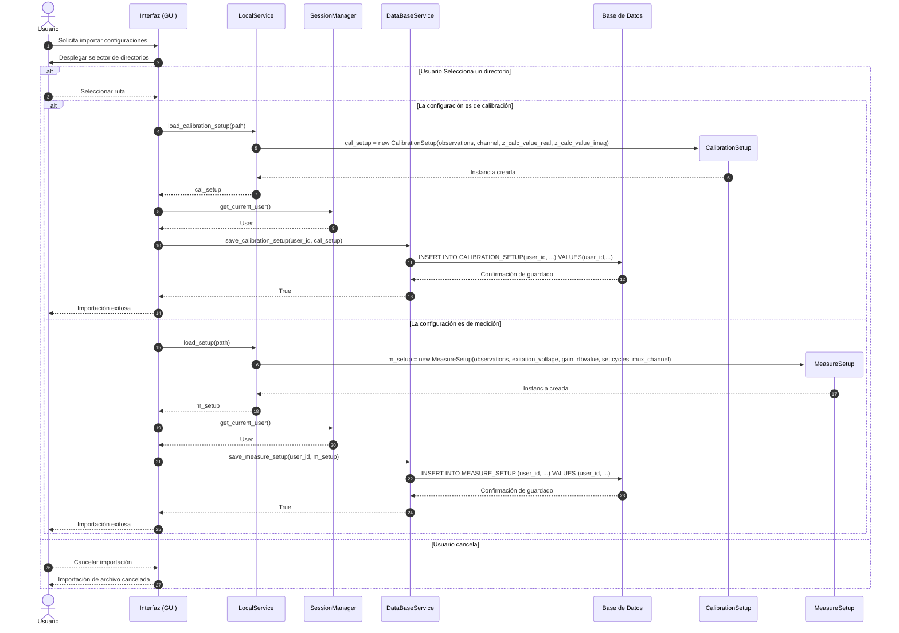
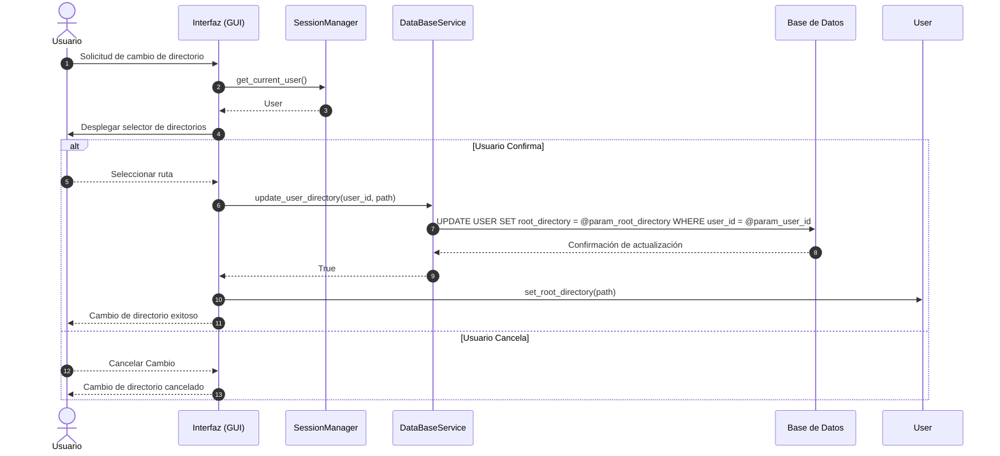
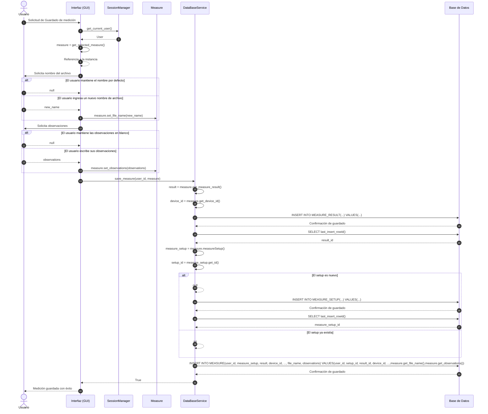

#### Subsistema 3: Configuración y Gestión de Perfiles (Setups)

##### Módulo 1: Perfiles de Usuario y Gestión de Setups de Medición

##### Crear Perfil de Usuario

##### Iniciar Sesión

##### Alternar entre Modos de Uso

##### Cerrar Sesión

##### Exportar Configuraciones

##### Importar Configuraciones

#### Subsistema 5: Persistencia

##### Módulo 1: Almacenamiento y Estructura de Datos

##### Configurar directorio raíz

##### Guardar mediciones con sus resultados

##### Guardar Setups de calibración

##### Guardar Setups de medición

##### Exportar gráficas generadas
