# Laboratorio de Desarrollo de Software

## Curso 2026

**Alegre, Elias Nahuel
Hegemann, Albaro Tobias
Vasquez Mamani, Juan Pablo
Vargas Da Silva, Eliam Joaquin**

## ÍNDICE

- [**INTRODUCCIÓN**](#introducción)
- **ANÁLISIS Y DISEÑO**
	- **[Análisis](#análisis)**
		- [**Especificación de Requerimientos**](#especificación-de-requerimientos)
			- [Introducción y ámbito del sistema](#introducción-y-ámbito-del-sistema)
				- Definiciones, siglas y abreviaturas
				- Referencias
			- [Descripción General](#descripción-general)
				- Funciones del producto
				- Características de los usuarios
				- Restricciones
			- [Requisitos específicos](#requisitos-específicos)
				- [Subsistema 1: Comunicación e Interacción con el Hardware](#subsistema-1-comunicación-e-interacción-con-el-Hardware)
					- Modulo 1: Conectividad y Estado
					- Modulo 2: Calibración del Dispositivo
				- [Subsistema 2: Configuración y Toma de Mediciones](#subsistema-2-configuración-y-toma-de-mediciones)
					- Modulo 1: Tipos y Estrategias de Medición
				- [Subsistema 3: Configuración y Gestión de Perfiles (Setups)](#subsistema-3-configuración-y-gestión-de-perfiles-setups)
					- Modulo 1: Perfiles de Usuario y Gestión de Setups de Medición
				- [Subsistema 4: Entorno de Ejecución y Plataforma](#subsistema-4-entorno-de-ejecución-y-plataforma)
					- Modulo 1: Compatibilidad del Sistema
				- [Subsistema 5: Persistencia](#subsistema-5-persistencia)
					- Modulo 1: Almacenamiento y Estructura de Datos
		- [**Casos de Uso**](#casos-de-uso)
			- Convenciones Gráficas
			- Diagramas de Casos de Uso
			- Especificación de Casos de Uso
	  **[Diseño](#diseño)**
		- [**Clases Software**](#clases-software)
			- Lista de Clases
			- Diagramas de Clases
		- [**Base de Datos**](#base-de-datos)
			- Convenciones Gráficas
			- Diagrama de Entidad Relación
		- **[Diagramas de Secuencia](#diagramas-de-secuencia)**
		- [**Tabla de Trazabilidad**](#tabla-de-trazabilidad)
		- **[Pantallas](#pantallas)**
			-  Pantalla de Registro 
			- Pantalla Principal 
			- Pantalla de Configuración 
			- Pantalla de Mediciones y Setups de Usuario 
			- Pantalla de Perfil de Usuario
- [**CRONOGRAMA DE TRABAJO**](#cronograma-de-trabajo)
	- Visión general
	- Cronograma por requerimientos
- [**METODOLOGÍA DE DESARROLLO**](#metodología-de-desarrollo)
	- Resumen de la metodología elegida
- [**HERRAMIENTAS UTILIZADAS**](#herramientas-utilizadas)
	- Diagrama de Arquitectura de Software
		- Diagrama de Contexto
		- Diagrama de Contenedores
		- Diagrama de Componentes
- [**SOBRE LAS ITERACIONES**](#sobre-las-iteraciones)
- [**SOBRE LOS ENTREGABLES**](#sobre-los-entregables)
	- Aplicaciones y plataformas que forman parte del sistema
	- Requerimientos técnicos para la instalación
- [**PRESENTACIÓN VISUAL PARA APROBAR EL FINAL**](#presentación-visual-para-aprobar-el-final)

## INTRODUCCIÓN
El proyecto tiene como propósito el desarrollo integral de una plataforma de software y una interfaz gráfica de usuario (GUI) para el hardware "Guanaco Mini” (GMini) desarrollado por el Laboratorio de Electrónica Aplicada y Biomedicina (LEAB) del Instituto de Desarrollo Económico e Innovación de la Universidad Nacional de Tierra del Fuego AeiAS. El cliente interesado en el desarrollo de este software es el Doctor en Ciencias Biológicas e Ingeniero Biomédico Antonio Héctor Dell’osa, el cual en este contexto es miembro del LEAB, autor de la tesis “Espectroscopía de Impedancia para la Detección Rápida de Lesiones Óseas” sobre la cual este proyecto está basado y líder del proyecto GMini. Nuestro contacto con él es mediante su correo electrónico institucional [ahdellosa@untdf.edu.ar](mailto:ahdellosa@untdf.edu.ar) .

Dicho dispositivo está diseñado para proveer una interfaz capaz de realizar mediciones de espectroscopía de impedancia eléctrica y bioimpedancia.

El GMini ofrece un alto potencial para aplicaciones en investigaciones científicas y académicas. Desde el punto de vista médico y tecnológico, la bioimpedancia resulta interesante porque permite obtener información sobre un tejido utilizando corrientes eléctricas de pequeña amplitud, sin recurrir necesariamente a técnicas de diagnóstico más complejas, costosas o que utilicen radiación ionizante.

Además, los equipos de medición pueden ser relativamente pequeños y de bajo costo, por lo que existe interés en desarrollar sistemas portátiles capaces de realizar mediciones fuera de grandes centros médicos.

Sin embargo, medir la impedancia es solamente una parte del problema. Una medición puede contener una gran cantidad de datos: diferentes frecuencias, módulo de impedancia, fase, componente real, componente imaginaria y mediciones repetidas sobre diferentes personas o condiciones.

Desde nuestra formación en Sistemas, el problema resulta especialmente interesante en la etapa posterior a la adquisición de los datos: almacenamiento, organización, procesamiento, visualización e identificación automática de patrones que puedan relacionarse con diferentes estados del tejido.

Actualmente, la comunicación a bajo nivel con la placa GMini está resuelta y documentada, sin embargo, carece de una plataforma que permita a los usuarios no especializados utilizarla. La solución provisional existente, que parte de una implementación anterior, presenta múltiples problemas estructurales, errores de ejecución y limitaciones operativas, como la incapacidad de realizar muestreos continuos prolongados (sólo es posible ser utilizada para realizar mediciones por sus propios desarrolladores o usuarios entrenados específicamente). Por lo tanto, el desarrollo de una interfaz para el nuevo dispositivo es fundamental para explotar todas las capacidades del hardware, permitiendo su uso en entornos de campo y laboratorio sin requerir que el operador posea conocimientos técnicos en electrónica o programación a bajo nivel. Esta solución permitiría que los 5 dispositivos que actualmente se encuentran sin uso puedan ser puestos en común a partir del producto de software que se propone.

El objetivo principal de nuestro proyecto es desarrollar una aplicación que controle las distintas instrucciones de la placa (de las que disponemos una lista de comandos), mejore y agregue nuevas funcionalidades, implemente las claves para la calidad de software como la robustez, mantenibilidad, usabilidad y portabilidad.==\[Agregar los formatos en los que la placa arroja los resultados\]==

Por otro lado, la bioimpedancia se ha utilizado o investigado en distintos problemas médicos. Algunas de sus aplicaciones más conocidas son la estimación de la composición corporal, como porcentaje de grasa, masa muscular y cantidad de agua corporal, y el seguimiento de cambios en la distribución de líquidos.

También existen aplicaciones e investigaciones relacionadas con:

- detección y seguimiento de edemas o acumulaciones de líquido;
    
- evaluación del estado de tejidos musculares;
    
- análisis de cambios asociados con lesiones o alteraciones de tejidos;
    
- estudio de diferencias entre tejidos sanos y patológicos;
    
- monitoreo cardiovascular mediante técnicas como la cardiografía por impedancia;
    
- evaluación de tejidos pulmonares mediante Tomografía por Impedancia Eléctrica;
    
- investigación de alteraciones producidas por lesiones óseas, inflamación u otros cambios estructurales.

Es importante aclarar que no todas estas aplicaciones tienen el mismo grado de desarrollo clínico. Algunas están ampliamente utilizadas, mientras que otras continúan siendo objeto de investigación. Desde nuestra perspectiva, una dificultad importante aparece cuando las mediciones generan grandes cantidades de datos que deben ser interpretados.

Por ejemplo, para cada paciente pueden obtenerse decenas o cientos de valores correspondientes a diferentes frecuencias. Si además se realizan mediciones sobre diferentes zonas del cuerpo, condiciones o momentos, el volumen de información aumenta rápidamente.

El problema que nos interesa abordar puede formularse entonces de la siguiente manera:

**¿Cómo desarrollar herramientas computacionales que permitan organizar, procesar, visualizar y analizar mediciones de espectroscopía de bioimpedancia, facilitando la identificación de diferencias o patrones que puedan estar asociados con cambios en los tejidos biológicos?**

Este problema involucra aspectos propios de nuestra formación, como procesamiento de datos, programación, construcción de bases de datos, visualización de información, análisis estadístico y eventualmente utilización de algoritmos de aprendizaje automático.

Por lo tanto, nuestro objetivo no sería realizar directamente un diagnóstico médico, sino desarrollar herramientas computacionales que ayuden a transformar las mediciones eléctricas en información interpretable, que posteriormente pueda ser analizada y validada por especialistas del área biomédica.

## Análisis
### Especificación de Requerimientos

#### Introducción y ámbito del sistema

El Sistema GMini GUI es una aplicación de escritorio integrada directamente con el firmware del microcontrolador ESP32 mediante comunicación alámbrica o inalámbrica.

Su principal objetivo es permitir a los usuarios realizar funciones como:

- Tomar mediciones de espectroscopía por bioimpedancia e impedancia eléctrica con una frecuencia o un espectro de frecuencias.
    
- Configurar los intervalos en los que se toman las mediciones.

- Traducir y procesar los resultados arrojados por la placa.
  
- Permitir visualizar, modificar y exportar.
	- Configuraciones de cada medición.
	- Configuraciones de calibración.
    
- Visualizar desde la misma aplicación las mediciones junto con sus resultados.

- Importar y exportar mediciones junto con sus resultados.
    
- Almacenar en una base de datos.
	- Mediciones junto con sus resultados.
	- Configuraciones de cada medición.
	- Datos del usuario.
	- Configuraciones de calibración.
    
- Realizar muestreos continuos.
    
- Realizar labores de calibración del dispositivo.

Al reemplazar la actual comunicación mediante comandos a bajo nivel por esta interfaz gráfica, se elimina la barrera técnica, permitiendo explotar todo el potencial de la placa Guanaco Mini.
El proyecto está dirigido tanto para usuarios técnicos, investigadores y miembros de laboratorios con pocos o nulos conocimientos de programación en cualquiera de sus niveles. El sistema utilizará un perfil unificado con acceso a todas las herramientas de la plataforma, organizando la interfaz para presentar las configuraciones avanzadas mediante menús colapsables bajo el principio de revelación progresiva (*progressive disclosure*).

##### Definiciones, siglas y abreviaturas

- **Bioimpedancia**: Resistencia que oponen los tejidos biológicos (células, fluidos, bacterias, etc.) al paso de una corriente eléctrica alterna.
    
- **CSV (Comma-Separated Values)**: Formato de archivo de texto estructurado que representa datos tabulares separados por comas, ampliamente utilizado para la exportación y análisis de datos científicos.
    
- **EIS (Electrical Impedance Spectroscopy)**: Técnica de análisis no destructiva que consiste en aplicar una señal eléctrica alterna (voltaje o corriente de pequeña amplitud) a un material o tejido biológico a través de un rango de distintas frecuencias, con el fin de medir su impedancia (oposición al paso de la corriente).
    
- **ESP32**: Microcontrolador de bajo costo y consumo de energía que cuenta con tecnología Wi-Fi y Bluetooth de modo dual integrada, utilizado como núcleo de procesamiento del hardware original.
    
- **Espectroscopía (Barrido espectral / Sweep)**:Forma de medición que consiste en realizar una medición de impedancia o bioimpedancia en un determinado intervalo de frecuencias.
    
- **Firmware**: Software de bajo nivel que está integrado de forma permanente o semipermanente en el hardware (en este caso, el código desarrollado por el laboratorio que se ejecuta directamente sobre el ESP32).
    
- **GMini (Guanaco Mini)**: Dispositivo de hardware desarrollado por el laboratorio cliente, diseñado para realizar mediciones de espectroscopía.
    
- **GUI (Graphical User Interface)**: Interfaz Gráfica de Usuario. Entorno visual del software que permite a los operadores interactuar con el sistema y el hardware subyacente mediante elementos gráficos y ventanas, en lugar de comandos de texto.
    
- **ISO 8601**: Estándar internacional para la representación de fechas y horas, utilizado como formato básico para generar la nomenclatura predeterminada de los archivos guardados.
    
- **JSON (JavaScript Object Notation)**: Formato de texto ligero para el intercambio de datos, fácil de leer y escribir tanto para humanos como para máquinas.
    
- **LEAB (Laboratorio de Electrónica Aplicada y Biomedicina)**: Laboratorio perteneciente al Instituto de Desarrollo Económico e Innovación de la Universidad Nacional de Tierra del Fuego. Actúa como creador del hardware y cliente principal del proyecto de software.
    
- **Metadatos**: Información adicional (estado de los parámetros de configuración y observaciones libres) que se adjunta en las cabeceras de los archivos locales junto con los datos crudos de la medición.
    
- **Monofrecuencia**: Forma de medición que consiste en realizar la medición de impedancia o bioimpedancia a una frecuencia fija, también llamado del inglés “single frequency”.
    
- **Muestreo Continuo**: Proceso de recolección de datos y mediciones de manera ininterrumpida o periódica durante un rango de tiempo prolongado, gestionado automáticamente por el software.
    
- **Multifrecuencia**: Forma de medición que implica realizar mediciones a diferentes frecuencias fijas (diferentes mediciones monofrecuencia) que pueden tener o no intervalos equidistantes o no en el campo de la frecuencia.
    
- **Multiplexado (Canales / Llaves)**: Sistema de llaves (“switchs”) o conmutación que permite seleccionar diferentes canales en forma secuencial o fija.
    
- **Puerto Serial / Comunicación Serial**: Interfaz de transferencia de datos en la que la información se envía bit a bit de forma secuencial. Se utilizará (vía cable USB) como uno de los medios de comunicación principal entre la PC y el dispositivo.
    
- **Setups (Configuraciones de medición)**: Conjunto de parámetros técnicos (tipo, rango, canales) definidos y guardados localmente por un usuario experto, que pueden ser exportados, o bien importados y aplicados por un usuario operador.

##### Referencias

- **Espressif Systems**: ESP32 Technical Reference Manual. Espressif Systems, Shanghái (2023). Disponible en: [https://documentation.espressif.com/esp32_datasheet_en.html?q=ESP32](https://www.espressif.com/en/support/documents/technical-documents)
    
- **Python Software Foundation**: Python 3 Reference Manual. Disponible en: [https://docs.python.org/3/](https://docs.python.org/3/)
    
- **IEEE Computer Society**: IEEE Recommended Practice for Software Requirements Specifications (IEEE Std 830-1998). IEEE, Nueva York (1998).
    
- **Laboratorio de Electrónica Aplicada y Biomedicina (LEAB)**: Dispositivo de medición de bioimpedancia Guanaco Mini V2.0 [Rev3]. Universidad Nacional de Tierra del Fuego, A.I.A.S. (2026).
    
- **The pandas development team**: pandas-dev/pandas: Pandas. Zenodo. Disponible en: [https://pandas.pydata.org/](https://pandas.pydata.org/)
    
- **Hunter, J. D.: Matplotlib**: A 2D graphics environment. Computing in Science & Engineering, 9(3), 90-95 (2007).

### Descripción General

##### Funciones del Producto

**Subsistema de Comunicación e Interacción con el Hardware**
Este subsistema agrupa las funciones encargadas de establecer y mantener el enlace de datos bidireccional entre la computadora y la placa ESP32, garantizando una transferencia estable.

- Establecer conexión con el entorno de escritorio mediante conexión alámbrica.
    
- Establecer conexión con el entorno de escritorio mediante conexión inalámbrica.

**Subsistema de Configuración y Toma de Mediciones**
Este subsistema es el encargado de agrupar aquellas funciones que permiten a los usuarios monitorear, parametrizar, calibrar y realizar mediciones de manera controlada, pudiendo determinar aspectos como rangos de frecuencia o estrategias de medición.

- Calibrar el dispositivo.
    
- Tomar mediciones de espectroscopía por bioimpedancia e impedancia eléctrica.
    
- Seleccionar una frecuencia o un espectro de frecuencias para realizar las mediciones.
    
- Configurar los intervalos en los que se toman las mediciones.
    
- Visualizar los datos desde la misma aplicación.
    
- Contraponer datos para realizar comparaciones.
    
- Realizar procesamiento de datos.
  
**Subsistema de Configuración y Gestión de Perfiles (Setups)**
Este subsistema es el encargado de habilitar los distintos usuarios para garantizar la seguridad entre perfiles, los datos almacenados y sus configuraciones.
  

**Subsistema de Entorno de Ejecución y Plataforma**
Este subsistema es el encargado de garantizar la disponibilidad del proyecto en sistemas operativos Microsoft Windows y ofrecer soporte secundario en kernels de Linux.
  
**Subsistema Persistencia**
Este subsistema centraliza las operaciones de persistencia del sistema, garantizando que tanto los datos estructurados como la información de los usuarios se almacenen de manera ordenada y estandarizada.
- Exportar datos.
    
- Importar datos.
    
- Organizar los datos en una carpeta definida.

- Almacenar resultados e información en una Base de Datos

##### Características de los usuarios

Los principales usuarios de la plataforma serán los miembros del LEAB, los cuales serán piezas fundamentales a lo largo del desarrollo del proyecto,abarcando desde técnicos experimentados hasta operadores

Para agilizar el flujo de trabajo, el sistema utiliza un **Perfil Unificado de Investigador**. La interfaz aplica el principio de *progressive disclosure* (inspirada en software de grado científico): las funciones de adquisición rápida y visualización están disponibles en el área principal de trabajo, mientras que las configuraciones profundas del hardware (calibración, ajuste fino de frecuencias, ganancia, voltaje de excitación) se acceden bajo demanda mediante paneles colapsables. Esto elimina la necesidad de alternar entre modos o cuentas con distintos privilegios.

El sistema contemplara las sesiones de perfiles individuales para garantizar la organización, trazabilidad y privacidad de los *setups*, sesiones y datos recolectados por cada investigador.

##### Restricciones
  
El software no puede modificar el comportamiento interno del dispositivo, debe limitarse a realizar la lista de comandos y eventos ya programadas y documentadas por el LEAB.

El software está destinado para ser utilizado únicamente en la placa ESP32.

El sistema contempla únicamente dos vías de comunicación con la placa. Alámbrica e inalámbrica.
  
El sistema debe garantizar la funcionalidad en el sistema operativo Microsoft Windows.

El sistema deberá ser capaz de funcionar sin acceso a internet.

El sistema no busca realizar un diagnóstico médico.

## Requisitos específicos

### Subsistema 1: Comunicación e Interacción con el Hardware

#### Módulo 1: Conectividad y Estado

| **CON-01**      | Establecer conexión Alámbrica con el hardware                                                                      |
| :-------------- | :----------------------------------------------------------------------------------------------------------------- |
| **Usuarios**    | Usuario Registrado.                                                                                                |
| **Descripción** | El sistema debe permitir establecer y gestionar la comunicación con la placa ESP32, soportando conexión alámbrica. |

| **CON-02**      | Establecer conexión inalámbrica con el hardware                                                                      |
| :-------------- | :------------------------------------------------------------------------------------------------------------------- |
| **Usuarios**    | Usuario Registrado.                                                                                                  |
| **Descripción** | El sistema debe permitir establecer y gestionar la comunicación con la placa ESP32, soportando conexión inalámbrica. |

| **CON-03**      | Traducir comandos de control                                                              |
| :-------------- | :---------------------------------------------------------------------------------------- |
| **Usuarios**    | Usuario Registrado.                                                                       |
| **Descripción** | El sistema debe permitir utilizar los comandos de la placa mediante una interfaz gráfica. |

| **CON-04**      | Notificar visualmente el estado activo de conexión                                                                     |
| :-------------- | :--------------------------------------------------------------------------------------------------------------------- |
| **Usuarios**    | Usuario Registrado.                                                                                                    |
| **Descripción** | El sistema debe informar al usuario mediante indicadores visuales en la interfaz gráfica el estado activo de conexión. |

| **CON-05**      | Notificar visualmente el estado Inactivo de conexión                                                                     |
| :-------------- | :----------------------------------------------------------------------------------------------------------------------- |
| **Usuarios**    | Usuario Registrado.                                                                                                      |
| **Descripción** | El sistema debe informar al usuario mediante indicadores visuales en la interfaz gráfica el estado inactivo de conexión. |

| **CON-06**      | Notificar visualmente el estado error de conexión                                                                                                                  |
| :-------------- | :----------------------------------------------------------------------------------------------------------------------------------------------------------------- |
| **Usuarios**    | Usuario Registrado.                                                                                                                                                |
| **Descripción** | El sistema debe informar al usuario mediante indicadores visuales en la interfaz gráfica el estado de error de la comunicación con el dispositivo en todo momento. |

#### **Módulo 2: Calibración del Dispositivo**

| **CAL-01**      | Configurar la calibración electrónica del equipo                                            |
| :-------------- | :------------------------------------------------------------------------------------------ |
| **Usuarios**    | Usuario Registrado.                                                                         |
| **Descripción** | El sistema debe permitir parametrizar la secuencia de comandos de calibración del hardware. |

| **CAL-02**      | Ejecutar calibración electrónica del equipo                                            |
| :-------------- | :------------------------------------------------------------------------------------- |
| **Usuarios**    | Usuario Registrado.                                                                    |
| **Descripción** | El sistema debe permitir iniciar la secuencia de comandos de calibración del hardware. |

| **CAL-03**      | Bloquear ejecución por descalibración                                                                                                                                                                             |
| :-------------- | :---------------------------------------------------------------------------------------------------------------------------------------------------------------------------------------------------------------- |
| **Usuarios**    | Usuario Registrado.                                                                                                                                                                                               |
| **Descripción** | El sistema debe impedir el inicio de nuevas mediciones si detecta que los parámetros críticos del hardware (ganancia, voltaje o resistencia) han sido modificados sin registrar una calibración válida posterior. |

| **CAL-04**      | Limitar la configuración de calibración al Modo Avanzado                                                                                   |
| :-------------- | :----------------------------------------------------------------------------------------------------------------------------------------- |
| **Usuarios**    | Usuario Registrado.                                                                                                                        |
| **Descripción** | El sistema solo debe permitir parametrizar la secuencia de comandos de calibración del hardware si se encuentra activado el Modo Avanzado. |

### Subsistema 2: Configuración y Toma de Mediciones

#### Módulo 1: Tipos y Estrategias de Medición

| **MED-01**      | Configurar apartados comunes a una medición                                                                                                                                |
| :-------------- | :------------------------------------------------------------------------------------------------------------------------------------------------------------------------- |
| **Usuarios**    | Usuario Registrado.                                                                                                                                                        |
| **Descripción** | El sistema debe permitir establecer los apartados comunes a todos los tipos de medición (voltaje de excitación, ganancia, ciclos, canales de multiplexado y valor de rfb). |

| **MED-02**      | Configurar medición de una frecuencia (Monofrecuencia)                                                                         |
| :-------------- | :----------------------------------------------------------------------------------------------------------------------------- |
| **Usuarios**    | Usuario Registrado.                                                                                                            |
| **Descripción** | El sistema debe permitir elegir los parámetros de medición para mediciones continuas a una única frecuencia fija seleccionada. |

| **MED-03**      | Ejecutar medición de una frecuencia (Monofrecuencia)                                             |
| :-------------- | :----------------------------------------------------------------------------------------------- |
| **Usuarios**    | Usuario Registrado.                                                                              |
| **Descripción** | El sistema debe permitir ejecutar mediciones continuas a una única frecuencia fija seleccionada. |

| **MED-04**      | Configurar medición por espectroscopía (Barrido espectral)                                                                                                                                      |
| :-------------- | :---------------------------------------------------------------------------------------------------------------------------------------------------------------------------------------------- |
| **Usuarios**    | Usuario Registrado.                                                                                                                                                                             |
| **Descripción** | El sistema debe permitir elegir los parámetros de medición para realizar una medición secuencial a intervalos fijos de frecuencias establecidas en el espectro frecuencial (sweep) determinado. |

| **MED-05**      | Ejecutar medición por espectroscopía (Barrido espectral)                                                                                                 |
| :-------------- | :------------------------------------------------------------------------------------------------------------------------------------------------------- |
| **Usuarios**    | Usuario Registrado.                                                                                                                                      |
| **Descripción** | El sistema debe permitir ejecutar una medición secuencial a intervalos fijos de frecuencias establecidas en el espectro frecuencial (sweep) determinado. |

| **MED-06**      | Configurar medición de multifrecuencia                                                                               |
| :-------------- | :------------------------------------------------------------------------------------------------------------------- |
| **Usuarios**    | Usuario Registrado.                                                                                                  |
| **Descripción** | El sistema debe permitir elegir los parámetros de medición para una cantidad de frecuencias discretas y específicas. |

| **MED-07**      | Ejecutar medición multifrecuencia                                                                                         |
| :-------------- | :------------------------------------------------------------------------------------------------------------------------ |
| **Usuarios**    | Usuario Registrado.                                                                                                       |
| **Descripción** | El sistema permite ejecutar una cantidad de mediciones a las mismas frecuencias discretas y especificadas por el usuario. |

| **MED-08**      | Ejecutar mediciones en bucle                                                               |
| :-------------- | :----------------------------------------------------------------------------------------- |
| **Usuarios**    | Usuario Registrado.                                                                        |
| **Descripción** | El sistema debe permitir ejecutar mediciones continuas del mismo tipo a través del tiempo. |

| **MED-09**      | Mostrar progreso de la medición                                                                                                                     |
| :-------------- | :-------------------------------------------------------------------------------------------------------------------------------------------------- |
| **Usuarios**    | Usuario Registrado.                                                                                                                                 |
| **Descripción** | El sistema debe proporcionar una indicación visual en pantalla que informe al usuario que un proceso de medición se encuentra actualmente en curso. |

| **MED-10**      | Mostrar resultados intermedios                                                                                                 |
| :-------------- | :----------------------------------------------------------------------------------------------------------------------------- |
| **Usuarios**    | Usuario Registrado.                                                                                                            |
| **Descripción** | El sistema debe proporcionar en pantalla los datos de mediciones intermedias realizadas durante procesos de medición ciclicos. |

| **MED-11**      | Calcular estadísticos descriptivos básicos                                                                                |
| :-------------- | :------------------------------------------------------------------------------------------------------------------------ |
| **Usuarios**    | Usuario Registrado.                                                                                                       |
| **Descripción** | El sistema debe ser capaz de calcular estadísticos descriptivos a partir de los datos crudos obtenidos en las mediciones. |

| **MED-12**      | Presentar estadísticos descriptivos básicos                                                                |
| :-------------- | :--------------------------------------------------------------------------------------------------------- |
| **Usuarios**    | Usuario Registrado.                                                                                        |
| **Descripción** | El sistema debe ser capaz de presentar métricas estadísticas básicas a partir de los resultados obtenidos. |

| **MED-13**      | Limitar configuración de mediciones al Modo Avanzado                                                                              |
| :-------------- | :-------------------------------------------------------------------------------------------------------------------------------- |
| **Usuarios**    | Usuario Registrado.                                                                                                               |
| **Descripción** | El sistema solo debe permitir configurar setups de medición (independientemente del tipo) si se encuentra activo el Modo Avanzado |

| MED-14          | Persistir últimos datos generados ante un error                                                                                               |
| :-------------- | :-------------------------------------------------------------------------------------------------------------------------------------------- |
| **Usuarios**    | Usuario Registrado.                                                                                                                           |
| **Descripción** | El sistema debe guardar automáticamente los últimos datos recolectados ante una pérdida repentina de señal durante el proceso de adquisición. |

| MED-15          | Renderizar gráficas a partir de los resultados                                                                   |
| :-------------- | :--------------------------------------------------------------------------------------------------------------- |
| **Usuarios**    | Usuario Registrado.                                                                                              |
| **Descripción** | El sistema debe ser capaz de generar gráficos utilizando los resultados obtenidos y los parámetros establecidos. |

### Subsistema 3: Configuración y Gestión de Perfiles (Setups)

#### Módulo 1: Perfiles de Usuario y Gestión de Setups de Medición

| **SET-01**      | Inicializar entorno de trabajo                                                         |
| :-------------- | -------------------------------------------------------------------------------------- |
| **Usuarios**    | Usuario.                                                                               |
| **Descripción** | El usuario debe poder ingresar a la aplicación y recuperar la sesión activa si existe. |

| **SET-02**      | Crear Perfil de Usuario                             |
| :-------------- | --------------------------------------------------- |
| **Usuarios**    | Usuario.                                            |
| **Descripción** | El sistema debe permitir crear perfiles de usuario. |

| **SET-03**      | Solicitar al usuario que inicie sesión luego de registrarse                                                     |
| :-------------- | --------------------------------------------------------------------------------------------------------------- |
| **Usuarios**    | Usuario Registrado.                                                                                             |
| **Descripción** | El sistema debe volver a solicitar los datos de inicio de sesión al usuario una vez este haya creado su perfil. |

| **SET-04**      | Iniciar Sesión                                          |
| :-------------- | ------------------------------------------------------- |
| **Usuarios**    | Usuario Registrado.                                     |
| **Descripción** | El sistema debe permitir a los usuarios iniciar sesión. |

| **SET-05**      | Cerrar Sesión                                          |
| :-------------- | ------------------------------------------------------ |
| **Usuarios**    | Usuario Registrado.                                    |
| **Descripción** | El sistema debe permitir a los usuarios cerrar sesión. |

| **SET-06**      | Aplicar configuraciones                                                                 |
| :-------------- | --------------------------------------------------------------------------------------- |
| **Usuarios**    | Usuario Registrado.                                                                     |
| **Descripción** | El sistema debe permitir al usuario seleccionar una configuración previamente guardada. |

| **SET-07**      | Importar configuraciones de medición                                                                                                     |
| :-------------- | ---------------------------------------------------------------------------------------------------------------------------------------- |
| **Usuarios**    | Usuario Registrado.                                                                                                                      |
| **Descripción** | El sistema debe permitir al usuario importar configuraciones de medición desde el almacenamiento local y guardarlos en la base de datos. |

| **SET-08**      | Exportar configuraciones de medición                                                                                                  |
| :-------------- | ------------------------------------------------------------------------------------------------------------------------------------- |
| **Usuarios**    | Usuario Registrado.                                                                                                                   |
| **Descripción** | El sistema debe permitir al usuario exportar las configuraciones de medición guardadas en la base de datos a su almacenamiento local. |

| **SET-09**      | Importar configuraciones de calibración                                                                                                     |
| :-------------- | ------------------------------------------------------------------------------------------------------------------------------------------- |
| **Usuarios**    | Usuario Registrado.                                                                                                                         |
| **Descripción** | El sistema debe permitir al usuario importar configuraciones de calibración desde el almacenamiento local y guardarlos en la base de datos. |

| **SET-10**      | Exportar configuraciones de calibración                                                                                                  |
| :-------------- | ---------------------------------------------------------------------------------------------------------------------------------------- |
| **Usuarios**    | Usuario Registrado.                                                                                                                      |
| **Descripción** | El sistema debe permitir al usuario exportar las configuraciones de calibración guardadas en la base de datos a su almacenamiento local. |

| **SET-11**      | Importar mediciones                                                                                                     |
| :-------------- | ----------------------------------------------------------------------------------------------------------------------- |
| **Usuarios**    | Usuario Registrado.                                                                                                     |
| **Descripción** | El sistema debe permitir al usuario importar mediciones desde el almacenamiento local y guardarlos en la base de datos. |

| **SET-12**      | Exportar mediciones                                                                                                  |
| :-------------- | -------------------------------------------------------------------------------------------------------------------- |
| **Usuarios**    | Usuario Registrado.                                                                                                  |
| **Descripción** | El sistema debe permitir al usuario exportar las mediciones guardadas en la base de datos a su almacenamiento local. |

| **SET-13**      | Exportar gráficas generadas                                                                     |
| :-------------- | ----------------------------------------------------------------------------------------------- |
| **Usuarios**    | Usuario Registrado.                                                                             |
| **Descripción** | El sistema debe permitir a los usuarios exportar las gráficas generadas en una carpeta definida |

| **SET-14**      | Visualizar datos guardados                                                                                                         |
| :-------------- | ---------------------------------------------------------------------------------------------------------------------------------- |
| **Usuarios**    | Usuario Registrado.                                                                                                                |
| **Descripción** | El sistema debe permitir visualizar datos (mediciones realizadas, gráficas y setups) anteriores aunque la placa no esté conectada. |

| **SET-15**      | Mantener la sesión activa en el dispositivo                                                 |
| :-------------- | ------------------------------------------------------------------------------------------- |
| **Usuarios**    | Usuario Registrado.                                                                         |
| **Descripción** | El sistema debe mantener la sesión del usuario activa aunque se haya cerrado la aplicación. |

### Subsistema 4: Entorno de Ejecución y Plataforma

#### Módulo 1: Compatibilidad del Sistema

| **COM-01**      | Proveer entorno de aplicación de escritorio                                                                                                            |
| :-------------- | ------------------------------------------------------------------------------------------------------------------------------------------------------ |
| **Usuarios**    | Usuario Registrado.                                                                                                                                    |
| **Descripción** | El software debe ser diseñado, compilado y distribuido como una aplicación de escritorio orientada a computadoras personales y portátiles (notebooks). |

| **COM-02**      | Garantizar ejecución nativa en Microsoft Windows                                                                                                                                          |
| :-------------- | ----------------------------------------------------------------------------------------------------------------------------------------------------------------------------------------- |
| **Usuarios**    | Usuario Registrado.                                                                                                                                                                       |
| **Descripción** | El sistema debe garantizar total compatibilidad, estabilidad y funcionalidad de todos sus módulos (especialmente la comunicación de puertos) bajo el sistema operativo Microsoft Windows. |

| **COM-03**      | Proveer soporte secundario para entornos Linux                                                                                                                |
| :-------------- | ------------------------------------------------------------------------------------------------------------------------------------------------------------- |
| **Usuarios**    | Usuario Registrado.                                                                                                                                           |
| **Descripción** | El sistema debe contemplar en su arquitectura la portabilidad necesaria para poder ser ejecutado en distribuciones de escritorio del sistema operativo Linux. |

| **COM-04**      | Garantizar el funcionamiento sin conexión a internet                                                   |
| :-------------- | ------------------------------------------------------------------------------------------------------ |
| **Usuarios**    | Usuario Registrado.                                                                                    |
| **Descripción** | El sistema debe ser capaz de funcionar de manera completa aunque no se establezca conexión a internet. |

### Subsistema 5: Persistencia

#### Módulo 1: Almacenamiento y Estructura de Datos

| **PER-01**      | Almacenar setups de medición y calibración en una Base de Datos                                                                             |
| :-------------- | ------------------------------------------------------------------------------------------------------------------------------------------- |
| **Usuarios**    | Usuario Registrado.                                                                                                                         |
| **Descripción** | El sistema debe guardar todos las configuraciones de calibración y medición establecidas por el usuario en en una base de datos relacional. |

| **PER-02**      | Almacenar mediciones y sus resultados en una Base de Datos                                                                      |
| :-------------- | ------------------------------------------------------------------------------------------------------------------------------- |
| **Usuarios**    | Usuario Registrado.                                                                                                             |
| **Descripción** | El sistema debe guardar todas las mediciones completadas junto con sus resultados directamente en una base de datos relacional. |

| **PER-03**      | Configurar directorios                                                                                                |
| :-------------- | --------------------------------------------------------------------------------------------------------------------- |
| **Usuarios**    | Usuario Registrado.                                                                                                   |
| **Descripción** | El sistema debe permitir al usuario seleccionar un directorio raíz específico para el almacenamiento de sus campañas. |

| **PER-04**      | Generar nomenclatura predeterminada de archivos                                                                                                              |
| :-------------- | ------------------------------------------------------------------------------------------------------------------------------------------------------------ |
| **Usuarios**    | Usuario Registrado.                                                                                                                                          |
| **Descripción** | El sistema debe asignar automáticamente a cada archivo de salida un nombre basado en la fecha y hora de la medición, utilizando el estándar ISO 8601 básico. |

| **PER-05**      | Renombramiento manual de archivos                                                                             |
| :-------------- | ------------------------------------------------------------------------------------------------------------- |
| **Usuarios**    | Usuario Registrado.                                                                                           |
| **Descripción** | El sistema debe permitir al usuario sobrescribir el nombre automático del archivo antes de su guardado final. |

| **PER-06**      | Estructurar cabeceras de metadatos integrados                                                                                                                                                                                |
| :-------------- | ---------------------------------------------------------------------------------------------------------------------------------------------------------------------------------------------------------------------------- |
| **Usuarios**    | Usuario Registrado.                                                                                                                                                                                                          |
| **Descripción** | El sistema debe incluir en el archivo final exportado tanto los datos duros de la medición, como una cabecera que contenga el estado exacto de todos los parámetros de configuración utilizados y el texto de observaciones. |

| **PER-07**      | Adjuntar metadatos y observaciones libres sobre mediciones                                                                                                                                              |
| :-------------- | ------------------------------------------------------------------------------------------------------------------------------------------------------------------------------------------------------- |
| **Usuarios**    | Usuario Registrado.                                                                                                                                                                                     |
| **Descripción** | El sistema debe proveer un campo de entrada de texto libre para documentar observaciones contextuales sobre el objeto o tejido medido, vinculando este texto al paquete de datos final de una medición. |

| **PER-08**      | Adjuntar metadatos y observaciones libres sobre setups                                                                                                                                                                                           |
| :-------------- | ------------------------------------------------------------------------------------------------------------------------------------------------------------------------------------------------------------------------------------------------ |
| **Usuarios**    | Usuario Registrado.                                                                                                                                                                                                                              |
| **Descripción** | El sistema debe proveer un campo de entrada de texto libre para documentar observaciones contextuales sobre las configuraciones establecidas en un setup (de calibración o medición), vinculando este texto al paquete de datos final del mismo. |


### Casos de Uso
#### Convenciones gráficas

##### Actores
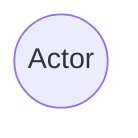
##### Casos de Uso

##### Asignaciones
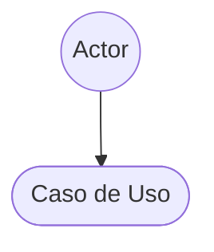
##### Generalización
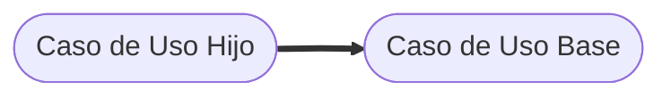

##### Limites del Subsistema


##### Extensiones e Inclusiones
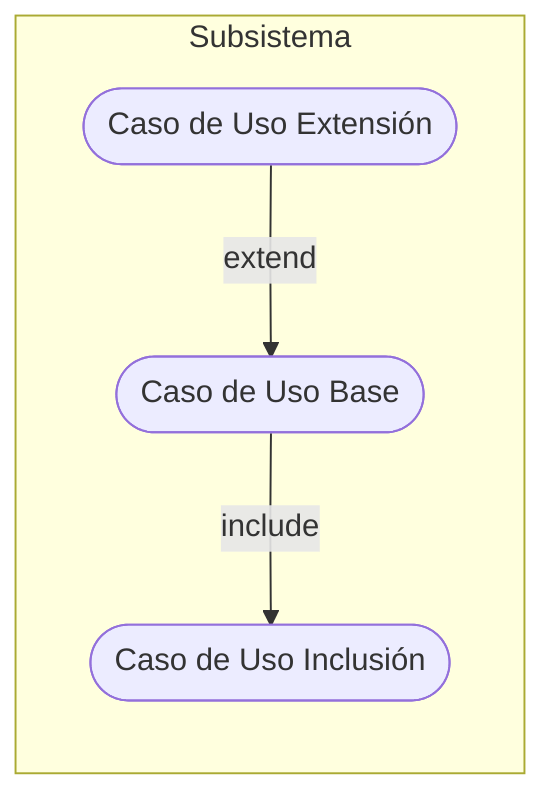

### Diagramas de Casos de Uso
#### Subsistema 1: Comunicación e Interacción con el Hardware

##### Módulo 1: Conectividad y Estado


##### Módulo 2: Calibración del Dispositivo
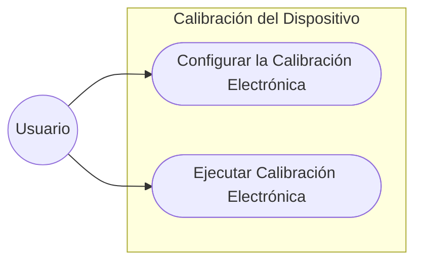

#### Subsistema 2: Configuración y Toma de Mediciones
##### Módulo 1: Tipos y Estrategias de Medición


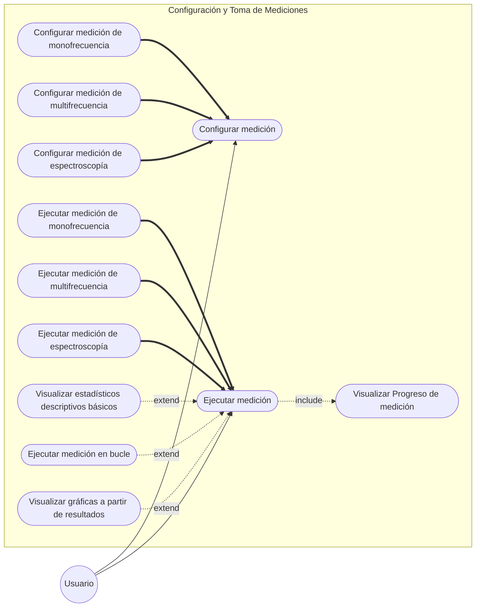

#### Subsistema 3: Configuración y Gestión de Perfiles (Setups)

##### Módulo 1: Perfiles de Usuario y Gestión de Setups de Medición


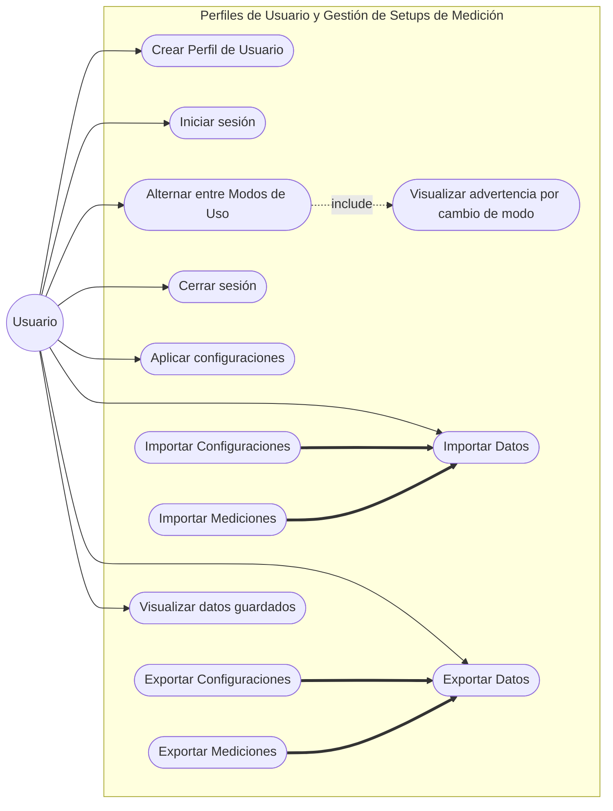

#### Subsistema 5: Persistencia

##### Módulo 1: Almacenamiento y Estructura de Datos
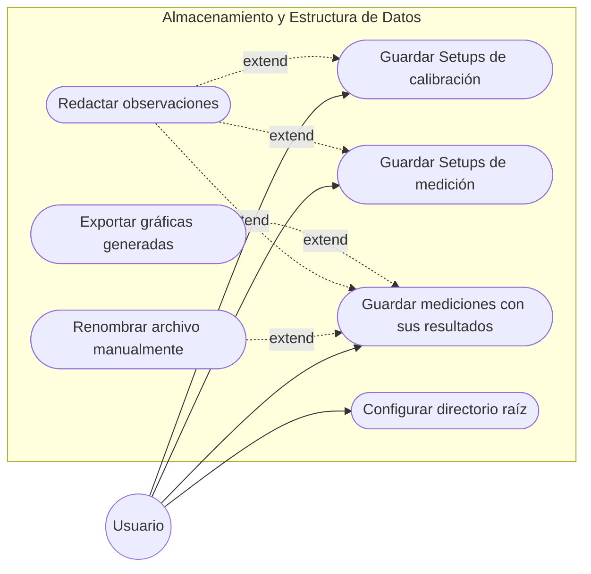
#### Especificación de Casos de Uso

## Diseño
### Clases Software

### Diagrama General

```mermaid
classDiagram
direction LR

%% jerarquias

MeasureSetup <|-- SpecMeasureSetup
MeasureSetup <|-- SingleMeasureSetup
MeasureSetup <|-- MultiMeasureSetup

BaseMeasureSetupBuilder <|-- SpectroSetupBuilder
BaseMeasureSetupBuilder <|-- SingleFreqSetupBuilder
BaseMeasureSetupBuilder <|-- MultiFreqSetupBuilder

ConnectionType <|-- Wire
ConnectionType <|-- WireLess

%% interfaces
ConnectionState <|.. ConnectedState : implementa
ConnectionState <|.. DisconnectedState : implementa
ConnectionState <|.. ConnectionErrorState : implementa

DeviceState <|.. FreeDeviceState : implementa
DeviceState <|.. CalibratedState : implementa
DeviceState <|.. MeasuringState : implementa
DeviceState <|.. DeviceErrorState : implementa
DeviceState <|.. UncalibratedState : implementa

IMeasureAdapter <|.. GminiMeasureAdapter : implementa

ICalibrationAdapter <|.. GminiCalibrationAdapter : implementa

IObserver <|.. ConnectionService : implementa
IObservable <|.. ConnectionService : implementa
IObserver <|.. ConnectionType : implementa
IObserver <|.. MeasureService : implementa
IObservable <|.. SessionManager : implementa

%% clases

class User {
	- user_id : int
	- user_name : str
	- email : str
	- password : str
	- root_directory : str
	%% getters
	+ get_id() : int
	+ get_root_directory() : str
	
	%% setters
	+ set_user_id(id : int)
	+ set_root_directory(path : str)
}

class Token {
	- user_id : int
	- token_string : str
	- created_at : DateTime
}

class Measure {
	- measure_id : int
	- measureSetup : MeasureSetup
	- date : DateTime
	- file_name : str
	- state : ['EXECUTING', 'COMPLETE', 'ERROR']
	- device_id : int
	- device_temp : float
	- result : MeasureResult
	- observations : str
	- loop_group_id : str
	- iteration_number : int
	  
	%% getters
	+ get_device_id() : int
	+ get_measure_result() : MeasureResult
	+ get_file_name() : str
	+ get_observations() : str
	+ get_measure_setup() : MeasureSetup
	
	+ get_state() : str
	+ set_default_name()
	
	%% setters
	+ set_file_name(new_name : name)
	+ set_observations(obs : str)
	+ set_state(new_state : str)

}

class MeasureSetup {
	<<abstract>>
	- measure_setup_id : int
	- observations : str
	- exitation_voltage : float
	- gain : float
	- rfbvalue : float
	- settcycles : int
	- mux_channel : [0, 1, 2, 3]
	  
	%% getters
	+ get_id() : int
	
	%% setters
	+ set_observations(obs : str)
}
class SpecMeasureSetup{
	- startfreq : float
	- incfreq : float
	- steps : int
	- repeat : int
}
class SingleMeasureSetup{
	- freq : float
	- delay : int
	- count : int
}
class MultiMeasureSetup{
	- freq_list :[float]
}

class CalibrationSetup{
	c
	- observations : str
	- channel : ["RCAL1":0, "RCAL2":1, "Other":2/3]
	- z_calc_value_real : float
	- z_calc_value_imag : float
	
	%% getters
	+ get_id() : int
	
	%% setters
	+ set_observations(obs : str)
}

class Device{
	- device_id : int
	- device_state : DeviceState
	+ set_state(new_state : DeviceState)
	+ get_state() : DeviceState
}

class MeasureResult{
	- m_resul_id : int
	- frequencies : [float]
	- amplitudes : [float]
	- phases : [float]
	- impedances : [complex]
	+ measure_mean() : [float]
	+ measure_std() : [float]
}

class ConnectionType {
	<<abstract>>
	- connection_state : ConnectionState
	+ connect()
	+ disconnect()
	+ send(data : str)
	+ receive() : str
	+ set_state(new_state : ConnectionState)
	+ get_state() : ConnectionState
}
class Wire{
	- baudrate : int
	- port_name : str
	- timeout : int
}
class WireLess{
	- protocol : str
}

%% servicios

class MeasureService{
	+ execute_measure(measure : Measure)
	+ finish_measure() : [MeasureResult]
	+ apply_setup(device : Device, setup : MeasureSetup)
	+ execute_loop(device : Device, base_setup : MeasureSetup, iterations : int, delay : float)
	- update_progress()
}

class LocalService{
	%% operaciones en archivos
	+ load_measure(path : str) : Measure
	+ load_calibration_setup(path : str) : CalibrationSetup
	+ load_setup(path : str) : MeasureSetup
	+ load_user_token(path : str) : Token
	+ export_setup_to_file(path : str, setup : MeasureSetup)
	+ export_calibration_setup_to_file(path : str, setup : CalibrationSetup)
	+ export_measure_to_file(path : str, measure : Measure)
	+ export_user_token(path : str, token : Token)
	+ export_plot(path : str, figure : Figure)
	+ delete_token()
}
class DataBaseService{
	- db_root : str
	%% operaciones en db
	+ save_user(user : User)
	+ save_measure(user_id : int, measure : Measure)
	+ save_calibration_setup(user_id : int, cal_setup : CalibrationSetup)
	+ save_measure_setup(user_id : int, m_setup : MeasureSetup)
	+ get_user_by_id(user_id : int): User
	+ get_user_by_email(email : str): User
	+ get_user_by_name(user_name : str): User 
	+ get_measures_by_user(user_id : int) : [Measure]
	+ get_calibration_setups_by_user(user_id : int) : [CalibrationSetup]
	+ get_measure_setups_by_user(user_id : int) : [MeasureSetup]
	+ update_user_directory(user_id : int, path : str) 
}


class AuthService{
	+ user_token_file_path : str
	+ login(user_name, password) : Token
	+ logout()
	+ register(user_name, email, password)
	+ restore_session(token : str)
	+ verify_password(password : str)
	+ generate_token() : str
	- rehash_password(password : str) : str
}

class SessionManager{
	- current_user : User
	- advanced_mode_active : boolean
	- active_token : Token
	+ switch_user_mode()
	+ get_current_user() : User
	+ set_current_user(user : User)
	+ get_active_mode() : boolean
	+ set_active_mode(mode : boolean)
	+ get_active_token() : Token
	+ set_active_token(token : Token)
}

class ConnectionService{
	+ active_conections : [device : connection_type]
	+ connect(device : Device, connection_type : ConnectionType)
	+ disconnect(device : Device)
	+ send(device : Device, command : str)
	+ receive(device : Device) : str
}

class CalibrationService{
	+ calibrate_device(device : Device, cal_setup : CalibrationSetup)
}

%% state patern

class DeviceState{
		<<interface>>
		+ can_measure() : boolean
	}
	class FreeDeviceState
	class CalibratedState
	class MeasuringState
	class DeviceErrorState
	class UncalibratedState
	
class ConnectionState{
		<<interface>>
		+ connect(context : ConnectionType)
		+ disconnect(context : ConnectionType)
		+ send(context : ConnectionType, data: str)
		+ receive(context : ConnectionType) : str
	}
class ConnectedState
class DisconnectedState
class ConnectionErrorState

%% observer patern
class IObserver{
	<<interface>>
	+ update(observable : IObservable, event_info : str)
}

class IObservable{
	<<interface>>
	+ attach()
	+ detach()
	+ notify()
}

%% builder patern
class BaseMeasureSetupBuilder{
	<<abstract>>
	- observations : str
	- exitation_voltage : float
	- gain : float
	- rfbvalue : float
	- settcycles : int
	- mux_channel : [0, 1, 2, 3]
	+ build() : MeasureSetup
	+ with_observations()
	+ with_voltage()
	+ with_gain()
	+ with_rfb_value()
	+ with_cycles()
	+ with_mux_channel()
}

class SpectroSetupBuilder{
	- startfreq : float
	- incfreq : float
	- steps : int
	- repeat : int
	+ build() : SpecMeasureSetup
	+ with_start_freq(startfreq : float) : self
	+ with_inc_freq(incfreq : float) : self
	+ with_steps(steps : int) : self
	+ with_repeat(repeat : int) : self
}

class SingleFreqSetupBuilder{
	- freq : float
	- delay : int
	- count : int
	+ build() : SingleMeasureSetup
	+ with_freq(freq : float) : self
	+ with_delay(delay : int) : self
	+ with_count(count : int) : self
}

class MultiFreqSetupBuilder{
	- freq_list :[float]
	+ build() : MultiMeasureSetup
	+ with_freq_list(freq_list :[float]) : self
}

%% factory method
class ConnectionFactory{ 
	+ create_connection(type : str) : ConnectionType 
} 
class MeasureSetupBuilderFactory{ 
	+ create_builder(mode : str) : BaseMeasureSetupBuilder 
}

%% patron adapter
class ICalibrationAdapter{ 
	<<interface>>
	+ encode(setup : CalibrationSetup) : str 
	+ decode(response : str) : bool 
}

class GminiCalibrationAdapter{ 
	+ encode(setup : CalibrationSetup) : str 
	+ decode(response : str) : bool 
} 

class IMeasureAdapter{ 
	<<interface>>
	+ encode_setup(setup : MeasureSetup) : str 
	+ encode_execution(setup : MeasureSetup) : str 
	+ decode(response : str) : MeasureResult 
}

class GminiMeasureAdapter{ 
	+ encode_setup(setup : MeasureSetup) : str 
	+ encode_execution(setup : MeasureSetup) : str 
	+ decode(response : str) : MeasureResult 
}

%% relaciones

ConnectionService --> ConnectionType : establece conexión
ConnectionService --> Device : establece conexión

MeasureService --> ConnectionService : envía comandos y observa
MeasureService --> Measure : ejecuta medición
MeasureService --> DataBaseService : invoca guardado de emergencia 
MeasureService --> SessionManager : verifica usuario
MeasureService --> Device : verifica y actualiza estado
MeasureService --> IMeasureAdapter : envía setups y recibe comandos

CalibrationService --> CalibrationSetup : crea setup
CalibrationService --> Device : establece calibración
CalibrationService --> SessionManager : verifica usuario
CalibrationService --> ConnectionService : envía comandos y espera devolución
CalibrationService --> ICalibrationAdapter : envía setups y espera comandos

AuthService --> DataBaseService : guarda usuario
AuthService --> SessionManager : establece usuario
AuthService --> LocalService : persiste/recupera token
AuthService --> Token : crea token
AuthService --> User : crea usuario

LocalService --> CalibrationSetup : exporta/importa setup
LocalService --> MeasureSetup : exporta/importa setup
LocalService --> Measure : exporta/importa medición

DataBaseService -->  CalibrationSetup : guarda setup
DataBaseService -->  MeasureSetup : guarda setup
DataBaseService -->  Measure : guarda medición

MeasureSetupBuilderFactory --> BaseMeasureSetupBuilder : construye
BaseMeasureSetupBuilder --> MeasureSetup : instancia
ConnectionFactory --> ConnectionType : crea

Device o-- DeviceState

ConnectionType o-- ConnectionState

SessionManager o-- User
SessionManager o-- Token

Measure --> Device
Measure o-- MeasureSetup
Measure *-- MeasureResult
```

#### Lista de Clases

##### Jerarquía

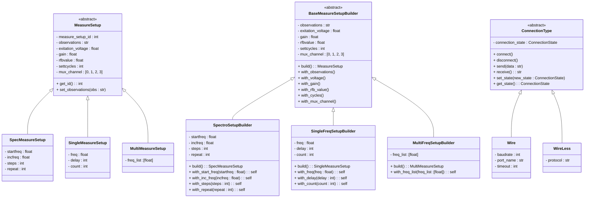

##### Patrón State
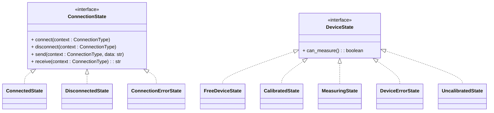

##### Patrón Adapter
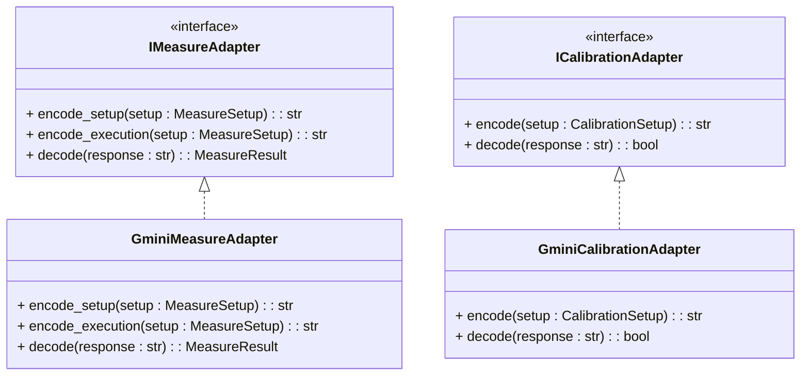

##### Patrón Observer
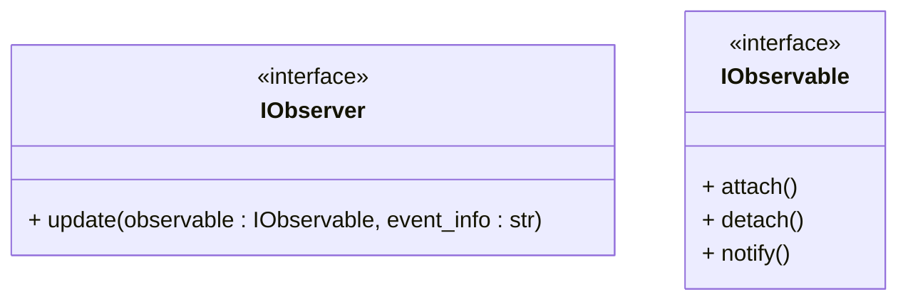

##### Patrón Factory
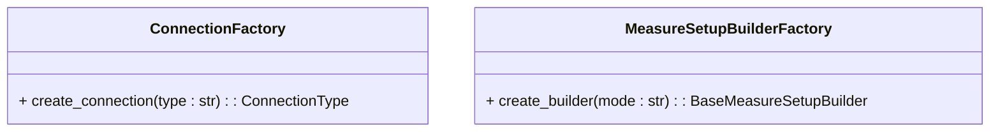
##### Clases del Dominio
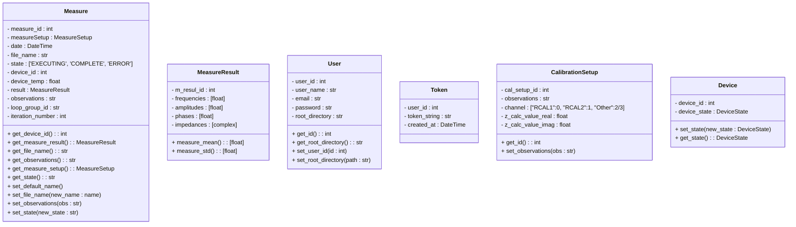

##### Servicios de Mediciones y Calibración
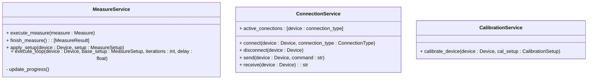

##### Servicios de Usuario y Autenticación
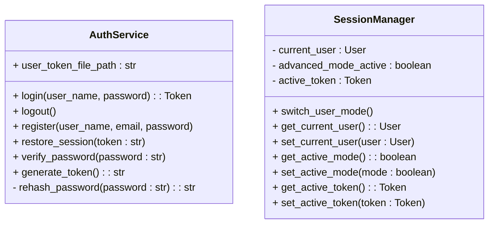
##### Servicios de Persistencia
```mermaid
classDiagram

%% persistencia
class LocalService{
	%% operaciones en archivos
	+ load_measure(path : str) : Measure
	+ load_calibration_setup(path : str) : CalibrationSetup
	+ load_setup(path : str) : MeasureSetup
	+ load_user_token(path : str) : Token
	+ export_setup_to_file(path : str, setup : MeasureSetup)
	+ export_calibration_setup_to_file(path : str, setup : CalibrationSetup)
	+ export_measure_to_file(path : str, measure : Measure)
	+ export_user_token(path : str, token : Token)
	+ export_plot(path : str, figure : Figure)
	+ delete_token()	
}
class DataBaseService{
	- db_root : str
	%% operaciones en db
	+ save_user(user : User)
	+ save_measure(user_id : int, measure : Measure)
	+ save_calibration_setup(user_id : int, cal_setup : CalibrationSetup)
	+ save_measure_setup(user_id : int, m_setup : MeasureSetup)
	+ get_user_by_id(user_id : int): User
	+ get_user_by_email(email : str): User
	+ get_user_by_name(user_name : str): User 
	+ get_measures_by_user(user_id : int) : [Measure]
	+ get_calibration_setups_by_user(user_id : int) : [CalibrationSetup]
	+ get_measure_setups_by_user(user_id : int) : [MeasureSetup]
	+ update_user_directory(user_id : int, path : str) 
}

```

#### Diagramas de Clases
###### Subsistema 1: Comunicación e Interacción con el Hardware

###### Módulo 1: Conectividad y Estado

```mermaid
classDiagram

%% jerarquias
ConnectionType <|-- Wire
ConnectionType <|-- WireLess

%% clases

class ConnectionType {
	<<abstract>>
	- connection_state : ConnectionState
	+ connect()
	+ disconnect()
	+ send(data : str)
	+ receive() : str
	+ set_state(new_state : ConnectionState)
	+ get_state() : ConnectionState
}
class Wire{
	- baudrate : int
	- port_name : str
	- timeout : int
}
class WireLess{
	- protocol : str
}

class Device{
	- device_id : int
	- device_state : DeviceState
	+ set_state(new_state : DeviceState)
	+ get_state() : DeviceState
}

%% state patern
	
class ConnectionState{
		<<interface>>
		+ connect(context : ConnectionType)
		+ disconnect(context : ConnectionType)
		+ send(context : ConnectionType, data: str)
		+ receive(context : ConnectionType) : str
	}
class ConnectedState
class DisconnectedState
class ConnectionErrorState

class DeviceState{
		<<interface>>
		+ can_measure() : boolean
	}
	class FreeDeviceState
	class CalibratedState
	class MeasuringState
	class DeviceErrorState
	class UncalibratedState

%% observer patern
class IObserver{
	<<interface>>
	+ update(observable : IObservable, event_info : str)
}

class IObservable{
	<<interface>>
	+ attach()
	+ detach()
	+ notify()
}

%% servicios

class ConnectionService{
	+ active_conections : [device : connection_type]
	+ connect(device : Device, connection_type : ConnectionType)
	+ disconnect(device : Device)
	+ send(device : Device, command : str)
	+ receive(device : Device) : str
}

%% factory method
class ConnectionFactory{ 
	+ create_connection(type : str) : ConnectionType 
}

%% relaciones

ConnectionService ..|> IObserver : implementa
ConnectionService ..|> IObservable : implementa
ConnectionType ..|> IObservable : implementa

DeviceState <|.. FreeDeviceState : implementa
DeviceState <|.. CalibratedState : implementa
DeviceState <|.. MeasuringState : implementa
DeviceState <|.. DeviceErrorState : implementa
DeviceState <|.. UncalibratedState : implementa

ConnectionState <|.. ConnectedState : implementa
ConnectionState <|.. DisconnectedState : implementa
ConnectionState <|.. ConnectionErrorState : implementa

ConnectionFactory --> ConnectionType : crea

ConnectionType o-- ConnectionState
Device o-- DeviceState

ConnectionService --> ConnectionType : establece conexión
ConnectionService --> Device : establece conexión
ConnectionService --> ConnectionType : observa
```


###### Módulo 2: Calibración del Dispositivo
```mermaid
classDiagram
DeviceState <|.. FreeDeviceState : implementa
DeviceState <|.. CalibratedState : implementa
DeviceState <|.. MeasuringState : implementa
DeviceState <|.. DeviceErrorState : implementa
DeviceState <|.. UncalibratedState : implementa
IObservable <|.. SessionManager : implementa

%% clases
class IObservable{
	<<interface>>
	+ attach()
	+ detach()
	+ notify()
}

class User {
	- user_id : int
	- user_name : str
	- email : str
	- password : str
	- root_directory : str
	%% getters
	+ get_id() : int
	+ get_root_directory() : str
	
	%% setters
	+ set_user_id(id : int)
	+ set_root_directory(path : str)
}

class CalibrationSetup{
	- cal_setup_id : int
	- observations : str
	- channel : ["RCAL1":0, "RCAL2":1, "Other":2/3]
	- z_calc_value_real : float
	- z_calc_value_imag : float
	%% getters
	+ get_id() : int
	
	%% setters
	+ set_observations(obs : str)
}

class Device{
	- device_id : int
	- device_state : DeviceState
	+ set_state(new_state : DeviceState)
	+ get_state() : DeviceState
}

class DeviceState{
		<<interface>>
		+ can_measure() : boolean
	}
	class FreeDeviceState
	class CalibratedState
	class MeasuringState
	class DeviceErrorState
	class UncalibratedState

class CalibrationService{
	+ calibrate_device(device : Device, cal_setup : CalibrationSetup)
}

class SessionManager{
	- current_user : User
	- advanced_mode_active : boolean
	- active_token : Token
	+ switch_user_mode()
	+ get_current_user() : User
	+ set_current_user(user : User)
	+ get_active_mode() : boolean
	+ set_active_mode(mode : boolean)
	+ get_active_token() : Token
	+ set_active_token(token : Token)
}

class ConnectionService{
	+ active_conections : [device : connection_type]
	+ connect(device : Device, connection_type : ConnectionType)
	+ disconnect(device : Device)
	+ send(device : Device, command : str)
	+ receive(device : Device) : str
}

class Token {
	- user_id : int
	- token_string : str
	- created_at : DateTime
}

%% patron adapter
class ICalibrationAdapter{ 
	<<interface>>
	+ encode(setup : CalibrationSetup) : str 
	+ decode(response : str) : bool 
}

class GminiCalibrationAdapter{ 
	+ encode(setup : CalibrationSetup) : str 
	+ decode(response : str) : bool 
} 

%% relaciones

Device "1"*--"1" DeviceState

SessionManager "1"o--"0..1" Token
SessionManager "1"o--"0..1" User

ICalibrationAdapter <|.. GminiCalibrationAdapter : implementa

CalibrationService ..> ConnectionService : envía comandos y espera devolución
CalibrationService ..> Device : establece calibración
CalibrationService ..> CalibrationSetup : crea setup
CalibrationService ..> SessionManager : verifica usuario
CalibrationService ..> ICalibrationAdapter : envía objetos y espera comandos
```

##### Subsistema 2: Configuración y Toma de Mediciones
###### Módulo 1: Tipos y Estrategias de Medición

```mermaid
classDiagram

MeasureSetup <|-- SpecMeasureSetup
MeasureSetup <|-- SingleMeasureSetup
MeasureSetup <|-- MultiMeasureSetup

BaseMeasureSetupBuilder <|-- SpectroSetupBuilder
BaseMeasureSetupBuilder <|-- SingleFreqSetupBuilder
BaseMeasureSetupBuilder <|-- MultiFreqSetupBuilder

DeviceState <|.. FreeDeviceState : implementa
DeviceState <|.. CalibratedState : implementa
DeviceState <|.. MeasuringState : implementa
DeviceState <|.. DeviceErrorState : implementa
DeviceState <|.. UncalibratedState : implementa

ConnectionService ..|> IObservable : implementa

MeasureService ..|> IObserver : implementa
MeasureService ..|> IObservable : implementa

IObservable <|.. SessionManager : implementa

%% clases
class User {
	- user_id : int
	- user_name : str
	- email : str
	- password : str
	- root_directory : str
	%% getters
	+ get_id() : int
	+ get_root_directory() : str
	
	%% setters
	+ set_user_id(id : int)
	+ set_root_directory(path : str)
}

class Device{
	- device_id : int
	- device_state : DeviceState
	+ set_state(new_state : DeviceState)
	+ get_state() : DeviceState
}

class DeviceState{
		<<interface>>
		+ can_measure() : boolean
	}
	class FreeDeviceState
	class CalibratedState
	class MeasuringState
	class DeviceErrorState
	class UncalibratedState

class Measure {
	- measure_id : int
	- measureSetup : MeasureSetup
	- date : DateTime
	- file_name : str
	- state : ['EXECUTING', 'COMPLETE', 'ERROR']
	- device_id : int
	- device_temp : float
	- result : MeasureResult
	- observations : str
	- loop_group_id : str
	- iteration_number : int
	  
	%% getters
	+ get_device_id() : int
	+ get_measure_result() : MeasureResult
	+ get_file_name() : str
	+ get_observations() : str
	+ get_measure_setup() : MeasureSetup
	
	+ get_state() : str
	+ set_default_name()
	
	%% setters
	+ set_file_name(new_name : name)
	+ set_observations(obs : str)
	+ set_state(new_state : str)

}

class SessionManager{
	- current_user : User
	- advanced_mode_active : boolean
	- active_token : Token
	+ switch_user_mode()
	+ get_current_user() : User
	+ set_current_user(user : User)
	+ get_active_mode() : boolean
	+ set_active_mode(mode : boolean)
	+ get_active_token() : Token
	+ set_active_token(token : Token)
}

class Token {
	- user_id : int
	- token_string : str
	- created_at : DateTime
}

class MeasureSetup {
	<<abstract>>
	- measure_setup_id : int
	- observations : str
	- exitation_voltage : float
	- gain : float
	- rfbvalue : float
	- settcycles : int
	- mux_channel : [0, 1, 2, 3]
	  
	%% getters
	+ get_id() : int
	
	%% setters
	+ set_observations(obs : str)
}
class SpecMeasureSetup{
	- startfreq : float
	- incfreq : float
	- steps : int
	- repeat : int
}
class SingleMeasureSetup{
	- freq : float
	- delay : int
	- count : int
}
class MultiMeasureSetup{
	- freq_list :[float]
}

class MeasureResult{
	- m_resul_id : int
	- frequencies : [float]
	- amplitudes : [float]
	- phases : [float]
	- impedances : [complex]
	+ measure_mean() : [float]
	+ measure_std() : [float]
}

class MeasureService{
	+ execute_measure(measure : Measure)
	+ finish_measure() : [MeasureResult]
	+ apply_setup(device : Device, setup : MeasureSetup)
	+ execute_loop(device : Device, base_setup : MeasureSetup, iterations : int, delay : float)
	- update_progress()
}

class ConnectionService{
	+ active_conections : [device : connection_type]
	+ connect(device : Device, connection_type : ConnectionType)
	+ disconnect(device : Device)
	+ send(device : Device, command : str)
	+ receive(device : Device) : str
}

class DataBaseService{
	- db_root : str
	%% operaciones en db
	+ save_user(user : User)
	+ save_measure(user_id : int, measure : Measure)
	+ save_calibration_setup(user_id : int, cal_setup : CalibrationSetup)
	+ save_measure_setup(user_id : int, m_setup : MeasureSetup)
	+ get_user_by_id(user_id : int): User
	+ get_user_by_email(email : str): User
	+ get_user_by_name(user_name : str): User 
	+ get_measures_by_user(user_id : int) : [Measure]
	+ get_calibration_setups_by_user(user_id : int) : [CalibrationSetup]
	+ get_measure_setups_by_user(user_id : int) : [MeasureSetup]
	+ update_user_directory(user_id : int, path : str) 
}


%% builder patern
class BaseMeasureSetupBuilder{
	<<abstract>>
	- observations : str
	- exitation_voltage : float
	- gain : float
	- rfbvalue : float
	- settcycles : int
	- mux_channel : [0, 1, 2, 3]
	+ build() : MeasureSetup
	+ with_observations()
	+ with_voltage()
	+ with_gain()
	+ with_rfb_value()
	+ with_cycles()
	+ with_mux_channel()
}

class SpectroSetupBuilder{
	- startfreq : float
	- incfreq : float
	- steps : int
	- repeat : int
	+ build() : SpecMeasureSetup
	+ with_start_freq(startfreq : float) : self
	+ with_inc_freq(incfreq : float) : self
	+ with_steps(steps : int) : self
	+ with_repeat(repeat : int) : self
}

class SingleFreqSetupBuilder{
	- freq : float
	- delay : int
	- count : int
	+ build() : SingleMeasureSetup
	+ with_freq(freq : float) : self
	+ with_delay(delay : int) : self
	+ with_count(count : int) : self
}

class MultiFreqSetupBuilder{
	- freq_list :[float]
	+ build() : MultiMeasureSetup
	+ with_freq_list(freq_list :[float]) : self
}

%% observer patern
class IObserver{
	<<interface>>
	+ update(observable : IObservable, event_info : str)
}

class IObservable{
	<<interface>>
	+ attach()
	+ detach()
	+ notify()
}

%% factory method
class MeasureSetupBuilderFactory{ 
	+ create_builder(mode : str) : BaseMeasureSetupBuilder 
}

%% adapter pattern
class IMeasureAdapter{ 
	<<interface>>
	+ encode_setup(setup : MeasureSetup) : str 
	+ encode_execution(setup : MeasureSetup) : str 
	+ decode(response : str) : MeasureResult 
}

class GminiMeasureAdapter{ 
	+ encode_setup(setup : MeasureSetup) : str 
	+ encode_execution(setup : MeasureSetup) : str 
	+ decode(response : str) : MeasureResult 
}

%% relaciones

MeasureSetupBuilderFactory ..> BaseMeasureSetupBuilder : construye

Measure "1"o--"1" MeasureSetup
Measure "1"*--"1" MeasureResult
Measure --> Device : conoce

BaseMeasureSetupBuilder ..> MeasureSetup : instancia

MeasureService ..> Measure : ejecuta medición
MeasureService ..> SessionManager : verifica usuario
MeasureService ..> IMeasureAdapter : envía setups y recibe comandos
MeasureService --> ConnectionService : envía comandos y observa
MeasureService --> DataBaseService : invoca guardado de emergencia
MeasureService ..> Device : verifica y actualiza estado

SessionManager "1"o--"0..1" Token
SessionManager "1"o--"0..1" User

IMeasureAdapter <|.. GminiMeasureAdapter : implementa

Device "1"*--"1" DeviceState
```
##### Subsistema 3: Configuración y Gestión de Perfiles (Setups)

###### Módulo 1: Perfiles de Usuario y Gestión de Setups de Medición
```mermaid
classDiagram

%% jerarquias

MeasureSetup <|-- SpecMeasureSetup
MeasureSetup <|-- SingleMeasureSetup
MeasureSetup <|-- MultiMeasureSetup

BaseMeasureSetupBuilder <|-- SpectroSetupBuilder
BaseMeasureSetupBuilder <|-- SingleFreqSetupBuilder
BaseMeasureSetupBuilder <|-- MultiFreqSetupBuilder

IObservable <|.. SessionManager : implementa

class User {
	- user_id : int
	- user_name : str
	- email : str
	- password : str
	- root_directory : str
	%% getters
	+ get_id() : int
	+ get_root_directory() : str
	
	%% setters
	+ set_user_id(id : int)
	+ set_root_directory(path : str)
}

class AuthService{
	+ user_token_file_path : str
	+ login(user_name, password) : Token
	+ logout()
	+ register(user_name, email, password)
	+ restore_session(token : str)
	+ verify_password(password : str)
	+ generate_token() : str
	- rehash_password(password : str) : str
}

class Token {
	- user_id : int
	- token_string : str
	- created_at : DateTime
}

class IObservable{
	<<interface>>
	+ attach()
	+ detach()
	+ notify()
}

class LocalService{
	%% operaciones en archivos
	+ load_measure(path : str) : Measure
	+ load_calibration_setup(path : str) : CalibrationSetup
	+ load_setup(path : str) : MeasureSetup
	+ load_user_token(path : str) : Token
	+ export_setup_to_file(path : str, setup : MeasureSetup)
	+ export_calibration_setup_to_file(path : str, setup : CalibrationSetup)
	+ export_measure_to_file(path : str, measure : Measure)
	+ export_user_token(path : str, token : Token)
	+ export_plot(path : str, figure : Figure)
	+ delete_token()
}
class DataBaseService{
	- db_root : str
	%% operaciones en db
	+ save_user(user : User)
	+ save_measure(user_id : int, measure : Measure)
	+ save_calibration_setup(user_id : int, cal_setup : CalibrationSetup)
	+ save_measure_setup(user_id : int, m_setup : MeasureSetup)
	+ get_user_by_id(user_id : int): User
	+ get_user_by_email(email : str): User
	+ get_user_by_name(user_name : str): User 
	+ get_measures_by_user(user_id : int) : [Measure]
	+ get_calibration_setups_by_user(user_id : int) : [CalibrationSetup]
	+ get_measure_setups_by_user(user_id : int) : [MeasureSetup]
	+ update_user_directory(user_id : int, path : str) 
}

class MeasureSetup {
	<<abstract>>
	- measure_setup_id : int
	- observations : str
	- exitation_voltage : float
	- gain : float
	- rfbvalue : float
	- settcycles : int
	- mux_channel : [0, 1, 2, 3]
	  
	%% getters
	+ get_id() : int
	
	%% setters
	+ set_observations(obs : str)
}
class SpecMeasureSetup{
	- startfreq : float
	- incfreq : float
	- steps : int
	- repeat : int
}
class SingleMeasureSetup{
	- freq : float
	- delay : int
	- count : int
}
class MultiMeasureSetup{
	- freq_list :[float]
}

class CalibrationSetup{
	- cal_setup_id : int
	- observations : str
	- channel : ["RCAL1":0, "RCAL2":1, "Other":2/3]
	- z_calc_value_real : float
	- z_calc_value_imag : float
}

class SessionManager{
	- current_user : User
	- advanced_mode_active : boolean
	- active_token : Token
	+ switch_user_mode()
	+ get_current_user() : User
	+ set_current_user(user : User)
	+ get_active_mode() : boolean
	+ set_active_mode(mode : boolean)
	+ get_active_token() : Token
	+ set_active_token(token : Token)
}

%% builder patern
class BaseMeasureSetupBuilder{
	<<abstract>>
	- observations : str
	- exitation_voltage : float
	- gain : float
	- rfbvalue : float
	- settcycles : int
	- mux_channel : [0, 1, 2, 3]
	+ build() : MeasureSetup
	+ with_observations()
	+ with_voltage()
	+ with_gain()
	+ with_rfb_value()
	+ with_cycles()
	+ with_mux_channel()
}

class SpectroSetupBuilder{
	- startfreq : float
	- incfreq : float
	- steps : int
	- repeat : int
	+ build() : SpecMeasureSetup
	+ with_start_freq(startfreq : float) : self
	+ with_inc_freq(incfreq : float) : self
	+ with_steps(steps : int) : self
	+ with_repeat(repeat : int) : self
}

class SingleFreqSetupBuilder{
	- freq : float
	- delay : int
	- count : int
	+ build() : SingleMeasureSetup
	+ with_freq(freq : float) : self
	+ with_delay(delay : int) : self
	+ with_count(count : int) : self
}

class MultiFreqSetupBuilder{
	- freq_list :[float]
	+ build() : MultiMeasureSetup
	+ with_freq_list(freq_list :[float]) : self
}

%% factory method 
class MeasureSetupBuilderFactory{ 
	+ create_builder(mode : str) : BaseMeasureSetupBuilder 
} 

%% relaciones
BaseMeasureSetupBuilder ..> MeasureSetup : instancia

AuthService ..> User : crea usuario
AuthService ..> DataBaseService : guarda usuario
AuthService ..> SessionManager : establece usuario
AuthService ..> Token : crea
AuthService ..> LocalService : periste/recupera token

SessionManager "1"o--"0..1" Token
SessionManager "1"o--"0..1" User

LocalService ..> CalibrationSetup : exporta/importa
LocalService ..> MeasureSetup : exporta/importa

MeasureSetupBuilderFactory ..> BaseMeasureSetupBuilder : construye
```

##### Subsistema 5: Persistencia

###### Módulo 1: Almacenamiento y Estructura de Datos

```mermaid
classDiagram

%% jerarquias
MeasureSetup <|-- SpecMeasureSetup
MeasureSetup <|-- SingleMeasureSetup
MeasureSetup <|-- MultiMeasureSetup

BaseMeasureSetupBuilder <|-- SpectroSetupBuilder
BaseMeasureSetupBuilder <|-- SingleFreqSetupBuilder
BaseMeasureSetupBuilder <|-- MultiFreqSetupBuilder

IObservable <|.. SessionManager : implementa

%% clases
class IObservable{
	<<interface>>
	+ attach()
	+ detach()
	+ notify()
}

class User {
	- user_id : int
	- user_name : str
	- email : str
	- password : str
	- root_directory : str
	%% getters
	+ get_id() : int
	+ get_root_directory() : str
	
	%% setters
	+ set_user_id(id : int)
	+ set_root_directory(path : str)
}

class Measure {
	- measure_id : int
	- measureSetup : MeasureSetup
	- date : DateTime
	- file_name : str
	- state : ['EXECUTING', 'COMPLETE', 'ERROR']
	- device_id : int
	- device_temp : float
	- result : MeasureResult
	- observations : str
	- loop_group_id : str
	- iteration_number : int
	  
	%% getters
	+ get_device_id() : int
	+ get_measure_result() : MeasureResult
	+ get_file_name() : str
	+ get_observations() : str
	+ get_measure_setup() : MeasureSetup
	
	+ get_state() : str
	+ set_default_name()
	
	%% setters
	+ set_file_name(new_name : name)
	+ set_observations(obs : str)
	+ set_state(new_state : str)

}

class MeasureResult{
	- m_resul_id : int
	- frequencies : [float]
	- amplitudes : [float]
	- phases : [float]
	- impedances : [complex]
	+ measure_mean() : [float]
	+ measure_std() : [float]
}

class MeasureSetup {
	<<abstract>>
	- measure_setup_id : int
	- observations : str
	- exitation_voltage : float
	- gain : float
	- rfbvalue : float
	- settcycles : int
	- mux_channel : [0, 1, 2, 3]
	  
	%% getters
	+ get_id() : int
	
	%% setters
	+ set_observations(obs : str)
}
class SpecMeasureSetup{
	- startfreq : float
	- incfreq : float
	- steps : int
	- repeat : int
}
class SingleMeasureSetup{
	- freq : float
	- delay : int
	- count : int
}
class MultiMeasureSetup{
	- freq_list :[float]
}

class CalibrationSetup{
	- cal_setup_id : int
	- observations : str
	- channel : ["RCAL1":0, "RCAL2":1, "Other":2/3]
	- z_calc_value_real : float
	- z_calc_value_imag : float
	%% getters
	+ get_id() : int
	
	%% setters
	+ set_observations(obs : str)
}

class SessionManager{
	- current_user : User
	- advanced_mode_active : boolean
	- active_token : Token
	+ switch_user_mode()
	+ get_current_user() : User
	+ set_current_user(user : User)
	+ get_active_mode() : boolean
	+ set_active_mode(mode : boolean)
	+ get_active_token() : Token
	+ set_active_token(token : Token)
}

class Token {
	- user_id : int
	- token_string : str
	- created_at : DateTime
}

class MeasureService{
	+ execute_measure(measure : Measure)
	+ finish_measure() : [MeasureResult]
	+ apply_setup(device : Device, setup : MeasureSetup)
	+ execute_loop(device : Device, base_setup : MeasureSetup, iterations : int, delay : float)
	- update_progress()
}

class CalibrationService{
	+ calibrate_device(device : Device, cal_setup : CalibrationSetup)
}

class DataBaseService{
	- db_root : str
	%% operaciones en db
	+ save_user(user : User)
	+ save_measure(user_id : int, measure : Measure)
	+ save_calibration_setup(user_id : int, cal_setup : CalibrationSetup)
	+ save_measure_setup(user_id : int, m_setup : MeasureSetup)
	+ get_user_by_id(user_id : int): User
	+ get_user_by_email(email : str): User
	+ get_user_by_name(user_name : str): User 
	+ get_measures_by_user(user_id : int) : [Measure]
	+ get_calibration_setups_by_user(user_id : int) : [CalibrationSetup]
	+ get_measure_setups_by_user(user_id : int) : [MeasureSetup]
	+ update_user_directory(user_id : int, path : str) 
}

class LocalService{
	%% operaciones en archivos
	+ load_measure(path : str) : Measure
	+ load_calibration_setup(path : str) : CalibrationSetup
	+ load_setup(path : str) : MeasureSetup
	+ load_user_token(path : str) : Token
	+ export_setup_to_file(path : str, setup : MeasureSetup)
	+ export_calibration_setup_to_file(path : str, setup : CalibrationSetup)
	+ export_measure_to_file(path : str, measure : Measure)
	+ export_user_token(path : str, token : Token)
	+ export_plot(path : str, figure : Figure)
	+ delete_token()
}

%% builder patern
class BaseMeasureSetupBuilder{
	<<abstract>>
	- observations : str
	- exitation_voltage : float
	- gain : float
	- rfbvalue : float
	- settcycles : int
	- mux_channel : [0, 1, 2, 3]
	+ build() : MeasureSetup
	+ with_observations()
	+ with_voltage()
	+ with_gain()
	+ with_rfb_value()
	+ with_cycles()
	+ with_mux_channel()
}

class SpectroSetupBuilder{
	- startfreq : float
	- incfreq : float
	- steps : int
	- repeat : int
	+ build() : SpecMeasureSetup
	+ with_start_freq(startfreq : float) : self
	+ with_inc_freq(incfreq : float) : self
	+ with_steps(steps : int) : self
	+ with_repeat(repeat : int) : self
}

class SingleFreqSetupBuilder{
	- freq : float
	- delay : int
	- count : int
	+ build() : SingleMeasureSetup
	+ with_freq(freq : float) : self
	+ with_delay(delay : int) : self
	+ with_count(count : int) : self
}

class MultiFreqSetupBuilder{
	- freq_list :[float]
	+ build() : MultiMeasureSetup
	+ with_freq_list(freq_list :[float]) : self
}

%% factory method 
class MeasureSetupBuilderFactory{ 
	+ create_builder(mode : str) : BaseMeasureSetupBuilder 
} 

%% relaciones

MeasureSetupBuilderFactory ..> BaseMeasureSetupBuilder : construye

Measure "1"*--"1" MeasureResult
Measure "1"o--"1" MeasureSetup

BaseMeasureSetupBuilder ..> MeasureSetup : instancia

CalibrationService ..> SessionManager : verifica usuario
CalibrationService ..> CalibrationSetup : modifica datos

MeasureService ..> SessionManager : verifica usuario
MeasureService ..> Measure : modifica datos

SessionManager "1"o--"0..1" Token
SessionManager "1"o--"0..1" User

LocalService ..> Measure : importa/exporta la medición
LocalService ..> MeasureSetup : importa/exporta el setup
LocalService ..> CalibrationSetup : importa/exporta el setup

DataBaseService ..> Measure : persiste la medición
DataBaseService ..> MeasureSetup : persiste el setup
DataBaseService ..> CalibrationSetup : persiste el setup

MeasureService ..|> IObservable : implementa
```


### Base de Datos

#### Convenciones Gráficas

##### Entidades, Atributos y Claves
```mermaid
erDiagram
    ENTIDAD_EJEMPLO {
        tipo_dato clave_primaria PK "Identificador único (Primary Key)"
        tipo_dato clave_foranea FK "Referencia a otra tabla (Foreign Key)"
        tipo_dato atributo_comun "Campo estándar"
    }
```

##### Cardinalidad y Multiplicidad
```mermaid
erDiagram
    LADO_UNO ||--|{ LADO_MUCHOS : "Uno a Muchos (al menos 1)"
    LADO_UNO ||--o{ LADO_MUCHOS_OPCIONAL : "Uno a Muchos (0 a N)"
    ENTIDAD_A ||--|| ENTIDAD_B : "Uno a Uno estricto"
```

##### Representación de Herencia
```mermaid
erDiagram
    TABLA_PADRE o|--|| TABLA_HIJA_A : "es un (extiende)"
    TABLA_PADRE o|--|| TABLA_HIJA_B : "es un (extiende)"
```

#### Diagrama de Entidad Relacion
```mermaid
erDiagram

USER{
	int user_id PK
	string email
	string user_name
	string password
	string root_directory
}

CALIBRATION_SETUP{
	int cal_setup_id PK
	int user_id FK
	string observations
	string channel
	float z_calc_value_real
	float z_calc_value_imag
}

MEASURE{
	int measure_id PK
	int user_id FK
	int measure_setup FK
	int result FK
	int device_id FK
	date date
	string state
	float device_temp
	string file_name
	string observations
	string loop_group_id
	int iteration_number
}

DEVICE{
	int device_id PK
	string device_name
}

MEASURE_RESULT{
	int result_id PK
	string frequencies
	string amplitudes
	string phases
	string impedances_real
	string impedances_imag
}

MEASURE_SETUP{
	int measure_setup_id PK
	int user_id FK
	string observations
	float exitation_voltage
	float gain
	float rfbvalue
	int settcycles
	int mux_channel
}

SPEC_MEASURE_SETUP{
	int spec_ms_id PK
	int m_setup FK
	float startfreq
	float incfreq
	int steps
	int repeat
}

SINGLE_MEASURE_SETUP{
	int single_ms_id PK
	int m_setup FK
	float freq
	int delay
	int count
}

MULTI_MEASURE_SETUP{
	int multi_ms_id PK
	int m_setup FK
	string frequencies_list
}

USER ||--o{ MEASURE : mide

USER ||--o{ CALIBRATION_SETUP : crea

USER ||--o{ MEASURE_SETUP : configura

MEASURE ||--|| MEASURE_RESULT : arroja

MEASURE |{--|| MEASURE_SETUP : tiene

MEASURE o{--|| DEVICE : realiza

MEASURE_SETUP o|--|| SPEC_MEASURE_SETUP : es_un
MEASURE_SETUP o|--|| SINGLE_MEASURE_SETUP : es_un
MEASURE_SETUP o|--|| MULTI_MEASURE_SETUP : es_un
```

### Diagramas de Secuencia

#### Subsistema 3: Configuración y Gestión de Perfiles (Setups)

##### Módulo 1: Perfiles de Usuario y Gestión de Setups de Medición

##### Crear Perfil de Usuario

```mermaid
sequenceDiagram
autonumber

actor U as Usuario
participant G as Interfaz (GUI)
participant auth as AuthService


U->>G: Solicitud de Registro
G->>auth: register(user_name, email, password)


participant dbs as DataBaseService
participant db as Base de Datos

auth->>dbs: get_user_by_email(email)
dbs->>db: SELECT * FROM USER WHERE email = @email_param
alt Usuario Inexistente
	db-->>dbs: NULL
	dbs-->>auth: null
	auth->>auth: hashed_password = rehash_password(password)
	create participant user as User
	auth->>user: new User(user_name, email, hashed_password, null)
	user-->>auth: Instancia creada
	auth->>dbs: save_user(user : User)
	dbs->>db: INSERT INTO USER (user_name, email, password, root_directory) VALUES(user_name, email, hashed_password, null)
	db-->>dbs: Confirmacion de Guardado
	dbs->>db: SELECT last_insert_rowid()
	db-->>dbs: user_id
	dbs->>user: set_user_id(user_id)
	dbs-->>auth: Confirmacion de Guardado
	auth-->>G: True
	G-->>U: Registro exitoso
else
	db-->>dbs: USER.user_name, USER.email, USER.password, USER.root_directory
	dbs-->>auth: User
	auth-->>G: False
	G-->>U: Usuario no registrado
end
```

##### Iniciar Sesión
```mermaid
sequenceDiagram
autonumber

actor U as Usuario
participant G as Interfaz (GUI)
participant auth as AuthService

U->>G: Solicitud de Inicio de Sesión
G->>auth: login(user_name, password)
participant dbs as DataBaseService
participant db as Base de Datos
auth->>dbs: get_user_by_name(user_name)
dbs->>db: SELECT * FROM USER WHERE user_name = @user_name_param
alt Usuario Registrado
	db-->>dbs: USER.user_name, USER.email, USER.password, USER.root_directory
	dbs-->>auth: User
	auth->>auth: verify_password(password)
	alt Contraseña Correcta
		participant session as SessionManager
		auth->>session: set_current_user(user)
		auth->>auth: token_string = generate_token()
		create participant T as Token
		auth->>T: new Token(user_id, token_string, created_at)
		T-->>auth: Instancia Creada
		auth->>session: set_active_token(token)
		participant local as LocalService
		auth->>local: export_user_token(path, token)
		local-->>auth: Guardado exitoso
		auth->>session: set_active_mode(False)
		auth-->>G: True
		G-->>U: Inicio de sesión exitoso
	
	else Contraseña Incorrecta
			auth-->>G: False
			G-->>U: Inicio de sesión rechazado
	end
	
else Usuario Inexistente
	db-->>dbs: NULL
	dbs-->>auth: null
	auth-->>G: False
	G-->>U: Inicio de sesión rechazado
end
```

##### Alternar entre Modos de Uso

```mermaid
sequenceDiagram
autonumber

actor U as Usuario
participant G as Interfaz (GUI)
participant session as SessionManager

U->>G: Solicitud de Cambio de Modo de Uso
G->>U: Solicitud de Confirmación
alt Usuario Acepta 
	U-->>G: Aceptar
	G->>session: switch_user_mode()
	session->>session: notify()
	session->>G: update(observable, event_info)
	G->>session: get_active_mode()
	alt Cambia a Modo Avanzado
		session-->>G: True
		G-->>U: Cambio de modo (avanzado) aplicado
	else Cambia a Modo Básico
		session-->>G: False
		G-->>U: Cambio de modo (básico) aplicado
	end
	
else Usuario Cancela
	U-->>G: Cancelar
	G-->>U: Cambio de modo cancelado
end


```

##### Cerrar Sesión
```mermaid
sequenceDiagram
autonumber

actor U as Usuario
participant G as Interfaz (GUI)
participant auth as AuthService
participant session as SessionManager
participant local as LocalService

U->>G: Solicitud de Cierre de Sesión
G->>auth: logout()
auth->>local: delete_token()
local-->>auth: Eliminación exitosa
auth->>session: set_active_token(null)
auth->>session: set_current_user(null)
session->>session: notify()
session->>G: update(observable, event_info)
auth-->>G: True
G-->>U: Cierre de Sesión exitoso


```

##### Exportar Medición

```mermaid
sequenceDiagram
autonumber

actor U as Usuario
participant G as Interfaz (GUI)
participant local as LocalService

U->>G: Solicita exportar datos
G->>U: Desplegar selector de directorios
alt Usuario Selecciona un directorio
	U-->>G: Seleccionar ruta
	G->>local: export_measure_to_file(path, Measure)
	local-->>G: True
	G-->>U: Confirmación de guardado
else Usuario cancela
	U-->>G: Cancelar guardado
	G-->>U: Guardado de archivo cancelado
end
```

##### Exportar Configuración

```mermaid
sequenceDiagram
autonumber

actor U as Usuario
participant G as Interfaz (GUI)
participant local as LocalService

U->>G: Solicita exportar datos
G->>U: Desplegar selector de directorios
alt Usuario Selecciona un directorio
	U-->>G: Seleccionar ruta
	alt La configuración es de calibración
		G->>local: export_calibration_setup_to_file(path, CalibrationSetup)
		local-->>G: True
		G-->>U: Confirmación de guardado
	else La configuración es de medición
		G->>local: export_setup_to_file(path, MeasureSetup)
		local-->>G: True
		G-->>U: Confirmación de guardado
	end
else Usuario cancela
	U-->>G: Cancelar guardado
	G-->>U: Guardado de archivo cancelado
end
```

##### Importar Configuración

```mermaid
sequenceDiagram
autonumber

actor U as Usuario
participant G as Interfaz (GUI)
participant local as LocalService
participant session as SessionManager
participant dbs as DataBaseService
participant db as Base de Datos

U->>G: Solicita importar una configuración
	alt Usuario Selecciona un directorio
	alt La configuración es de calibración
			G->>local: load_calibration_setup(path)
			create participant C as CalibrationSetup
			local->>C: cal_setup = new CalibrationSetup(...)
			C-->>local: Instancia creada
			local-->>G: cal_setup
			G->>session: get_current_user()
			session-->>G: User
			G->>dbs: save_calibration_setup(user_id, cal_setup)
			Note over dbs, db: [REF] Ejecutar guardar setup de calibración
			dbs-->>G: True
			G-->>U: Importación exitosa
	else La configuración es de medición	
		G->>local: load_setup(path)
		create participant MS as MeasureSetup
		local->>MS: m_setup = new MeasureSetup(...)
		MS-->>local: Instancia creada
		local-->>G: m_setup
		G->>session: get_current_user()
		session-->>G: User
		G->>dbs: save_measure_setup(user_id, m_setup)
		Note over dbs, db: [REF] Ejecutar guardar setup de medición
		dbs-->>G: True
		G-->>U: Importación exitosa
	end
	else Usuario cancela
		U-->>G: Cancelar importación
		G-->>U: Importación de archivo cancelada
	end
```

##### Importar Medición
```mermaid
sequenceDiagram
autonumber

actor U as Usuario
participant G as Interfaz (GUI)
participant local as LocalService
participant session as SessionManager
participant dbs as DataBaseService
participant db as Base de Datos

U->>G: Solicita importar una medición

G->>U: Desplegar selector de directorios
	alt Usuario Selecciona un directorio
		U-->>G: Seleccionar ruta
		G->>local: load_measure(path)
		create participant M as Measure
		local->>M: new Measure(observations)
		M-->>local: Instancia creada
		local-->>G: measure
		G->>session: get_current_user()
			session-->>G: User
			G->>dbs: save_measure(user_id, measure)
			Note over dbs, db: [REF] Ejecutar guardar medición con sus resultados
			dbs-->>G: True
			G-->>U: Importación exitosa
	else Usuario cancela
		U-->>G: Cancelar importación
		G-->>U: Importación de archivo cancelada
	end
```

#### Subsistema 5: Persistencia

##### Módulo 1: Almacenamiento y Estructura de Datos

##### Configurar directorio raíz
```mermaid
sequenceDiagram
autonumber

actor U as Usuario
participant G as Interfaz (GUI)
participant session as SessionManager
participant dbs as DataBaseService
participant db as Base de Datos
participant user as User

U->>G: Solicitud de cambio de directorio
G->>session: get_current_user()
session-->>G: User
G->>U: Desplegar selector de directorios
alt Usuario Confirma
	U-->>G: Seleccionar ruta
	G->>dbs: update_user_directory(user_id, path)
	dbs->>db: UPDATE USER SET root_directory = @param_root_directory WHERE user_id = @param_user_id
	db-->>dbs: Confirmación de actualización
	dbs-->>G: True
	G->>user: set_root_directory(path)
	G-->>U: Cambio de directorio exitoso
else Usuario Cancela
	U-->>G: Cancelar Cambio
	G-->>U: Cambio de directorio cancelado
end
```

##### Guardar mediciones con sus resultados
```mermaid
sequenceDiagram
autonumber

actor U as Usuario
participant G as Interfaz (GUI)
participant session as SessionManager
participant M as Measure

U->>G: Solicitud de Guardado de medición
G->>session: get_current_user()
session-->>G: User
G->>G: measure = get_selected_measure()
G-->>G: Referencia a la instancia
G->>U: Solicita nombre del archivo
alt El usuario mantiene el nombre por defecto
	U-->>G: null
else El usuario ingresa un nuevo nombre de archivo
	U-->>G: new_name
	G->>M: measure.set_file_name(new_name)
end

G->>U: Solicita observaciones
alt El usuario mantiene las observaciones en blanco
	U-->>G: null
else El usuario escribe sus observaciones
	U-->>G: observations
	G->>M: measure.set_observations(observations)
end

participant dbs as DataBaseService
participant db as Base de Datos

G->>dbs: save_measure(user_id, measure)
dbs->>dbs: result = measure.get_measure_result()
dbs->>dbs: device_id = measure.get_device_id()
dbs->>db: INSERT INTO MEASURE_RESULT(...) VALUES(...)
db-->>dbs: Confirmación de guardado
dbs->>db: SELECT last_insert_rowid()
db-->>dbs: result_id
dbs->>dbs: measure_setup = measure.get_measure_setup()
	dbs->>dbs: setup_id = measure_setup.get_id()
alt El setup es nuevo
	Note over dbs, db: [REF] Ejecutar guardar Setups de medición
	dbs-->>dbs: measure_setup_id
else El setup ya existía
	dbs-->>dbs: int
end
dbs->>db: INSERT INTO MEASURE(user_id, measure_setup, result, device_id, ..., file_name, observations) VALUES(user_id, setup_id, result_id, device_id, ...,measure.get_file_name(),measure.get_observations())
db-->>dbs: Confirmación de guardado
dbs-->>G: True
G-->>U: Medición guardada con éxito
```

##### Guardar Setups de calibración
```mermaid
sequenceDiagram
autonumber

actor U as Usuario
participant G as Interfaz (GUI)
participant session as SessionManager
participant C as CalibrationSetup

U->>G: Solicitud de Guardado de setup de calibración
G->>session: get_current_user()
session-->>G: User
G->>G: cal_setup = get_selected_calibration_setup()
G-->>G: Referencia a la instancia

G->>U: Solicita observaciones
alt El usuario mantiene las observaciones en blanco
	U-->>G: null
else El usuario escribe sus observaciones
	U-->>G: observations
	G->>C: cal_setup.set_observations(observations)
end

participant dbs as DataBaseService
participant db as Base de Datos

G->>dbs: save_calibration_setup(user_id, cal_setup)
dbs->>db: INSERT INTO CALIBRATION_SETUP(user_id,...) VALUES(user_id,...)
db-->>dbs: Confirmación de guardado
dbs-->>G: True
G-->>U: Setup de calibración guardado con éxito
```

##### Guardar Setups de medición

```mermaid
sequenceDiagram
autonumber

actor U as Usuario
participant G as Interfaz (GUI)
participant session as SessionManager
participant MS as MeasureSetup

U->>G: Solicitud de Guardado de setup de medición
G->>session: get_current_user()
session-->>G: User
G->>G: m_setup = get_selected_measure_setup()
G-->>G: Referencia a la instancia

G->>U: Solicita observaciones
alt El usuario mantiene las observaciones en blanco
	U-->>G: null
else El usuario escribe sus observaciones
	U-->>G: observations
	G->>MS: m_setup.set_observations(observations)
end

participant dbs as DataBaseService
participant db as Base de Datos

G->>dbs: save_measure_setup(user_id, m_setup)
dbs->>db: INSERT INTO MEASURE_SETUP(user_id,...) VALUES(user_id,...)
	db-->>dbs: Confirmación de guardado
	
	dbs->>db: SELECT last_insert_rowid()
	db-->>dbs: measure_setup_id
	
	alt El setup es de Espectroscopía
		dbs->>db: INSERT INTO SPEC_MEASURE_SETUP(m_setup,...) VALUES(m_setup,...)
		db-->>dbs: Confirmación de guardado
	else El setup es de Monofrecuencia
		dbs->>db: INSERT INTO SINGLE_MEASURE_SETUP(m_setup,...) VALUES(m_setup,...)
		db-->>dbs: Confirmación de guardado
	else El setup es de Multifrecuencia
		dbs->>db: INSERT INTO MULTI_MEASURE_SETUP(m_setup,...) VALUES(m_setup,...)
		db-->>dbs: Confirmación de guardado
	end
dbs-->>G: True
G-->>U: Setup de medición guardado con éxito
```

##### Exportar gráficas generadas
```mermaid
sequenceDiagram
autonumber

actor U as Usuario
participant G as Interfaz (GUI)
participant local as LocalService

U->>G: Solicita exportar gráficas generadas
G->>U: Desplegar selector de directorios
alt Usuario Selecciona un directorio
	U-->>G: Seleccionar ruta
	G->>local: export_plot(path, Figure)
	local-->>G: True
	G-->>U: Confirmación de guardado
	
else Usuario cancela
	U-->>G: Cancelar guardado
	G-->>U: Guardado de archivo cancelado
end
```


### Tabla de trazabilidad

##### Subsistema 1: Comunicación e Interacción con el Hardware

##### Módulo 1: Conectividad y Estado

| **Requisito** | Caso de uso                                          | Clase/servicio                                                                                                           | Persistencia |
| ------------- | ---------------------------------------------------- | ------------------------------------------------------------------------------------------------------------------------ | ------------ |
| **CON-01**    | Establecer conexión alámbrica                        | ConnectionService/ConnectionType/Wire                                                                                    | -            |
| **CON-02**    | Establecer conexión inalámbrica                      | ConnectionService/ConnectionType/Wireless                                                                                | -            |
| **CON-03**    | Traducir comandos de control                         | CalibrationService/ICalibrationAdapter/GminiCalibrationAdapter<br><br>MeasureService/IMeasureAdapter/GminiMeasureAdapter | -            |
| **CON-04**    | Notificar visualmente el estado activo de conexión   | ConnectionService/ConnectionState/ConnectedState                                                                         | -            |
| **CON-05**    | Notificar visualmente el estado Inactivo de conexión | ConnectionService/ConnectionState/DisconnectedState                                                                      | -            |
| **CON-06**    | Notificar visualmente el estado error de conexión    | ConnectionService/ConnectionState/ConnectionErrorState                                                                   | -            |


##### Módulo 2: Calibración del Dispositivo
| **Requisito** | Caso de uso                                              | Clase/servicio                       | Persistencia |
| ------------- | -------------------------------------------------------- | ------------------------------------ | ------------ |
| **CAL-01**    | Configurar la calibración electrónica del equipo         | CalibrationService/CalibrationSetup  | -            |
| **CAL-02**    | Ejecutar calibración electrónica del equipo              | CalibrationService                   | -            |
| **CAL-03**    | Bloquear ejecución por descalibración                    | Device/DeviceState/UncalibratedState | -            |
| **CAL-04**    | Limitar la configuración de calibración al Modo Avanzado | SessionManager                       | -            |

#### Subsistema 2: Configuración y Toma de Mediciones
##### Módulo 1: Tipos y Estrategias de Medición

| **Requisito** | Caso de uso                                                | Clase/servicio                  | Persistencia  |
| ------------- | ---------------------------------------------------------- | ------------------------------- | ------------- |
| **MED-01**    | Configurar apartados comunes a una medición                | MeasureSetup                    | -             |
| **MED-02**    | Configurar medición de una frecuencia  (Monofrecuencia)    | MeasureSetup/SingleMeasureSetup | -             |
| **MED-03**    | Ejecutar medición de una frecuencia (Monofrecuencia)       | MeasureService                  | MeasureResult |
| **MED-04**    | Configurar medición por espectroscopía (Barrido espectral) | MeasureSetup/SpecMeasureSetup   | -             |
| **MED-05**    | Ejecutar medición por espectroscopía (Barrido espectral)   | MeasureService                  | MeasureResult |
| **MED-06**    | Configurar medición de multifrecuencia                     | MeasureSetup/MultiMeasureSetup  | -             |
| **MED-07**    | Ejecutar medición multifrecuencia                          | MeasureService                  | MeasureResult |
| **MED-08**    | Ejecutar mediciones en bucle                               | MeasureService                  | MeasureResult |
| **MED-09**    | Mostrar Progreso de la medición                            | MeasureService/IObservable/GUI  | -             |
| **MED-10**    | Mostrar resultados intermedios                             | MeasureService/IObservable/GUI  | -             |
| **MED-11**    | Calcular estadísticos descriptivos básicos                 | MeasureResult                   | -             |
| **MED-13**    | Limitar configuración de mediciones al Modo Avanzado       | SessionManager                  | -             |
| **MED-14**    | Persistir últimos datos generados ante un error            | MeasureService/DataBaseService  | MEASURE       |
| **MED-15**    | Renderizar gráficas a partir de los resultados             | GUI                             |               |

#### Subsistema 3: Configuración y Gestión de Perfiles (Setups)

##### Módulo 1: Perfiles de Usuario y Gestión de Setups de Medición

| **Requisito** | Caso de uso                                 | Clase/servicio                 | Persistencia                    |
| ------------- | ------------------------------------------- | ------------------------------ | ------------------------------- |
| **SET-01**    | Crear Perfil de Usuario                     | AuthService/DataBaseService    | USER                            |
| **SET-02**    | Iniciar Sesión                              | AuthService                    | -                               |
| **SET-03**    | Cerrar Sesión                               | AuthService                    | -                               |
| **SET-04**    | Habilitar Modos de Uso                      | SessionManager                 | -                               |
| **SET-05**    | Habilitar Modo Avanzado                     | SessionManager                 | -                               |
| **SET-06**    | Habilitar Modo Básico                       | SessionManager                 | -                               |
| **SET-07**    | Cambiar entre modos de uso                  | SessionManager                 | -                               |
| **SET-08**    | Advertir sobre cambio de modo               | SessionManager/IObservable/GUI | -                               |
| **SET-09**    | Aplicar configuraciones                     | DataBaseService                | -                               |
| **SET-10**    | Cargar configuraciones                      | DataBaseService                | CALIBRATION_SETUP/MEASURE_SETUP |
| **SET-11**    | Exportar configuraciones de medición        | LocalService                   | -                               |
| **SET-13**    | Mantener la sesión activa en el dispositivo | LocalService/Token             | -                               |

#### Subsistema 5: Persistencia

##### Módulo 1: Almacenamiento y Estructura de Datos

| **Requisito** | Caso de uso                                                      | Clase/servicio                                                       | Persistencia                           |
| ------------- | ---------------------------------------------------------------- | -------------------------------------------------------------------- | -------------------------------------- |
| **PER-01**    | Almacenar setups de medición y calibración en una Base de Datos  | DataBaseService/MeasureSetup<br><br>DataBaseService/CalibrationSetup | MEASURE_SETUP<br><br>CALIBRATION_SETUP |
| **PER-02**    | Almacenar mediciones y sus resultados en una Base de Datos       | DataBaseService/Measure<br><br>DataBaseService/MeasureResult<br><br> | MEASURE<br><br>MEASURE_RESULT          |
| **PER-03**    | Configurar directorios                                           | User                                                                 | -                                      |
| **PER-04**    | Generar nomenclatura predeterminada de archivos                  | Measure                                                              | MEASURE                                |
| **PER-05**    | Renombramiento manual de archivos                                | Measure                                                              | MEASURE                                |
| **PER-06**    | Estructurar cabeceras de metadatos integrados                    | Mesaure                                                              | MEASURE                                |
| **PER-07**    | Limitar el guardado de setups al Modo Avanzado                   | SessionManager                                                       | -                                      |
| **PER-08**    | Adjuntar metadatos y observaciones libres sobre mediciones       | Mesaure                                                              | MEASURE                                |
| **PER-09**    | Adjuntar metadatos y observaciones libres sobre setups           | MeasureSetup<br><br>CalibrationSetup                                 | MEASURE_SETUP<br><br>CALIBRATION_SETUP |
| **PER-10**    | Limitar la escritura de observaciones en setups al modo Avanzado | SessionManager                                                       | -                                      |
| **PER-11**    | Permitir exportación de gráficas generadas                       | LocalService                                                         | -                                      |

### Pantallas

#### Pantalla de Login
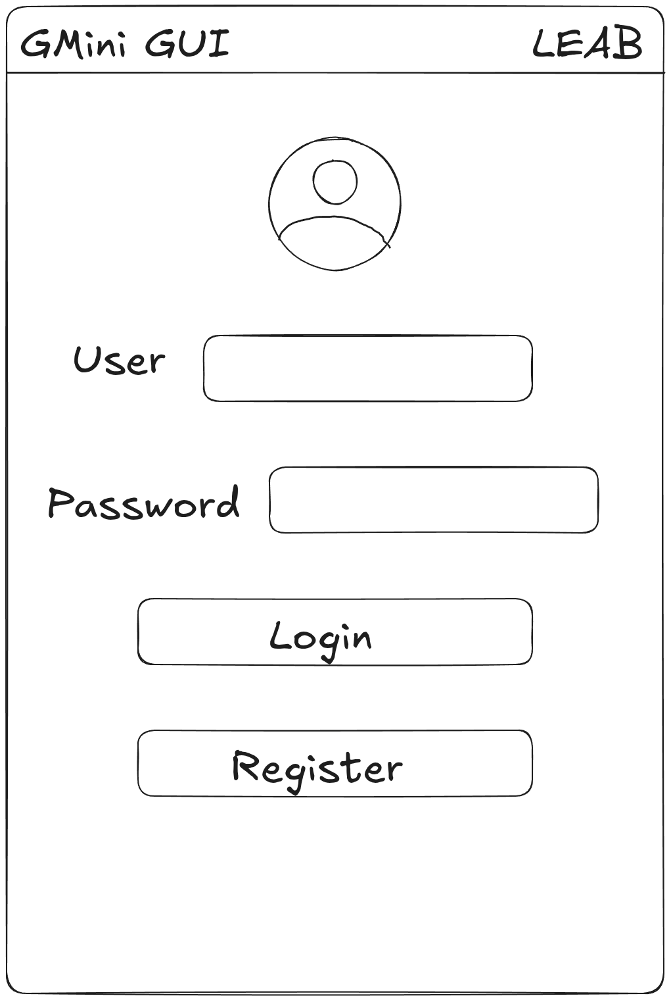

#### Pantalla de Registro
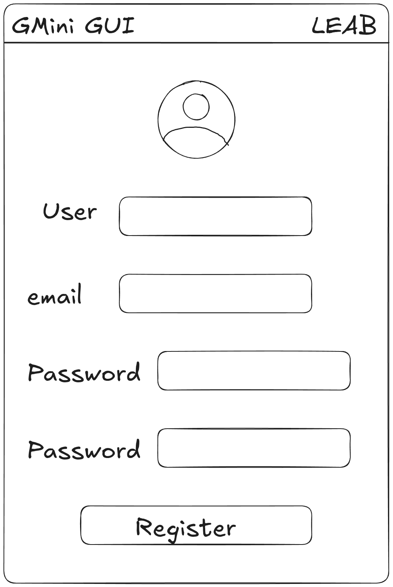

#### Pantalla Principal
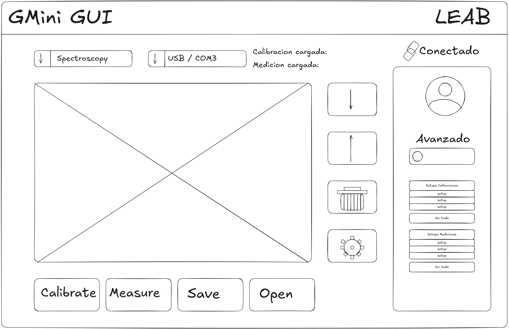

#### Pantalla de Configuración
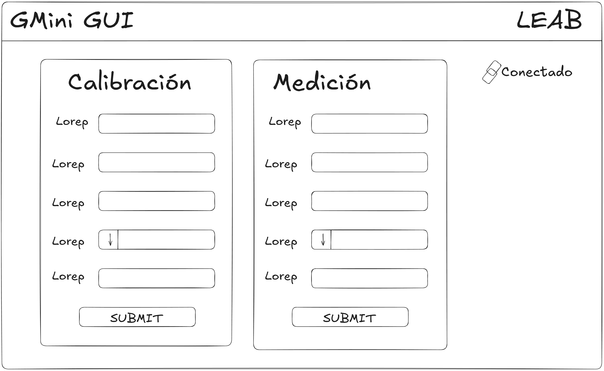

#### Pantalla de Mediciones y Setups de Usuario
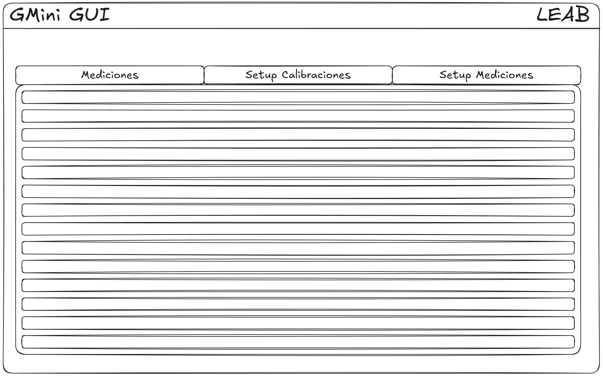

#### Pantalla de Perfil de Usuario
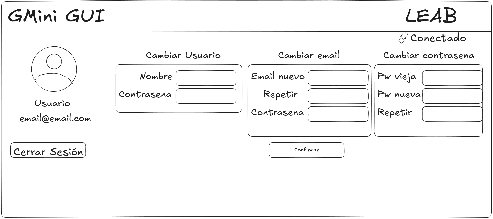

## HERRAMIENTAS UTILIZADAS
### Diagramas de Arquitectura de Software
#### Diagrama de Contexto
```mermaid
C4Context

title Diagrama de Contexto para el Sistema GMini GUI
Person(user, "Usuario registrado")

System(GMini-GUI, "Sistema Guanaco Mini", "Permite a los usuarios interactuar con el dispositivo Guanaco Mini.")

System_Ext(ESP32, "Placa GMini", "Dispositivo de Hardware que realiza mediciones de impedancia y bioimpedancia eléctrica.")

Rel(user, GMini-GUI, "Calibra el dispositivo y realiza mediciones")
Rel(GMini-GUI, ESP32, "Envía comandos de control al dispositivo y recolecta las respuestas")
```

#### Diagrama de Contenedores

```mermaid
C4Container

title Diagrama de Contenedores para el Sistema GMini GUI

Enterprise_Boundary(LEAB, "Entorno de Laboratorio") {

Person(user, "Usuario registrado")

System_Boundary(sys_gmini, "Sistema Guanaco Mini"){

Container(app, "Aplicación de Escritorio", "Python3 + PyQt6" ,"Provee la interfaz gráfica de usuario y la lógica de negocio para interactuar con el Hardware.")

ContainerDb(sqlite, "Base de Datos del Sistema", "SQLite3", "Base de Datos relacional donde se almacenan mediciones y setups de configuración.")

}

System_Ext(ESP32, "Placa GMini", "Dispositivo medidor de impedancia.")

}

Rel(user, app, "Calibra el dispositivo y realiza mediciones")
Rel(app, sqlite, "Persiste datos generados")
Rel(app, ESP32, "Envía comandos de control al dispositivo y recolecta las respuestas")
```
#### Diagrama de Componentes

```mermaid
C4Component
UpdateLayoutConfig($c4ShapeInRow="2", $c4BoundaryInRow="1")
title Diagrama de Componentes para el Sistema GMini GUI

Person(user, "Usuario registrado")

System_Boundary(GMini-GUI, "Sistema Guanaco Mini") {

Container_Boundary(app, "Aplicación de Escritorio"){

Component(UI, "Interfaz Gráfica", "PyQt6", "Maneja la interacción visual.")
    
Component(sesion, "Autenticación y Sesión", "Python 3", "Mantiene la sesión activa.")

Component(mediciones, "Mediciones y Config", "Python 3", "Orquesta las mediciones.")

Component(comunicacion, "Comunicación y HW", "Python 3", "Maneja el puerto serial/Bluetooth.")
    
Component(persistencia, "Persistencia", "Python 3", "Centraliza el acceso a datos.")
}

System_Boundary(externos, "Infraestructura Externa") {
ContainerDb(sqlite, "Base de Datos", "SQLite3", "Almacenamiento local.")
}

}

System_Ext(ESP32, "Placa GMini", "Dispositivo medidor de impedancia.")

Rel(user, UI, "Opera sistema")

Rel(UI, sesion, "Valida acceso")
Rel(UI, mediciones, "Inicia proceso")
Rel(UI, comunicacion, "Ajusta puerto")
Rel(UI, persistencia, "Exporta/Importa")

Rel(mediciones, comunicacion, "Delega comandos")
Rel(sesion, persistencia, "Consulta usuario")
Rel(mediciones, persistencia, "Guarda resultados")

Rel(comunicacion, ESP32, "I/O Hardware")
Rel(persistencia, sqlite, "Lee / Escribe")
```
