# Laboratorio de Desarrollo de Software

## Curso 2026

**Alegre, Elias Nahuel
Hegemann, Albaro Tobias
Vasquez Mamani, Juan Pablo
Vargas Da Silva, Eliam Joaquin**

## ÍNDICE

- [**INTRODUCCIÓN**](#introducción)
- **ANÁLISIS Y DISEÑO**
	- **[Análisis](#análisis)**
		- [**Especificación de Requerimientos**](#especificación-de-requerimientos)
			- [Introducción y ámbito del sistema](#introducción-y-ámbito-del-sistema)
				- Definiciones, siglas y abreviaturas
				- Referencias
			- [Descripción General](#descripción-general)
				- Funciones del producto
				- Características de los usuarios
				- Restricciones
			- [Requisitos específicos](#requisitos-específicos)
				- [Subsistema 1: Comunicación e Interacción con el Hardware](#subsistema-1-comunicación-e-interacción-con-el-Hardware)
					- Modulo 1: Conectividad y Estado
					- Modulo 2: Calibración del Dispositivo
				- [Subsistema 2: Configuración y Toma de Mediciones](#subsistema-2-configuración-y-toma-de-mediciones)
					- Modulo 1: Tipos y Estrategias de Medición
				- [Subsistema 3: Configuración y Gestión de Perfiles (Setups)](#subsistema-3-configuración-y-gestión-de-perfiles-setups)
					- Modulo 1: Perfiles de Usuario y Gestión de Setups de Medición
				- [Subsistema 4: Entorno de Ejecución y Plataforma](#subsistema-4-entorno-de-ejecución-y-plataforma)
					- Modulo 1: Compatibilidad del Sistema
				- [Subsistema 5: Persistencia](#subsistema-5-persistencia)
					- Modulo 1: Almacenamiento y Estructura de Datos
		- [**Casos de Uso**](#casos-de-uso)
			- Convenciones Gráficas
			- Diagramas de Casos de Uso
			- Especificación de Casos de Uso
	  **[Diseño](#diseño)**
		- [**Clases Software**](#clases-software)
			- Lista de Clases
			- Diagramas de Clases
		- [**Base de Datos**](#base-de-datos)
			- Convenciones Gráficas
			- Diagrama de Entidad Relación
		- [**Tabla de Trazabilidad**](#tabla-de-trazabilidad)
		- **[Pantallas](#pantallas)**
			-  Pantalla de Registro 
			- Pantalla Principal 
			- Pantalla de Configuración 
			- Pantalla de Mediciones y Setups de Usuario 
			- Pantalla de Perfil de Usuario
- [**CRONOGRAMA DE TRABAJO**](#cronograma-de-trabajo)
	- Visión general
	- Cronograma por requerimientos
- [**METODOLOGÍA DE DESARROLLO**](#metodología-de-desarrollo)
	- Resumen de la metodología elegida
- [**HERRAMIENTAS UTILIZADAS**](#herramientas-utilizadas)
	- Diagrama de Arquitectura de Software
- [**SOBRE LAS ITERACIONES**](#sobre-las-iteraciones)
- [**SOBRE LOS ENTREGABLES**](#sobre-los-entregables)
	- Aplicaciones y plataformas que forman parte del sistema
	- Requerimientos técnicos para la instalación
- [**PRESENTACIÓN VISUAL PARA APROBAR EL FINAL**](#presentación-visual-para-aprobar-el-final)

## INTRODUCCIÓN
El proyecto tiene como propósito el desarrollo integral de una plataforma de software y una interfaz gráfica de usuario (GUI) para el hardware "Guanaco Mini” (GMini) desarrollado por el Laboratorio de Electrónica Aplicada y Biomedicina (LEAB) del Instituto de Desarrollo Económico e Innovación de la Universidad Nacional de Tierra del Fuego AeiAS. El cliente interesado en el desarrollo de este software es el Doctor en Ciencias Biológicas e Ingeniero Biomédico Antonio Héctor Dell’osa, el cual en este contexto es miembro del LEAB, autor de la tesis “Espectroscopía de Impedancia para la Detección Rápida de Lesiones Óseas” sobre la cual este proyecto está basado y líder del proyecto GMini. Nuestro contacto con él es mediante su correo electrónico institucional [ahdellosa@untdf.edu.ar](mailto:ahdellosa@untdf.edu.ar) .

Dicho dispositivo está diseñado para proveer una interfaz capaz de realizar mediciones de espectroscopía de impedancia eléctrica y bioimpedancia.

El GMini ofrece un alto potencial para aplicaciones en investigaciones científicas y académicas. Desde el punto de vista médico y tecnológico, la bioimpedancia resulta interesante porque permite obtener información sobre un tejido utilizando corrientes eléctricas de pequeña amplitud, sin recurrir necesariamente a técnicas de diagnóstico más complejas, costosas o que utilicen radiación ionizante.

Además, los equipos de medición pueden ser relativamente pequeños y de bajo costo, por lo que existe interés en desarrollar sistemas portátiles capaces de realizar mediciones fuera de grandes centros médicos.

Sin embargo, medir la impedancia es solamente una parte del problema. Una medición puede contener una gran cantidad de datos: diferentes frecuencias, módulo de impedancia, fase, componente real, componente imaginaria y mediciones repetidas sobre diferentes personas o condiciones.

Desde nuestra formación en Sistemas, el problema resulta especialmente interesante en la etapa posterior a la adquisición de los datos: almacenamiento, organización, procesamiento, visualización e identificación automática de patrones que puedan relacionarse con diferentes estados del tejido.

Actualmente, la comunicación a bajo nivel con la placa GMini está resuelta y documentada, sin embargo, carece de una plataforma que permita a los usuarios no especializados utilizarla. La solución provisional existente, que parte de una implementación anterior, presenta múltiples problemas estructurales, errores de ejecución y limitaciones operativas, como la incapacidad de realizar muestreos continuos prolongados (sólo es posible ser utilizada para realizar mediciones por sus propios desarrolladores o usuarios entrenados específicamente). Por lo tanto, el desarrollo de una interfaz para el nuevo dispositivo es fundamental para explotar todas las capacidades del hardware, permitiendo su uso en entornos de campo y laboratorio sin requerir que el operador posea conocimientos técnicos en electrónica o programación a bajo nivel. Esta solución permitiría que los 5 dispositivos que actualmente se encuentran sin uso puedan ser puestos en común a partir del producto de software que se propone.

El objetivo principal de nuestro proyecto es desarrollar una aplicación que controle las distintas instrucciones de la placa (de las que disponemos una lista de comandos), mejore y agregue nuevas funcionalidades, implemente las claves para la calidad de software como la robustez, mantenibilidad, usabilidad y portabilidad.==\[Agregar los formatos en los que la placa arroja los resultados\]==

Por otro lado, la bioimpedancia se ha utilizado o investigado en distintos problemas médicos. Algunas de sus aplicaciones más conocidas son la estimación de la composición corporal, como porcentaje de grasa, masa muscular y cantidad de agua corporal, y el seguimiento de cambios en la distribución de líquidos.

También existen aplicaciones e investigaciones relacionadas con:

- detección y seguimiento de edemas o acumulaciones de líquido;
    
- evaluación del estado de tejidos musculares;
    
- análisis de cambios asociados con lesiones o alteraciones de tejidos;
    
- estudio de diferencias entre tejidos sanos y patológicos;
    
- monitoreo cardiovascular mediante técnicas como la cardiografía por impedancia;
    
- evaluación de tejidos pulmonares mediante Tomografía por Impedancia Eléctrica;
    
- investigación de alteraciones producidas por lesiones óseas, inflamación u otros cambios estructurales.

Es importante aclarar que no todas estas aplicaciones tienen el mismo grado de desarrollo clínico. Algunas están ampliamente utilizadas, mientras que otras continúan siendo objeto de investigación. Desde nuestra perspectiva, una dificultad importante aparece cuando las mediciones generan grandes cantidades de datos que deben ser interpretados.

Por ejemplo, para cada paciente pueden obtenerse decenas o cientos de valores correspondientes a diferentes frecuencias. Si además se realizan mediciones sobre diferentes zonas del cuerpo, condiciones o momentos, el volumen de información aumenta rápidamente.

El problema que nos interesa abordar puede formularse entonces de la siguiente manera:

**¿Cómo desarrollar herramientas computacionales que permitan organizar, procesar, visualizar y analizar mediciones de espectroscopía de bioimpedancia, facilitando la identificación de diferencias o patrones que puedan estar asociados con cambios en los tejidos biológicos?**

Este problema involucra aspectos propios de nuestra formación, como procesamiento de datos, programación, construcción de bases de datos, visualización de información, análisis estadístico y eventualmente utilización de algoritmos de aprendizaje automático.

Por lo tanto, nuestro objetivo no sería realizar directamente un diagnóstico médico, sino desarrollar herramientas computacionales que ayuden a transformar las mediciones eléctricas en información interpretable, que posteriormente pueda ser analizada y validada por especialistas del área biomédica.

## Análisis
### Especificación de Requerimientos

#### Introducción y ámbito del sistema

El Sistema GMini GUI es una aplicación de escritorio integrada directamente con el firmware del microcontrolador ESP32 mediante comunicación alámbrica o inalámbrica.

Su principal objetivo es permitir a los usuarios realizar funciones como:

- Tomar mediciones de espectroscopía por bioimpedancia e impedancia eléctrica con una frecuencia o un espectro de frecuencias.
    
- Configurar los intervalos en los que se toman las mediciones.

- Traducir y procesar los resultados arrojados por la placa.
  
- Permitir visualizar, modificar y exportar.
	- Configuraciones de cada medición.
	- Configuraciones de calibración.
    
- Visualizar desde la misma aplicación las mediciones junto con sus resultados.

- Importar y exportar mediciones junto con sus resultados.
    
- Almacenar en una base de datos.
	- Mediciones junto con sus resultados.
	- Configuraciones de cada medición.
	- Datos del usuario.
	- Configuraciones de calibración.
    
- Realizar muestreos continuos.
    
- Realizar labores de calibración del dispositivo.

Al reemplazar la actual comunicación mediante comandos a bajo nivel por esta interfaz gráfica, se elimina la barrera técnica, permitiendo explotar todo el potencial de la placa Guanaco Mini.
El proyecto está dirigido tanto para usuarios técnicos, investigadores y miembros de laboratorios con pocos o nulos conocimientos de programación en cualquiera de sus niveles. El sistema contemplará un único tipo de usuario con acceso a dos modalidades de trabajo intercambiables desde la interfaz: "Modo Avanzado" y "Modo Básico".
Los usuarios en "Modo Avanzado" tendrán total acceso al sistema, pudiendo configurar la calibración del dispositivo y los parámetros de las mediciones, pudiendo persistir estos cambios como setups reutilizables. En el "Modo Básico" se ocultarán las herramientas de edición de configuración, con el objetivo de agilizar el flujo de trabajo y prevenir alteraciones accidentales. Los usuarios en este modo estarán restringidos a realizar mediciones y labores de calibración preconfiguradas.

##### Definiciones, siglas y abreviaturas

- **Bioimpedancia**: Resistencia que oponen los tejidos biológicos (células, fluidos, bacterias, etc.) al paso de una corriente eléctrica alterna.
    
- **CSV (Comma-Separated Values)**: Formato de archivo de texto estructurado que representa datos tabulares separados por comas, ampliamente utilizado para la exportación y análisis de datos científicos.
    
- **EIS (Electrical Impedance Spectroscopy)**: Técnica de análisis no destructiva que consiste en aplicar una señal eléctrica alterna (voltaje o corriente de pequeña amplitud) a un material o tejido biológico a través de un rango de distintas frecuencias, con el fin de medir su impedancia (oposición al paso de la corriente).
    
- **ESP32**: Microcontrolador de bajo costo y consumo de energía que cuenta con tecnología Wi-Fi y Bluetooth de modo dual integrada, utilizado como núcleo de procesamiento del hardware original.
    
- **Espectroscopía (Barrido espectral / Sweep)**:Forma de medición que consiste en realizar una medición de impedancia o bioimpedancia en un determinado intervalo de frecuencias.
    
- **Firmware**: Software de bajo nivel que está integrado de forma permanente o semipermanente en el hardware (en este caso, el código desarrollado por el laboratorio que se ejecuta directamente sobre el ESP32).
    
- **GMini (Guanaco Mini)**: Dispositivo de hardware desarrollado por el laboratorio cliente, diseñado para realizar mediciones de espectroscopía.
    
- **GUI (Graphical User Interface)**: Interfaz Gráfica de Usuario. Entorno visual del software que permite a los operadores interactuar con el sistema y el hardware subyacente mediante elementos gráficos y ventanas, en lugar de comandos de texto.
    
- **ISO 8601**: Estándar internacional para la representación de fechas y horas, utilizado como formato básico para generar la nomenclatura predeterminada de los archivos guardados.
    
- **JSON (JavaScript Object Notation)**: Formato de texto ligero para el intercambio de datos, fácil de leer y escribir tanto para humanos como para máquinas.
    
- **LEAB (Laboratorio de Electrónica Aplicada y Biomedicina)**: Laboratorio perteneciente al Instituto de Desarrollo Económico e Innovación de la Universidad Nacional de Tierra del Fuego. Actúa como creador del hardware y cliente principal del proyecto de software.
    
- **Metadatos**: Información adicional (estado de los parámetros de configuración y observaciones libres) que se adjunta en las cabeceras de los archivos locales junto con los datos crudos de la medición.
    
- **Monofrecuencia**: Forma de medición que consiste en realizar la medición de impedancia o bioimpedancia a una frecuencia fija, también llamado del inglés “single frequency”.
    
- **Muestreo Continuo**: Proceso de recolección de datos y mediciones de manera ininterrumpida o periódica durante un rango de tiempo prolongado, gestionado automáticamente por el software.
    
- **Multifrecuencia**: Forma de medición que implica realizar mediciones a diferentes frecuencias fijas (diferentes mediciones monofrecuencia) que pueden tener o no intervalos equidistantes o no en el campo de la frecuencia.
    
- **Multiplexado (Canales / Llaves)**: Sistema de llaves (“switchs”) o conmutación que permite seleccionar diferentes canales en forma secuencial o fija.
    
- **Puerto Serial / Comunicación Serial**: Interfaz de transferencia de datos en la que la información se envía bit a bit de forma secuencial. Se utilizará (vía cable USB) como uno de los medios de comunicación principal entre la PC y el dispositivo.
    
- **Setups (Configuraciones de medición)**: Conjunto de parámetros técnicos (tipo, rango, canales) definidos y guardados localmente por un usuario experto, que pueden ser exportados, o bien importados y aplicados por un usuario operador.

##### Referencias

- **Espressif Systems**: ESP32 Technical Reference Manual. Espressif Systems, Shanghái (2023). Disponible en: [https://documentation.espressif.com/esp32_datasheet_en.html?q=ESP32](https://www.espressif.com/en/support/documents/technical-documents)
    
- **Python Software Foundation**: Python 3 Reference Manual. Disponible en: [https://docs.python.org/3/](https://docs.python.org/3/)
    
- **IEEE Computer Society**: IEEE Recommended Practice for Software Requirements Specifications (IEEE Std 830-1998). IEEE, Nueva York (1998).
    
- **Laboratorio de Electrónica Aplicada y Biomedicina (LEAB)**: Dispositivo de medición de bioimpedancia Guanaco Mini V2.0 [Rev3]. Universidad Nacional de Tierra del Fuego, A.I.A.S. (2026).
    
- **The pandas development team**: pandas-dev/pandas: Pandas. Zenodo. Disponible en: [https://pandas.pydata.org/](https://pandas.pydata.org/)
    
- **Hunter, J. D.: Matplotlib**: A 2D graphics environment. Computing in Science & Engineering, 9(3), 90-95 (2007).

### Descripción General

##### Funciones del Producto

**Subsistema de Comunicación e Interacción con el Hardware**
Este subsistema agrupa las funciones encargadas de establecer y mantener el enlace de datos bidireccional entre la computadora y la placa ESP32, garantizando una transferencia estable.

- Establecer conexión con el entorno de escritorio mediante conexión alámbrica.
    
- Establecer conexión con el entorno de escritorio mediante conexión inalámbrica.

**Subsistema de Configuración y Toma de Mediciones**
Este subsistema es el encargado de agrupar aquellas funciones que permiten a los usuarios monitorear, parametrizar, calibrar y realizar mediciones de manera controlada, pudiendo determinar aspectos como rangos de frecuencia o estrategias de medición.

- Calibrar el dispositivo.
    
- Tomar mediciones de espectroscopía por bioimpedancia e impedancia eléctrica.
    
- Seleccionar una frecuencia o un espectro de frecuencias para realizar las mediciones.
    
- Configurar los intervalos en los que se toman las mediciones.
    
- Visualizar los datos desde la misma aplicación.
    
- Contraponer datos para realizar comparaciones.
    
- Realizar procesamiento de datos.
  
**Subsistema de Configuración y Gestión de Perfiles (Setups)**
Este subsistema es el encargado de habilitar los distintos usuarios para garantizar la seguridad entre perfiles, los datos almacenados y sus configuraciones.
  

**Subsistema de Entorno de Ejecución y Plataforma**
Este subsistema es el encargado de garantizar la disponibilidad del proyecto en sistemas operativos Microsoft Windows y ofrecer soporte secundario en kernels de Linux.
  
**Subsistema Persistencia**
Este subsistema centraliza las operaciones de persistencia del sistema, garantizando que tanto los datos estructurados como la información de los usuarios se almacenen de manera ordenada y estandarizada.
- Exportar datos.
    
- Importar datos.
    
- Organizar los datos en una carpeta definida.

- Almacenar resultados e información en una Base de Datos

##### Características de los usuarios

Los principales usuarios de la plataforma serán los miembros del LEAB, los cuales serán piezas fundamentales a lo largo del desarrollo del proyecto. Para poder brindarles a estos mismos una herramienta que sea capaz de adecuarse a cada perfil, se contemplarán los siguientes modos de uso:

**Modo Avanzado**: Este modo de uso está pensado para aquellos usuarios con un mayor nivel técnico en cuanto a uso intensivo del dispositivo, análisis de los datos, parametrización y calibración del mismo. Los usuarios con este modo activado podrán dejar preparado el entorno del sistema para que los usuarios en modo básico puedan realizar mediciones sin dificultad. Esta distinción está pensada para líderes de laboratorios, jefes de proyectos de investigación, técnicos con amplia experiencia en EIS, entre otros.
  
**Modo Básico**: Este modo de uso está diseñado para aquellos usuarios menos experimentados, los cuales deban realizar tareas sencillas sin enfocarse en los aspectos más complejos del sistema. Aquellos usuarios que utilicen este modo solo podrán realizar mediciones previamente preconfiguradas.

##### Restricciones
  
El software no puede modificar el comportamiento interno del dispositivo, debe limitarse a realizar la lista de comandos y eventos ya programadas y documentadas por el LEAB.

El software está destinado para ser utilizado únicamente en la placa ESP32.

El sistema contempla únicamente dos vías de comunicación con la placa. Alámbrica e inalámbrica.

El uso de funciones del software está limitado por modos de uso.
  
El sistema debe garantizar la funcionalidad en el sistema operativo Microsoft Windows.

El sistema deberá ser capaz de funcionar sin acceso a internet.

El sistema no busca realizar un diagnóstico médico.

### Requisitos específicos
#### Subsistema 1: Comunicación e Interacción con el Hardware
##### Módulo 1: Conectividad y Estado

| **CON-01**      | Establecer conexión Alámbrica con el hardware                                                                      |
| :-------------- | :--------------------------------------------------------------------------------------------------------------------- |
| **Usuarios**    | Usuario Registrado.                                                                                 |
| **Descripción** | El sistema debe permitir establecer y gestionar la comunicación con la placa ESP32, soportando conexión alámbrica. |

| **CON-02**      | Establecer conexión inalámbrica con el hardware                                                                      |
| :-------------- | :------------------------------------------------------------------------------------------------------------------- |
| **Usuarios**    | Usuario Registrado.                                                                                   |
| **Descripción** | El sistema debe permitir establecer y gestionar la comunicación con la placa ESP32, soportando conexión inalámbrica. |

| **CON-03**      | Traducir comandos de control                                                              |
| :-------------- | :-------------------------------------------------------------------------------------------- |
| **Usuarios**    | Usuario Registrado.                                                        |
| **Descripción** | El sistema debe permitir utilizar los comandos de la placa mediante una interfaz gráfica. |

| **CON-04**      | Notificar visualmente el estado activo de conexión                                                                     |
| :---------- | :--------------------------------------------------------------------------------------------------------------------- |
| **Usuarios**    | Usuario Registrado.                                                                                     |
| **Descripción** | El sistema debe informar al usuario mediante indicadores visuales en la interfaz gráfica el estado activo de conexión. |

| **CON-05**      | Notificar visualmente el estado Inactivo de conexión                                                                     |
| :-------------- | :--------------------------------------------------------------------------------------------------------------------------- |
| **Usuarios**    | Usuario Registrado.                                                                                       |
| **Descripción** | El sistema debe informar al usuario mediante indicadores visuales en la interfaz gráfica el estado inactivo de conexión. |

| **CON-06**      | Notificar visualmente el estado error de conexión                                                                                                                  |
| :-------------- | :--------------------------------------------------------------------------------------------------------------------------------------------------------------------- |
| **Usuarios**    | Usuario Registrado.                                                                                                                                 |
| **Descripción** | El sistema debe informar al usuario mediante indicadores visuales en la interfaz gráfica el estado de error de la comunicación con el dispositivo en todo momento. |

| **CON-07**      | Persistir últimos datos generados ante un error                                                                                               |
| :-------------- | :------------------------------------------------------------------------------------------------------------------------------------------------ |
| **Usuarios**    | Usuario Registrado.                                                                                                            |
| **Descripción** | El sistema debe guardar automáticamente los últimos datos recolectados ante una pérdida repentina de señal durante el proceso de adquisición. |

##### **Módulo 2: Calibración del Dispositivo**
| **CAL-01**      | Configurar la calibración electrónica del equipo                                            |
| :-------------- | :------------------------------------------------------------------------------------------ |
| **Usuarios**    | Usuario Registrado.                                                                         |
| **Descripción** | El sistema debe permitir parametrizar la secuencia de comandos de calibración del hardware. |

| **CAL-02**      | Ejecutar calibración electrónica del equipo                                            |
| :-------------- | :----------------------------------------------------------------------------------------- |
| **Usuarios**    | Usuario Registrado.                                                     |
| **Descripción** | El sistema debe permitir iniciar la secuencia de comandos de calibración del hardware. |

| **CAL-03**      | Bloquear ejecución por descalibración                                                                                                                                                                             |
| :-------------- | :---------------------------------------------------------------------------------------------------------------------------------------------------------------------------------------------------------------- |
| **Usuarios**    | Usuario Registrado.                                                                                                                                                                                                |
| **Descripción** | El sistema debe impedir el inicio de nuevas mediciones si detecta que los parámetros críticos del hardware (ganancia, voltaje o resistencia) han sido modificados sin registrar una calibración válida posterior. |

| **CAL-04**      | Limitar la configuración de calibración al Modo Avanzado                                                                                   |
| :-------------- | :----------------------------------------------------------------------------------------------------------------------------------------- |
| **Usuarios**    | Usuario Registrado.                                                                                                                        |
| **Descripción** | El sistema solo debe permitir parametrizar la secuencia de comandos de calibración del hardware si se encuentra activado el Modo Avanzado. |
#### Subsistema 2: Configuración y Toma de Mediciones
##### Módulo 1: Tipos y Estrategias de Medición


| **MED-01**      | Configurar apartados comunes a una medición                                                                                                                                |
| :-------------- | :------------------------------------------------------------------------------------------------------------------------------------------------------------------------- |
| **Usuarios**    | Usuario Registrado.                                                                                                                                                        |
| **Descripción** | El sistema debe permitir establecer los apartados comunes a todos los tipos de medición (voltaje de excitación, ganancia, ciclos, canales de multiplexado y valor de rfb). |

| **MED-02**      | Configurar medición de una frecuencia  (Monofrecuencia)                                                                         |
| :-------------- | :------------------------------------------------------------------------------------------------------------------------------ |
| **Usuarios**    | Usuario Registrado.                                                                                                             |
| **Descripción** | El sistema debe permitir elegir los parámetros de medición para  mediciones continuas a una única frecuencia fija seleccionada. |

| **MED-03**      | Ejecutar medición de una frecuencia (Monofrecuencia)                                             |
| :-------------- | :----------------------------------------------------------------------------------------------- |
| **Usuarios**    | Usuario Registrado.                                                                              |
| **Descripción** | El sistema debe permitir ejecutar mediciones continuas a una única frecuencia fija seleccionada. |

| **MED-04**      | Configurar medición por espectroscopía (Barrido espectral)                                                                                                                                      |
| :-------------- | :---------------------------------------------------------------------------------------------------------------------------------------------------------------------------------------------- |
| **Usuarios**    | Usuario Registrado.                                                                                                                                                                             |
| **Descripción** | El sistema debe permitir elegir los parámetros de medición para realizar una medición secuencial a intervalos fijos de frecuencias establecidas en el espectro frecuencial (sweep) determinado. |

| **MED-05**      | Ejecutar medición por espectroscopía (Barrido espectral)                                                                                                 |
| :-------------- | :------------------------------------------------------------------------------------------------------------------------------------------------------- |
| **Usuarios**    | Usuario Registrado.                                                                                                                                      |
| **Descripción** | El sistema debe permitir ejecutar una medición secuencial a intervalos fijos de frecuencias establecidas en el espectro frecuencial (sweep) determinado. |

| **MED-06**      | Configurar medición de multifrecuencia                                                                               |
| :-------------- | :------------------------------------------------------------------------------------------------------------------- |
| **Usuarios**    | Usuario Registrado.                                                                                                  |
| **Descripción** | El sistema debe permitir elegir los parámetros de medición para una cantidad de frecuencias discretas y específicas. |

| **MED-07**      | Ejecutar medición multifrecuencia                                                                                         |
| :-------------- | :------------------------------------------------------------------------------------------------------------------------ |
| **Usuarios**    | Usuario Registrado.                                                                                                       |
| **Descripción** | El sistema permite ejecutar una cantidad de mediciones a las mismas frecuencias discretas y especificadas por el usuario. |

| **MED-08**      | Ejecutar mediciones en bucle                                                               |
| :-------------- | :----------------------------------------------------------------------------------------- |
| **Usuarios**    | Usuario Registrado.                                                                        |
| **Descripción** | El sistema debe permitir ejecutar mediciones continuas del mismo tipo a través del tiempo. |
|                 |                                                                                            |

| **MED-09**      | Mostrar progreso de la medición                                                                                                                     |
| :-------------- | :-------------------------------------------------------------------------------------------------------------------------------------------------- |
| **Usuarios**    | Usuario Registrado.                                                                                                                                 |
| **Descripción** | El sistema debe proporcionar una indicación visual en pantalla que informe al usuario que un proceso de medición se encuentra actualmente en curso. |

| **MED-10**      | Mostrar resultados intermedios                                                                                                 |
| :-------------- | :----------------------------------------------------------------------------------------------------------------------------- |
| **Usuarios**    | Usuario Registrado.                                                                                                            |
| **Descripción** | El sistema debe proporcionar en pantalla los datos de mediciones intermedias realizadas durante procesos de medición ciclicos. |

| **MED-11**      | Calcular estadísticos descriptivos básicos                                                                                |
| :-------------- | :------------------------------------------------------------------------------------------------------------------------ |
| **Usuarios**    | Usuario Registrado.                                                                                                       |
| **Descripción** | El sistema debe ser capaz de calcular estadísticos descriptivos a partir de los datos crudos obtenidos en las mediciones. |

| **MED-12**      | Presentar estadísticos descriptivos básicos                               |
| :-------------- | :------------------------------------------------------------------------ |
| **Usuarios**    | Usuario Registrado.                                                       |
| **Descripción** | El sistema debe ser capaz de presentar métricas estadísticas automáticas. |

| **MED-13**      | Limitar configuración de mediciones al Modo Avanzado                                                                              |
| :-------------- | :-------------------------------------------------------------------------------------------------------------------------------- |
| **Usuarios**    | Usuario Registrado.                                                                                                               |
| **Descripción** | El sistema solo debe permitir configurar setups de medición (independientemente del tipo) si se encuentra activo el Modo Avanzado |
#### Subsistema 3: Configuración y Gestión de Perfiles (Setups)

##### Módulo 1: Perfiles de Usuario y Gestión de Setups de Medición
| **SET-01**      | Crear Perfil de Usuario                             |
| :-------------- | --------------------------------------------------- |
| **Usuarios**    | Usuario Registrado.                                 |
| **Descripción** | El sistema debe permitir crear perfiles de usuario. |

| **SET-02**      | Iniciar Sesión                                          |
| :-------------- | ------------------------------------------------------- |
| **Usuarios**    | Usuario Registrado.                                     |
| **Descripción** | El sistema debe permitir a los usuarios iniciar sesión. |

| **SET-03**      | Cerrar Sesión                                          |
| :-------------- | ------------------------------------------------------ |
| **Usuarios**    | Usuario Registrado.                                    |
| **Descripción** | El sistema debe permitir a los usuarios cerrar sesión. |

| **SET-04**      | Habilitar Modos de Uso                                                                                                                 |
| :-------------- | -------------------------------------------------------------------------------------------------------------------------------------- |
| **Usuarios**    | Usuario Registrado.                                                                                                                    |
| **Descripción** | La aplicación debe proveer dos modos de uso intercambiables desde la interfaz gráfica, definidos como "Modo Avanzado" y "Modo Básico". |

| **SET-05**      | Habilitar Modo Avanzado                                                                                        |
| :-------------- | -------------------------------------------------------------------------------------------------------------- |
| **Usuarios**    | Usuario Registrado.                                                                                            |
| **Descripción** | La aplicación debe proveer un "Modo Avanzado" con acceso total a la configuración de parámetros y calibración. |

| **SET-06**      | Habilitar Modo Básico                                                                                                                                                           |
| :-------------- | ------------------------------------------------------------------------------------------------------------------------------------------------------------------------------- |
| **Usuarios**    | Usuario Registrado.                                                                                                                                                             |
| **Descripción** | La aplicación debe proveer un "Modo Básico" con permisos restringidos exclusivamente a la ejecución de mediciones y ejecución de calibración (con los parámetros predefinidos). |

| **SET-07**      | Cambiar entre modos de uso                                                     |
| :-------------- | ------------------------------------------------------------------------------ |
| **Usuarios**    | Usuario Registrado.                                                            |
| **Descripción** | El sistema tiene que permitir a un usuario realizar cambios de modo dinámicos. |

| **SET-08**      | Advertir sobre cambio de modo                                                                              |
| :-------------- | ---------------------------------------------------------------------------------------------------------- |
| **Usuarios**    | Usuario Registrado.                                                                                        |
| **Descripción** | El sistema debe desplegar una alerta visual de confirmación cuando se intente alternar entre modos de uso. |

| **SET-09**      | Aplicar configuraciones                                                                 |
| :-------------- | --------------------------------------------------------------------------------------- |
| **Usuarios**    | Usuario Registrado.                                                                     |
| **Descripción** | El sistema debe permitir al usuario seleccionar una configuración previamente guardada. |

| **SET-10**      | Cargar configuraciones                                                                                                       |
| :-------------- | ---------------------------------------------------------------------------------------------------------------------------- |
| **Usuarios**    | Usuario Registrado.                                                                                                          |
| **Descripción** | El sistema debe permitir al usuario importar configuraciones desde el almacenamiento local y guardarlos en la base de datos. |

| **SET-11**      | Exportar configuraciones de medición                                                                                      |
| :-------------- | ------------------------------------------------------------------------------------------------------------------------- |
| **Usuarios**    | Usuario Registrado.                                                                                                       |
| **Descripción** | El sistema debe permitir al usuario exportar las configuraciones guardadas en la base de datos a su almacenamiento local. |

| **SET-12**      | Visualizar datos guardados                                                                                               |
| :-------------- | ------------------------------------------------------------------------------------------------------------------------ |
| **Usuarios**    | Usuario Registrado.                                                                                                      |
| **Descripción** | El sistema debe permitir visualizar datos (mediciones realizadas y setups) anteriores aunque la placa no esté conectada. |

| **SET-13**      | Mantener la sesión activa en el dispositivo                                                 |
| :-------------- | ------------------------------------------------------------------------------------------- |
| **Usuarios**    | Usuario Registrado.                                                                         |
| **Descripción** | El sistema debe mantener la sesión del usuario activa aunque se haya cerrado la aplicación. |

#### Subsistema 4: Entorno de Ejecución y Plataforma

##### Módulo 1: Compatibilidad del Sistema

| **COM-01**      | Proveer entorno de aplicación de escritorio                                                                                                            |
| :-------------- | ---------------------------------------------------------------------------------------------------------------------------------------------------------- |
| **Usuarios**    | Usuario Registrado.                                                                                                                     |
| **Descripción** | El software debe ser diseñado, compilado y distribuido como una aplicación de escritorio orientada a computadoras personales y portátiles (notebooks). |

| **COM-02**      | Garantizar ejecución nativa en Microsoft Windows                                                                                                                                          |
| :-------------- | --------------------------------------------------------------------------------------------------------------------------------------------------------------------------------------------- |
| **Usuarios**    | Usuario Registrado.                                                                                                                                                        |
| **Descripción** | El sistema debe garantizar total compatibilidad, estabilidad y funcionalidad de todos sus módulos (especialmente la comunicación de puertos) bajo el sistema operativo Microsoft Windows. |

| **COM-03**      | Proveer soporte secundario para entornos Linux                                                                                                                |
| :-------------- | ----------------------------------------------------------------------------------------------------------------------------------------------------------------- |
| **Usuarios**    | Usuario Registrado.                                                                                                                            |
| **Descripción** | El sistema debe contemplar en su arquitectura la portabilidad necesaria para poder ser ejecutado en distribuciones de escritorio del sistema operativo Linux. |

| **COM-04**      | Garantizar el funcionamiento sin conexión a internet                                                   |
| :-------------- | ------------------------------------------------------------------------------------------------------ |
| **Usuarios**    | Usuario Registrado.                                                                                    |
| **Descripción** | El sistema debe ser capaz de funcionar de manera completa aunque no se establezca conexión a internet. |
#### Subsistema 5: Persistencia

##### Módulo 1: Almacenamiento y Estructura de Datos

| **PER-01**      | Almacenar setups de medición y calibración en una Base de Datos                                                                             |
| :-------------- | ------------------------------------------------------------------------------------------------------------------------------------------- |
| **Usuarios**    | Usuario Registrado.                                                                                                                         |
| **Descripción** | El sistema debe guardar todos las configuraciones de calibración y medición establecidas por el usuario en en una base de datos relacional. |

| **PER-02**      | Almacenar mediciones y sus resultados en una Base de Datos                                                                      |
| :-------------- | ------------------------------------------------------------------------------------------------------------------------------- |
| **Usuarios**    | Usuario Registrado.                                                                                                             |
| **Descripción** | El sistema debe guardar todas las mediciones completadas junto con sus resultados directamente en una base de datos relacional. |

| **PER-03**      | Configurar directorios                                                                                                |
| :-------------- | --------------------------------------------------------------------------------------------------------------------- |
| **Usuarios**    | Usuario Registrado.                                                                                                   |
| **Descripción** | El sistema debe permitir al usuario seleccionar un directorio raíz específico para el almacenamiento de sus campañas. |

| **PER-04**      | Generar nomenclatura predeterminada de archivos                                                                                                              |
| :-------------- | ------------------------------------------------------------------------------------------------------------------------------------------------------------ |
| **Usuarios**    | Usuario Registrado.                                                                                                                                          |
| **Descripción** | El sistema debe asignar automáticamente a cada archivo de salida un nombre basado en la fecha y hora de la medición, utilizando el estándar ISO 8601 básico. |

| **PER-05**      | Renombramiento manual de archivos                                                                             |
| :-------------- | ------------------------------------------------------------------------------------------------------------- |
| **Usuarios**    | Usuario Registrado.                                                                                           |
| **Descripción** | El sistema debe permitir al usuario sobrescribir el nombre automático del archivo antes de su guardado final. |

| **PER-06**      | Estructurar cabeceras de metadatos integrados                                                                                                                                                                                |
| :-------------- | ---------------------------------------------------------------------------------------------------------------------------------------------------------------------------------------------------------------------------- |
| **Usuarios**    | Usuario Registrado.                                                                                                                                                                                                          |
| **Descripción** | El sistema debe incluir en el archivo final exportado tanto los datos duros de la medición, como una cabecera que contenga el estado exacto de todos los parámetros de configuración utilizados y el texto de observaciones. |

| **PER-07**      | Limitar el guardado de setups en la base de datos al Modo Avanzado                                                                    |
| :-------------- | ------------------------------------------------------------------------------------------------------------------------------------- |
| **Usuarios**    | Usuario Registrado.                                                                                                                   |
| **Descripción** | Las configuraciones de calibración y medición solo podrán ser guardadas en la Base de Datos si se encuentra activado el Modo Avanzado |

| **PER-08**      | Adjuntar metadatos y observaciones libres sobre mediciones                                                                                                                                              |
| :-------------- | ------------------------------------------------------------------------------------------------------------------------------------------------------------------------------------------------------- |
| **Usuarios**    | Usuario Registrado.                                                                                                                                                                                     |
| **Descripción** | El sistema debe proveer un campo de entrada de texto libre para documentar observaciones contextuales sobre el objeto o tejido medido, vinculando este texto al paquete de datos final de una medición. |

| **PER-09**      | Adjuntar metadatos y observaciones libres sobre setups                                                                                                                                                                                           |
| :-------------- | ------------------------------------------------------------------------------------------------------------------------------------------------------------------------------------------------------------------------------------------------ |
| **Usuarios**    | Usuario Registrado.                                                                                                                                                                                                                              |
| **Descripción** | El sistema debe proveer un campo de entrada de texto libre para documentar observaciones contextuales sobre las configuraciones establecidas en un setup (de calibración o medición), vinculando este texto al paquete de datos final del mismo. |

| **PER-10**      | Limitar la escritura de observaciones en setups al modo Avanzado                                      |
| :-------------- | ----------------------------------------------------------------------------------------------------- |
| **Usuarios**    | Usuario Registrado.                                                                                   |
| **Descripción** | El sistema solo debe habilitar las observaciones en setups si el Modo Avanzado se encuentra activado. |

### Casos de Uso
#### Convenciones gráficas

##### Actores
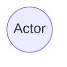
##### Casos de Uso

##### Asignaciones
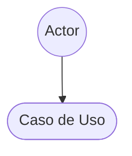
##### Generalización


##### Limites del Subsistema
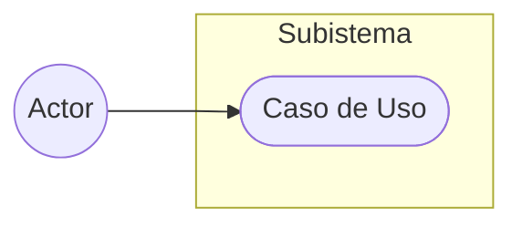

##### Extensiones e Inclusiones
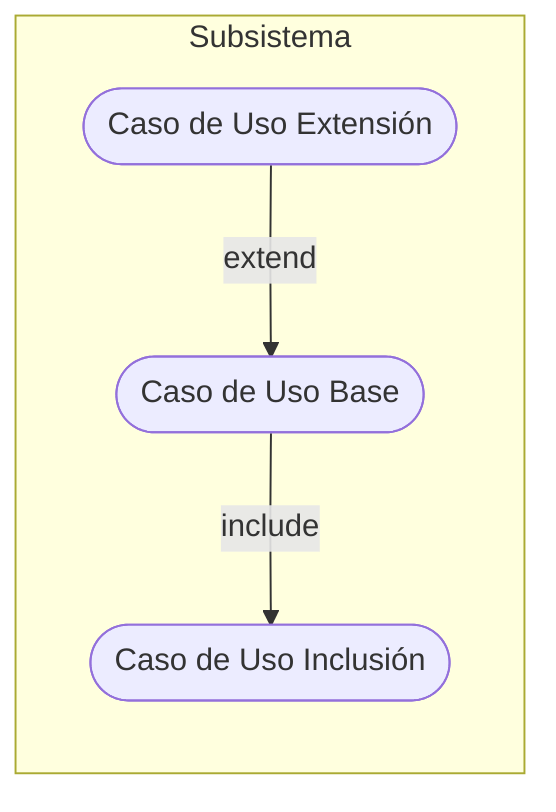

#### Diagramas de Casos de Uso
##### Subsistema 1: Comunicación e Interacción con el Hardware

###### Módulo 1: Conectividad y Estado
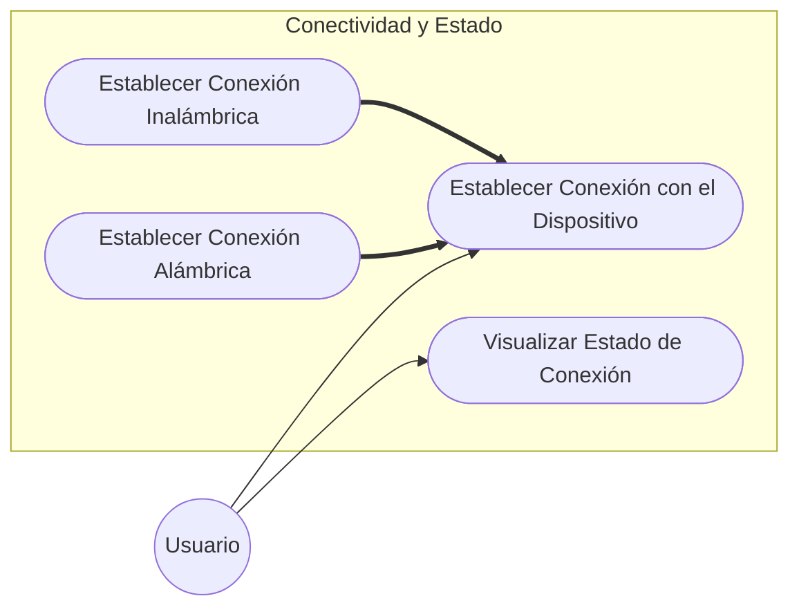

###### Módulo 2: Calibración del Dispositivo


##### Subsistema 2: Configuración y Toma de Mediciones
###### Módulo 1: Tipos y Estrategias de Medición


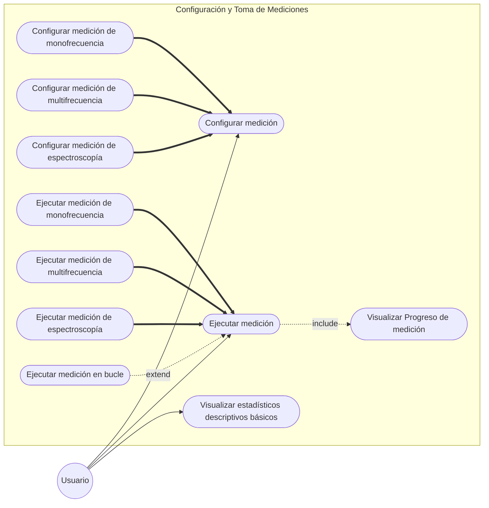

##### Subsistema 3: Configuración y Gestión de Perfiles (Setups)

###### Módulo 1: Perfiles de Usuario y Gestión de Setups de Medición


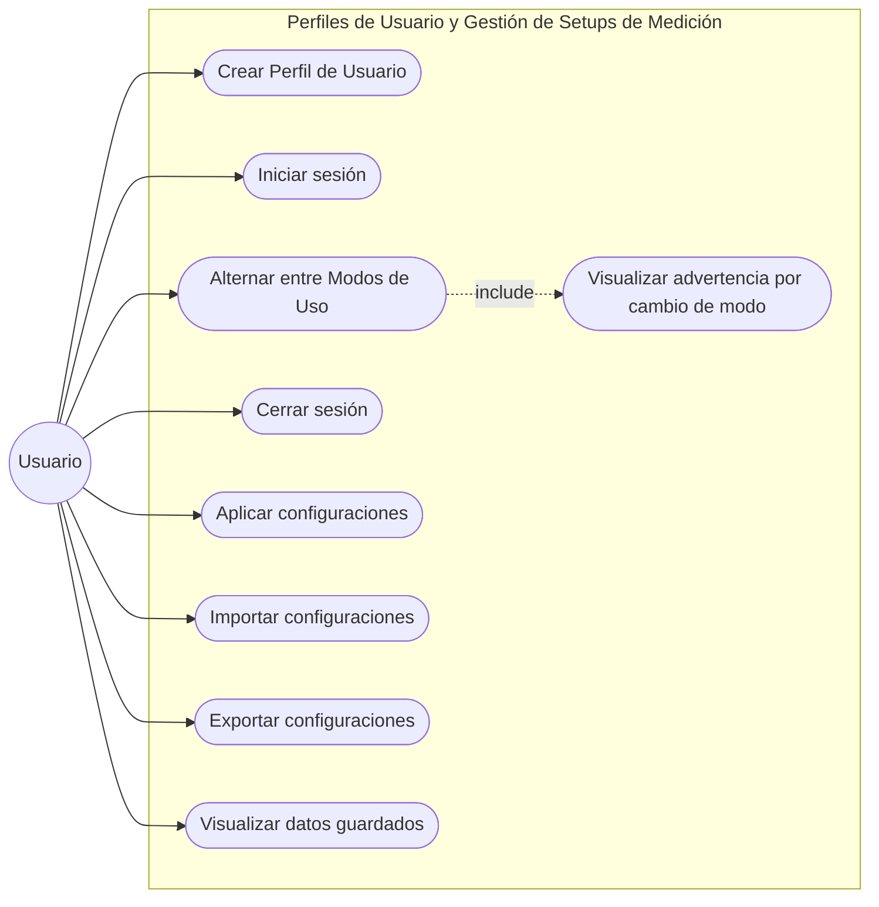

##### Subsistema 5: Persistencia

###### Módulo 1: Almacenamiento y Estructura de Datos
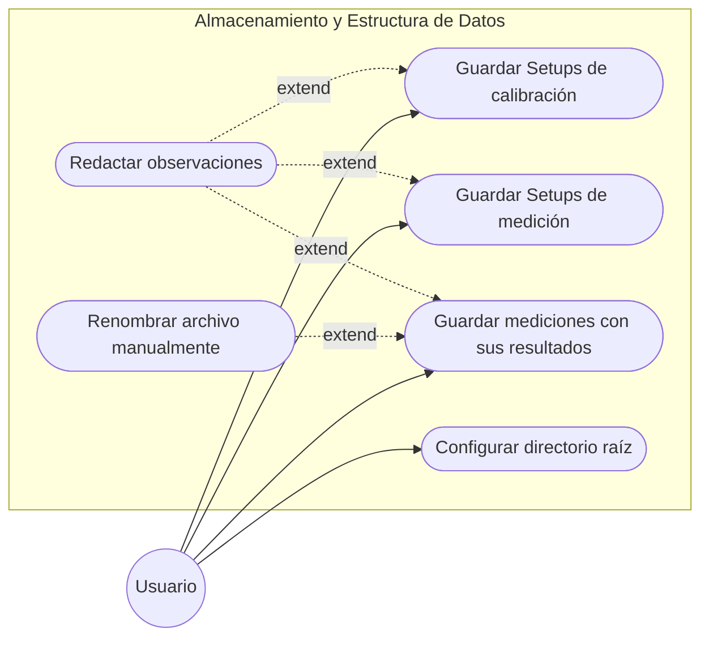


#### Especificación de Casos de Uso

##### Subsistema 1: Comunicación e Interacción con el Hardware

| **Nombre**                       | Establecer Conexión con el Dispositivo |
| :------------------------------- | :--- |
| **Tipo**                         | Abstracto |
| **Objetivo**                     | Define los pasos específicos para establecer la conexión con la placa ESP32 |
| **Actor Primario**               | Usuario |
| **Alcance**                      | Subsistema 1: Comunicación e Interacción con el Hardware |
| **Precondiciones**               | Debe haberse registrado el inicio de sesión del usuario |
| **Escenario principal de éxito** | 1. Desde la pantalla principal el usuario accede al panel de "Conexión".<br>2. El usuario elige el canal de comunicación.<br>3. [Paso abstracto: El Sistema procesa la solicitud de enlace con el hardware.]<br>4. El sistema arroja un mensaje de éxito "Conexión exitosa" |
| **Postcondiciones**              | El sistema permite la comunicación con el dispositivo |
| **Extensiones**                  | |

| **Nombre**                                                | Establecer Conexión Inalámbrica |
| :-------------------------------------------------------- | :--- |
| **Hereda de**                                             | Establecer Conexión con el Dispositivo |
| **Objetivo**                                              | Define los pasos específicos para establecer conexión inalámbrica con la placa ESP32 |
| **Actor Primario**                                        | Usuario |
| **Alcance**                                               | Subsistema 1: Comunicación e Interacción con el Hardware |
| **Precondiciones**                                        | Debe haberse registrado el inicio de sesión del usuario |
| **Escenario principal de éxito** (Sobreescribe el paso 3) | 3.1. El sistema activa la interfaz Bluetooth.<br>3.2. El Sistema escanea el entorno buscando el dispositivo.<br>3.3. El usuario selecciona el dispositivo “ESP32”.<br>3.4. El sistema empareja el dispositivo y establece el canal de datos. |
| **Postcondiciones**                                       | El sistema permite la comunicación con el dispositivo |
| **Extensiones**                                           | 3.2.a. El sistema no logra encontrar la placa en el entorno.<br>3.2.a.1. El sistema arroja un mensaje de error: "ERROR: No se encuentra el dispositivo, intente nuevamente." y aborta la conexión |

| **Nombre**                                                | Establecer Conexión Alámbrica |
| :-------------------------------------------------------- | :--- |
| **Hereda de**                                             | Establecer Conexión con el Dispositivo |
| **Objetivo**                                              | Define los pasos específicos para establecer conexión alámbrica con la placa ESP32 |
| **Actor Primario**                                        | Usuario |
| **Alcance**                                               | Subsistema 1: Comunicación e Interacción con el Hardware |
| **Precondiciones**                                        | Debe haberse registrado el inicio de sesión del usuario |
| **Escenario principal de éxito** (Sobreescribe el paso 3) | 3.1. El sistema escanea los puertos de comunicación de la computadora.<br>3.2. El sistema presenta un menú desplegable con las opciones de puerto encontradas.<br>3.3. El usuario selecciona el puerto correspondiente.<br>3.4. El Sistema inicializa la comunicación abriendo el puerto correspondiente. |
| **Postcondiciones**                                       | El sistema permite la comunicación con el dispositivo |
| **Extensiones**                                           | 3.3.a. El puerto está bloqueado o la placa no responde al intento de conexión.<br>3.3.a.1. El sistema arroja un mensaje de error: "ERROR DE CONEXIÓN: No es posible comunicarse con el dispositivo, intente nuevamente." y aborta la conexión |

| **Nombre**                       | Visualizar Estado de Conexión |
| :------------------------------- | :--- |
| **Objetivo**                     | Define los pasos específicos para visualizar el estado de conexión entre la placa y la computadora |
| **Actor Primario**               | Usuario |
| **Alcance**                      | Subsistema 1: Comunicación e Interacción con el Hardware |
| **Precondiciones**               | Debe haberse registrado el inicio de sesión del usuario |
| **Escenario principal de éxito** | 1. Desde la pantalla principal el usuario accede al panel de "Conexión".<br>2. El sistema presenta un indicador visual de color verde, junto con un mensaje: "Dispositivo Conectado" |
| **Postcondiciones**              | |
| **Extensiones**                  | 2.a. La placa se encuentra desconectada.<br>2.a.1. El sistema presenta un indicador visual de color rojo, junto con un mensaje: "Dispositivo Desconectado" |

| **Nombre**                       | Configurar Calibración Electrónica                                                                                                                                                                                                                                                                                                                                                                                                                   |
| :------------------------------- | :--------------------------------------------------------------------------------------------------------------------------------------------------------------------------------------------------------------------------------------------------------------------------------------------------------------------------------------------------------------------------------------------------------------------------------------------------- |
| **Objetivo**                     | Define los pasos específicos para establecer los parámetros de calibración de la placa.                                                                                                                                                                                                                                                                                                                                                              |
| **Actor Primario**               | Usuario                                                                                                                                                                                                                                                                                                                                                                                                                                              |
| **Alcance**                      | Subsistema 1: Comunicación e Interacción con el Hardware                                                                                                                                                                                                                                                                                                                                                                                             |
| **Precondiciones**               | - Debe mantenerse la comunicación con el dispositivo.<br>- El usuario debe tener el Modo Avanzado activado.                                                                                                                                                                                                                                                                                                                                          |
| **Escenario principal de éxito** | 1. Desde la pantalla principal el usuario accede al panel de "Configuración/Calibración".<br>2. El sistema presenta un formulario con apartados obligatorios de calibración.<br>3. El usuario completa el formulario llenando todos los valores obligatorios.<br>4. El usuario selecciona la opción "aplicar".<br>5. El sistema arroja un mensaje de éxito: "Cambios aplicados correctamente"<br>6. El usuario sale de la pantalla de configuración. |
| **Postcondiciones**              | Se aplican los nuevos parámetros de calibración                                                                                                                                                                                                                                                                                                                                                                                                      |
| **Extensiones**                  | 4.a. No se completan todos los apartados obligatorios.<br>4.a.1. El sistema presenta un indicador visual de color rojo en cada apartado sin completar, junto con un mensaje: "Es necesario rellenar todos los campos obligatorios"                                                                                                                                                                                                                   |

| **Nombre**                       | Ejecutar Calibración Electrónica                                                                                                                                                                                                                                                                                                                                                                               |
| :------------------------------- | :------------------------------------------------------------------------------------------------------------------------------------------------------------------------------------------------------------------------------------------------------------------------------------------------------------------------------------------------------------------------------------------------------------- |
| **Objetivo**                     | Define los pasos específicos para ejecutar los comandos de calibración de la placa.                                                                                                                                                                                                                                                                                                                            |
| **Actor Primario**               | Usuario                                                                                                                                                                                                                                                                                                                                                                                                        |
| **Alcance**                      | Subsistema 1: Comunicación e Interacción con el Hardware                                                                                                                                                                                                                                                                                                                                                       |
| **Precondiciones**               | - Deben haberse configurado los parámetros de calibración.<br>- El usuario debe tener el Modo Avanzado activado.                                                                                                                                                                                                                                                                                               |
| **Escenario principal de éxito** | 1. El usuario accede a la pantalla principal del sistema.<br>2. El usuario selecciona un botón con el mensaje "Calibrar".<br>3. El sistema procesa y envía la secuencia de comandos de calibración a la placa ESP32<br>4. El sistema arroja un mensaje de éxito: "Calibración Exitosa"<br>5. El botón "Calibrar" se bloquea hasta que se realice una medición.<br>6. El sistema desbloquea el botón de "Medir" |
| **Postcondiciones**              | - Se realiza la calibración del equipo<br>- El sistema permite a los usuarios medir                                                                                                                                                                                                                                                                                                                            |
| **Extensiones**                  | 3.a. La placa no responde a la secuencia de comandos o se pierde la conexión física.<br>3.a.1. El sistema arroja un mensaje de error en pantalla y aborta el proceso de calibración.                                                                                                                                                                                                                           |

##### Subsistema 2: Configuración y Toma de Mediciones

| **Nombre**                       | Ejecutar Medición                                                                                                                                                                                                                                                                                                                                                                                                                                                                                                                                                                                                                                                                                                                                                              |
| :------------------------------- | :----------------------------------------------------------------------------------------------------------------------------------------------------------------------------------------------------------------------------------------------------------------------------------------------------------------------------------------------------------------------------------------------------------------------------------------------------------------------------------------------------------------------------------------------------------------------------------------------------------------------------------------------------------------------------------------------------------------------------------------------------------------------------- |
| **Tipo**                         | Abstracto                                                                                                                                                                                                                                                                                                                                                                                                                                                                                                                                                                                                                                                                                                                                                                      |
| **Objetivo**                     | Iniciar, coordinar y validar el proceso de toma de datos desde la placa Guanaco Mini según los parámetros establecidos.                                                                                                                                                                                                                                                                                                                                                                                                                                                                                                                                                                                                                                                        |
| **Actor Primario**               | Usuario                                                                                                                                                                                                                                                                                                                                                                                                                                                                                                                                                                                                                                                                                                                                                                        |
| **Alcance**                      | Subsistema 2: Configuración y Toma de Mediciones                                                                                                                                                                                                                                                                                                                                                                                                                                                                                                                                                                                                                                                                                                                               |
| **Precondiciones**               | - La placa debe estar conectada.<br>- La placa debe estar calibrada.<br>- Debe existir una configuración de medición previamente seleccionada.                                                                                                                                                                                                                                                                                                                                                                                                                                                                                                                                                                                                                                 |
| **Escenario principal de éxito** | 1. El Usuario ingresa al panel principal en la interfaz.<br>2. El Sistema presenta la información de la configuración activa y un botón etiquetado como "Iniciar Medición", el cual se encuentra habilitado.<br>3. El Usuario hace clic en el botón "Iniciar Medición".<br>4. Punto de Inclusión: El Sistema invoca inmediatamente al caso de uso CU “Visualizar Progreso de medición” para dar retroalimentación visual al usuario.<br>5. (Herencia): El Sistema procesa la solicitud según el tipo de medición configurada.<br>6. El Sistema recibe exitosamente la respuesta de la placa con los datos complejos.<br>7. El Sistema presenta por pantalla los datos recolectados.<br>8. El Sistema habilita el botón "Guardar Resultados" y finaliza el estado de ejecución. |
| **Postcondiciones**              |                                                                                                                                                                                                                                                                                                                                                                                                                                                                                                                                                                                                                                                                                                                                                                                |
| **Extensiones**                  | 5.a. El sistema recibe que el tipo de medición es en “bucle” (EXTEND).<br>5.a.1. El sistema se redirige al CU “Ejecutar medición en bucle”.<br><br>6.a. El sistema no recibe correctamente los datos complejos.<br>6.a.1. El sistema aborta el proceso de medición.<br>6.a.2. El sistema libera el puerto de comunicación.                                                                                                                                                                                                                                                                                                                                                                                                                                                     |

| **Nombre**                       | Ejecutar Medición de Espectroscopía |
| :------------------------------- | :--- |
| **Hereda de**                    | Ejecutar Medición |
| **Objetivo**                     | Dirigir la ejecución de un barrido secuencial de frecuencias (sweep) en el hardware utilizando los parámetros preestablecidos. |
| **Actor Primario**               | Usuario |
| **Alcance**                      | Subsistema 2: Configuración y Toma de Mediciones |
| **Precondiciones**               | El tipo de medición activa en el setup seleccionado debe ser "Espectroscopía". |
| **Escenario principal de éxito** | 5.1. El Sistema extrae de la configuración activa los parámetros específicos del barrido: frecuencia de inicio (freq), incremento de frecuencia (inc), cantidad de pasos (steps) y cantidad de promedios (repeat).<br>5.2. El Sistema envía el comando vdda 1 a la placa para asegurar que el Frontend Analógico (AFE) se encuentre encendido y reciba alimentación eléctrica.<br>5.3. El Sistema emite el comando de ejecución sweep [freq] [inc] [steps] [repeat] al hardware.<br>5.4. El Sistema bloquea la emisión de nuevos comandos y entra en estado de espera.<br>5.5. El flujo retorna inmediatamente al Paso 6 del caso base para recibir el bloque JSON o RAW resultante una vez que la placa finaliza físicamente el muestreo. |
| **Postcondiciones**              | |
| **Extensiones**                  | |

| **Nombre**                       | Ejecutar Medición de Monofrecuencia |
| :------------------------------- | :--- |
| **Hereda de**                    | Ejecutar Medición |
| **Objetivo**                     | Organizar la toma de mediciones a una única frecuencia fija, gestionando la recepción de datos en tiempo de ejecución. |
| **Actor Primario**               | Usuario |
| **Alcance**                      | Subsistema 2: Configuración y Toma de Mediciones |
| **Precondiciones**               | El tipo de medición activa en el setup seleccionado debe ser "Monofrecuencia". |
| **Escenario principal de éxito** | 5.1. El Sistema extrae de la configuración activa únicamente el parámetro de frecuencia de trabajo (freq), omitiendo los parámetros de iteración (count) y retardo (delay).<br>5.2. El Sistema envía el comando vdda 1 de forma oculta para encender el Frontend Analógico (AFE).<br>5.3. El Sistema emite el comando de ejecución singlefreq [freq] a la placa Guanaco Mini.<br>5.4. El Sistema recibe en runtime el paquete de datos correspondiente a la medición.<br>5.5. Inmediatamente tras recibir la primera trama válida, el Sistema envía por consola un carácter genérico (ej. \n) para interrumpir intencionalmente la lectura de la placa y evitar que continúe midiendo indefinidamente.<br>5.6. El flujo retorna al Paso 6 del caso base para consolidar el dato unitario recolectado. |
| **Postcondiciones**              | |
| **Extensiones**                  | |

| **Nombre**                       | Ejecutar Medición de Multifrecuencia |
| :------------------------------- | :--- |
| **Hereda de**                    | Ejecutar Medición |
| **Objetivo**                     | Coordinar la toma secuencial de mediciones discretas sobre un conjunto específico de frecuencias arbitrarias definidas por el usuario. |
| **Actor Primario**               | Usuario |
| **Alcance**                      | Subsistema 2: Configuración y Toma de Mediciones |
| **Precondiciones**               | El tipo de medición activa en el setup seleccionado debe ser "Multifrecuencia" y contener un arreglo válido de al menos dos frecuencias distintas. |
| **Escenario principal de éxito** | 5.1. El Sistema extrae de la configuración activa el arreglo (lista) de frecuencias discretas a medir.<br>5.2. El Sistema envía el comando vdda 1 de forma oculta para encender el Frontend Analógico (AFE).<br>5.3. El Sistema inicia un ciclo automatizado para recorrer la lista de frecuencias extraída. Por cada frecuencia en la lista, ejecuta los siguientes pasos:<br>5.3.1. El Sistema emite el comando singlefreq [freq] 0 1 a la placa Guanaco Mini.<br>5.3.2. El Sistema recibe en runtime el paquete de datos correspondiente a esa frecuencia.<br>5.3.3. Inmediatamente, el Sistema envía por consola un carácter genérico (ej. \n) para interrumpir el comando activo.<br>5.3.4. El Sistema anexa temporalmente el resultado a una estructura de datos en memoria y pasa a la siguiente frecuencia.<br>5.4. Al finalizar el ciclo sobre todas las frecuencias de la lista, el flujo retorna al Paso 6 del caso base con todas las muestras individuales en un único bloque de datos complejo. |
| **Postcondiciones**              | |
| **Extensiones**                  | 5.3.a El usuario interrumpe la medición manualmente durante el ciclo:<br>5.3.a.1. El usuario hace clic en el botón "Detener Medición".<br>5.3.a.2. El Sistema envía el carácter de interrupción a la placa para frenar el comando singlefreq que se esté ejecutando en ese preciso instante.<br>5.3.a.3. El Sistema aborta el ciclo automatizado de software, omitiendo las frecuencias restantes de la lista.<br>5.3.a.4. El Sistema compila y asegura en memoria todos los datos parciales obtenidos hasta ese momento exacto.<br>5.3.a.5. El flujo retorna al Paso 6 del caso base conservando los datos obtenidos. |

| **Nombre**                       | Ejecutar medición en bucle |
| :------------------------------- | :--- |
| **Tipo**                         | Extend: Ejecutar medición |
| **Objetivo**                     | Automatizar la repetición continua de cualquier tipo de medición a lo largo del tiempo, con un registro histórico. |
| **Actor Primario**               | Usuario |
| **Alcance**                      | Subsistema 2: Configuración y Toma de Mediciones |
| **Precondiciones**               | La configuración activa del usuario tiene habilitada la opción "Medición Continua" o "En bucle", con un intervalo de tiempo y/o cantidad máxima de repeticiones definidas. |
| **Escenario principal de éxito** | 1. El Sistema recupera los parámetros de bucle configurados: tipo de medición base (monofrecuencia, espectroscopía, etc.), retardo entre ciclos y límite de repeticiones (si existe).<br>2. El Sistema inicia el ciclo principal iterativo.<br>3. El Sistema invoca la medición base correspondiente para obtener un bloque de datos.<br>4. El Sistema anexa el bloque de datos obtenido en memoria y actualiza la visualización gráfica en pantalla.<br>5. El Sistema verifica si se ha cumplido la condición de corte (límite de repeticiones, tiempo).<br>6. El ciclo finaliza y el flujo retorna al Paso 6 del caso base. |
| **Postcondiciones**              | |
| **Extensiones**                  | 5.a. No se cumplió la condición de corte:<br>5.a.1. El Sistema ejecuta el retardo configurado (delay) y luego vuelve al paso 3.<br><br>5.b. El usuario interrumpe el bucle manualmente:<br>5.b.1. Durante la espera del retardo o la recolección, el usuario hace clic en el botón "Detener Medición Continua".<br>5.b.2. El Sistema rompe inmediatamente el ciclo automatizado.<br>5.b.3. El flujo salta directamente al Paso 6 del caso base conservando los datos obtenidos hasta el momento. |

| **Nombre**                       | Visualizar Progreso de medición                                                                                                                                                                                                                                                                                                                                                                                                                                                                                                                                                                                                                                                                                                                                                                                    |
| :------------------------------- | :----------------------------------------------------------------------------------------------------------------------------------------------------------------------------------------------------------------------------------------------------------------------------------------------------------------------------------------------------------------------------------------------------------------------------------------------------------------------------------------------------------------------------------------------------------------------------------------------------------------------------------------------------------------------------------------------------------------------------------------------------------------------------------------------------------------- |
| **Tipo**                         | Include: Ejecutar Medición (Punto de Inclusión: Paso 4)                                                                                                                                                                                                                                                                                                                                                                                                                                                                                                                                                                                                                                                                                                                                                            |
| **Objetivo**                     | Proveer retroalimentación visual al usuario sobre el estado de ejecución de la medición en curso, limitando la interfaz para evitar interacciones no deseadas.                                                                                                                                                                                                                                                                                                                                                                                                                                                                                                                                                                                                                                                     |
| **Actor Primario**               | Usuario                                                                                                                                                                                                                                                                                                                                                                                                                                                                                                                                                                                                                                                                                                                                                                                                            |
| **Alcance**                      | Subsistema 2: Configuración y Toma de Mediciones                                                                                                                                                                                                                                                                                                                                                                                                                                                                                                                                                                                                                                                                                                                                                                   |
| **Precondiciones**               | El caso base ha alcanzado el Paso 4 y determinó los parámetros de la medición a realizar.                                                                                                                                                                                                                                                                                                                                                                                                                                                                                                                                                                                                                                                                                                                          |
| **Escenario principal de éxito** | 1. El Sistema identifica el tipo de medición solicitada (Espectroscopía, Monofrecuencia o Multifrecuencia).<br>2. El Sistema despliega un panel modal en la interfaz dedicado al estado de ejecución, bloqueando los controles de configuración para evitar cambios accidentales.<br>3. El Sistema muestra un indicador de carga indeterminado (ej. una animación circular tipo spinner o una barra de movimiento continuo) junto con el texto "Midiendo... Por favor espere". El botón de detener medición se mantiene deshabilitado.<br>4. El Sistema actualiza el estado visual a "Procesando datos..." inmediatamente después de recibir la última trama esperada desde la placa Guanaco Mini.<br>5. El Sistema oculta el indicador de progreso y retorna el control visual completo al caso de uso principal. |
| **Postcondiciones**              |                                                                                                                                                                                                                                                                                                                                                                                                                                                                                                                                                                                                                                                                                                                                                                                                                    |
| **Extensiones**                  |                                                                                                                                                                                                                                                                                                                                                                                                                                                                                                                                                                                                                                                                                                                                                                                                                    |

| **Nombre**                       | Visualizar estadísticos descriptivos básicos |
| :------------------------------- | :--- |
| **Tipo**                         | Base |
| **Objetivo**                     | Procesar matemáticamente los datos crudos obtenidos de la placa para calcular y mostrar estadísticas. |
| **Actor Primario**               | Usuario |
| **Alcance**                      | Subsistema 2: Configuración y Toma de Mediciones |
| **Precondiciones**               | El usuario debe tener un paquete de datos válidos estructurados en memoria o cargados desde el historial. |
| **Escenario principal de éxito** | 1. El usuario accede al panel de "Estadísticas" en la interfaz.<br>2. El sistema analiza la cantidad de muestras para cada frecuencia evaluada.<br>3. Al detectar múltiples muestras para una misma frecuencia, el sistema calcula la Media Aritmética de la impedancia.<br>4. El sistema calcula el desvío estándar.<br>5. El sistema renderiza estos valores calculados en un panel específico. |
| **Postcondiciones**              | |
| **Extensiones**                  | 2.a Muestra insuficiente:<br>2.a.1 El sistema detecta que el paquete de datos contiene una única frecuencia sin bucle.<br>2.a.2 El sistema omite los cálculos de media y Desvío Estándar y oculta estos campos en el panel estadístico. |

| **Nombre**                       | Configurar Medición                                                                                                                                                                                                                                                                                                                                                                                                                                                                                                                                                                                                                                                                                                                 |
| :------------------------------- | :---------------------------------------------------------------------------------------------------------------------------------------------------------------------------------------------------------------------------------------------------------------------------------------------------------------------------------------------------------------------------------------------------------------------------------------------------------------------------------------------------------------------------------------------------------------------------------------------------------------------------------------------------------------------------------------------------------------------------------- |
| **Tipo**                         | Abstracto                                                                                                                                                                                                                                                                                                                                                                                                                                                                                                                                                                                                                                                                                                                           |
| **Objetivo**                     | Establecer los parámetros técnicos, el modo de ejecución y el tipo de medición, garantizando que los valores sean compatibles con los límites del hardware.                                                                                                                                                                                                                                                                                                                                                                                                                                                                                                                                                                         |
| **Actor Primario**               | Usuario                                                                                                                                                                                                                                                                                                                                                                                                                                                                                                                                                                                                                                                                                                                             |
| **Alcance**                      | Subsistema 2: Configuración y Toma de Mediciones                                                                                                                                                                                                                                                                                                                                                                                                                                                                                                                                                                                                                                                                                    |
| **Precondiciones**               | El usuario debe tener el Modo Avanzado activado.                                                                                                                                                                                                                                                                                                                                                                                                                                                                                                                                                                                                                                                                                    |
| **Escenario principal de éxito** | 1. El usuario ingresa a la pestaña principal.<br>2. El sistema presenta una lista desplegable para elegir el modo de medición (Espectroscopía, Multifrecuencia o Monofrecuencia).<br>3. El usuario selecciona el modo deseado.<br>4. El usuario ingresa a la pestaña de “configuración”.<br>5. (Herencia) El sistema despliega los campos dinámicos correspondientes.<br>6. El usuario rellena los campos solicitados.<br>7. El usuario hace click en aplicar Configuración.<br>8. El sistema valida que los parámetros ingresados se encuentren dentro de los límites operativos.<br>9. El sistema almacena temporalmente la configuración como setup activo y muestra un mensaje de éxito “configuración aplicada correctamente”. |
| **Postcondiciones**              |                                                                                                                                                                                                                                                                                                                                                                                                                                                                                                                                                                                                                                                                                                                                     |
| **Extensiones**                  | 6.a. No se completan todos los apartados obligatorios.<br>6.a.1. El sistema presenta un indicador visual de color rojo en cada apartado sin completar, junto con un mensaje: "Es necesario rellenar todos los campos obligatorios"<br><br>8.a Los valores ingresados están fuera de los límites del hardware:<br>8.a.1 El sistema detecta que uno de los valores no son soportados por la placa.<br>8.a.2 El sistema aborta el guardado en memoria.<br>8.a.3 El sistema resalta en color rojo los campos inválidos en el formulario.<br>8.a.4 El flujo retorna al Paso 4.                                                                                                                                                           |

| **Nombre**                       | Configurar Medición de Espectroscopía                                                                                                                                                                                                                                                                                                                                                                                                                                                                                                                                                                                                                     |
| :------------------------------- | :-------------------------------------------------------------------------------------------------------------------------------------------------------------------------------------------------------------------------------------------------------------------------------------------------------------------------------------------------------------------------------------------------------------------------------------------------------------------------------------------------------------------------------------------------------------------------------------------------------------------------------------------------------- |
| **Hereda de**                    | Configurar Medición                                                                                                                                                                                                                                                                                                                                                                                                                                                                                                                                                                                                                                       |
| **Objetivo**                     | Definir los parámetros específicos (rango de espectro, pasos y promedios) necesarios para configurar un barrido de frecuencias.                                                                                                                                                                                                                                                                                                                                                                                                                                                                                                                           |
| **Actor Primario**               | Usuario                                                                                                                                                                                                                                                                                                                                                                                                                                                                                                                                                                                                                                                   |
| **Alcance**                      | Subsistema 2: Configuración y Toma de Mediciones                                                                                                                                                                                                                                                                                                                                                                                                                                                                                                                                                                                                          |
| **Precondiciones**               | El usuario seleccionó el modo "Espectroscopía" en el Paso 3 del caso padre y tiene el Modo Avanzado activado.                                                                                                                                                                                                                                                                                                                                                                                                                                                                                                                                             |
| **Escenario principal de éxito** | 5.1 El sistema actualiza el panel de configuración desplegando los campos obligatorios específicos para un barrido espectral: “Frecuencia Inicial”, incremento de frecuencia, cantidad de pasos y promedios por paso.<br>5.2 El usuario ingresa los valores correspondientes.<br>5.3 El sistema calcula en tiempo real la frecuencia final proyectada (Frecuencia inicial + (Incremento + pasos)) y la muestra en pantalla.<br>5.4 El sistema valida internamente que la frecuencia final calculada no supere el límite máximo.<br>5.5 El flujo retorna al paso 5 del caso base, permitiendo al usuario continuar con la configuración general.           |
| **Postcondiciones**              |                                                                                                                                                                                                                                                                                                                                                                                                                                                                                                                                                                                                                                                           |
| **Extensiones**                  | 5.4.a La frecuencia final calculada excede el límite del hardware:<br>5.4.a.1 El sistema detecta que la matemática de la configuración genera una frecuencia superior a los 100 kHz o inferior a los 0.5 kHz.<br>5.4.a.2 El Sistema resalta en color rojo el texto de la Frecuencia Final proyectada y deshabilita preventivamente el botón "Aplicar Configuración".<br>5.4.a.3 El Sistema muestra un mensaje de ayuda: "La frecuencia final excede el límite operativo del equipo. Reduzca el incremento o la cantidad de pasos."<br>5.4.a.4 El Sistema se mantiene a la espera (Paso 5.2) hasta que se ingresen valores válidos que restauren el botón. |

| **Nombre**                       | Configurar Medición de Monofrecuencia                                                                                                                                                                                                                                                                                                                                                                                                                                                                                                        |
| :------------------------------- | :------------------------------------------------------------------------------------------------------------------------------------------------------------------------------------------------------------------------------------------------------------------------------------------------------------------------------------------------------------------------------------------------------------------------------------------------------------------------------------------------------------------------------------------- |
| **Hereda de**                    | Configurar Medición                                                                                                                                                                                                                                                                                                                                                                                                                                                                                                                          |
| **Objetivo**                     | Definir el parámetro de frecuencia exacta de trabajo para ejecutar una medición discreta.                                                                                                                                                                                                                                                                                                                                                                                                                                                    |
| **Actor Primario**               | Usuario                                                                                                                                                                                                                                                                                                                                                                                                                                                                                                                                      |
| **Alcance**                      | Subsistema 2: Configuración y Toma de Mediciones                                                                                                                                                                                                                                                                                                                                                                                                                                                                                             |
| **Precondiciones**               | El usuario seleccionó el modo "Monofrecuencia" en el Paso 3 del caso padre y tiene el Modo Avanzado activado.                                                                                                                                                                                                                                                                                                                                                                                                                                |
| **Escenario principal de éxito** | 5.1. El Sistema actualiza el panel de configuración desplegando campos obligatorios específicos: "Frecuencia de Trabajo" (Hz/kHz), delay y count.<br>5.2. El usuario ingresa el valor numérico de la frecuencia deseada.<br>5.3. El Sistema valida en tiempo real que el valor ingresado tenga un formato numérico válido y se encuentre dentro del rango operativo del hardware Guanaco Mini (0.5 kHz a 100 kHz).<br>5.4. El flujo retorna al Paso 5 del caso base, permitiendo habilitar opciones de bucle si lo desea y aplicar el setup. |
| **Postcondiciones**              |                                                                                                                                                                                                                                                                                                                                                                                                                                                                                                                                              |
| **Extensiones**                  | 5.3.a El valor de frecuencia ingresado está fuera de los límites físicos:<br>5.3.a.1. El Sistema detecta que el valor es inferior a 0.5 kHz o superior a 100 kHz.<br>5.3.a.2 El sistema resalta en color rojo el borde del campo de texto y deshabilita preventivamente el botón “Aplicar Configuración”.<br>5.3.a.3 El sistema muestra un mensaje de ayuda: “Valor fuera de rango. Ingrese una frecuencia operativa válida.”<br>5.3.a.4 El sistema se mantiene a la espera (Paso 4.2) hasta que se corrija el valor.                        |

| **Nombre**                       | Configurar Medición de Multifrecuencia                                                                                                                                                                                                                                                                                                                                                                                                                                                                                                                                                                                                                                                                                                                                                                                                                                                                                      |
| :------------------------------- | :-------------------------------------------------------------------------------------------------------------------------------------------------------------------------------------------------------------------------------------------------------------------------------------------------------------------------------------------------------------------------------------------------------------------------------------------------------------------------------------------------------------------------------------------------------------------------------------------------------------------------------------------------------------------------------------------------------------------------------------------------------------------------------------------------------------------------------------------------------------------------------------------------------------------------- |
| **Hereda de**                    | Configurar Medición                                                                                                                                                                                                                                                                                                                                                                                                                                                                                                                                                                                                                                                                                                                                                                                                                                                                                                         |
| **Objetivo**                     | Definir y gestionar un conjunto de frecuencias discretas personalizadas sobre las cuales se ejecutarán las mediciones.                                                                                                                                                                                                                                                                                                                                                                                                                                                                                                                                                                                                                                                                                                                                                                                                      |
| **Actor Primario**               | Usuario                                                                                                                                                                                                                                                                                                                                                                                                                                                                                                                                                                                                                                                                                                                                                                                                                                                                                                                     |
| **Alcance**                      | Subsistema 2: Configuración y Toma de Mediciones                                                                                                                                                                                                                                                                                                                                                                                                                                                                                                                                                                                                                                                                                                                                                                                                                                                                            |
| **Precondiciones**               | El usuario seleccionó el modo “Multifrecuencia” en el paso 3 del caso padre y tiene el Modo Avanzado activado.                                                                                                                                                                                                                                                                                                                                                                                                                                                                                                                                                                                                                                                                                                                                                                                                              |
| **Escenario principal de éxito** | 5.1 El sistema actualiza el panel de configuración desplegando un gestor de listas, compuesto por un campo de texto numérico “Nueva frecuencia”, Botón “agregar”, un Botón “Finalizar Frecuencias” y un cuadro visual (Tabla o lista) que mostrará las frecuencias acumuladas.<br>5.2 El usuario ingresa un valor numérico en el campo de texto y hace click en “Agregar”.<br>5.3 El sistema valida que el valor ingresado se encuentre dentro del rango operativo y que no se encuentre duplicado en la lista actual.<br>5.4 El sistema adjunta el valor válido al arreglo en memoria y lo refleja visualmente en la lista de la interfaz.<br>5.5 El usuario repite los pasos 5.2 a 5.4 hasta completar un conjunto de frecuencias deseado (Mínimo dos valores).<br>5.6 El usuario presiona el botón “Finalizar Frecuencias” y el flujo retorna al paso 5 del caso base, permitiendo continuar con las opciones generales. |
| **Postcondiciones**              |                                                                                                                                                                                                                                                                                                                                                                                                                                                                                                                                                                                                                                                                                                                                                                                                                                                                                                                             |
| **Extensiones**                  | 5.3.a El valor de frecuencia es inválido o está fuera de rango:<br>5.3.a.1. El Sistema detecta que el valor es inferior a 0.5 kHz, superior a 100 kHz, o no tiene formato numérico.<br>5.3.a.2 El Sistema aborta la inserción y muestra una advertencia junto al campo: "Valor fuera de rango (0.5 kHz - 100 kHz)".<br><br>5.3.b El valor ingresado ya existe en la lista:<br>5.3.b.1. El Sistema detecta una colisión de datos (duplicado).<br>5.3.b.2 El Sistema ignora la acción de agregar y muestra un mensaje temporal: "Esta frecuencia ya se encuentra en la lista".<br><br>5.6.a El usuario intenta continuar con una lista insuficiente:<br>5.6.a.1 El sistema detecta que la lista está vacía o contiene una sola frecuencia.<br>5.6.a.2 El sistema deshabilita el botón “Finalizar frecuencias” y muestra un cartel “La cantidad de frecuencias es inválida”.                                                   |

##### Subsistema 3: Configuración y Gestión de Perfiles (Setups)

| **Nombre**                       | Crear Perfil de Usuario                                                                                                                                                                                                                                                                                                                                                                                                                                                                                                                                                                                                                                                                                                                                                                                                                                                                         |
| :------------------------------- | :---------------------------------------------------------------------------------------------------------------------------------------------------------------------------------------------------------------------------------------------------------------------------------------------------------------------------------------------------------------------------------------------------------------------------------------------------------------------------------------------------------------------------------------------------------------------------------------------------------------------------------------------------------------------------------------------------------------------------------------------------------------------------------------------------------------------------------------------------------------------------------------------- |
| **Actor Primario**               | Usuario                                                                                                                                                                                                                                                                                                                                                                                                                                                                                                                                                                                                                                                                                                                                                                                                                                                                                         |
| **Alcance**                      | Subsistema 3: Configuración y Gestión de Perfiles (Setups)                                                                                                                                                                                                                                                                                                                                                                                                                                                                                                                                                                                                                                                                                                                                                                                                                                      |
| **Objetivo**                     | Registrar una nueva cuenta local en el sistema, definiendo sus credenciales de acceso y generando su propio espacio de almacenamiento.                                                                                                                                                                                                                                                                                                                                                                                                                                                                                                                                                                                                                                                                                                                                                          |
| **Precondición**                 | El sistema se encuentra en estado de espera (deslogueado) en la pantalla inicial.                                                                                                                                                                                                                                                                                                                                                                                                                                                                                                                                                                                                                                                                                                                                                                                                               |
| **Escenario principal de éxito** | 1. El Usuario ingresa a la pantalla de registro.<br>2. El Sistema presenta un formulario de registro con los siguientes campos obligatorios: "Nombre de Usuario", "email", "Contraseña" y "Confirmar Contraseña".<br>3. El Usuario completa los datos solicitados y hace clic en el botón "Registrar Perfil".<br>4. El Sistema valida internamente que el "Nombre de Usuario" ingresado no exista previamente en la Base de Datos.<br>5. El Sistema verifica que las contraseñas ingresadas en ambos campos coinciden exactamente y cumplan con los requisitos mínimos de seguridad.<br>6. El Sistema persiste las credenciales de forma segura en el archivo de base de datos local de la aplicación.<br>7. El Sistema muestra un mensaje emergente de éxito: "Perfil creado exitosamente. Ya puede iniciar sesión." y retorna al panel de Login.                                              |
| **Postcondición**                | El sistema registra el nuevo perfil en la base de datos local.                                                                                                                                                                                                                                                                                                                                                                                                                                                                                                                                                                                                                                                                                                                                                                                                                                  |
| **Extensiones**                  | 4.a El Nombre de Usuario ya se encuentra registrado:<br>4.a.1. El Sistema detecta una colisión de datos al consultar los perfiles existentes.<br>4.a.2. El Sistema aborta la creación de la cuenta.<br>4.a.3. El Sistema resalta el campo de nombre en rojo y muestra el mensaje: "Error: El nombre de usuario ya existe. Por favor, elija uno diferente."<br>4.a.4. El flujo retorna al Paso 3, conservando los demás datos ingresados.<br><br>5.a Las contraseñas no coinciden o son inválidas:<br>5.a.1. El Sistema detecta que el campo "Contraseña" y "Confirmar Contraseña" difieren, o que la clave ingresada está en blanco.<br>5.a.2. El Sistema detiene el registro, resalta ambos campos en rojo y advierte: "Las contraseñas no coinciden o no cumplen con la longitud mínima requerida."<br>5.a.3. El flujo retorna al Paso 3, obligando al usuario a reingresar sus credenciales. |

| **Nombre**                       | Iniciar sesión                                                                                                                                                                                                                                                                                                                                                                                                                                                                                                                                                                                                                                                                                                                                  |
| :------------------------------- | :---------------------------------------------------------------------------------------------------------------------------------------------------------------------------------------------------------------------------------------------------------------------------------------------------------------------------------------------------------------------------------------------------------------------------------------------------------------------------------------------------------------------------------------------------------------------------------------------------------------------------------------------------------------------------------------------------------------------------------------------- |
| **Actor Primario**               | Usuario                                                                                                                                                                                                                                                                                                                                                                                                                                                                                                                                                                                                                                                                                                                                         |
| **Alcance**                      | Subsistema 3: Configuración y Gestión de Perfiles (Setups)                                                                                                                                                                                                                                                                                                                                                                                                                                                                                                                                                                                                                                                                                      |
| **Objetivo**                     | Autenticar la identidad del usuario para concederle acceso al sistema, cargando su entorno y estableciendo el Modo Básico por defecto.                                                                                                                                                                                                                                                                                                                                                                                                                                                                                                                                                                                                          |
| **Precondición**                 | - El usuario debe tener un perfil asociado.<br>- El usuario debe estar "deslogueado" del sistema.                                                                                                                                                                                                                                                                                                                                                                                                                                                                                                                                                                                                                                               |
| **Escenario principal de éxito** | 1. El sistema presenta la pantalla de autenticación solicitando “Nombre de usuario” y “contraseña”.<br>2. El usuario ingresa credenciales de acceso y hace click en el botón “ingresar”.<br>3. El sistema consulta la base de datos local y verifica que las credenciales coinciden exactamente.<br>4. El sistema inicializa el entorno de trabajo, y establece el modo de uso básico por defecto.<br>5. El sistema adapta la interfaz gráfica bloqueando las funciones avanzadas (Modo Avanzado apagado).<br>6. El sistema redirige al usuario al panel de control principal.                                                                                                                                                                  |
| **Postcondición**                | El sistema registra el login del usuario, brindándole los permisos base para operar.                                                                                                                                                                                                                                                                                                                                                                                                                                                                                                                                                                                                                                                            |
| **Extensiones**                  | 1.a. No existen perfiles registrados en el sistema:<br>1.a.1. El sistema detecta en su arranque inicial que la base de datos local está completamente vacía.<br>1.a.2. El sistema oculta el formulario de inicio de sesión y redirige el flujo al CU Crear Perfil.<br><br>3.a Credenciales incorrectas o usuario inexistente:<br>3.a.1 El sistema detecta que el nombre de usuario no figura en la base de datos o que la contraseña no coincide.<br>3.a.2 El sistema deniega el acceso.<br>3.a.3 El sistema limpia el campo de contraseña, resalta los cuadros de texto en rojo y emite la advertencia “Error de autenticación: Usuario o contraseña incorrectos”.<br>3.a.4 El flujo retorna al paso 2, esperando un nuevo intento de ingreso. |

| **Nombre**                       | Cerrar sesión |
| :------------------------------- | :--- |
| **Actor Primario**               | Usuario |
| **Alcance**                      | Subsistema 3: Configuración y Gestión de Perfiles (Setups) |
| **Objetivo**                     | Finalizar la sesión activa del usuario protegiendo su entorno de trabajo. |
| **Precondición**                 | Existe una sesión iniciada en el sistema. |
| **Escenario principal de éxito** | 1. El usuario hace clic en el botón "Cerrar sesión" de su perfil.<br>2. El sistema verifica que no existan mediciones en ejecución.<br>3. El sistema destruye las variables de entorno de la sesión activa.<br>4. El sistema redirige al usuario a la pantalla inicial de Login. |
| **Postcondición**                | El sistema queda bloqueado a la espera de una nueva autenticación. |
| **Extensiones**                  | |

| **Nombre**                       | Alternar entre Modos de Uso                                                                                                                                                                                                                                                                                                                                                                                                                                                                                             |
| :------------------------------- | :---------------------------------------------------------------------------------------------------------------------------------------------------------------------------------------------------------------------------------------------------------------------------------------------------------------------------------------------------------------------------------------------------------------------------------------------------------------------------------------------------------------------- |
| **Actor Primario**               | Usuario                                                                                                                                                                                                                                                                                                                                                                                                                                                                                                                 |
| **Alcance**                      | Subsistema 3: Configuración y Gestión de Perfiles (Setups)                                                                                                                                                                                                                                                                                                                                                                                                                                                              |
| **Objetivo**                     | Elevar los privilegios del entorno de trabajo actual hacia el Modo Avanzado, o reducirlos al Modo Básico.                                                                                                                                                                                                                                                                                                                                                                                                               |
| **Precondición**                 | Hay una sesión iniciada.                                                                                                                                                                                                                                                                                                                                                                                                                                                                                                |
| **Escenario principal de éxito** | 1. El Usuario hace clic en el indicador de Modo de Uso (botón toggle "Activar Modo Avanzado/Modo Básico").<br>2. Punto de Include: El Sistema intercepta la acción e invoca obligatoriamente al caso de uso CU “Visualizar advertencia por cambio de modo”.<br>3. El Sistema recibe la confirmación positiva desde el caso de uso incluido.<br>4. El Sistema recarga la interfaz gráfica habilitando los paneles de configuración técnica y calibración, y muestra una notificación temporal: "Modo Avanzado Activado". |
| **Postcondición**                | El sistema opera bajo los privilegios elevados del Modo Avanzado dentro de la sesión del usuario.                                                                                                                                                                                                                                                                                                                                                                                                                       |
| **Extensiones**                  | 1.a El usuario ya estaba en Modo Avanzado y desea desactivarlo:<br>1.a.1 El Sistema invoca la advertencia (Paso 2).<br>1.a.2 Tras la confirmación, el Sistema revoca los privilegios y vuelve al Modo Básico.<br><br>3.a El Usuario cancela la operación durante la advertencia:<br>3.a.1. El Usuario selecciona la opción de cancelar dentro de la ventana de advertencia.<br>3.a.2. El Sistema detiene el proceso de cambio inmediatamente.<br>3.a.3. El Sistema mantiene intacta la sesión actual, sin perder datos. |

| **Nombre**                       | Visualizar advertencia por cambio de modo                                                                                                                                                                                                                                                                                                                                                                                                                                                                                                                                                                                                                                                                                                                                                                      |
| :------------------------------- | :------------------------------------------------------------------------------------------------------------------------------------------------------------------------------------------------------------------------------------------------------------------------------------------------------------------------------------------------------------------------------------------------------------------------------------------------------------------------------------------------------------------------------------------------------------------------------------------------------------------------------------------------------------------------------------------------------------------------------------------------------------------------------------------------------------- |
| **Tipo**                         | Include: CU Alternar entre Modos de Uso                                                                                                                                                                                                                                                                                                                                                                                                                                                                                                                                                                                                                                                                                                                                                                        |
| **Actor Primario**               | Usuario                                                                                                                                                                                                                                                                                                                                                                                                                                                                                                                                                                                                                                                                                                                                                                                                        |
| **Alcance**                      | Subsistema 3: Configuración y Gestión de Perfiles (Setups)                                                                                                                                                                                                                                                                                                                                                                                                                                                                                                                                                                                                                                                                                                                                                     |
| **Objetivo**                     | Alertar al usuario sobre las consecuencias de cambiar de modo de acceso (pérdida de datos no guardados o interrupción de procesos) y requerir su confirmación explícita antes de proceder.                                                                                                                                                                                                                                                                                                                                                                                                                                                                                                                                                                                                                     |
| **Precondición**                 | El caso base ha alcanzado el Paso 2 y ha pausado temporalmente la acción de cambio de privilegios.                                                                                                                                                                                                                                                                                                                                                                                                                                                                                                                                                                                                                                                                                                             |
| **Escenario principal de éxito** | 1. El Sistema analiza el estado actual del entorno de trabajo, buscando datos volátiles (configuraciones sin guardar).<br>2. Al no detectar datos sin guardar, el Sistema despliega una ventana modal de confirmación.<br>3. La ventana muestra el mensaje: "¿Está seguro que desea cambiar de Modo?" junto con los botones "Aceptar" y "Cancelar".<br>4. El Usuario hace clic en "Aceptar".<br>5. El Sistema registra la confirmación positiva, cierra la ventana modal y retorna el flujo al caso base para que ejecute el cambio de modo.                                                                                                                                                                                                                                                                   |
| **Postcondición**                | El sistema retorna la decisión del usuario al caso de uso base para que este proceda o cancele.                                                                                                                                                                                                                                                                                                                                                                                                                                                                                                                                                                                                                                                                                                                |
| **Extensiones**                  | 2.a El Sistema detecta datos volátiles sin guardar:<br>2.a.1 El Sistema identifica que hay una configuración modificada o resultados de una medición recién hecha que no han sido guardados/exportados.<br>2.a.2 El Sistema adapta la ventana modal mostrando una advertencia de nivel medio (ej. ícono amarillo): "Atención: Tiene configuraciones o resultados sin guardar. Si cambia de modo ahora, estos datos se perderán de forma permanente. ¿Desea continuar de todos modos?".<br>2.a.3. El flujo continúa en el paso 4.<br><br>4.a El Usuario decide no continuar (Cancelación voluntaria):<br>4.a.1. Ante cualquiera de las ventanas, el Usuario hace clic en el botón "Cancelar".<br>4.a.2. El Sistema retorna inmediatamente una confirmación negativa al caso de uso base para abortar el cambio. |

| **Nombre**                       | Aplicar configuraciones                                                                                                                                                                                                                                                                                                                                                             |
| :------------------------------- | :---------------------------------------------------------------------------------------------------------------------------------------------------------------------------------------------------------------------------------------------------------------------------------------------------------------------------------------------------------------------------------- |
| **Actor Primario**               | Usuario                                                                                                                                                                                                                                                                                                                                                                             |
| **Alcance**                      | Subsistema 3: Configuración y Gestión de Perfiles (Setups)                                                                                                                                                                                                                                                                                                                          |
| **Objetivo**                     | Volcar los parámetros técnicos de un archivo guardado a la memoria activa.                                                                                                                                                                                                                                                                                                          |
| **Precondición**                 | Existen setups almacenados en el directorio del usuario.                                                                                                                                                                                                                                                                                                                            |
| **Escenario principal de éxito** | 1. El Usuario selecciona un setup en la lista de configuraciones (desde la pestaña de Visualizar datos guardados o panel rápido).<br>2. Hace clic en "Aplicar"<br>3. El Sistema lee el archivo, valida su integridad y carga los parámetros en memoria RAM.<br>4. El Sistema habilita el panel para ejecutar calibración y ejecutar mediciones reflejando la configuración elegida. |
| **Postcondición**                | El sistema queda listo para calibrar y medir con el setup cargado.                                                                                                                                                                                                                                                                                                                  |
| **Extensiones**                  |                                                                                                                                                                                                                                                                                                                                                                                     |

| **Nombre**                       | Importar configuraciones |
| :------------------------------- | :--- |
| **Actor Primario**               | Usuario |
| **Alcance**                      | Subsistema 3: Configuración y Gestión de Perfiles (Setups) |
| **Objetivo**                     | Poder importar la configuración que se utilice en una medición desde un archivo externo. |
| **Precondición**                 | El usuario tiene una sesión activa y posee un archivo compatible guardado. |
| **Escenario principal de éxito** | 1. El usuario se encuentra en la pestaña de configuraciones guardadas.<br>2. El usuario selecciona el botón “Importar”.<br>3. El sistema revisa la configuración del perfil del usuario y sus rutas.<br>4. El sistema envía la solicitud al sistema operativo anfitrión para abrir una ventana de selección de archivos en la ruta predeterminada.<br>5. El sistema operativo muestra la ventana nativa del gestor de archivos.<br>6. El usuario selecciona el archivo con la configuración que desea cargar y presiona "Abrir".<br>7. El sistema revisa que el formato del archivo sea válido y que los valores no superen los límites físicos de la placa.<br>8. El sistema carga los datos que se encuentren completados y añade el archivo al directorio de configuraciones locales. |
| **Postcondición**                | El sistema añade la configuración cargada desde el archivo a la lista de setups disponibles del usuario. |
| **Extensiones**                  | 7.a. El archivo se encuentra en un formato inválido o parámetros fuera de rango.<br>7.a.1. El sistema muestra una notificación “El archivo es de formato inválido o contiene valores no permitidos.”<br>7.a.2. El sistema muestra dos botones: “Abrir otro archivo” y “Cerrar”.<br>7.a.2.a. El usuario selecciona “Abrir otro archivo”: El flujo retorna al Paso 4.<br>7.a.2.b. El usuario selecciona “Cerrar”: El sistema cierra la notificación y aborta la importación. |

| **Nombre**                       | Exportar configuraciones |
| :------------------------------- | :--- |
| **Actor Primario**               | Usuario |
| **Alcance**                      | Subsistema 3: Configuración y Gestión de Perfiles (Setups) |
| **Objetivo**                     | Poder exportar la configuración que se utilice en una medición para reutilizarse en otra cuenta o dispositivo. |
| **Precondición**                 | El usuario tiene una sesión activa y existe un setup válido guardado o activo. |
| **Escenario principal de éxito** | 1. El usuario se encuentra en la pestaña de configuraciones guardadas.<br>2. El usuario selecciona una configuración guardada.<br>3. El usuario selecciona el botón “Exportar”.<br>4. El sistema revisa la configuración del perfil del usuario.<br>5. El sistema abre el diálogo de guardado solicitando una ruta al sistema operativo anfitrión.<br>6. El usuario selecciona la ruta deseada.<br>7. El sistema genera un archivo en el formato predefinido y lo guarda en la carpeta seleccionada.<br>8. El sistema notifica al usuario “El archivo ha sido exportado con éxito a la carpeta ‘{ruta de archivo}’”.<br>9. El sistema muestra dos botones debajo de la notificación: “Abrir ubicación” y “Cerrar”.<br>10. El usuario selecciona el botón “Cerrar”.<br>11. El sistema cierra la notificación. |
| **Postcondición**                | El sistema crea el archivo de configuración de la medición y lo guarda en el disco del dispositivo. |
| **Extensiones**                  | 10.a. El usuario selecciona el botón “Abrir ubicación”:<br>10.a.1. El sistema envía la solicitud al sistema operativo anfitrión para abrir el gestor de archivos predeterminado en la ruta correspondiente.<br>10.a.2. El sistema operativo muestra la ventana del gestor de archivos.<br>10.a.3. El gestor de archivos resalta como seleccionado el archivo exportado en cuestión. |

| **Nombre**                       | Visualizar datos guardados                                                                                                                                                                                                                                                                                                                                                                                                                                                                                                                                                                                                                                                                                                                                                                                                                                                  |
| :------------------------------- | :-------------------------------------------------------------------------------------------------------------------------------------------------------------------------------------------------------------------------------------------------------------------------------------------------------------------------------------------------------------------------------------------------------------------------------------------------------------------------------------------------------------------------------------------------------------------------------------------------------------------------------------------------------------------------------------------------------------------------------------------------------------------------------------------------------------------------------------------------------------------------- |
| **Actor Primario**               | Usuario                                                                                                                                                                                                                                                                                                                                                                                                                                                                                                                                                                                                                                                                                                                                                                                                                                                                     |
| **Alcance**                      | Subsistema 3: Configuración y Gestión de Perfiles (Setups)                                                                                                                                                                                                                                                                                                                                                                                                                                                                                                                                                                                                                                                                                                                                                                                                                  |
| **Objetivo**                     | Mostrarle al usuario sus configuraciones y datos de medición guardados.                                                                                                                                                                                                                                                                                                                                                                                                                                                                                                                                                                                                                                                                                                                                                                                                     |
| **Precondición**                 | El usuario tiene una sesión activa.                                                                                                                                                                                                                                                                                                                                                                                                                                                                                                                                                                                                                                                                                                                                                                                                                                         |
| **Escenario principal de éxito** | 1. El usuario se encuentra en la pestaña de "Configuraciones guardadas".<br>2. El sistema escanea el directorio local del perfil y muestra una lista de todos los archivos con su nombre, tipo de medición, creador y fecha de creación.<br>3. El sistema muestra al lado de cada ítem los botones de "Editar" y "Cargar" como opciones rápidas.<br>4. El sistema muestra en el panel superior opciones extra: "Importar", "Exportar" y "Borrar".<br>5. El usuario selecciona el botón "Editar" (requiere Modo Avanzado para guardar cambios sobre setups).<br>6. El sistema lleva al usuario a la pestaña de configurar mediciones, con la configuración ya precargada.                                                                                                                                                                                                    |
| **Postcondición**                |                                                                                                                                                                                                                                                                                                                                                                                                                                                                                                                                                                                                                                                                                                                                                                                                                                                                             |
| **Extensiones**                  | 5.a. El usuario selecciona el botón "Cargar":<br>5.a.1. El usuario es llevado al panel de ejecución de medición (Aplica el CU Aplicar configuraciones).<br><br>5.b. El usuario selecciona el botón "Importar":<br>5.b.1. El Sistema invoca al caso de uso CU Importar configuraciones.<br><br>5.c. El usuario selecciona el botón "Exportar":<br>5.c.1. El Sistema invoca al caso de uso CU Exportar configuraciones.<br><br>5.d. El usuario selecciona el botón "Borrar":<br>5.d.1. El sistema muestra un panel de confirmación "¿Está seguro que desea borrar este archivo? Esta acción no es reversible."<br>5.d.2. El usuario selecciona "Aceptar".<br>5.d.3. El sistema borra el archivo del disco duro.<br>5.d.4. El sistema actualiza la lista visual volviendo al paso 2.<br>5.d.2.a. El usuario selecciona "Cancelar": El sistema cierra el panel sin borrar nada. |

##### Subsistema 5: Persistencia

| **Nombre**                       | Guardar mediciones con sus resultados |
| :------------------------------- | :--- |
| **Tipo**                         | Base |
| **Actor Primario**               | Usuario |
| **Alcance**                      | Subsistema 5: Persistencia |
| **Objetivo**                     | Persistir los datos crudos recolectados del hardware junto a sus metadatos e información de la configuración utilizada. |
| **Precondición**                 | Existe una medición recién finalizada en la memoria activa del programa. |
| **Escenario principal de éxito** | 1. El usuario se encuentra en la pestaña de resultados tras finalizar la medición.<br>2. El usuario presiona el botón "Guardar Resultados".<br>3. El sistema compila los datos obtenidos, la configuración utilizada y la marca de tiempo (fecha/hora).<br>4. El sistema serializa la información y escribe el archivo final (ej. CSV/JSON) en el directorio asignado al perfil activo.<br>5. El sistema informa al usuario mediante una notificación temporal: "Los resultados fueron guardados correctamente".<br>6. El usuario puede seguir operando la medición o retroceder al panel de control. |
| **Postcondición**                | El archivo de resultados se almacena permanentemente en el disco y queda disponible para su visualización o exportación. |
| **Extensiones**                  | 2.a El usuario quiere renombrar el archivo (**Extend**) <br>2.a.1 El sistema redirige el flujo a el CU "Renombrar archivo manualmente" <br>2.b El usuario quiere dejar observaciones de la medicion (**Extend**) <br>2.b.1 El sistema redirige el flujo a el CU "redactar observaciones" <br> 3.a. No hay datos válidos en memoria:<br>3.a.1. El sistema detecta que la matriz de resultados está vacía.<br>3.a.2. El sistema muestra una advertencia "No se puede guardar un resultado vacío."<br>3.a.3. El flujo se detiene y aborta el guardado. |

| **Nombre**                       | Guardar Setups de calibración                                                                                                                                                                                                                                                                                                                                                                                                                                                 |
| :------------------------------- | :---------------------------------------------------------------------------------------------------------------------------------------------------------------------------------------------------------------------------------------------------------------------------------------------------------------------------------------------------------------------------------------------------------------------------------------------------------------------------- |
| **Tipo**                         | Base                                                                                                                                                                                                                                                                                                                                                                                                                                                                          |
| **Actor Primario**               | Usuario (en Modo Avanzado)                                                                                                                                                                                                                                                                                                                                                                                                                                                    |
| **Alcance**                      | Subsistema 5: Persistencia                                                                                                                                                                                                                                                                                                                                                                                                                                                    |
| **Objetivo**                     | Guardar los parámetros de calibración para evitar recalibrar el equipo desde cero en cada sesión.                                                                                                                                                                                                                                                                                                                                                                             |
| **Precondición**                 | El usuario configuró valores válidos de calibración en la interfaz y tiene el Modo Experto activado.                                                                                                                                                                                                                                                                                                                                                                          |
| **Escenario principal de éxito** | 1. Desde el panel de calibración, el usuario selecciona el botón "Guardar Setup de Calibración".<br>2. El sistema compila los valores ingresados.<br>3. El sistema serializa estos parámetros y los persiste en un archivo dedicado dentro de la carpeta raíz del perfil.<br>4. El sistema informa al usuario "El setup de calibración fue guardado correctamente".<br>5. El sistema vincula esta calibración a la base de datos local para precargarla en futuros arranques. |
| **Postcondición**                | Los parámetros de calibración quedan guardados para futuros usos.                                                                                                                                                                                                                                                                                                                                                                                                             |
| **Extensiones**                  | 1.a El usuario quiere dejar observaciones de la medicion (**Extend**) <br>1.a.1 El sistema redirige el flujo a el CU "redactar observaciones" <br> 2.a Los campos de calibración están incompletos:<br>2.a.1 El sistema intercepta el guardado advirtiendo que faltan parámetros críticos.<br>2.a.2 El flujo se detiene a la espera de que el usuario complete los campos.                                                                                                    |

| **Nombre**                       | Guardar Setups de medición                                                                                                                                                                                                                                                                                                                                                                                                                                                                  |
| :------------------------------- | :------------------------------------------------------------------------------------------------------------------------------------------------------------------------------------------------------------------------------------------------------------------------------------------------------------------------------------------------------------------------------------------------------------------------------------------------------------------------------------------ |
| **Tipo**                         | Base                                                                                                                                                                                                                                                                                                                                                                                                                                                                                        |
| **Actor Primario**               | Usuario (en Modo Avanzado)                                                                                                                                                                                                                                                                                                                                                                                                                                                                  |
| **Alcance**                      | Subsistema 5: Persistencia                                                                                                                                                                                                                                                                                                                                                                                                                                                                  |
| **Objetivo**                     | Persistir la configuración técnica paramétrica de una medición para ser aplicada a futuro de forma repetitiva.                                                                                                                                                                                                                                                                                                                                                                              |
| **Precondición**                 | El usuario finalizó la configuración de una medición válida (frecuencias, MUX, etc.) en memoria y tiene el Modo Experto activado.                                                                                                                                                                                                                                                                                                                                                           |
| **Escenario principal de éxito** | 1. El usuario se encuentra en la pestaña de configuración de una medición con los parámetros completados.<br>2. El usuario selecciona el botón "Guardar Setup".<br>3. El sistema solicita un nombre descriptivo para el archivo.<br>4. El usuario ingresa el nombre y confirma.<br>5. El sistema serializa los parámetros activos y persiste el registro en el disco local vinculándolo al ID del perfil activo.<br>6. El sistema informa al usuario "El setup fue guardado correctamente". |
| **Postcondición**                | El setup de medición queda disponible en el directorio del sistema y en el listado de configuraciones guardadas.                                                                                                                                                                                                                                                                                                                                                                            |
| **Extensiones**                  | 1.a La configuración está vacía o incompleta:<br>1.a.1 El sistema muestra una advertencia "No se puede guardar una configuración vacía o con errores."<br>1.a.2 El flujo retorna al panel de edición. <br> 2.a El usuario quiere dejar observaciones de la medicion (**Extend**) <br>2.a.1 El sistema redirige el flujo a el CU "redactar observaciones"                                                                                                                                    |

| **Nombre**                       | Configurar directorio raíz                                                                                                                                                                                                                                                                                                                                                                                                                                                                                                                                                                                                                                                             |
| :------------------------------- | :------------------------------------------------------------------------------------------------------------------------------------------------------------------------------------------------------------------------------------------------------------------------------------------------------------------------------------------------------------------------------------------------------------------------------------------------------------------------------------------------------------------------------------------------------------------------------------------------------------------------------------------------------------------------------------- |
| **Tipo**                         | Extend: Guardar mediciones..., Guardar Setups de calibración, Guardar Setups de medición                                                                                                                                                                                                                                                                                                                                                                                                                                                                                                                                                                                               |
| **Actor Primario**               | Usuario                                                                                                                                                                                                                                                                                                                                                                                                                                                                                                                                                                                                                                                                                |
| **Alcance**                      | Subsistema 5: Persistencia                                                                                                                                                                                                                                                                                                                                                                                                                                                                                                                                                                                                                                                             |
| **Objetivo**                     | Cambiar la carpeta predefinida del sistema operativo para el almacenamiento de archivos de un perfil específico.                                                                                                                                                                                                                                                                                                                                                                                                                                                                                                                                                                       |
| **Precondición**                 | El usuario tiene una sesión activa y decide alterar la ruta de destino.                                                                                                                                                                                                                                                                                                                                                                                                                                                                                                                                                                                                                |
| **Escenario principal de éxito** | 1. El usuario se encuentra en su perfil de usuario.<br>2. El sistema muestra el ítem "Ruta de mediciones:" junto a un field box con una ubicación placeholder predefinida y un botón con el ícono de explorador de archivos.<br>3. El usuario selecciona el botón de explorador.<br>4. El sistema abre la ventana nativa de selección de carpetas de Windows.<br>5. El usuario navega y elige una nueva carpeta.<br>6. El sistema copia la ruta absoluta de esa carpeta y la escribe en el field box de "Ruta de mediciones".<br>7. El sistema actualiza la ruta en la base de datos local asociada al perfil activo, asegurando que los próximos guardados utilicen el nuevo destino. |
| **Postcondición**                | El sistema configura el directorio raíz predeterminado elegido por el usuario para todas las futuras persistencias.                                                                                                                                                                                                                                                                                                                                                                                                                                                                                                                                                                    |
| **Extensiones**                  | 5.a El usuario cancela el cuadro de diálogo de Windows:<br>5.a.1. El sistema aborta la selección, cierra la ventana nativa y mantiene la ruta anterior en el campo de texto.                                                                                                                                                                                                                                                                                                                                                                                                                                                                                                           |

| **Nombre**                       | Renombrar archivo manualmente |
| :------------------------------- | :--- |
| **Tipo**                         | Extend: Guardar mediciones con sus resultados |
| **Actor Primario**               | Usuario |
| **Alcance**                      | Subsistema 5: Persistencia |
| **Objetivo**                     | Cambiar el nombre autogenerado del archivo de medición por uno descriptivo antes de guardarlo. |
| **Precondición**                 | El usuario se encuentra en la etapa previa al guardado final de resultados tras realizar una medición. |
| **Escenario principal de éxito** | 1. El usuario se encuentra en la pestaña de medición, viendo el resumen de resultados listos para persistir.<br>2. El usuario selecciona el field box de "Nombre" que contiene un nombre generado automáticamente por el sistema (placeholder).<br>3. El usuario escribe un nuevo nombre personalizado para identificar la prueba.<br>4. El sistema valida en tiempo real que el nombre ingresado no contenga caracteres inválidos para el sistema operativo (ej. `/`, `*`, `?`) y lo actualiza en la memoria temporal.<br>5. El flujo retorna al caso base de guardado utilizando el nombre provisto. |
| **Postcondición**                | El nuevo nombre queda establecido en memoria como el identificador del archivo final que se creará al guardar. |
| **Extensiones**                  | 4.a El nombre ingresado posee caracteres inválidos:<br>4.a.1 El sistema bloquea el ingreso de dicho carácter o resalta el campo indicando el error de sintaxis, esperando la corrección. |

| **Nombre**                       | Redactar observaciones |
| :------------------------------- | :--- |
| **Tipo**                         | Extend: Guardar mediciones..., Guardar Setups de calibración, Guardar Setups de medición |
| **Actor Primario**               | Usuario |
| **Alcance**                      | Subsistema 5: Persistencia |
| **Objetivo**                     | Incluir notas cualitativas, metadatos o comentarios de texto libre que el usuario desee adjuntar a los archivos generados. |
| **Precondición**                 | El usuario se encuentra configurando un guardado o revisión de parámetros. |
| **Escenario principal de éxito** | 1. El usuario selecciona y despliega el campo de área de texto etiquetado como "Observaciones" o "Metadatos".<br>2. El usuario redacta libremente las anotaciones contextuales pertinentes a la prueba (ej. anomalías, estado de la muestra).<br>3. El sistema asocia inmediatamente la cadena de texto ingresada a la estructura de datos que reside en la memoria temporal de la aplicación.<br>4. El flujo retorna al caso base para que, al momento de realizar la persistencia, el texto quede inyectado dentro de la cabecera del archivo final. |
| **Postcondición**                | El texto de observaciones queda vinculado a la configuración activa, listo para ser incluido permanentemente en la estructura del archivo. |
| **Extensiones**                  | |

## Diseño
### Clases Software
#### Lista de Clases

```mermaid
classDiagram
direction LR

%% jerarquias

MeasureSetup <|-- SpecMeasureSetup
MeasureSetup <|-- SingleMeasureSetup
MeasureSetup <|-- MultiMeasureSetup

ConnectionType <|-- Wire
ConnectionType <|-- WireLess

ConnectionState <|-- ConnectedState
ConnectionState <|-- DisconnectedState
ConnectionState <|-- ConnectionErrorState

DeviceState <|-- FreeDeviceState
DeviceState <|-- CalibratedState
DeviceState <|-- MeasuringState
DeviceState <|-- DeviceErrorState
DeviceState <|-- UncalibratedState

%% clases

class User {
	- user_id : int
	- user_name : str
	- email : str
	- password : str
	- root_directory : str
	
}

class Measure {
	- measureSetup : MeasureSetup
	- date : DateTime
	- file_name : str
	- state : ['EXECUTING', 'COMPLETE', 'ERROR']
	- device_temp : float
	- result : MeasureResult
	- observations : str
	- loop_group_id : str
	- iteration_number : int
	+ set_state(new_state : str)
	+ get_state() : str
}

class MeasureSetup {
		<<abstract>>
		- observations : str
		- exitation_voltage : float
		- gain : float
		- rfbvalue : float
		- settcycles : int
		- mux_channel : [0, 1, 2, 3]
		+ get_command() : str
}
class SpecMeasureSetup{
	- startfreq : float
	- incfreq : float
	- steps : int
	- repeat : int
}
class SingleMeasureSetup{
	- freq : float
	- delay : int
	- count : int
}
class MultiMeasureSetup{
	- freq_list :[float]
}

class CalibrationSetup{
	- observations : str
	- channel : ["RCAL1":0, "RCAL2":1, "Other":2/3]
	- z_calc_value_real : float
	- z_calc_value_imag : float
	+ get_command() : str
}

class Device{
	- device_id : int
	- connection_type : ConnectionType
	- device_state : DeviceState
	+ set_state(new_state : DeviceState)
	+ get_state() : DeviceState
}

class MeasureResult{
	- frequencies : [float]
	- amplitudes : [float]
	- phases : [float]
	- impedances : [complex]
	+ measure_mean() : [float]
	+ measure_std() : [float]
}

class ConnectionType {
	<<abstract>>
	- connection_state : ConnectionState
	+ connect(device)
	+ disconnect()
	+ send(data : str)
	+ receive() : str
	+ set_state(new_state : ConnectionState)
	+ get_state() : ConnectionState
}
class Wire{
	- baudrate : int
	- port_name : str
	- timeout : int
}
class WireLess{
	- protocol : str
}

%% servicios

class MeasureService{
	+ execute_measure(measure : Measure)
	+ finish_measure() : [MeasureResult]
	- update_progress()
}

class LocalService{
	- local_root : str
	%% operaciones en archivos
	+ load_measure() : Measure
	+ load_calibration_setup() : CalibrationSetup
	+ load_setup() : MeasureSetup
	+ export_setup_to_file(setup : MeasureSetup)
	+ export_calibration_setup_to_file(setup : CalibrationSetup)
	+ export_measure_to_file(measure : Measure)
}
class DataBaseService{
	- db_root : str
	%% operaciones en db
	+ save_user(user : User)
	+ save_measure(measure : Measure)
	+ save_calibration_setup(cal_setup : CalibrationSetup)
	+ save_measure_setup(m_setup : MeasureSetup)
	+ get_measures_by_user(user_id : int) : [Measure]
	+ get_calibration_setups_by_user(user_id : int) : [CalibrationSetup]
	+ get_measure_setups_by_user(user_id : int) : [MeasureSetup]
}


class AuthService{
	+ login(user_name, email, password) : Token
	+ logout()
	+ register(user_name, email, password) : Token
	
}

class SessionManager{
	- current_user : User
	- advanced_mode_active : boolean
	- active_token : Token
}

class ConnectionService{
	+ connect(device : Device, connection_type : ConnectionType)
	+ disconnect()
}
class CalibrationService{
	+ calibrate_device(device : Device, cal_setup : CalibrationSetup)
}

%% state patern

class DeviceState{
		<<interface>>
	}
	class FreeDeviceState
	class CalibratedState
	class MeasuringState
	class DeviceErrorState
	
class ConnectionState{
		<<interface>>
		+ connect(context : ConnectionType, device : Device)
		+ disconnect(context : ConnectionType)
		+ send(context : ConnectionType, data: str)
		+ receive(context : ConnectionType) : str
	}
class ConnectedState
class DisconnectedState
class ConnectionErrorState
	
class MeasureState{
	 <<interface>>
	 + do_measure(context : Measure)
	 + cancel_measure(context : Measure)
}
class PendingState
class ExecutingState
class CompleteState
class ErrorState

%% observer patern
class IObserver{
	<<interface>>
	+ update(observable : IObservable, event_info : str)
}

class IObservable{
	<<interface>>
	+ attach()
	+ detach()
	+ notify()
}
```

#### Diagramas de Clases
###### Subsistema 1: Comunicación e Interacción con el Hardware

###### Módulo 1: Conectividad y Estado

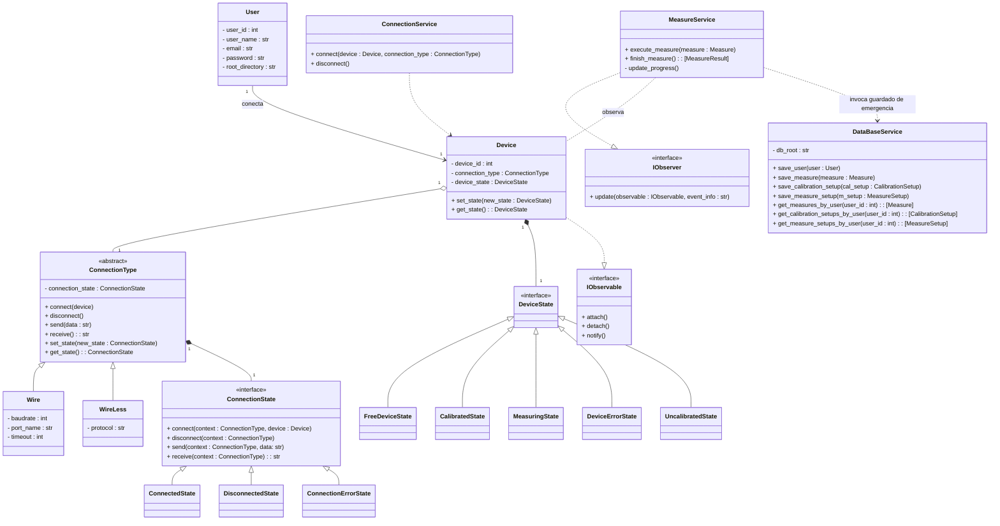


###### Módulo 2: Calibración del Dispositivo
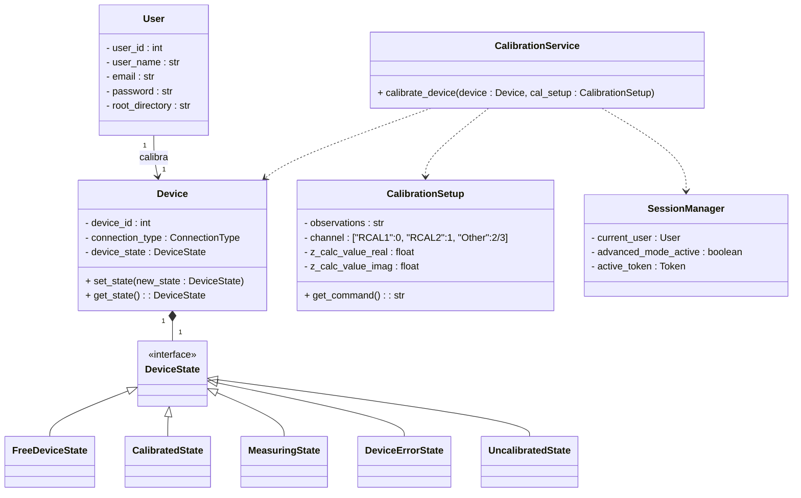

##### Subsistema 2: Configuración y Toma de Mediciones
###### Módulo 1: Tipos y Estrategias de Medición

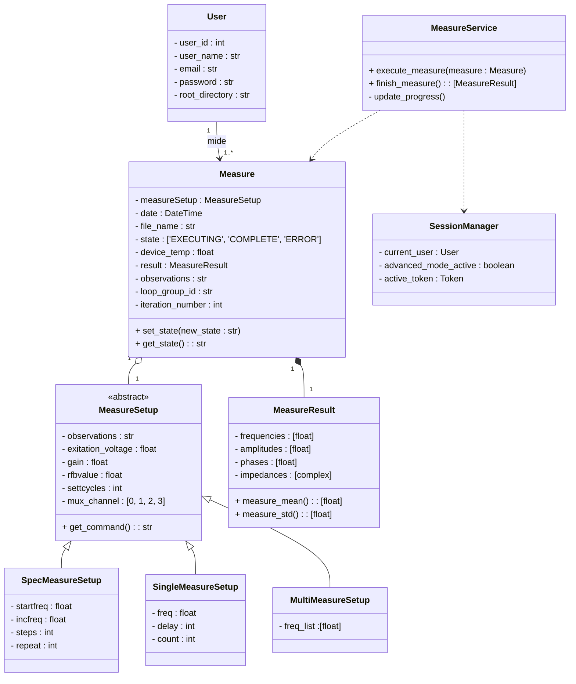
##### Subsistema 3: Configuración y Gestión de Perfiles (Setups)

###### Módulo 1: Perfiles de Usuario y Gestión de Setups de Medición
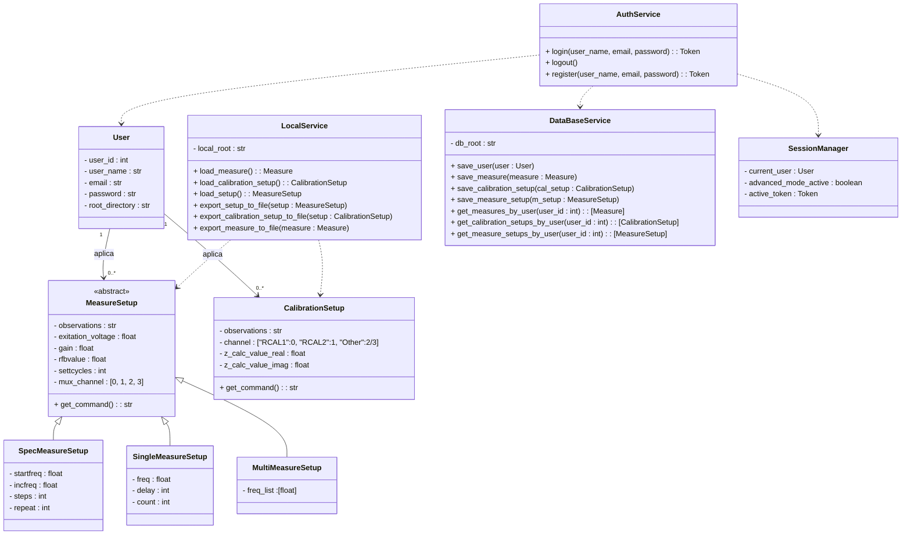

##### Subsistema 5: Persistencia

###### Módulo 1: Almacenamiento y Estructura de Datos

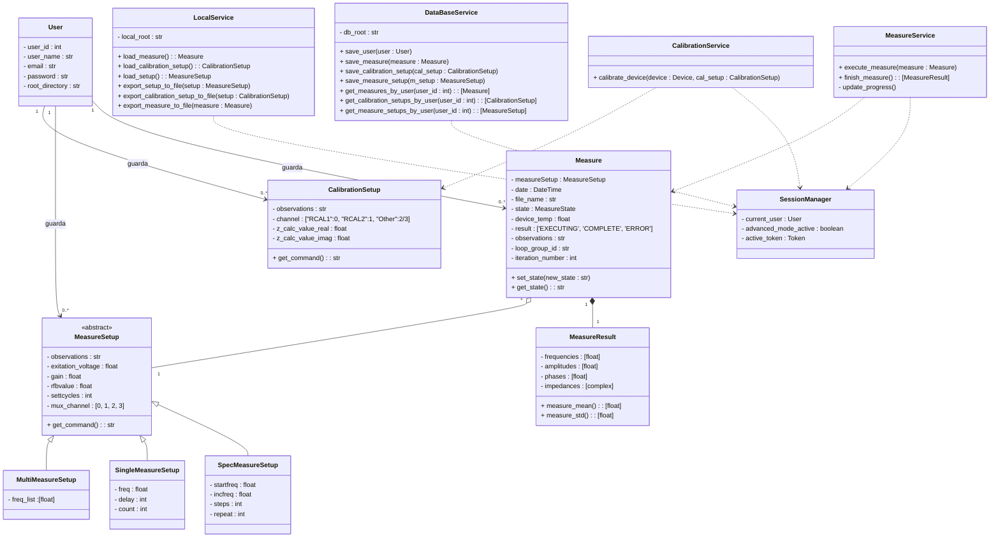


### Base de Datos

#### Convenciones Gráficas

##### Entidades, Atributos y Claves
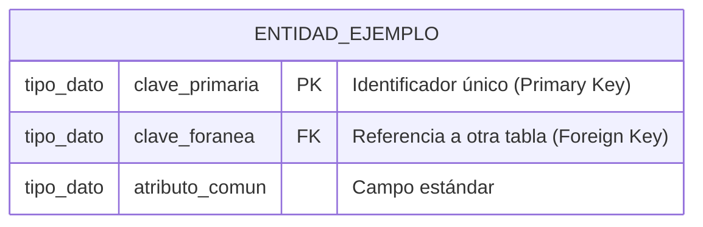

##### Cardinalidad y Multiplicidad
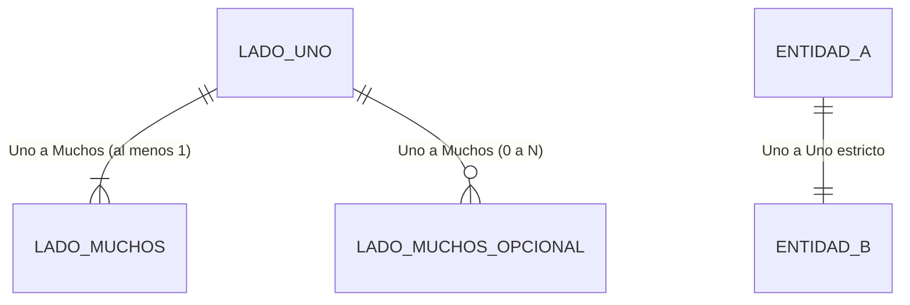

##### Representación de Herencia
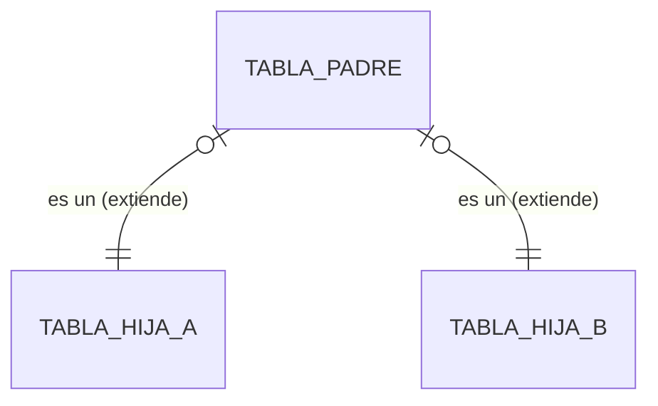

#### Diagrama de Entidad Relacion
```mermaid
erDiagram

USER{
	int user_id PK
	string email
	string user_name
	string password
	string root_directory
}

CALIBRATION_SETUP{
	int cal_setup_id PK
	int user_id FK
	string observations
	string channel
	float z_calc_value_real
	float z_calc_value_imag
}

MEASURE{
	int measure_id PK
	int user_id FK
	int measure_setup FK
	int result FK
	date date
	string file_name
	string observations
	string loop_group_id
	int iteration_number
}

MEASURE_RESULT{
	int result_id PK
	string frequencies
	string amplitudes
	string phases
	string impedances
}

MEASURE_SETUP{
	int measure_setup_id PK
	int user_id FK
	string observations
	float exitation_voltage
	float gain
	float rfbvalue
	int settcycles
	int mux_channel
}

SPEC_MEASURE_SETUP{
	int spec_ms_id PK
	int m_setup FK
	float startfreq
	int steps
	int repeat
}

SINGLE_MEASURE_SETUP{
	int single_ms_id PK
	int m_setup FK
	float freq
	int delay
	int count
}

MULTI_MEASURE_SETUP{
	int multi_ms_id PK
	int m_setup FK
	string frequencies_list
}

USER ||--o{ MEASURE : realiza

USER ||--o{ CALIBRATION_SETUP : crea

USER ||--o{ MEASURE_SETUP : configura

MEASURE ||--|| MEASURE_RESULT : arroja

MEASURE |{--|| MEASURE_SETUP : tiene

MEASURE_SETUP o|--|| SPEC_MEASURE_SETUP : es_un
MEASURE_SETUP o|--|| SINGLE_MEASURE_SETUP : es_un
MEASURE_SETUP o|--|| MULTI_MEASURE_SETUP : es_un
```


### Tabla de trazabilidad

###### Subsistema 1: Comunicación e Interacción con el Hardware

###### Módulo 1: Conectividad y Estado

| **Requisito** | Caso de uso                                          | Clase/servicio                                         | Persistencia |
| ------------- | ---------------------------------------------------- | ------------------------------------------------------ | ------------ |
| **CON-01**    | Establecer conexión alámbrica                        | ConnectionService/Wire                                 | -            |
| **CON-02**    | Establecer conexión inalámbrica                      | ConnectionService/Wireless                             | -            |
| **CON-03**    | Traducir comandos de control                         | Pendiente                                              | -            |
| **CON-04**    | Notificar visualmente el estado activo de conexión   | ConnectionService/ConnectionState/ConnectedState       | -            |
| **CON-05**    | Notificar visualmente el estado Inactivo de conexión | ConnectionService/ConnectionState/DisconnectedState    | -            |
| **CON-06**    | Notificar visualmente el estado error de conexión    | ConnectionService/ConnectionState/ConnectionErrorState | -            |
| **CON-07**    | Persistir últimos datos generados ante un error      | MeasureService/PersistenceService                      | MEASURE      |

###### Módulo 2: Calibración del Dispositivo
| **Requisito** | Caso de uso                                              | Clase/servicio                       | Persistencia |
| ------------- | -------------------------------------------------------- | ------------------------------------ | ------------ |
| **CAL-01**    | Configurar la calibración electrónica del equipo         | CalibrationService/CalibrationSetup  | -            |
| **CAL-02**    | Ejecutar calibración electrónica del equipo              | CalibrationService                   | -            |
| **CAL-03**    | Bloquear ejecución por descalibración                    | Device/DeviceState/UncalibratedState | -            |
| **CAL-04**    | Limitar la configuración de calibración al Modo Avanzado | SessionManager                       | -            |

##### Subsistema 2: Configuración y Toma de Mediciones
###### Módulo 1: Tipos y Estrategias de Medición

| **Requisito** | Caso de uso                                                | Clase/servicio                  | Persistencia  |
| ------------- | ---------------------------------------------------------- | ------------------------------- | ------------- |
| **MED-01**    | Configurar apartados comunes a una medición                | Measure                         | -             |
| **MED-02**    | Configurar medición de una frecuencia  (Monofrecuencia)    | MeasureSetup/SingleMeasureSetup | -             |
| **MED-03**    | Ejecutar medición de una frecuencia (Monofrecuencia)       | MeasureService                  | MeasureResult |
| **MED-04**    | Configurar medición por espectroscopía (Barrido espectral) | MeasureSetup/SpecMeasureSetup   | -             |
| **MED-05**    | Ejecutar medición por espectroscopía (Barrido espectral)   | MeasureService                  | MeasureResult |
| **MED-06**    | Configurar medición de multifrecuencia                     | MeasureSetup/MultiMeasureSetup  | -             |
| **MED-07**    | Ejecutar medición multifrecuencia                          | MeasureService                  | MeasureResult |
| **MED-08**    | Ejecutar mediciones en bucle                               | MeasureService                  | MeasureResult |
| **MED-11**    | Calcular estadísticos descriptivos básicos                 | Clase Pendiente                 | -             |
| **MED-13**    | Limitar configuración de mediciones al Modo Avanzado       | SessionManager                  | -             |

##### Subsistema 3: Configuración y Gestión de Perfiles (Setups)

###### Módulo 1: Perfiles de Usuario y Gestión de Setups de Medición

| **Requisito** | Caso de uso                                 | Clase/servicio     | Persistencia                    |
| ------------- | ------------------------------------------- | ------------------ | ------------------------------- |
| **SET-01**    | Crear Perfil de Usuario                     | AuthService        | USER                            |
| **SET-02**    | Iniciar Sesión                              | AuthService        | -                               |
| **SET-03**    | Cerrar Sesión                               | AuthService        | -                               |
| **SET-04**    | Habilitar Modos de Uso                      | SessionManager     | -                               |
| **SET-05**    | Habilitar Modo Avanzado                     | SessionManager     | -                               |
| **SET-06**    | Habilitar Modo Básico                       | SessionManager     | -                               |
| **SET-07**    | Cambiar entre modos de uso                  | SessionManager     | -                               |
| **SET-09**    | Aplicar configuraciones                     | PersistenceService | -                               |
| **SET-10**    | Cargar configuraciones                      | PersistenceService | CALIBRATION_SETUP/MEASURE_SETUP |
| **SET-11**    | Exportar configuraciones de medición        | PersistenceService | -                               |
| **SET-13**    | Mantener la sesión activa en el dispositivo | SessionManager     | -                               |

##### Subsistema 5: Persistencia

###### Módulo 1: Almacenamiento y Estructura de Datos

| **Requisito** | Caso de uso                                                      | Clase/servicio                                                             | Persistencia                           |
| ------------- | ---------------------------------------------------------------- | -------------------------------------------------------------------------- | -------------------------------------- |
| **PER-01**    | Almacenar setups de medición y calibración en una Base de Datos  | PersistenceService/MeasureSetup<br><br>PersistenceService/CalibrationSetup | MEASURE_SETUP<br><br>CALIBRATION_SETUP |
| **PER-02**    | Almacenar mediciones y sus resultados en una Base de Datos       | PersistenceService/Measure<br><br>PersistenceService/MeasureResult<br><br> | MEASURE<br><br>MEASURE_RESULT          |
| **PER-03**    | Configurar directorios                                           | PersistenceService                                                         | -                                      |
| **PER-04**    | Generar nomenclatura predeterminada de archivos                  | Measure                                                                    | MEASURE                                |
| **PER-05**    | Renombramiento manual de archivos                                | Measure                                                                    | MEASURE                                |
| **PER-06**    | Estructurar cabeceras de metadatos integrados                    | Mesaure                                                                    | MEASURE                                |
| **PER-07**    | Limitar el guardado de setups al Modo Avanzado                   | SessionManager                                                             | -                                      |
| **PER-08**    | Adjuntar metadatos y observaciones libres sobre mediciones       | Mesaure                                                                    | MEASURE                                |
| **PER-09**    | Adjuntar metadatos y observaciones libres sobre setups           | PersistenceService/MeasureSetup<br><br>PersistenceService/CalibrationSetup | MEASURE_SETUP<br><br>CALIBRATION_SETUP |
| **PER-10**    | Limitar la escritura de observaciones en setups al modo Avanzado | SessionManager                                                             | -                                      |

### Pantallas

#### Pantalla de Login


#### Pantalla de Registro


#### Pantalla Principal


#### Pantalla de Configuración


#### Pantalla de Mediciones y Setups de Usuario


#### Pantalla de Perfil de Usuario


## HERRAMIENTAS UTILIZADAS
### Diagrama de Arquitectura de Software

```mermaid
flowchart TD
    %% Definición de estilos
    classDef frontend fill:#2b5c8f,stroke:#1a3a5c,stroke-width:2px,color:#fff
    classDef backend fill:#278f56,stroke:#175c35,stroke-width:2px,color:#fff
    classDef database fill:#b06c13,stroke:#7a4a0c,stroke-width:2px,color:#fff
    classDef hardware fill:#666666,stroke:#333333,stroke-width:2px,color:#fff
    classDef user fill:#8c3b3b,stroke:#5c2424,stroke-width:2px,color:#fff

    Actor((Usuario\nExperto / Operador)):::user

    subgraph Entorno Cliente [PC / Notebook con Microsoft Windows]
        UI[Frontend de Escritorio\nPyQt6]:::frontend
        
        subgraph Motor Lógico Local
            API[API Orquestador\nFastAPI]:::backend
            DB[(Persistencia\nSQLite)]:::database
        end
    end

    subgraph Entorno Físico
        ESP[Hardware Guanaco Mini\nESP32]:::hardware
    end

    %% Relaciones y Flujos de Información
    Actor -->|Interactúa con| UI
    UI <-->|Peticiones HTTP / WebSockets| API
    API <-->|Lectura / Escritura SQL| DB
    API <-->|Puerto Serial USB / Bluetooth| ESP
```
