# Laboratorio de Desarrollo de Software

## Curso 2026

**Alegre, Elias Nahuel
Hegemann, Albaro Tobias
Vasquez Mamani, Juan Pablo
Vargas Da Silva, Eliam Joaquin**

## ÍNDICE

- [**INTRODUCCIÓN**](#introducción)
- **ANÁLISIS Y DISEÑO**
  - **[Análisis](#análisis)**
    - [**Especificación de Requerimientos**](#especificación-de-requerimientos)
      - [Introducción y ámbito del sistema](#introducción-y-ámbito-del-sistema)
        - Definiciones, siglas y abreviaturas
        - Referencias
      - [Descripción General](#descripción-general)
        - Funciones del producto
        - Características de los usuarios
        - Restricciones
      - [Requisitos específicos](#requisitos-específicos)
        - [Subsistema 1: Comunicación e Interacción con el Hardware](#subsistema-1-comunicación-e-interacción-con-el-Hardware)
          - Modulo 1: Conectividad y Estado
          - Modulo 2: Calibración del Dispositivo
        - [Subsistema 2: Configuración y Toma de Mediciones](#subsistema-2-configuración-y-toma-de-mediciones)
          - Modulo 1: Tipos y Estrategias de Medición
        - [Subsistema 3: Configuración y Gestión de Perfiles (Setups)](#subsistema-3-configuración-y-gestión-de-perfiles-setups)
          - Modulo 1: Perfiles de Usuario y Gestión de Setups de Medición
        - [Subsistema 4: Entorno de Ejecución y Plataforma](#subsistema-4-entorno-de-ejecución-y-plataforma)
          - Modulo 1: Compatibilidad del Sistema
        - [Subsistema 5: Persistencia](#subsistema-5-persistencia)
          - Modulo 1: Almacenamiento y Estructura de Datos
    - [**Casos de Uso**](#casos-de-uso) - Convenciones Gráficas - Diagramas de Casos de Uso - Especificación de Casos de Uso
      **[Diseño](#diseño)**
    - [**Clases Software**](#clases-software)
      - Lista de Clases
      - Diagramas de Clases
    - [**Base de Datos**](#base-de-datos)
      - Convenciones Gráficas
      - Diagrama de Entidad Relación
    - **[Diagramas de Secuencia](#diagramas-de-secuencia)**
    - [**Tabla de Trazabilidad**](#tabla-de-trazabilidad)
    - **[Pantallas](#pantallas)**
      - Pantalla de Registro
      - Pantalla Principal
      - Pantalla de Configuración
      - Pantalla de Mediciones y Setups de Usuario
      - Pantalla de Perfil de Usuario
- [**CRONOGRAMA DE TRABAJO**](#cronograma-de-trabajo)
  - Visión general
  - Cronograma por requerimientos
- [**METODOLOGÍA DE DESARROLLO**](#metodología-de-desarrollo)
  - Resumen de la metodología elegida
- [**HERRAMIENTAS UTILIZADAS**](#herramientas-utilizadas)
  - Diagrama de Arquitectura de Software
    - Diagrama de Contexto
    - Diagrama de Contenedores
    - Diagrama de Componentes
- [**SOBRE LAS ITERACIONES**](#sobre-las-iteraciones)
- [**SOBRE LOS ENTREGABLES**](#sobre-los-entregables)
  - Aplicaciones y plataformas que forman parte del sistema
  - Requerimientos técnicos para la instalación
- [**PRESENTACIÓN VISUAL PARA APROBAR EL FINAL**](#presentación-visual-para-aprobar-el-final)

## INTRODUCCIÓN

El proyecto tiene como propósito el desarrollo integral de una plataforma de software y una interfaz gráfica de usuario (GUI) para el hardware "Guanaco Mini” (GMini) desarrollado por el Laboratorio de Electrónica Aplicada y Biomedicina (LEAB) del Instituto de Desarrollo Económico e Innovación de la Universidad Nacional de Tierra del Fuego AeiAS. El cliente interesado en el desarrollo de este software es el Doctor en Ciencias Biológicas e Ingeniero Biomédico Antonio Héctor Dell’osa, el cual en este contexto es miembro del LEAB, autor de la tesis “Espectroscopía de Impedancia para la Detección Rápida de Lesiones Óseas” sobre la cual este proyecto está basado y líder del proyecto GMini. Nuestro contacto con él es mediante su correo electrónico institucional [ahdellosa@untdf.edu.ar](mailto:ahdellosa@untdf.edu.ar) .

Dicho dispositivo está diseñado para proveer una interfaz capaz de realizar mediciones de espectroscopía de impedancia eléctrica y bioimpedancia.

El GMini ofrece un alto potencial para aplicaciones en investigaciones científicas y académicas. Desde el punto de vista médico y tecnológico, la bioimpedancia resulta interesante porque permite obtener información sobre un tejido utilizando corrientes eléctricas de pequeña amplitud, sin recurrir necesariamente a técnicas de diagnóstico más complejas, costosas o que utilicen radiación ionizante.

Además, los equipos de medición pueden ser relativamente pequeños y de bajo costo, por lo que existe interés en desarrollar sistemas portátiles capaces de realizar mediciones fuera de grandes centros médicos.

Sin embargo, medir la impedancia es solamente una parte del problema. Una medición puede contener una gran cantidad de datos: diferentes frecuencias, módulo de impedancia, fase, componente real, componente imaginaria y mediciones repetidas sobre diferentes personas o condiciones.

Desde nuestra formación en Sistemas, el problema resulta especialmente interesante en la etapa posterior a la adquisición de los datos: almacenamiento, organización, procesamiento, visualización e identificación automática de patrones que puedan relacionarse con diferentes estados del tejido.

Actualmente, la comunicación a bajo nivel con la placa GMini está resuelta y documentada, sin embargo, carece de una plataforma que permita a los usuarios no especializados utilizarla. La solución provisional existente, que parte de una implementación anterior, presenta múltiples problemas estructurales, errores de ejecución y limitaciones operativas, como la incapacidad de realizar muestreos continuos prolongados (sólo es posible ser utilizada para realizar mediciones por sus propios desarrolladores o usuarios entrenados específicamente). Por lo tanto, el desarrollo de una interfaz para el nuevo dispositivo es fundamental para explotar todas las capacidades del hardware, permitiendo su uso en entornos de campo y laboratorio sin requerir que el operador posea conocimientos técnicos en electrónica o programación a bajo nivel. Esta solución permitiría que los 5 dispositivos que actualmente se encuentran sin uso puedan ser puestos en común a partir del producto de software que se propone.

El objetivo principal de nuestro proyecto es desarrollar una aplicación que controle las distintas instrucciones de la placa (de las que disponemos una lista de comandos), mejore y agregue nuevas funcionalidades, implemente las claves para la calidad de software como la robustez, mantenibilidad, usabilidad y portabilidad.

Por otro lado, la bioimpedancia se ha utilizado o investigado en distintos problemas médicos. Algunas de sus aplicaciones más conocidas son la estimación de la composición corporal, como porcentaje de grasa, masa muscular y cantidad de agua corporal, y el seguimiento de cambios en la distribución de líquidos.

También existen aplicaciones e investigaciones relacionadas con:

- detección y seguimiento de edemas o acumulaciones de líquido;
- evaluación del estado de tejidos musculares;
- análisis de cambios asociados con lesiones o alteraciones de tejidos;
- estudio de diferencias entre tejidos sanos y patológicos;
- monitoreo cardiovascular mediante técnicas como la cardiografía por impedancia;
- evaluación de tejidos pulmonares mediante Tomografía por Impedancia Eléctrica;
- investigación de alteraciones producidas por lesiones óseas, inflamación u otros cambios estructurales.

Es importante aclarar que no todas estas aplicaciones tienen el mismo grado de desarrollo clínico. Algunas están ampliamente utilizadas, mientras que otras continúan siendo objeto de investigación. Desde nuestra perspectiva, una dificultad importante aparece cuando las mediciones generan grandes cantidades de datos que deben ser interpretados.

Por ejemplo, para cada paciente pueden obtenerse decenas o cientos de valores correspondientes a diferentes frecuencias. Si además se realizan mediciones sobre diferentes zonas del cuerpo, condiciones o momentos, el volumen de información aumenta rápidamente.

El problema que nos interesa abordar puede formularse entonces de la siguiente manera:

**¿Cómo desarrollar herramientas computacionales que permitan organizar, procesar, visualizar y analizar mediciones de espectroscopía de bioimpedancia, facilitando la identificación de diferencias o patrones que puedan estar asociados con cambios en los tejidos biológicos?**

Este problema involucra aspectos propios de nuestra formación, como procesamiento de datos, programación, construcción de bases de datos, visualización de información, análisis estadístico y eventualmente utilización de algoritmos de aprendizaje automático.

Por lo tanto, nuestro objetivo no sería realizar directamente un diagnóstico médico, sino desarrollar herramientas computacionales que ayuden a transformar las mediciones eléctricas en información interpretable, que posteriormente pueda ser analizada y validada por especialistas del área biomédica.

## Análisis

### Especificación de Requerimientos

#### Introducción y ámbito del sistema

El Sistema GMini GUI es una aplicación de escritorio integrada directamente con el firmware del microcontrolador ESP32 mediante comunicación alámbrica o inalámbrica.

Su principal objetivo es permitir a los usuarios realizar funciones como:

- Tomar mediciones de espectroscopía por bioimpedancia e impedancia eléctrica con una frecuencia o un espectro de frecuencias.
- Configurar los intervalos en los que se toman las mediciones.

- Traducir y procesar los resultados arrojados por la placa.
- Permitir visualizar, modificar y exportar.
  - Configuraciones de cada medición.
  - Configuraciones de calibración.
- Visualizar desde la misma aplicación las mediciones junto con sus resultados.

- Importar y exportar mediciones junto con sus resultados.
- Almacenar en una base de datos.
  - Mediciones junto con sus resultados.
  - Configuraciones de cada medición.
  - Datos del usuario.
  - Configuraciones de calibración.
- Realizar muestreos continuos.
- Realizar labores de calibración del dispositivo.

Al reemplazar la actual comunicación mediante comandos a bajo nivel por esta interfaz gráfica, se elimina la barrera técnica, permitiendo explotar todo el potencial de la placa Guanaco Mini.
El proyecto está dirigido tanto para usuarios técnicos, investigadores y miembros de laboratorios con pocos o nulos conocimientos de programación en cualquiera de sus niveles. El sistema utilizará un perfil unificado con acceso a todas las herramientas de la plataforma, organizando la interfaz para presentar las configuraciones avanzadas mediante menús colapsables bajo el principio de revelación progresiva (_progressive disclosure_).

##### Definiciones, siglas y abreviaturas

- **Bioimpedancia**: Resistencia que oponen los tejidos biológicos (células, fluidos, bacterias, etc.) al paso de una corriente eléctrica alterna.
- **CSV (Comma-Separated Values)**: Formato de archivo de texto estructurado que representa datos tabulares separados por comas, ampliamente utilizado para la exportación y análisis de datos científicos.
- **EIS (Electrical Impedance Spectroscopy)**: Técnica de análisis no destructiva que consiste en aplicar una señal eléctrica alterna (voltaje o corriente de pequeña amplitud) a un material o tejido biológico a través de un rango de distintas frecuencias, con el fin de medir su impedancia (oposición al paso de la corriente).
- **ESP32**: Microcontrolador de bajo costo y consumo de energía que cuenta con tecnología Wi-Fi y Bluetooth de modo dual integrada, utilizado como núcleo de procesamiento del hardware original.
- **Espectroscopía (Barrido espectral / Sweep)**:Forma de medición que consiste en realizar una medición de impedancia o bioimpedancia en un determinado intervalo de frecuencias.
- **Firmware**: Software de bajo nivel que está integrado de forma permanente o semipermanente en el hardware (en este caso, el código desarrollado por el laboratorio que se ejecuta directamente sobre el ESP32).
- **GMini (Guanaco Mini)**: Dispositivo de hardware desarrollado por el laboratorio cliente, diseñado para realizar mediciones de espectroscopía.
- **GUI (Graphical User Interface)**: Interfaz Gráfica de Usuario. Entorno visual del software que permite a los operadores interactuar con el sistema y el hardware subyacente mediante elementos gráficos y ventanas, en lugar de comandos de texto.
- **ISO 8601**: Estándar internacional para la representación de fechas y horas, utilizado como formato básico para generar la nomenclatura predeterminada de los archivos guardados.
- **JSON (JavaScript Object Notation)**: Formato de texto ligero para el intercambio de datos, fácil de leer y escribir tanto para humanos como para máquinas.
- **LEAB (Laboratorio de Electrónica Aplicada y Biomedicina)**: Laboratorio perteneciente al Instituto de Desarrollo Económico e Innovación de la Universidad Nacional de Tierra del Fuego. Actúa como creador del hardware y cliente principal del proyecto de software.
- **Metadatos**: Información adicional (estado de los parámetros de configuración y observaciones libres) que se adjunta en las cabeceras de los archivos locales junto con los datos crudos de la medición.
- **Monofrecuencia**: Forma de medición que consiste en realizar la medición de impedancia o bioimpedancia a una frecuencia fija, también llamado del inglés “single frequency”.
- **Muestreo Continuo**: Proceso de recolección de datos y mediciones de manera ininterrumpida o periódica durante un rango de tiempo prolongado, gestionado automáticamente por el software.
- **Multifrecuencia**: Forma de medición que implica realizar mediciones a diferentes frecuencias fijas (diferentes mediciones monofrecuencia) que pueden tener o no intervalos equidistantes o no en el campo de la frecuencia.
- **Multiplexado (Canales / Llaves)**: Sistema de llaves (“switchs”) o conmutación que permite seleccionar diferentes canales en forma secuencial o fija.
- **Puerto Serial / Comunicación Serial**: Interfaz de transferencia de datos en la que la información se envía bit a bit de forma secuencial. Se utilizará (vía cable USB) como uno de los medios de comunicación principal entre la PC y el dispositivo.
- **Setups (Configuraciones de medición)**: Conjunto de parámetros técnicos (tipo, rango, canales) definidos y guardados localmente por un usuario, que pueden ser exportados, o bien importados y aplicados.

##### Referencias

- **Espressif Systems**: ESP32 Technical Reference Manual. Espressif Systems, Shanghái (2023). Disponible en: [https://documentation.espressif.com/esp32_datasheet_en.html?q=ESP32](https://www.espressif.com/en/support/documents/technical-documents)
- **Python Software Foundation**: Python 3 Reference Manual. Disponible en: [https://docs.python.org/3/](https://docs.python.org/3/)
- **IEEE Computer Society**: IEEE Recommended Practice for Software Requirements Specifications (IEEE Std 830-1998). IEEE, Nueva York (1998).
- **Laboratorio de Electrónica Aplicada y Biomedicina (LEAB)**: Dispositivo de medición de bioimpedancia Guanaco Mini V2.0 [Rev3]. Universidad Nacional de Tierra del Fuego, A.I.A.S. (2026).
- **The pandas development team**: pandas-dev/pandas: Pandas. Zenodo. Disponible en: [https://pandas.pydata.org/](https://pandas.pydata.org/)
- **Hunter, J. D.: Matplotlib**: A 2D graphics environment. Computing in Science & Engineering, 9(3), 90-95 (2007).

### Descripción General

##### Funciones del Producto

**Subsistema de Comunicación e Interacción con el Hardware**
Este subsistema agrupa las funciones encargadas de establecer y mantener el enlace de datos bidireccional entre la computadora y la placa ESP32, garantizando una transferencia estable.

- Establecer conexión con el entorno de escritorio mediante conexión alámbrica.
- Establecer conexión con el entorno de escritorio mediante conexión inalámbrica.

**Subsistema de Configuración y Toma de Mediciones**
Este subsistema es el encargado de agrupar aquellas funciones que permiten a los usuarios monitorear, parametrizar, calibrar y realizar mediciones de manera controlada, pudiendo determinar aspectos como rangos de frecuencia o estrategias de medición.

- Calibrar el dispositivo.
- Tomar mediciones de espectroscopía por bioimpedancia e impedancia eléctrica.
- Seleccionar una frecuencia o un espectro de frecuencias para realizar las mediciones.
- Configurar los intervalos en los que se toman las mediciones.
- Visualizar los datos desde la misma aplicación.
- Contraponer datos para realizar comparaciones.
- Realizar procesamiento de datos.

**Subsistema de Configuración y Gestión de Perfiles (Setups)**
Este subsistema es el encargado de habilitar los distintos usuarios para garantizar la seguridad entre perfiles, los datos almacenados y sus configuraciones.

**Subsistema de Entorno de Ejecución y Plataforma**
Este subsistema es el encargado de garantizar la disponibilidad del proyecto en sistemas operativos Microsoft Windows y ofrecer soporte secundario en kernels de Linux.

**Subsistema Persistencia**
Este subsistema centraliza las operaciones de persistencia del sistema, garantizando que tanto los datos estructurados como la información de los usuarios se almacenen de manera ordenada y estandarizada.

- Exportar datos.
- Importar datos.
- Organizar los datos en una carpeta definida.

- Almacenar resultados e información en una Base de Datos

##### Características de los usuarios

Los principales usuarios de la plataforma serán los miembros del LEAB, los cuales serán piezas fundamentales a lo largo del desarrollo del proyecto,abarcando desde técnicos experimentados hasta operadores

Para agilizar el flujo de trabajo, el sistema utiliza un **Perfil Unificado de Investigador**. La interfaz aplica el principio de _progressive disclosure_ (inspirada en software de grado científico): las funciones de adquisición rápida y visualización están disponibles en el área principal de trabajo, mientras que las configuraciones profundas del hardware (calibración, ajuste fino de frecuencias, ganancia, voltaje de excitación) se acceden bajo demanda mediante paneles colapsables. Esto elimina la necesidad de alternar entre modos o cuentas con distintos privilegios.

El sistema contemplara las sesiones de perfiles individuales para garantizar la organización, trazabilidad y privacidad de los _setups_, sesiones y datos recolectados por cada investigador.

##### Restricciones

El software no puede modificar el comportamiento interno del dispositivo, debe limitarse a realizar la lista de comandos y eventos ya programadas y documentadas por el LEAB.

El software está destinado para ser utilizado únicamente en la placa ESP32.

El sistema contempla únicamente dos vías de comunicación con la placa. Alámbrica e inalámbrica.

El sistema debe garantizar la funcionalidad en el sistema operativo Microsoft Windows.

El sistema deberá ser capaz de funcionar sin acceso a internet.

El sistema no busca realizar un diagnóstico médico.

## Requisitos específicos

### Subsistema 1: Comunicación e Interacción con el Hardware

#### Módulo 1: Conectividad y Estado

| **CON-01**      | Establecer conexión Alámbrica con el hardware                                                                      |
| :-------------- | :----------------------------------------------------------------------------------------------------------------- |
| **Usuarios**    | Usuario Registrado.                                                                                                |
| **Descripción** | El sistema debe permitir establecer y gestionar la comunicación con la placa ESP32, soportando conexión alámbrica. |

| **CON-02**      | Establecer conexión inalámbrica con el hardware                                                                      |
| :-------------- | :------------------------------------------------------------------------------------------------------------------- |
| **Usuarios**    | Usuario Registrado.                                                                                                  |
| **Descripción** | El sistema debe permitir establecer y gestionar la comunicación con la placa ESP32, soportando conexión inalámbrica. |

| **CON-03**      | Traducir comandos de control                                                              |
| :-------------- | :---------------------------------------------------------------------------------------- |
| **Usuarios**    | Usuario Registrado.                                                                       |
| **Descripción** | El sistema debe permitir utilizar los comandos de la placa mediante una interfaz gráfica. |

| **CON-04**      | Notificar visualmente el estado activo de conexión                                                                     |
| :-------------- | :--------------------------------------------------------------------------------------------------------------------- |
| **Usuarios**    | Usuario Registrado.                                                                                                    |
| **Descripción** | El sistema debe informar al usuario mediante indicadores visuales en la interfaz gráfica el estado activo de conexión. |

| **CON-05**      | Notificar visualmente el estado Inactivo de conexión                                                                     |
| :-------------- | :----------------------------------------------------------------------------------------------------------------------- |
| **Usuarios**    | Usuario Registrado.                                                                                                      |
| **Descripción** | El sistema debe informar al usuario mediante indicadores visuales en la interfaz gráfica el estado inactivo de conexión. |

| **CON-06**      | Notificar visualmente el estado error de conexión                                                                                                                  |
| :-------------- | :----------------------------------------------------------------------------------------------------------------------------------------------------------------- |
| **Usuarios**    | Usuario Registrado.                                                                                                                                                |
| **Descripción** | El sistema debe informar al usuario mediante indicadores visuales en la interfaz gráfica el estado de error de la comunicación con el dispositivo en todo momento. |

| **CON-07**      | Proveer consola de comandos para diagnóstico                                                                                                                                                           |
| :-------------- | :----------------------------------------------------------------------------------------------------------------------------------------------------------------------------------------------------- |
| **Usuarios**    | Usuario Registrado.                                                                                                                                                                                    |
| **Descripción** | El sistema debe proveer una interfaz de consola (CLI) que permita al usuario enviar comandos en texto plano directamente a la placa y visualizar sus respuestas crudas para propósitos de diagnóstico. |

| **CON-08**      | Intentar reconexión automática                                                                                                                           |
| :-------------- | :------------------------------------------------------------------------------------------------------------------------------------------------------- |
| **Usuarios**    | Usuario Registrado.                                                                                                                                      |
| **Descripción** | El sistema debe ejecutar un mecanismo de contingencia para intentar recuperar automáticamente la comunicación si esta se interrumpe de forma inesperada. |

#### Módulo 2: Calibración del Dispositivo

| **CAL-01**      | Configurar la calibración electrónica del equipo                                            |
| :-------------- | :------------------------------------------------------------------------------------------ |
| **Usuarios**    | Usuario Registrado.                                                                         |
| **Descripción** | El sistema debe permitir parametrizar la secuencia de comandos de calibración del hardware. |

| **CAL-02**      | Ejecutar calibración electrónica del equipo                                            |
| :-------------- | :------------------------------------------------------------------------------------- |
| **Usuarios**    | Usuario Registrado.                                                                    |
| **Descripción** | El sistema debe permitir iniciar la secuencia de comandos de calibración del hardware. |

| **CAL-03**      | Bloquear ejecución por descalibración                                                                                                                                                                             |
| :-------------- | :---------------------------------------------------------------------------------------------------------------------------------------------------------------------------------------------------------------- |
| **Usuarios**    | Usuario Registrado.                                                                                                                                                                                               |
| **Descripción** | El sistema debe impedir el inicio de nuevas mediciones si detecta que los parámetros críticos del hardware (ganancia, voltaje o resistencia) han sido modificados sin registrar una calibración válida posterior. |

| **CAL-04**      | Configurar apartados comunes a una medición                                                                                                                                |
| :-------------- | :------------------------------------------------------------------------------------------------------------------------------------------------------------------------- |
| **Usuarios**    | Usuario Registrado.                                                                                                                                                        |
| **Descripción** | El sistema debe permitir establecer los apartados comunes a todos los tipos de medición (voltaje de excitación, ganancia, ciclos, canales de multiplexado y valor de rfb). |

| **CAL-05**      | Proveer recalibración automática                                                                                                                 |
| :-------------- | :----------------------------------------------------------------------------------------------------------------------------------------------- |
| **Usuarios**    | Usuario Registrado.                                                                                                                              |
| **Descripción** | El sistema debe ofrecer o disparar automáticamente una nueva secuencia de calibración cuando se modifiquen parámetros que invaliden la anterior. |

### Subsistema 2: Configuración y Toma de Mediciones

#### Módulo 1: Tipos y Estrategias de Medición

| **MED-01**      | Configurar medición de una frecuencia (Monofrecuencia)                                                                         |
| :-------------- | :----------------------------------------------------------------------------------------------------------------------------- |
| **Usuarios**    | Usuario Registrado.                                                                                                            |
| **Descripción** | El sistema debe permitir elegir los parámetros de medición para mediciones continuas a una única frecuencia fija seleccionada. |

| **MED-02**      | Ejecutar medición de una frecuencia (Monofrecuencia)                                             |
| :-------------- | :----------------------------------------------------------------------------------------------- |
| **Usuarios**    | Usuario Registrado.                                                                              |
| **Descripción** | El sistema debe permitir ejecutar mediciones continuas a una única frecuencia fija seleccionada. |

| **MED-03**      | Configurar medición por espectroscopía (Barrido espectral)                                                                                                                                      |
| :-------------- | :---------------------------------------------------------------------------------------------------------------------------------------------------------------------------------------------- |
| **Usuarios**    | Usuario Registrado.                                                                                                                                                                             |
| **Descripción** | El sistema debe permitir elegir los parámetros de medición para realizar una medición secuencial a intervalos fijos de frecuencias establecidas en el espectro frecuencial (sweep) determinado. |

| **MED-04**      | Ejecutar medición por espectroscopía (Barrido espectral)                                                                                                 |
| :-------------- | :------------------------------------------------------------------------------------------------------------------------------------------------------- |
| **Usuarios**    | Usuario Registrado.                                                                                                                                      |
| **Descripción** | El sistema debe permitir ejecutar una medición secuencial a intervalos fijos de frecuencias establecidas en el espectro frecuencial (sweep) determinado. |

| **MED-05**      | Configurar medición de multifrecuencia                                                                               |
| :-------------- | :------------------------------------------------------------------------------------------------------------------- |
| **Usuarios**    | Usuario Registrado.                                                                                                  |
| **Descripción** | El sistema debe permitir elegir los parámetros de medición para una cantidad de frecuencias discretas y específicas. |

| **MED-06**      | Ejecutar medición multifrecuencia                                                                                         |
| :-------------- | :------------------------------------------------------------------------------------------------------------------------ |
| **Usuarios**    | Usuario Registrado.                                                                                                       |
| **Descripción** | El sistema permite ejecutar una cantidad de mediciones a las mismas frecuencias discretas y especificadas por el usuario. |

| **MED-07**      | Ejecutar mediciones en bucle                                                               |
| :-------------- | :----------------------------------------------------------------------------------------- |
| **Usuarios**    | Usuario Registrado.                                                                        |
| **Descripción** | El sistema debe permitir ejecutar mediciones continuas del mismo tipo a través del tiempo. |

| **MED-08**      | Mostrar progreso de la medición                                                                                                                     |
| :-------------- | :-------------------------------------------------------------------------------------------------------------------------------------------------- |
| **Usuarios**    | Usuario Registrado.                                                                                                                                 |
| **Descripción** | El sistema debe proporcionar una indicación visual en pantalla que informe al usuario que un proceso de medición se encuentra actualmente en curso. |

| **MED-09**      | Persistir últimos datos generados ante un error                                                                                               |
| :-------------- | :-------------------------------------------------------------------------------------------------------------------------------------------- |
| **Usuarios**    | Usuario Registrado.                                                                                                                           |
| **Descripción** | El sistema debe guardar automáticamente los últimos datos recolectados ante una pérdida repentina de señal durante el proceso de adquisición. |

| **MED-10**      | Seleccionar canal de medición y patrones físicos                                                                                                                                                  |
| :-------------- | :------------------------------------------------------------------------------------------------------------------------------------------------------------------------------------------------ |
| **Usuarios**    | Usuario Registrado.                                                                                                                                                                               |
| **Descripción** | El sistema debe permitir alternar entre los canales DUT1 y DUT2 para realizar mediciones, y elegir entre patrones de calibración internos o el ingreso manual de un valor de resistencia externa. |

| **MED-11**      | Detener mediciones en curso                                                                                                        |
| :-------------- | :--------------------------------------------------------------------------------------------------------------------------------- |
| **Usuarios**    | Usuario Registrado.                                                                                                                |
| **Descripción** | El sistema debe proveer una opción para solicitar el fin o cancelación segura de una adquisición que ya se encuentra en ejecución. |

| **MED-12**      | Mostrar estimación de tiempo de adquisición                                                                                             |
| :-------------- | :-------------------------------------------------------------------------------------------------------------------------------------- |
| **Usuarios**    | Usuario Registrado.                                                                                                                     |
| **Descripción** | El sistema debe calcular y mostrar de manera dinámica una estimación del tiempo restante para completar la medición o secuencia actual. |

| **MED-13**      | Construir secuencias experimentales automáticas                                                                                                       |
| :-------------- | :---------------------------------------------------------------------------------------------------------------------------------------------------- |
| **Usuarios**    | Usuario Registrado.                                                                                                                                   |
| **Descripción** | El sistema debe proveer un editor visual para construir flujos automáticos (macros) que combinen diferentes métodos de medición de forma consecutiva. |

| **MED-14**      | Configurar repeticiones e intervalos en secuencias                                                                                                          |
| :-------------- | :---------------------------------------------------------------------------------------------------------------------------------------------------------- |
| **Usuarios**    | Usuario Registrado.                                                                                                                                         |
| **Descripción** | El sistema debe permitir definir la cantidad de repeticiones de un método y establecer tiempos de pausa (delays) entre mediciones o etapas de la secuencia. |

| **MED-14**      | Mostrar resultados intermedios                                                                                                 |
| :-------------- | :----------------------------------------------------------------------------------------------------------------------------- |
| **Usuarios**    | Usuario Registrado.                                                                                                            |
| **Descripción** | El sistema debe proporcionar en pantalla los datos de mediciones intermedias realizadas durante procesos de medición ciclicos. |

#### Módulo 2: Graficos y Estadisticos

| **GYE-01**      | Renderizar gráficas a partir de los resultados                                                                   |
| :-------------- | :--------------------------------------------------------------------------------------------------------------- |
| **Usuarios**    | Usuario Registrado.                                                                                              |
| **Descripción** | El sistema debe ser capaz de generar gráficos utilizando los resultados obtenidos y los parámetros establecidos. |

| **GYE-02**      | Calcular estadística descriptiva temporal y espectral                                                                                                 |
| :-------------- | :---------------------------------------------------------------------------------------------------------------------------------------------------- |
| **Usuarios**    | Usuario Registrado.                                                                                                                                   |
| **Descripción** | El sistema debe calcular y mostrar promedios y desviaciones estándar sobre mediciones repetidas en el tiempo o en múltiples espectros de frecuencias. |

| **GYE-03**      | Ajustar modelos físicos de impedancia                                                                                                                    |
| :-------------- | :------------------------------------------------------------------------------------------------------------------------------------------------------- |
| **Usuarios**    | Usuario Registrado.                                                                                                                                      |
| **Descripción** | El sistema debe permitir estimar y ajustar parámetros matemáticos para modelos físicos predefinidos, como Debye o Cole-Cole, sobre los datos adquiridos. |

### Subsistema 3: Configuración y Gestión de Perfiles (Setups)

#### Módulo 1: Perfiles de Usuario y Gestión de Setups de Medición

| **SET-01**      | Inicializar entorno de trabajo                                                         |
| :-------------- | -------------------------------------------------------------------------------------- |
| **Usuarios**    | Usuario.                                                                               |
| **Descripción** | El usuario debe poder ingresar a la aplicación y recuperar la sesión activa si existe. |

| **SET-02**      | Crear Perfil de Usuario                             |
| :-------------- | --------------------------------------------------- |
| **Usuarios**    | Usuario.                                            |
| **Descripción** | El sistema debe permitir crear perfiles de usuario. |

| **SET-03**      | Solicitar al usuario que inicie sesión luego de registrarse                                                     |
| :-------------- | --------------------------------------------------------------------------------------------------------------- |
| **Usuarios**    | Usuario Registrado.                                                                                             |
| **Descripción** | El sistema debe volver a solicitar los datos de inicio de sesión al usuario una vez este haya creado su perfil. |

| **SET-04**      | Iniciar Sesión                                          |
| :-------------- | ------------------------------------------------------- |
| **Usuarios**    | Usuario Registrado.                                     |
| **Descripción** | El sistema debe permitir a los usuarios iniciar sesión. |

| **SET-05**      | Cerrar Sesión                                          |
| :-------------- | ------------------------------------------------------ |
| **Usuarios**    | Usuario Registrado.                                    |
| **Descripción** | El sistema debe permitir a los usuarios cerrar sesión. |

| **SET-06**      | Aplicar configuraciones                                                                 |
| :-------------- | --------------------------------------------------------------------------------------- |
| **Usuarios**    | Usuario Registrado.                                                                     |
| **Descripción** | El sistema debe permitir al usuario seleccionar una configuración previamente guardada. |

| **SET-07**      | Importar configuraciones de medición                                                                                                     |
| :-------------- | ---------------------------------------------------------------------------------------------------------------------------------------- |
| **Usuarios**    | Usuario Registrado.                                                                                                                      |
| **Descripción** | El sistema debe permitir al usuario importar configuraciones de medición desde el almacenamiento local y guardarlos en la base de datos. |

| **SET-08**      | Exportar configuraciones de medición                                                                                                  |
| :-------------- | ------------------------------------------------------------------------------------------------------------------------------------- |
| **Usuarios**    | Usuario Registrado.                                                                                                                   |
| **Descripción** | El sistema debe permitir al usuario exportar las configuraciones de medición guardadas en la base de datos a su almacenamiento local. |

| **SET-09**      | Importar configuraciones de calibración                                                                                                     |
| :-------------- | ------------------------------------------------------------------------------------------------------------------------------------------- |
| **Usuarios**    | Usuario Registrado.                                                                                                                         |
| **Descripción** | El sistema debe permitir al usuario importar configuraciones de calibración desde el almacenamiento local y guardarlos en la base de datos. |

| **SET-10**      | Exportar configuraciones de calibración                                                                                                  |
| :-------------- | ---------------------------------------------------------------------------------------------------------------------------------------- |
| **Usuarios**    | Usuario Registrado.                                                                                                                      |
| **Descripción** | El sistema debe permitir al usuario exportar las configuraciones de calibración guardadas en la base de datos a su almacenamiento local. |

| **SET-11**      | Importar mediciones                                                                                                     |
| :-------------- | ----------------------------------------------------------------------------------------------------------------------- |
| **Usuarios**    | Usuario Registrado.                                                                                                     |
| **Descripción** | El sistema debe permitir al usuario importar mediciones desde el almacenamiento local y guardarlos en la base de datos. |

| **SET-12**      | Exportar mediciones                                                                                                  |
| :-------------- | -------------------------------------------------------------------------------------------------------------------- |
| **Usuarios**    | Usuario Registrado.                                                                                                  |
| **Descripción** | El sistema debe permitir al usuario exportar las mediciones guardadas en la base de datos a su almacenamiento local. |

| **SET-13**      | Exportar gráficas generadas                                                                     |
| :-------------- | ----------------------------------------------------------------------------------------------- |
| **Usuarios**    | Usuario Registrado.                                                                             |
| **Descripción** | El sistema debe permitir a los usuarios exportar las gráficas generadas en una carpeta definida |

| **SET-14**      | Visualizar datos guardados                                                                                                         |
| :-------------- | ---------------------------------------------------------------------------------------------------------------------------------- |
| **Usuarios**    | Usuario Registrado.                                                                                                                |
| **Descripción** | El sistema debe permitir visualizar datos (mediciones realizadas, gráficas y setups) anteriores aunque la placa no esté conectada. |

| **SET-15**      | Mantener la sesión activa en el dispositivo                                                 |
| :-------------- | ------------------------------------------------------------------------------------------- |
| **Usuarios**    | Usuario Registrado.                                                                         |
| **Descripción** | El sistema debe mantener la sesión del usuario activa aunque se haya cerrado la aplicación. |

| **SET-16**      | Crear nueva sesión experimental                                                                                                                                          |
| :-------------- | :----------------------------------------------------------------------------------------------------------------------------------------------------------------------- |
| **Usuarios**    | Usuario Registrado.                                                                                                                                                      |
| **Descripción** | El sistema debe permitir al usuario crear una nueva sesión de trabajo para agrupar y organizar lógicamente un conjunto de mediciones, curvas, configuraciones y modelos. |

| **SET-17**      | Renombrar sesión experimental                                                                                                                            |
| :-------------- | :------------------------------------------------------------------------------------------------------------------------------------------------------- |
| **Usuarios**    | Usuario Registrado.                                                                                                                                      |
| **Descripción** | El sistema debe permitir modificar el nombre y la descripción de una sesión existente para facilitar su identificación en el historial del investigador. |

| **SET-18**      | Seleccionar y cargar sesión experimental                                                                                                                            |
| :-------------- | :------------------------------------------------------------------------------------------------------------------------------------------------------------------ |
| **Usuarios**    | Usuario Registrado.                                                                                                                                                 |
| **Descripción** | El sistema debe proveer una interfaz o explorador para seleccionar y cargar una sesión histórica en el Workspace, restaurando todos sus datos y gráficos asociados. |

| **SET-19**      | Exportar secuencias automáticas                                                                                                        |
| :-------------- | :------------------------------------------------------------------------------------------------------------------------------------- |
| **Usuarios**    | Usuario Registrado.                                                                                                                    |
| **Descripción** | El sistema debe permitir al usuario exportar y guardar las secuencias de automatización en archivos dentro de su almacenamiento local. |

| **SET-20**      | Importar secuencias automáticas                                                                                                 |
| :-------------- | :------------------------------------------------------------------------------------------------------------------------------ |
| **Usuarios**    | Usuario Registrado.                                                                                                             |
| **Descripción** | El sistema debe permitir al usuario cargar secuencias de automatización previamente configuradas desde su almacenamiento local. |


#### Módulo 2: Análisis y Visualización (Workspace)

| **AYV-01**      | Renderizar gráficos específicos avanzados                                                                                                       |
| :-------------- | :---------------------------------------------------------------------------------------------------------------------------------------------- |
| **Usuarios**    | Usuario Registrado.                                                                                                                             |
| **Descripción** | El sistema debe generar y visualizar gráficos temporales, diagramas de Bode (módulo/fase vs. frecuencia) y diagramas de Cole-Cole (-Im vs. Re). |

| **AYV-02**      | Proveer herramientas de interacción gráfica                                                                                              |
| :-------------- | :--------------------------------------------------------------------------------------------------------------------------------------- |
| **Usuarios**    | Usuario Registrado.                                                                                                                      |
| **Descripción** | El sistema debe permitir realizar zoom interactivo, paneo (desplazamiento libre) y utilizar cursores para consultar coordenadas exactas. |

| **AYV-03**      | Gestionar curvas de medición individuales                                                                                                              |
| :-------------- | :----------------------------------------------------------------------------------------------------------------------------------------------------- |
| **Usuarios**    | Usuario Registrado.                                                                                                                                    |
| **Descripción** | El sistema debe permitir superponer, ocultar, renombrar y asignar colores o estilos de línea diferentes a múltiples curvas dentro de un mismo gráfico. |

| **AYV-04**      | Visualizar datos en formato tabular                                                                                                                                       |
| :-------------- | :------------------------------------------------------------------------------------------------------------------------------------------------------------------------ |
| **Usuarios**    | Usuario Registrado.                                                                                                                                                       |
| **Descripción** | El sistema debe presentar los resultados numéricos adquiridos en una tabla estructurada, mostrando variables como frecuencia, módulo, fase, componente real e imaginaria. |

| **AYV-05**      | Manipular datos en tabla interactiva                                                                                                                                      |
| :-------------- | :------------------------------------------------------------------------------------------------------------------------------------------------------------------------ |
| **Usuarios**    | Usuario Registrado.                                                                                                                                                       |
| **Descripción** | El sistema debe permitir interactuar con la tabla de resultados mediante ordenamiento por columnas, filtrado condicional y la capacidad de copiar celdas al portapapeles. |

| **AYV-06**      | Vincular selección entre tabla y gráfico                                                                                                       |
| :-------------- | :--------------------------------------------------------------------------------------------------------------------------------------------- |
| **Usuarios**    | Usuario Registrado.                                                                                                                            |
| **Descripción** | El sistema debe resaltar automáticamente en la gráfica el punto o la curva que el usuario haya seleccionado en la tabla de datos, y viceversa. |

| **AYV-07**      | Calcular estadísticos descriptivos básicos                                                                                |
| :-------------- | :------------------------------------------------------------------------------------------------------------------------ |
| **Usuarios**    | Usuario Registrado.                                                                                                       |
| **Descripción** | El sistema debe ser capaz de calcular estadísticos descriptivos a partir de los datos crudos obtenidos en las mediciones. |

| **AYV-08**      | Presentar estadísticos descriptivos básicos                                                                |
| :-------------- | :--------------------------------------------------------------------------------------------------------- |
| **Usuarios**    | Usuario Registrado.                                                                                        |
| **Descripción** | El sistema debe ser capaz de presentar métricas estadísticas básicas a partir de los resultados obtenidos. |

### Subsistema 4: Entorno de Ejecución y Plataforma

#### Módulo 1: Compatibilidad del Sistema

| **COM-01**      | Proveer entorno de aplicación de escritorio                                                                                                            |
| :-------------- | ------------------------------------------------------------------------------------------------------------------------------------------------------ |
| **Usuarios**    | Usuario Registrado.                                                                                                                                    |
| **Descripción** | El software debe ser diseñado, compilado y distribuido como una aplicación de escritorio orientada a computadoras personales y portátiles (notebooks). |

| **COM-02**      | Garantizar ejecución nativa en Microsoft Windows                                                                                                                                          |
| :-------------- | ----------------------------------------------------------------------------------------------------------------------------------------------------------------------------------------- |
| **Usuarios**    | Usuario Registrado.                                                                                                                                                                       |
| **Descripción** | El sistema debe garantizar total compatibilidad, estabilidad y funcionalidad de todos sus módulos (especialmente la comunicación de puertos) bajo el sistema operativo Microsoft Windows. |

| **COM-03**      | Proveer soporte secundario para entornos Linux                                                                                                                |
| :-------------- | ------------------------------------------------------------------------------------------------------------------------------------------------------------- |
| **Usuarios**    | Usuario Registrado.                                                                                                                                           |
| **Descripción** | El sistema debe contemplar en su arquitectura la portabilidad necesaria para poder ser ejecutado en distribuciones de escritorio del sistema operativo Linux. |

| **COM-04**      | Garantizar el funcionamiento sin conexión a internet                                                   |
| :-------------- | ------------------------------------------------------------------------------------------------------ |
| **Usuarios**    | Usuario Registrado.                                                                                    |
| **Descripción** | El sistema debe ser capaz de funcionar de manera completa aunque no se establezca conexión a internet. |

#### Módulo 2: Interfaz y Trazabilidad

| **IZT-01**      | Mantener registro de eventos (Logs)                                                                                                                                     |
| :-------------- | :---------------------------------------------------------------------------------------------------------------------------------------------------------------------- |
| **Usuarios**    | Usuario Registrado.                                                                                                                                                     |
| **Descripción** | El sistema debe registrar y mostrar al usuario los eventos críticos de la sesión, incluyendo inicios de adquisición, interrupciones, errores y finalizaciones exitosas. |

| **IZT-02**      | Personalizar y modularizar espacios de trabajo (Workspace)                                                                                                  |
| :-------------- | :---------------------------------------------------------------------------------------------------------------------------------------------------------- |
| **Usuarios**    | Usuario Registrado.                                                                                                                                         |
| **Descripción** | El sistema debe permitir redimensionar, mover y ocultar los paneles visuales, y almacenar dicha configuración como una preferencia persistente del usuario. |

### Subsistema 5: Persistencia

#### Módulo 1: Almacenamiento y Estructura de Datos

| **PER-01**      | Almacenar setups de medición y calibración en una Base de Datos                                                                             |
| :-------------- | ------------------------------------------------------------------------------------------------------------------------------------------- |
| **Usuarios**    | Usuario Registrado.                                                                                                                         |
| **Descripción** | El sistema debe guardar todos las configuraciones de calibración y medición establecidas por el usuario en en una base de datos relacional. |

| **PER-02**      | Almacenar mediciones y sus resultados en una Base de Datos                                                                      |
| :-------------- | ------------------------------------------------------------------------------------------------------------------------------- |
| **Usuarios**    | Usuario Registrado.                                                                                                             |
| **Descripción** | El sistema debe guardar todas las mediciones completadas junto con sus resultados directamente en una base de datos relacional. |

| **PER-03**      | Configurar directorios                                                                                                |
| :-------------- | --------------------------------------------------------------------------------------------------------------------- |
| **Usuarios**    | Usuario Registrado.                                                                                                   |
| **Descripción** | El sistema debe permitir al usuario seleccionar un directorio raíz específico para el almacenamiento de sus campañas. |

| **PER-04**      | Generar nomenclatura predeterminada de archivos                                                                                                              |
| :-------------- | ------------------------------------------------------------------------------------------------------------------------------------------------------------ |
| **Usuarios**    | Usuario Registrado.                                                                                                                                          |
| **Descripción** | El sistema debe asignar automáticamente a cada archivo de salida un nombre basado en la fecha y hora de la medición, utilizando el estándar ISO 8601 básico. |

| **PER-05**      | Renombramiento manual de archivos                                                                             |
| :-------------- | ------------------------------------------------------------------------------------------------------------- |
| **Usuarios**    | Usuario Registrado.                                                                                           |
| **Descripción** | El sistema debe permitir al usuario sobrescribir el nombre automático del archivo antes de su guardado final. |

| **PER-06**      | Estructurar cabeceras de metadatos integrados                                                                                                                                                                                |
| :-------------- | ---------------------------------------------------------------------------------------------------------------------------------------------------------------------------------------------------------------------------- |
| **Usuarios**    | Usuario Registrado.                                                                                                                                                                                                          |
| **Descripción** | El sistema debe incluir en el archivo final exportado tanto los datos duros de la medición, como una cabecera que contenga el estado exacto de todos los parámetros de configuración utilizados y el texto de observaciones. |

| **PER-07**      | Adjuntar metadatos y observaciones libres sobre mediciones                                                                                                                                              |
| :-------------- | ------------------------------------------------------------------------------------------------------------------------------------------------------------------------------------------------------- |
| **Usuarios**    | Usuario Registrado.                                                                                                                                                                                     |
| **Descripción** | El sistema debe proveer un campo de entrada de texto libre para documentar observaciones contextuales sobre el objeto o tejido medido, vinculando este texto al paquete de datos final de una medición. |

| **PER-08**      | Adjuntar metadatos y observaciones libres sobre setups                                                                                                                                                                                           |
| :-------------- | ------------------------------------------------------------------------------------------------------------------------------------------------------------------------------------------------------------------------------------------------ |
| **Usuarios**    | Usuario Registrado.                                                                                                                                                                                                                              |
| **Descripción** | El sistema debe proveer un campo de entrada de texto libre para documentar observaciones contextuales sobre las configuraciones establecidas en un setup (de calibración o medición), vinculando este texto al paquete de datos final del mismo. |

| **PER-09**      | Autoguardar y recuperar sesiones experimentales                                                                                                                          |
| :-------------- | :----------------------------------------------------------------------------------------------------------------------------------------------------------------------- |
| **Usuarios**    | Usuario Registrado.                                                                                                                                                      |
| **Descripción** | El sistema debe realizar un guardado periódico o temporal del estado de la sesión para evitar pérdida de datos y ofrecer su recuperación tras un fallo de la aplicación. |

| **PER-10**      | Importar mediciones de hardware legacy                                                                                                               |
| :-------------- | :--------------------------------------------------------------------------------------------------------------------------------------------------- |
| **Usuarios**    | Usuario Registrado.                                                                                                                                  |
| **Descripción** | El sistema debe poder interpretar, importar y visualizar datos provenientes de versiones anteriores del instrumento Guanaco y de la placa AD5933EBZ. |

### Casos de Uso

#### Convenciones gráficas

##### Actores

```mermaid
usecase-beta
actor actor_generico("actor")
```

##### Casos de Uso

```mermaid
usecase-beta
CU("Caso de Uso")
```

##### Asignaciones

```mermaid
usecase-beta
actor actor_generico("Actor")
CU("Caso de Uso")

actor_generico --> CU
```

##### Generalización

```mermaid
usecase-beta
CU1("Caso de Uso Base")
CU2("Caso de Uso Hijo")
CU2 --hereda--> CU1
```

##### Limites del Subsistema

```mermaid
usecase-beta
actor actor_generico("Actor")

systemBoundary "Subsistema"
	CU("Caso de Uso")
end

actor_generico --> CU
```

##### Extensiones e Inclusiones

```mermaid
usecase-beta
systemBoundary "Subsistema"
	CU1("Caso de Uso Base")
	CU2("Caso de Uso Extensión")
	CU3("Caso de Uso Inclusión")
end

CU2 --extend--> CU1
CU1 --include--> CU3
```

### Diagramas de Casos de Uso

#### Subsistema 1: Comunicación e Interacción con el Hardware

##### Módulo 1: Conectividad y Estado

```mermaid
usecase-beta

actor user("Usuario Registrado")


systemBoundary "Conectividad y Estado"
	CU1("Establecer Conexión con el Dispositivo")
	CU2("Establecer Conexión Inalámbrica")
	CU3("Establecer Conexión Alámbrica")
	CU4("Visualizar Estado de Conexión")
	CU5("Enviar comandos por consola de diagnóstico")
end

user --> CU1
user --> CU4
user --> CU5

CU2 --hereda--> CU1
CU3 --hereda--> CU1
```


##### Módulo 2: Calibración del Dispositivo

```mermaid
usecase-beta
%% Actores
actor user("Usuario Registrado")

systemBoundary "Calibración del Dispositivo"
	CU5("Configurar la Calibración Electrónica")
	CU6("Ejecutar Calibración Electrónica")
	CU_D1("Seleccionar canal y patrones físicos")
	CU_D6("Ejecutar recalibración automática")
end

%% Asociación
user --> CU5
user --> CU6
user --> CU_D1

%% Relaciones Extend
CU_D6 --extend--> CU6
```

#### Subsistema 2: Configuración y Toma de Mediciones

##### Módulo 1: Tipos y Estrategias de Medición

```mermaid
usecase-beta
%% Actores
actor user("Usuario Registrado")

systemBoundary "Configuración y Toma de Mediciones"
	CU7("Configurar medición")
	CU8("Configurar medición de monofrecuencia")
	CU9("Configurar medición de multifrecuencia")
	CU10("Configurar medición de espectroscopía")
	CU11("Ejecutar medición")
	CU12("Ejecutar medición de monofrecuencia")
	CU13("Ejecutar medición de multifrecuencia")
	CU14("Ejecutar medición de espectroscopía")
	CU15("Visualizar Progreso y Tiempo de medición")
	CU19("Visualizar resultados intermedios")
	CU_D2("Cancelar medición en curso")

	%% Casos de Uso de Automatización incorporados
	CU_A1("Configurar secuencia de automatización")
	CU_A4("Ejecutar secuencia de automatización")
end

%% Generalización
CU8 --hereda--> CU7
CU9 --hereda--> CU7
CU10 --hereda--> CU7
CU12 --hereda--> CU11
CU13 --hereda--> CU11
CU14 --hereda--> CU11

%% Asociaciones
user --> CU7
user --> CU11
user --> CU_A1
user --> CU_A4

%% Relaciones Include/Extend
CU11 --include--> CU15
CU11 --include--> CU19
CU_D2 --extend--> CU11
CU_A4 --include--> CU11
```

#### Subsistema 3: Configuración y Gestión de Perfiles (Setups)

##### Módulo 1: Perfiles de Usuario y Gestión de Setups de Medición

```mermaid
usecase-beta
%% Actores
actor user("Usuario Registrado")

systemBoundary "Perfiles de Usuario y Gestión de Sesiones"
	CU20("Inicializar entorno de trabajo")
	CU21("Crear Perfil de Usuario")
	CU22("Iniciar sesión")
	CU24("Cerrar sesión")
	CU26("Aplicar configuraciones")
	CU29("Importar Configuraciones")
	CU30("Exportar Configuraciones")
	CU31("Importar Mediciones")
	CU32("Exportar Mediciones")
	CU33("Visualizar datos guardados")
	CU34("Exportar gráficas generadas")
	CU_B7("Crear nueva sesión experimental")
	CU_B8("Importar sesión experimental")
	CU_B9("Cargar sesión experimental")
	CU_B10("Renombrar sesión experimental")
	CU_A2("Exportar secuencia de automatización")
	CU_A3("Importar secuencia de automatización")
end

%% Asociaciones
user --> CU20
user --> CU21
user --> CU22
user --> CU24
user --> CU26
user --> CU29
user --> CU31
user --> CU30
user --> CU32
user --> CU34
user --> CU33
user --> CU_B7
user --> CU_B8
user --> CU_B9
user --> CU_B10
user --> CU_A2
user --> CU_A3

```

##### Módulo 2: Análisis y Visualización (Workspace)

```mermaid
usecase-beta
%% Actores
actor user("Usuario Registrado")

systemBoundary "Análisis y Visualización"
	CU_B1("Manipular curvas de medición")
	CU_B2("Navegar en gráficos de espectroscopía")
	CU_B3("Visualizar datos en formato tabular")
	CU_B4("Manipular datos en tabla interactiva")
	CU_B6("Calcular estadística descriptiva")
	CU_C1("Aplicar ajuste de modelo matemático")
	CU_C2("Configurar modelo de circuito equivalente predefinido")
end

%% Asociaciones
user --> CU_B1
user --> CU_B2
user --> CU_B3
user --> CU_B4
user --> CU_B6
user --> CU_C1
user --> CU_C2
```

#### Subsistema 4: Entorno de Ejecución y Plataforma

##### Módulo 2: Interfaz y Trazabilidad

```mermaid
usecase-beta
%% Actores
actor user("Usuario Registrado")

systemBoundary "Interfaz y Trazabilidad"
	CU_D3("Visualizar registro de eventos - Logs")
	CU_D7("Personalizar distribución de paneles")
end

%% Asociaciones
user --> CU_D3
user --> CU_D7
```

#### Subsistema 5: Persistencia

##### Módulo 1: Almacenamiento y Estructura de Datos

```mermaid
usecase-beta
%% Actores
actor user("Usuario Registrado")

systemBoundary "Almacenamiento y Estructura de Datos"
	CU35("Guardar Setups de calibración")
	CU36("Guardar Setups de medición")
	CU37("Guardar mediciones con sus resultados")
	CU38("Configurar directorio raíz")
	CU39("Renombrar archivo manualmente")
	CU40("Redactar observaciones")
	CU41("Guardar Sesión Experimental")
	CU42("Guardar Secuencia Automatica ")
end

%% Asociaciones
user --> CU35
user --> CU36
user --> CU37
user --> CU38
user --> CU41
user --> CU42

%% Relaciones Include/Extend
CU39 --extend--> CU37
CU40 --extend--> CU35
CU40 --extend--> CU36
CU40 --extend--> CU37
CU39 --extend--> CU41
CU39 --extend--> CU42
```

### Especificación de Casos de Uso

#### Subsistema 1: Comunicación e Interacción con el Hardware

##### Módulo 1: Conectividad y Estado

| **Nombre**                       | Enviar comandos por consola de diagnóstico                                                                                                                                                                                                                                                                                                                                                                                                                                                                                                                                                                                                                                                                                                                                                                     |
| :------------------------------- | :------------------------------------------------------------------------------------------------------------------------------------------------------------------------------------------------------------------------------------------------------------------------------------------------------------------------------------------------------------------------------------------------------------------------------------------------------------------------------------------------------------------------------------------------------------------------------------------------------------------------------------------------------------------------------------------------------------------------------------------------------------------------------------------------------------- |
| **Tipo**                         | Base                                                                                                                                                                                                                                                                                                                                                                                                                                                                                                                                                                                                                                                                                                                                                                                                           |
| **Objetivo**                     | Permitir al usuario enviar comandos en texto plano directamente al firmware de la placa y visualizar las respuestas crudas para realizar diagnósticos o pruebas técnicas de bajo nivel.                                                                                                                                                                                                                                                                                                                                                                                                                                                                                                                                                                                                                        |
| **Actor Primario**               | Usuario Registrado.                                                                                                                                                                                                                                                                                                                                                                                                                                                                                                                                                                                                                                                                                                                                                                                            |
| **Alcance**                      | Subsistema 1: Comunicación e Interacción con el Hardware                                                                                                                                                                                                                                                                                                                                                                                                                                                                                                                                                                                                                                                                                                                                                       |
| **Precondiciones**               | - El sistema mantiene una conexión activa (alámbrica o inalámbrica) con la placa Guanaco Mini.                                                                                                                                                                                                                                                                                                                                                                                                                                                                                                                                                                                                                                                                                                                 |
| **Escenario principal de éxito** | 1. Desde la interfaz principal, el usuario accede al panel de "Consola" (o Diagnóstico).<br>2. El sistema presenta un campo de entrada de texto y un área de texto de solo lectura que actúa como historial de la consola.<br>3. El usuario escribe un comando en el campo de texto (por ejemplo: `about` o `temperature`).<br>4. El usuario presiona la tecla "Enter" o hace clic en el botón "Enviar".<br>5. El sistema envía el comando al hardware a través del puerto de comunicación abierto.<br>6. El sistema recibe la respuesta de la placa Guanaco Mini.<br>7. El sistema renderiza el comando enviado y la respuesta recibida en el historial de la consola, adjuntando la hora exacta del evento.<br>8. El sistema limpia el campo de entrada de texto dejándolo listo para una nueva instrucción. |
| **Postcondiciones**              |                                                                                                                                                                                                                                                                                                                                                                                                                                                                                                                                                                                                                                                                                                                                                                                                                |
| **Extensiones**                  | 3.a. El usuario intenta enviar un comando vacío:<br>3.a.1. El sistema detecta que el campo de texto no contiene caracteres válidos.<br>3.a.2. El sistema ignora la acción, no emite mensajes al hardware y el flujo retorna al paso 3.<br>                                                                                                                                                                                                                                                                                                                                                                                                                                                                                                                                                                     |

| **Nombre**                       | Establecer Conexión con el Dispositivo                                                                                                                                                                                                                                      |
| :------------------------------- | :-------------------------------------------------------------------------------------------------------------------------------------------------------------------------------------------------------------------------------------------------------------------------- |
| **Tipo**                         | Abstracto                                                                                                                                                                                                                                                                   |
| **Objetivo**                     | Define los pasos específicos para establecer la conexión con la placa ESP32                                                                                                                                                                                                 |
| **Actor Primario**               | Usuario                                                                                                                                                                                                                                                                     |
| **Alcance**                      | Subsistema 1: Comunicación e Interacción con el Hardware                                                                                                                                                                                                                    |
| **Precondiciones**               | Debe haberse registrado el inicio de sesión del usuario                                                                                                                                                                                                                     |
| **Escenario principal de éxito** | 1. Desde la pantalla principal el usuario accede al panel de "Conexión".<br>2. El usuario elige el canal de comunicación.<br>3. [Paso abstracto: El Sistema procesa la solicitud de enlace con el hardware.]<br>4. El sistema arroja un mensaje de éxito "Conexión exitosa" |
| **Postcondiciones**              | El sistema permite la comunicación con el dispositivo                                                                                                                                                                                                                       |
| **Extensiones**                  |                                                                                                                                                                                                                                                                             |

| **Nombre**                                                | Establecer Conexión Inalámbrica                                                                                                                                                                                                              |
| :-------------------------------------------------------- | :------------------------------------------------------------------------------------------------------------------------------------------------------------------------------------------------------------------------------------------- |
| **Hereda de**                                             | Establecer Conexión con el Dispositivo                                                                                                                                                                                                       |
| **Objetivo**                                              | Define los pasos específicos para establecer conexión inalámbrica con la placa ESP32                                                                                                                                                         |
| **Actor Primario**                                        | Usuario                                                                                                                                                                                                                                      |
| **Alcance**                                               | Subsistema 1: Comunicación e Interacción con el Hardware                                                                                                                                                                                     |
| **Precondiciones**                                        | Debe haberse registrado el inicio de sesión del usuario                                                                                                                                                                                      |
| **Escenario principal de éxito** (Sobreescribe el paso 3) | 3.1. El sistema activa la interfaz Bluetooth.<br>3.2. El Sistema escanea el entorno buscando el dispositivo.<br>3.3. El usuario selecciona el dispositivo “ESP32”.<br>3.4. El sistema empareja el dispositivo y establece el canal de datos. |
| **Postcondiciones**                                       | El sistema permite la comunicación con el dispositivo                                                                                                                                                                                        |
| **Extensiones**                                           | 3.2.a. El sistema no logra encontrar la placa en el entorno.<br>3.2.a.1. El sistema arroja un mensaje de error: "ERROR: No se encuentra el dispositivo, intente nuevamente." y aborta la conexión                                            |

| **Nombre**                                                | Establecer Conexión Alámbrica                                                                                                                                                                                                                                                                             |
| :-------------------------------------------------------- | :-------------------------------------------------------------------------------------------------------------------------------------------------------------------------------------------------------------------------------------------------------------------------------------------------------- |
| **Hereda de**                                             | Establecer Conexión con el Dispositivo                                                                                                                                                                                                                                                                    |
| **Objetivo**                                              | Define los pasos específicos para establecer conexión alámbrica con la placa ESP32                                                                                                                                                                                                                        |
| **Actor Primario**                                        | Usuario                                                                                                                                                                                                                                                                                                   |
| **Alcance**                                               | Subsistema 1: Comunicación e Interacción con el Hardware                                                                                                                                                                                                                                                  |
| **Precondiciones**                                        | Debe haberse registrado el inicio de sesión del usuario                                                                                                                                                                                                                                                   |
| **Escenario principal de éxito** (Sobreescribe el paso 3) | 3.1. El sistema escanea los puertos de comunicación de la computadora.<br>3.2. El sistema presenta un menú desplegable con las opciones de puerto encontradas.<br>3.3. El usuario selecciona el puerto correspondiente.<br>3.4. El Sistema inicializa la comunicación abriendo el puerto correspondiente. |
| **Postcondiciones**                                       | El sistema permite la comunicación con el dispositivo                                                                                                                                                                                                                                                     |
| **Extensiones**                                           | 3.3.a. El puerto está bloqueado o la placa no responde al intento de conexión.<br>3.3.a.1. El sistema arroja un mensaje de error: "ERROR DE CONEXIÓN: No es posible comunicarse con el dispositivo, intente nuevamente." y aborta la conexión                                                             |

| **Nombre**                       | Visualizar Estado de Conexión                                                                                                                                  |
| :------------------------------- | :------------------------------------------------------------------------------------------------------------------------------------------------------------- |
| **Objetivo**                     | Define los pasos específicos para visualizar el estado de conexión entre la placa y la computadora                                                             |
| **Actor Primario**               | Usuario                                                                                                                                                        |
| **Alcance**                      | Subsistema 1: Comunicación e Interacción con el Hardware                                                                                                       |
| **Precondiciones**               | Debe haberse registrado el inicio de sesión del usuario                                                                                                        |
| **Escenario principal de éxito** | 1. Desde la pantalla principal el usuario accede al panel de "Conexión".<br>2. El sistema presenta un indicador visual con el mensaje: "Dispositivo Conectado" |
| **Postcondiciones**              |                                                                                                                                                                |
| **Extensiones**                  | 2.a. La placa se encuentra desconectada.<br>2.a.1. El sistema presenta un indicador visual con el mensaje: "Dispositivo Desconectado"                          |

##### Módulo 2: Calibración del Dispositivo

| **Nombre**                       | Configurar Calibración Electrónica                                                                                                                                                                                                                                                                                                                                                                                                                   |
| :------------------------------- | :--------------------------------------------------------------------------------------------------------------------------------------------------------------------------------------------------------------------------------------------------------------------------------------------------------------------------------------------------------------------------------------------------------------------------------------------------- |
| **Objetivo**                     | Define los pasos específicos para establecer los parámetros de calibración de la placa.                                                                                                                                                                                                                                                                                                                                                              |
| **Actor Primario**               | Usuario                                                                                                                                                                                                                                                                                                                                                                                                                                              |
| **Alcance**                      | Subsistema 1: Comunicación e Interacción con el Hardware                                                                                                                                                                                                                                                                                                                                                                                             |
| **Precondiciones**               | - Debe mantenerse la comunicación con el dispositivo.                                                                                                                                                                                                                                                                                                                                                                                                |
| **Escenario principal de éxito** | 1. Desde la pantalla principal el usuario accede al panel de "Configuración/Calibración".<br>2. El sistema presenta un formulario con apartados obligatorios de calibración.<br>3. El usuario completa el formulario llenando todos los valores obligatorios.<br>4. El usuario selecciona la opción "aplicar".<br>5. El sistema arroja un mensaje de éxito: "Cambios aplicados correctamente"<br>6. El usuario sale de la pantalla de configuración. |
| **Postcondiciones**              | Se aplican los nuevos parámetros de calibración                                                                                                                                                                                                                                                                                                                                                                                                      |
| **Extensiones**                  | 4.a. No se completan todos los apartados obligatorios.<br>4.a.1. El sistema presenta un indicador visual de color rojo en cada apartado sin completar, junto con un mensaje: "Es necesario rellenar todos los campos obligatorios"                                                                                                                                                                                                                   |

| **Nombre**                       | Ejecutar Calibración Electrónica                                                                                                                                                                                                                                                                                                                                                                               |
| :------------------------------- | :------------------------------------------------------------------------------------------------------------------------------------------------------------------------------------------------------------------------------------------------------------------------------------------------------------------------------------------------------------------------------------------------------------- |
| **Objetivo**                     | Define los pasos específicos para ejecutar los comandos de calibración de la placa.                                                                                                                                                                                                                                                                                                                            |
| **Actor Primario**               | Usuario                                                                                                                                                                                                                                                                                                                                                                                                        |
| **Alcance**                      | Subsistema 1: Comunicación e Interacción con el Hardware                                                                                                                                                                                                                                                                                                                                                       |
| **Precondiciones**               | - Deben haberse configurado los parámetros de calibración.                                                                                                                                                                                                                                                                                                                                                     |
| **Escenario principal de éxito** | 1. El usuario accede a la pantalla principal del sistema.<br>2. El usuario selecciona un botón con el mensaje "Calibrar".<br>3. El sistema procesa y envía la secuencia de comandos de calibración a la placa ESP32<br>4. El sistema arroja un mensaje de éxito: "Calibración Exitosa"<br>5. El botón "Calibrar" se bloquea hasta que se realice una medición.<br>6. El sistema desbloquea el botón de "Medir" |
| **Postcondiciones**              | - Se realiza la calibración del equipo<br>- El sistema permite a los usuarios medir                                                                                                                                                                                                                                                                                                                            |
| **Extensiones**                  | 3.a. La placa no responde a la secuencia de comandos o se pierde la conexión física.<br>3.a.1. El sistema arroja un mensaje de error en pantalla y aborta el proceso de calibración.                                                                                                                                                                                                                           |


| **Nombre**                       | Seleccionar canal y patrones físicos                                                                                                                                                                                                                                                                                                                                                                                                                                                                                                                                                                                                                                                                                                                                                                                                                                                                                        |
| :------------------------------- | :-------------------------------------------------------------------------------------------------------------------------------------------------------------------------------------------------------------------------------------------------------------------------------------------------------------------------------------------------------------------------------------------------------------------------------------------------------------------------------------------------------------------------------------------------------------------------------------------------------------------------------------------------------------------------------------------------------------------------------------------------------------------------------------------------------------------------------------------------------------------------------------------------------------------------- |
| **Tipo**                         | Base                                                                                                                                                                                                                                                                                                                                                                                                                                                                                                                                                                                                                                                                                                                                                                                                                                                                                                                        |
| **Objetivo**                     | Permitir al usuario elegir el canal de multiplexado deseado (DUT1, DUT2) o el patrón de calibración (RCAL interno o resistencia externa) antes de iniciar una tarea de medición o calibración.                                                                                                                                                                                                                                                                                                                                                                                                                                                                                                                                                                                                                                                                                                                              |
| **Actor Primario**               | Usuario Registrado.                                                                                                                                                                                                                                                                                                                                                                                                                                                                                                                                                                                                                                                                                                                                                                                                                                                                                                         |
| **Alcance**                      | Subsistema 1: Comunicación e Interacción con el Hardware                                                                                                                                                                                                                                                                                                                                                                                                                                                                                                                                                                                                                                                                                                                                                                                                                                                                    |
| **Precondiciones**               | El usuario debe tener una sesión activa en la aplicación.                                                                                                                                                                                                                                                                                                                                                                                                                                                                                                                                                                                                                                                                                                                                                                                                                                                                   |
| **Escenario principal de éxito** | 1. El usuario accede al panel de configuración de canales desde la interfaz principal.<br>2. El sistema despliega las opciones de multiplexado disponibles en el hardware: "DUT1", "DUT2", "R_CAL_1 (470 Ω)" y "R_CAL_2 (1 kΩ)".<br>3. El usuario selecciona una de las opciones disponibles.<br>4. El sistema registra la selección en la memoria activa.<br>5. El sistema habilita el canal para su uso.                                                                                                                                                                                                                                                                                                                                                                                                                                                                                                                  |
| **Postcondiciones**              | El canal o patrón físico seleccionado queda establecido globalmente para las próximas operaciones del hardware.                                                                                                                                                                                                                                                                                                                                                                                                                                                                                                                                                                                                                                                                                                                                                                                                             |
| **Extensiones**                  | 3.a. El usuario selecciona un canal externo (DUT1 o DUT2) para usarlo como patrón de calibración:<br>3.a.1. El sistema identifica que la opción carece de un valor teórico predefinido en el hardware.<br>3.a.2. El sistema despliega un campo numérico adicional etiquetado como "Valor de Resistencia Externa (Z)".<br>3.a.3. El usuario ingresa el valor en Ohmios de la resistencia patrón que conectó físicamente.<br>3.a.4. El sistema valida en tiempo real que la entrada sea estrictamente numérica y mayor a cero.<br>3.a.5. El sistema vincula el valor a la configuración activa y el flujo continúa en el paso 4.<br><br>3.a.4.a. El valor ingresado es inválido o nulo:<br>3.a.4.a.1. El sistema resalta el campo en rojo y muestra el mensaje: "Ingrese un valor de resistencia válido mayor a 0".<br>3.a.4.a.2. El sistema bloquea la confirmación de la selección hasta que el usuario corrija la entrada. |

| **Nombre**                       | Ejecutar recalibración automática |
| :------------------------------- | :-------------------------------- |
| **Objetivo**                     |                                   |
| **Actor Primario**               | Usuario                           |
| **Alcance**                      |                                   |
| **Precondiciones**               |                                   |
| **Escenario principal de éxito** |                                   |
| **Postcondiciones**              |                                   |
| **Extensiones**                  |                                   |
#### Subsistema 2: Configuración y Toma de Mediciones

##### Módulo 1: Tipos y Estrategias de Medición

| **Nombre**                       | Ejecutar Medición                                                                                                                                                                                                                                                                                                                                                                                                                                                                                                                                                                                                                                                                                                                                                              |
| :------------------------------- | :----------------------------------------------------------------------------------------------------------------------------------------------------------------------------------------------------------------------------------------------------------------------------------------------------------------------------------------------------------------------------------------------------------------------------------------------------------------------------------------------------------------------------------------------------------------------------------------------------------------------------------------------------------------------------------------------------------------------------------------------------------------------------- |
| **Tipo**                         | Abstracto                                                                                                                                                                                                                                                                                                                                                                                                                                                                                                                                                                                                                                                                                                                                                                      |
| **Objetivo**                     | Iniciar, coordinar y validar el proceso de toma de datos desde la placa Guanaco Mini según los parámetros establecidos.                                                                                                                                                                                                                                                                                                                                                                                                                                                                                                                                                                                                                                                        |
| **Actor Primario**               | Usuario                                                                                                                                                                                                                                                                                                                                                                                                                                                                                                                                                                                                                                                                                                                                                                        |
| **Alcance**                      | Subsistema 2: Configuración y Toma de Mediciones                                                                                                                                                                                                                                                                                                                                                                                                                                                                                                                                                                                                                                                                                                                               |
| **Precondiciones**               | - La placa debe estar conectada.<br>- La placa debe estar calibrada.<br>- Debe existir una configuración de medición previamente seleccionada.                                                                                                                                                                                                                                                                                                                                                                                                                                                                                                                                                                                                                                 |
| **Escenario principal de éxito** | 1. El Usuario ingresa al panel principal en la interfaz.<br>2. El Sistema presenta la información de la configuración activa y un botón etiquetado como "Iniciar Medición", el cual se encuentra habilitado.<br>3. El Usuario hace clic en el botón "Iniciar Medición".<br>4. Punto de Inclusión: El Sistema invoca inmediatamente al caso de uso CU “Visualizar Progreso de medición” para dar retroalimentación visual al usuario.<br>5. (Herencia): El Sistema procesa la solicitud según el tipo de medición configurada.<br>6. El Sistema recibe exitosamente la respuesta de la placa con los datos complejos.<br>7. El Sistema presenta por pantalla los datos recolectados.<br>8. El Sistema habilita el botón "Guardar Resultados" y finaliza el estado de ejecución. |
| **Postcondiciones**              |                                                                                                                                                                                                                                                                                                                                                                                                                                                                                                                                                                                                                                                                                                                                                                                |
| **Extensiones**                  | 6.a. El sistema no recibe correctamente los datos complejos.<br>6.a.1. El sistema aborta el proceso de medición.<br>6.a.2. El sistema libera el puerto de comunicación.                                                                                                                                                                                                                                                                                                                                                                                                                                                                                                                                                                                                        |

| **Nombre**                       | Cancelar medición en curso                                                                                                                                                                                                                                                                                                                                                                                                                                                                                                                                                                                                                                                                                                                                                                                                                                                                                                                                                                                                                                                                                                                                                                                                                       |
| :------------------------------- | :----------------------------------------------------------------------------------------------------------------------------------------------------------------------------------------------------------------------------------------------------------------------------------------------------------------------------------------------------------------------------------------------------------------------------------------------------------------------------------------------------------------------------------------------------------------------------------------------------------------------------------------------------------------------------------------------------------------------------------------------------------------------------------------------------------------------------------------------------------------------------------------------------------------------------------------------------------------------------------------------------------------------------------------------------------------------------------------------------------------------------------------------------------------------------------------------------------------------------------------------- |
| **Tipo**                         | Extend: Ejecutar medición                                                                                                                                                                                                                                                                                                                                                                                                                                                                                                                                                                                                                                                                                                                                                                                                                                                                                                                                                                                                                                                                                                                                                                                                                        |
| **Objetivo**                     | Abortar de manera segura y controlada una adquisición de datos que se encuentre actualmente en ejecución, interrumpiendo el proceso en el hardware y liberando el sistema para nuevas tareas.                                                                                                                                                                                                                                                                                                                                                                                                                                                                                                                                                                                                                                                                                                                                                                                                                                                                                                                                                                                                                                                    |
| **Actor Primario**               | Usuario Registrado.                                                                                                                                                                                                                                                                                                                                                                                                                                                                                                                                                                                                                                                                                                                                                                                                                                                                                                                                                                                                                                                                                                                                                                                                                              |
| **Alcance**                      | Subsistema 2: Configuración y Toma de Mediciones                                                                                                                                                                                                                                                                                                                                                                                                                                                                                                                                                                                                                                                                                                                                                                                                                                                                                                                                                                                                                                                                                                                                                                                                 |
| **Precondiciones**               | El caso de uso base (Ejecutar medición) se encuentra en ejecución (el hardware está activo muestreando datos y la interfaz muestra el panel de progreso).                                                                                                                                                                                                                                                                                                                                                                                                                                                                                                                                                                                                                                                                                                                                                                                                                                                                                                                                                                                                                                                                                        |
| **Escenario principal de éxito** | 1. Durante la ejecución de una medición, el usuario visualiza el panel de estado o progreso en la interfaz.<br>2. El usuario hace clic en el botón etiquetado como "Detener" (o "Cancelar").<br>3. El sistema envía inmediatamente un comando de interrupción (ej. un carácter de escape `\n`) a la placa Guanaco Mini.<br>4. El sistema detiene la escucha del puerto serial.<br>5. El sistema descarta el bloque de datos incompleto que se estaba procesando en ese instante exacto.<br>6. El sistema cierra u oculta el panel de progreso y muestra una notificación temporal: "Medición cancelada por el usuario".<br>7. El sistema restablece el estado del dispositivo a "Calibrado" o "Libre", habilitando nuevamente el botón de "Iniciar Medición".<br>8. El flujo del caso de uso base se da por finalizado sin guardar resultados.                                                                                                                                                                                                                                                                                                                                                                                                   |
| **Postcondiciones**              |                                                                                                                                                                                                                                                                                                                                                                                                                                                                                                                                                                                                                                                                                                                                                                                                                                                                                                                                                                                                                                                                                                                                                                                                                                                  |
| **Extensiones**                  | 3.a. La placa no responde al comando de interrupción (pérdida de sincronía o cuelgue):<br>3.a.1. El sistema envía el comando de detención pero no recibe confirmación, agotando el tiempo límite de espera (timeout).<br>3.a.2. El sistema ejecuta un cierre forzado lógico del puerto de comunicación (desconecta y vuelve a conectar por software).<br>3.a.3. El sistema muestra una advertencia en pantalla: "La medición fue forzada a detenerse por falta de respuesta del hardware".<br>3.a.4. El flujo salta directamente al paso 6.<br><br>3.b La medicion en proceso es atomica <br> 3.b.1 El sistema detecta que la medicion en proceso es una medicion ininterrumpible mostrando un cartel "Esta medicion no puede ser detenida ni iterrumpida" al usuario <br><br>5.a. Cancelación durante una secuencia o multifrecuencia:<br>5.a.1. El sistema detecta que la medición cancelada forma parte de un bucle, lista de frecuencias o automatización.<br>5.a.2. El sistema conserva en memoria los puntos o frecuencias que _sí_ se completaron exitosamente antes de presionar el botón.<br>5.a.3. El flujo salta al paso 6, pero envía los datos parciales recolectados al Workspace para que el usuario no pierda el trabajo previo. |

| **Nombre**                       | Ejecutar Medición de Espectroscopía                                                                                                                                                                                                                                                                                                                                                                                                                                                                                                                                                                                                                                                                                                        |
| :------------------------------- | :----------------------------------------------------------------------------------------------------------------------------------------------------------------------------------------------------------------------------------------------------------------------------------------------------------------------------------------------------------------------------------------------------------------------------------------------------------------------------------------------------------------------------------------------------------------------------------------------------------------------------------------------------------------------------------------------------------------------------------------- |
| **Hereda de**                    | Ejecutar Medición                                                                                                                                                                                                                                                                                                                                                                                                                                                                                                                                                                                                                                                                                                                          |
| **Objetivo**                     | Dirigir la ejecución de un barrido secuencial de frecuencias (sweep) en el hardware utilizando los parámetros preestablecidos.                                                                                                                                                                                                                                                                                                                                                                                                                                                                                                                                                                                                             |
| **Actor Primario**               | Usuario                                                                                                                                                                                                                                                                                                                                                                                                                                                                                                                                                                                                                                                                                                                                    |
| **Alcance**                      | Subsistema 2: Configuración y Toma de Mediciones                                                                                                                                                                                                                                                                                                                                                                                                                                                                                                                                                                                                                                                                                           |
| **Precondiciones**               | El tipo de medición activa en el setup seleccionado debe ser "Espectroscopía".                                                                                                                                                                                                                                                                                                                                                                                                                                                                                                                                                                                                                                                             |
| **Escenario principal de éxito** | 5.1. El Sistema extrae de la configuración activa los parámetros específicos del barrido: frecuencia de inicio (freq), incremento de frecuencia (inc), cantidad de pasos (steps) y cantidad de promedios (repeat).<br>5.2. El Sistema envía el comando vdda 1 a la placa para asegurar que el Frontend Analógico (AFE) se encuentre encendido y reciba alimentación eléctrica.<br>5.3. El Sistema emite el comando de ejecución sweep [freq] [inc] [steps] [repeat] al hardware.<br>5.4. El Sistema bloquea la emisión de nuevos comandos y entra en estado de espera.<br>5.5. El flujo retorna inmediatamente al Paso 6 del caso base para recibir el bloque JSON o RAW resultante una vez que la placa finaliza físicamente el muestreo. |
| **Postcondiciones**              |                                                                                                                                                                                                                                                                                                                                                                                                                                                                                                                                                                                                                                                                                                                                            |
| **Extensiones**                  |                                                                                                                                                                                                                                                                                                                                                                                                                                                                                                                                                                                                                                                                                                                                            |

| **Nombre**                       | Ejecutar Medición de Monofrecuencia                                                                                                                                                                                                                                                                                                                                                                                                                                                                                                                                                                                                                                                                                                                                                                   |
| :------------------------------- | :---------------------------------------------------------------------------------------------------------------------------------------------------------------------------------------------------------------------------------------------------------------------------------------------------------------------------------------------------------------------------------------------------------------------------------------------------------------------------------------------------------------------------------------------------------------------------------------------------------------------------------------------------------------------------------------------------------------------------------------------------------------------------------------------------- |
| **Hereda de**                    | Ejecutar Medición                                                                                                                                                                                                                                                                                                                                                                                                                                                                                                                                                                                                                                                                                                                                                                                     |
| **Objetivo**                     | Organizar la toma de mediciones a una única frecuencia fija, gestionando la recepción de datos en tiempo de ejecución.                                                                                                                                                                                                                                                                                                                                                                                                                                                                                                                                                                                                                                                                                |
| **Actor Primario**               | Usuario                                                                                                                                                                                                                                                                                                                                                                                                                                                                                                                                                                                                                                                                                                                                                                                               |
| **Alcance**                      | Subsistema 2: Configuración y Toma de Mediciones                                                                                                                                                                                                                                                                                                                                                                                                                                                                                                                                                                                                                                                                                                                                                      |
| **Precondiciones**               | El tipo de medición activa en el setup seleccionado debe ser "Monofrecuencia".                                                                                                                                                                                                                                                                                                                                                                                                                                                                                                                                                                                                                                                                                                                        |
| **Escenario principal de éxito** | 5.1. El Sistema extrae de la configuración activa únicamente el parámetro de frecuencia de trabajo (freq), omitiendo los parámetros de iteración (count) y retardo (delay).<br>5.2. El Sistema envía el comando vdda 1 de forma oculta para encender el Frontend Analógico (AFE).<br>5.3. El Sistema emite el comando de ejecución singlefreq [freq] a la placa Guanaco Mini.<br>5.4. El Sistema recibe en runtime el paquete de datos correspondiente a la medición.<br>5.5. Inmediatamente tras recibir la primera trama válida, el Sistema envía por consola un carácter genérico (ej. \n) para interrumpir intencionalmente la lectura de la placa y evitar que continúe midiendo indefinidamente.<br>5.6. El flujo retorna al Paso 6 del caso base para consolidar el dato unitario recolectado. |
| **Postcondiciones**              |                                                                                                                                                                                                                                                                                                                                                                                                                                                                                                                                                                                                                                                                                                                                                                                                       |
| **Extensiones**                  |                                                                                                                                                                                                                                                                                                                                                                                                                                                                                                                                                                                                                                                                                                                                                                                                       |

| **Nombre**                       | Ejecutar Medición de Multifrecuencia                                                                                                                                                                                                                                                                                                                                                                                                                                                                                                                                                                                                                                                                                                                                                                                                                                                                                                                                                                          |
| :------------------------------- | :------------------------------------------------------------------------------------------------------------------------------------------------------------------------------------------------------------------------------------------------------------------------------------------------------------------------------------------------------------------------------------------------------------------------------------------------------------------------------------------------------------------------------------------------------------------------------------------------------------------------------------------------------------------------------------------------------------------------------------------------------------------------------------------------------------------------------------------------------------------------------------------------------------------------------------------------------------------------------------------------------------ |
| **Hereda de**                    | Ejecutar Medición                                                                                                                                                                                                                                                                                                                                                                                                                                                                                                                                                                                                                                                                                                                                                                                                                                                                                                                                                                                             |
| **Objetivo**                     | Coordinar la toma secuencial de mediciones discretas sobre un conjunto específico de frecuencias arbitrarias definidas por el usuario.                                                                                                                                                                                                                                                                                                                                                                                                                                                                                                                                                                                                                                                                                                                                                                                                                                                                        |
| **Actor Primario**               | Usuario                                                                                                                                                                                                                                                                                                                                                                                                                                                                                                                                                                                                                                                                                                                                                                                                                                                                                                                                                                                                       |
| **Alcance**                      | Subsistema 2: Configuración y Toma de Mediciones                                                                                                                                                                                                                                                                                                                                                                                                                                                                                                                                                                                                                                                                                                                                                                                                                                                                                                                                                              |
| **Precondiciones**               | El tipo de medición activa en el setup seleccionado debe ser "Multifrecuencia" y contener un arreglo válido de al menos dos frecuencias distintas.                                                                                                                                                                                                                                                                                                                                                                                                                                                                                                                                                                                                                                                                                                                                                                                                                                                            |
| **Escenario principal de éxito** | 5.1. El Sistema extrae de la configuración activa el arreglo (lista) de frecuencias discretas a medir.<br>5.2. El Sistema envía el comando vdda 1 de forma oculta para encender el Frontend Analógico (AFE).<br>5.3. El Sistema inicia un ciclo automatizado para recorrer la lista de frecuencias extraída. Por cada frecuencia en la lista, ejecuta los siguientes pasos:<br>5.3.1. El Sistema emite el comando singlefreq [freq] 0 1 a la placa Guanaco Mini.<br>5.3.2. El Sistema recibe en runtime el paquete de datos correspondiente a esa frecuencia.<br>5.3.3. Inmediatamente, el Sistema envía por consola un carácter genérico (ej. \n) para interrumpir el comando activo.<br>5.3.4. El Sistema anexa temporalmente el resultado a una estructura de datos en memoria y pasa a la siguiente frecuencia.<br>5.4. Al finalizar el ciclo sobre todas las frecuencias de la lista, el flujo retorna al Paso 6 del caso base con todas las muestras individuales en un único bloque de datos complejo. |
| **Postcondiciones**              |                                                                                                                                                                                                                                                                                                                                                                                                                                                                                                                                                                                                                                                                                                                                                                                                                                                                                                                                                                                                               |
| **Extensiones**                  | 5.3.a El usuario interrumpe la medición manualmente durante el ciclo:<br>5.3.a.1. El usuario hace clic en el botón "Detener Medición".<br>5.3.a.2. El Sistema envía el carácter de interrupción a la placa para frenar el comando singlefreq que se esté ejecutando en ese preciso instante.<br>5.3.a.3. El Sistema aborta el ciclo automatizado de software, omitiendo las frecuencias restantes de la lista.<br>5.3.a.4. El Sistema compila y asegura en memoria todos los datos parciales obtenidos hasta ese momento exacto.<br>5.3.a.5. El flujo retorna al Paso 6 del caso base conservando los datos obtenidos.                                                                                                                                                                                                                                                                                                                                                                                        |

| **Nombre**                       | Visualizar resultados intermedios                                                                                                                                                                                                                                                                                                |
| :------------------------------- | :------------------------------------------------------------------------------------------------------------------------------------------------------------------------------------------------------------------------------------------------------------------------------------------------------------------------------- |
| **Tipo**                         | Include: Ejecutar Medición en Bucle (Punto de Inclusión: )                                                                                                                                                                                                                                                                       |
| **Objetivo**                     | Proveer retroalimentación visual al usuario sobre los resultados intermedios obtenidos al realizar una medición a lo largo del tiempo.                                                                                                                                                                                           |
| **Actor Primario**               | Usuario                                                                                                                                                                                                                                                                                                                          |
| **Alcance**                      | Subsistema 2: Configuración y Toma de Mediciones                                                                                                                                                                                                                                                                                 |
| **Precondiciones**               | El caso base ha alcanzado el Paso 4 y determinó los parámetros de la medición a realizar.                                                                                                                                                                                                                                        |
| **Escenario principal de éxito** | 1. El Sistema identifica el tipo de medición solicitada (Espectroscopía, Monofrecuencia o Multifrecuencia).<br>2. El Sistema presenta en una pantalla los gráficos generados a partir de los resultados intermedios.<br>3. El Sistema actualiza en cada iteración el gráfico generado para mostrar diferencias entre mediciones. |
| **Postcondiciones**              |                                                                                                                                                                                                                                                                                                                                  |
| **Extensiones**                  |                                                                                                                                                                                                                                                                                                                                  |

| **Nombre**                       | Visualizar Progreso de medición                                                                                                                                                                                                                                                                                                                                                                                                                                                                                                                                                                                                                                                                                                                                                                                    |
| :------------------------------- | :----------------------------------------------------------------------------------------------------------------------------------------------------------------------------------------------------------------------------------------------------------------------------------------------------------------------------------------------------------------------------------------------------------------------------------------------------------------------------------------------------------------------------------------------------------------------------------------------------------------------------------------------------------------------------------------------------------------------------------------------------------------------------------------------------------------- |
| **Tipo**                         | Include: Ejecutar Medición (Punto de Inclusión: Paso 4)                                                                                                                                                                                                                                                                                                                                                                                                                                                                                                                                                                                                                                                                                                                                                            |
| **Objetivo**                     | Proveer retroalimentación visual al usuario sobre el estado de ejecución de la medición en curso, limitando la interfaz para evitar interacciones no deseadas.                                                                                                                                                                                                                                                                                                                                                                                                                                                                                                                                                                                                                                                     |
| **Actor Primario**               | Usuario                                                                                                                                                                                                                                                                                                                                                                                                                                                                                                                                                                                                                                                                                                                                                                                                            |
| **Alcance**                      | Subsistema 2: Configuración y Toma de Mediciones                                                                                                                                                                                                                                                                                                                                                                                                                                                                                                                                                                                                                                                                                                                                                                   |
| **Precondiciones**               | El caso base ha alcanzado el Paso 4 y determinó los parámetros de la medición a realizar.                                                                                                                                                                                                                                                                                                                                                                                                                                                                                                                                                                                                                                                                                                                          |
| **Escenario principal de éxito** | 1. El Sistema identifica el tipo de medición solicitada (Espectroscopía, Monofrecuencia o Multifrecuencia).<br>2. El Sistema despliega un panel modal en la interfaz dedicado al estado de ejecución, bloqueando los controles de configuración para evitar cambios accidentales.<br>3. El Sistema muestra un indicador de carga indeterminado (ej. una animación circular tipo spinner o una barra de movimiento continuo) junto con el texto "Midiendo... Por favor espere". El botón de detener medición se mantiene deshabilitado.<br>4. El Sistema actualiza el estado visual a "Procesando datos..." inmediatamente después de recibir la última trama esperada desde la placa Guanaco Mini.<br>5. El Sistema oculta el indicador de progreso y retorna el control visual completo al caso de uso principal. |
| **Postcondiciones**              |                                                                                                                                                                                                                                                                                                                                                                                                                                                                                                                                                                                                                                                                                                                                                                                                                    |
| **Extensiones**                  |                                                                                                                                                                                                                                                                                                                                                                                                                                                                                                                                                                                                                                                                                                                                                                                                                    |

| **Nombre**                       | Configurar Medición                                                                                                                                                                                                                                                                                                                                                                                                                                                                                                                                                                                                                                                                                                                 |
| :------------------------------- | :---------------------------------------------------------------------------------------------------------------------------------------------------------------------------------------------------------------------------------------------------------------------------------------------------------------------------------------------------------------------------------------------------------------------------------------------------------------------------------------------------------------------------------------------------------------------------------------------------------------------------------------------------------------------------------------------------------------------------------- |
| **Tipo**                         | Abstracto                                                                                                                                                                                                                                                                                                                                                                                                                                                                                                                                                                                                                                                                                                                           |
| **Objetivo**                     | Establecer los parámetros técnicos, el modo de ejecución y el tipo de medición, garantizando que los valores sean compatibles con los límites del hardware.                                                                                                                                                                                                                                                                                                                                                                                                                                                                                                                                                                         |
| **Actor Primario**               | Usuario                                                                                                                                                                                                                                                                                                                                                                                                                                                                                                                                                                                                                                                                                                                             |
| **Alcance**                      | Subsistema 2: Configuración y Toma de Mediciones                                                                                                                                                                                                                                                                                                                                                                                                                                                                                                                                                                                                                                                                                    |
| **Precondiciones**               |                                                                                                                                                                                                                                                                                                                                                                                                                                                                                                                                                                                                                                                                                                                                     |
| **Escenario principal de éxito** | 1. El usuario ingresa a la pestaña principal.<br>2. El sistema presenta una lista desplegable para elegir el modo de medición (Espectroscopía, Multifrecuencia o Monofrecuencia).<br>3. El usuario selecciona el modo deseado.<br>4. El usuario ingresa a la pestaña de “configuración”.<br>5. (Herencia) El sistema despliega los campos dinámicos correspondientes.<br>6. El usuario rellena los campos solicitados.<br>7. El usuario hace click en aplicar Configuración.<br>8. El sistema valida que los parámetros ingresados se encuentren dentro de los límites operativos.<br>9. El sistema almacena temporalmente la configuración como setup activo y muestra un mensaje de éxito “configuración aplicada correctamente”. |
| **Postcondiciones**              |                                                                                                                                                                                                                                                                                                                                                                                                                                                                                                                                                                                                                                                                                                                                     |
| **Extensiones**                  | 6.a. No se completan todos los apartados obligatorios.<br>6.a.1. El sistema presenta un indicador visual de color rojo en cada apartado sin completar, junto con un mensaje: "Es necesario rellenar todos los campos obligatorios"<br><br>8.a Los valores ingresados están fuera de los límites del hardware:<br>8.a.1 El sistema detecta que uno de los valores no son soportados por la placa.<br>8.a.2 El sistema aborta el guardado en memoria.<br>8.a.3 El sistema resalta en color rojo los campos inválidos en el formulario.<br>8.a.4 El flujo retorna al Paso 4.                                                                                                                                                           |

| **Nombre**                       | Configurar Medición de Espectroscopía                                                                                                                                                                                                                                                                                                                                                                                                                                                                                                                                                                                                                     |
| :------------------------------- | :-------------------------------------------------------------------------------------------------------------------------------------------------------------------------------------------------------------------------------------------------------------------------------------------------------------------------------------------------------------------------------------------------------------------------------------------------------------------------------------------------------------------------------------------------------------------------------------------------------------------------------------------------------- |
| **Hereda de**                    | Configurar Medición                                                                                                                                                                                                                                                                                                                                                                                                                                                                                                                                                                                                                                       |
| **Objetivo**                     | Definir los parámetros específicos (rango de espectro, pasos y promedios) necesarios para configurar un barrido de frecuencias.                                                                                                                                                                                                                                                                                                                                                                                                                                                                                                                           |
| **Actor Primario**               | Usuario                                                                                                                                                                                                                                                                                                                                                                                                                                                                                                                                                                                                                                                   |
| **Alcance**                      | Subsistema 2: Configuración y Toma de Mediciones                                                                                                                                                                                                                                                                                                                                                                                                                                                                                                                                                                                                          |
| **Precondiciones**               | El usuario seleccionó el modo "Espectroscopía" en el Paso 3 del caso padre                                                                                                                                                                                                                                                                                                                                                                                                                                                                                                                                                                                |
| **Escenario principal de éxito** | 5.1 El sistema actualiza el panel de configuración desplegando los campos obligatorios específicos para un barrido espectral: “Frecuencia Inicial”, incremento de frecuencia, cantidad de pasos y promedios por paso.<br>5.2 El usuario ingresa los valores correspondientes.<br>5.3 El sistema calcula en tiempo real la frecuencia final proyectada (Frecuencia inicial + (Incremento + pasos)) y la muestra en pantalla.<br>5.4 El sistema valida internamente que la frecuencia final calculada no supere el límite máximo.<br>5.5 El flujo retorna al paso 5 del caso base, permitiendo al usuario continuar con la configuración general.           |
| **Postcondiciones**              |                                                                                                                                                                                                                                                                                                                                                                                                                                                                                                                                                                                                                                                           |
| **Extensiones**                  | 5.4.a La frecuencia final calculada excede el límite del hardware:<br>5.4.a.1 El sistema detecta que la matemática de la configuración genera una frecuencia superior a los 100 kHz o inferior a los 0.5 kHz.<br>5.4.a.2 El Sistema resalta en color rojo el texto de la Frecuencia Final proyectada y deshabilita preventivamente el botón "Aplicar Configuración".<br>5.4.a.3 El Sistema muestra un mensaje de ayuda: "La frecuencia final excede el límite operativo del equipo. Reduzca el incremento o la cantidad de pasos."<br>5.4.a.4 El Sistema se mantiene a la espera (Paso 5.2) hasta que se ingresen valores válidos que restauren el botón. |

| **Nombre**                       | Configurar Medición de Monofrecuencia                                                                                                                                                                                                                                                                                                                                                                                                                                                                                                        |
| :------------------------------- | :------------------------------------------------------------------------------------------------------------------------------------------------------------------------------------------------------------------------------------------------------------------------------------------------------------------------------------------------------------------------------------------------------------------------------------------------------------------------------------------------------------------------------------------- |
| **Hereda de**                    | Configurar Medición                                                                                                                                                                                                                                                                                                                                                                                                                                                                                                                          |
| **Objetivo**                     | Definir el parámetro de frecuencia exacta de trabajo para ejecutar una medición discreta.                                                                                                                                                                                                                                                                                                                                                                                                                                                    |
| **Actor Primario**               | Usuario                                                                                                                                                                                                                                                                                                                                                                                                                                                                                                                                      |
| **Alcance**                      | Subsistema 2: Configuración y Toma de Mediciones                                                                                                                                                                                                                                                                                                                                                                                                                                                                                             |
| **Precondiciones**               | El usuario seleccionó el modo "Monofrecuencia" en el Paso 3 del caso padre                                                                                                                                                                                                                                                                                                                                                                                                                                                                   |
| **Escenario principal de éxito** | 5.1. El Sistema actualiza el panel de configuración desplegando campos obligatorios específicos: "Frecuencia de Trabajo" (Hz/kHz), delay y count.<br>5.2. El usuario ingresa el valor numérico de la frecuencia deseada.<br>5.3. El Sistema valida en tiempo real que el valor ingresado tenga un formato numérico válido y se encuentre dentro del rango operativo del hardware Guanaco Mini (0.5 kHz a 100 kHz).<br>5.4. El flujo retorna al Paso 5 del caso base, permitiendo habilitar opciones de bucle si lo desea y aplicar el setup. |
| **Postcondiciones**              |                                                                                                                                                                                                                                                                                                                                                                                                                                                                                                                                              |
| **Extensiones**                  | 5.3.a El valor de frecuencia ingresado está fuera de los límites físicos:<br>5.3.a.1. El Sistema detecta que el valor es inferior a 0.5 kHz o superior a 100 kHz.<br>5.3.a.2 El sistema resalta en color rojo el borde del campo de texto y deshabilita preventivamente el botón “Aplicar Configuración”.<br>5.3.a.3 El sistema muestra un mensaje de ayuda: “Valor fuera de rango. Ingrese una frecuencia operativa válida.”<br>5.3.a.4 El sistema se mantiene a la espera (Paso 4.2) hasta que se corrija el valor.                        |

| **Nombre**                       | Configurar Medición de Multifrecuencia                                                                                                                                                                                                                                                                                                                                                                                                                                                                                                                                                                                                                                                                                                                                                                                                                                                                                      |
| :------------------------------- | :-------------------------------------------------------------------------------------------------------------------------------------------------------------------------------------------------------------------------------------------------------------------------------------------------------------------------------------------------------------------------------------------------------------------------------------------------------------------------------------------------------------------------------------------------------------------------------------------------------------------------------------------------------------------------------------------------------------------------------------------------------------------------------------------------------------------------------------------------------------------------------------------------------------------------- |
| **Hereda de**                    | Configurar Medición                                                                                                                                                                                                                                                                                                                                                                                                                                                                                                                                                                                                                                                                                                                                                                                                                                                                                                         |
| **Objetivo**                     | Definir y gestionar un conjunto de frecuencias discretas personalizadas sobre las cuales se ejecutarán las mediciones.                                                                                                                                                                                                                                                                                                                                                                                                                                                                                                                                                                                                                                                                                                                                                                                                      |
| **Actor Primario**               | Usuario                                                                                                                                                                                                                                                                                                                                                                                                                                                                                                                                                                                                                                                                                                                                                                                                                                                                                                                     |
| **Alcance**                      | Subsistema 2: Configuración y Toma de Mediciones                                                                                                                                                                                                                                                                                                                                                                                                                                                                                                                                                                                                                                                                                                                                                                                                                                                                            |
| **Precondiciones**               | El usuario seleccionó el modo “Multifrecuencia” en el paso 3 del caso padre                                                                                                                                                                                                                                                                                                                                                                                                                                                                                                                                                                                                                                                                                                                                                                                                                                                 |
| **Escenario principal de éxito** | 5.1 El sistema actualiza el panel de configuración desplegando un gestor de listas, compuesto por un campo de texto numérico “Nueva frecuencia”, Botón “agregar”, un Botón “Finalizar Frecuencias” y un cuadro visual (Tabla o lista) que mostrará las frecuencias acumuladas.<br>5.2 El usuario ingresa un valor numérico en el campo de texto y hace click en “Agregar”.<br>5.3 El sistema valida que el valor ingresado se encuentre dentro del rango operativo y que no se encuentre duplicado en la lista actual.<br>5.4 El sistema adjunta el valor válido al arreglo en memoria y lo refleja visualmente en la lista de la interfaz.<br>5.5 El usuario repite los pasos 5.2 a 5.4 hasta completar un conjunto de frecuencias deseado (Mínimo dos valores).<br>5.6 El usuario presiona el botón “Finalizar Frecuencias” y el flujo retorna al paso 5 del caso base, permitiendo continuar con las opciones generales. |
| **Postcondiciones**              |                                                                                                                                                                                                                                                                                                                                                                                                                                                                                                                                                                                                                                                                                                                                                                                                                                                                                                                             |
| **Extensiones**                  | 5.3.a El valor de frecuencia es inválido o está fuera de rango:<br>5.3.a.1. El Sistema detecta que el valor es inferior a 0.5 kHz, superior a 100 kHz, o no tiene formato numérico.<br>5.3.a.2 El Sistema aborta la inserción y muestra una advertencia junto al campo: "Valor fuera de rango (0.5 kHz - 100 kHz)".<br><br>5.3.b El valor ingresado ya existe en la lista:<br>5.3.b.1. El Sistema detecta una colisión de datos (duplicado).<br>5.3.b.2 El Sistema ignora la acción de agregar y muestra un mensaje temporal: "Esta frecuencia ya se encuentra en la lista".<br><br>5.6.a El usuario intenta continuar con una lista insuficiente:<br>5.6.a.1 El sistema detecta que la lista está vacía o contiene una sola frecuencia.<br>5.6.a.2 El sistema deshabilita el botón “Finalizar frecuencias” y muestra un cartel “La cantidad de frecuencias es inválida”.                                                   |

| **Nombre**                       | Configurar secuencia de automatización                                                                                                                                                                                                                                                                                                                                                                                                                                                                                                                                                                                                                                                                                                                                                                                                                                                                                                                                                                                  |
| :------------------------------- | :---------------------------------------------------------------------------------------------------------------------------------------------------------------------------------------------------------------------------------------------------------------------------------------------------------------------------------------------------------------------------------------------------------------------------------------------------------------------------------------------------------------------------------------------------------------------------------------------------------------------------------------------------------------------------------------------------------------------------------------------------------------------------------------------------------------------------------------------------------------------------------------------------------------------------------------------------------------------------------------------------------------------- |
| **Tipo**                         | Base                                                                                                                                                                                                                                                                                                                                                                                                                                                                                                                                                                                                                                                                                                                                                                                                                                                                                                                                                                                                                    |
| **Objetivo**                     | Permitir al usuario diseñar un flujo de trabajo encadenando métodos de medición ya existentes, definiendo repeticiones globales y estableciendo tiempos de espera (delays) entre ellos.                                                                                                                                                                                                                                                                                                                                                                                                                                                                                                                                                                                                                                                                                                                                                                                                                                 |
| **Actor Primario**               | Usuario Registrado.                                                                                                                                                                                                                                                                                                                                                                                                                                                                                                                                                                                                                                                                                                                                                                                                                                                                                                                                                                                                     |
| **Alcance**                      | Subsistema 2: Configuración y Toma de Mediciones                                                                                                                                                                                                                                                                                                                                                                                                                                                                                                                                                                                                                                                                                                                                                                                                                                                                                                                                                                        |
| **Precondiciones**               | El usuario debe tener al menos una configuración de medición (Setup) guardada en su perfil.                                                                                                                                                                                                                                                                                                                                                                                                                                                                                                                                                                                                                                                                                                                                                                                                                                                                                                                             |
| **Escenario principal de éxito** | 1. El usuario accede al panel o pestaña de "Automatización" desde la interfaz principal.<br>2. El sistema despliega dos paneles: un catálogo lateral con los Setups guardados del usuario, y un lienzo central con la "Secuencia Actual" vacía, junto con campos para "Repeticiones Globales" y "Retardo entre pruebas (segs)".<br>3. El usuario selecciona un Setup del catálogo lateral y presiona "Añadir a secuencia" (o lo arrastra).<br>4. El sistema inserta el Setup al final de la lista de la secuencia actual.<br>5. El usuario repite el proceso hasta tener el orden deseado de mediciones en la lista.<br>6. El usuario ingresa un valor en "Repeticiones Globales" y en "Retardo entre pruebas".<br>7. El usuario hace clic en el botón "Aplicar Secuencia".<br>8. El sistema valida que la secuencia tenga al menos un elemento y que los campos numéricos sean válidos.<br>9. El sistema compila la secuencia en la memoria activa y habilita los botones "Ejecutar Secuencia" y "Exportar Secuencia". |
| **Postcondiciones**              | La secuencia de automatización queda estructurada en memoria y lista para ser ejecutada por el hardware o exportada al almacenamiento local.                                                                                                                                                                                                                                                                                                                                                                                                                                                                                                                                                                                                                                                                                                                                                                                                                                                                            |
| **Extensiones**                  | 5.a. El usuario desea reordenar o eliminar un elemento de la secuencia:<br>5.a.1. El usuario selecciona un Setup ya cargado en la "Secuencia Actual".<br>5.a.2. El usuario utiliza los botones "Subir", "Bajar" o "Eliminar".<br>5.a.3. El sistema actualiza el orden del listado visual y en la memoria temporal, y el flujo retorna al paso 6.<br><br>8.a. La secuencia está vacía o los parámetros son inválidos:<br>8.a.1. El sistema detecta que la lista de setups está vacía o que los valores de repetición/retardo son negativos o no numéricos.<br>8.a.2. El sistema resalta los campos con errores en rojo y arroja la advertencia: "La secuencia debe contener al menos una medición y los valores de retardo deben ser mayores o iguales a 0".<br>8.a.3. El sistema deshabilita el botón de ejecutar/exportar hasta que el usuario corrija los parámetros (retorna al paso 6).                                                                                                                             |

| **Nombre**                       | Ejecutar secuencia de automatización                                                                                                                                                                                                                                                                                                                                                                                                                                                                                                                                                                                                                                                                                                                                                                                                                                                                                                                                                                                                                                                                                                                                                   |
| :------------------------------- | :------------------------------------------------------------------------------------------------------------------------------------------------------------------------------------------------------------------------------------------------------------------------------------------------------------------------------------------------------------------------------------------------------------------------------------------------------------------------------------------------------------------------------------------------------------------------------------------------------------------------------------------------------------------------------------------------------------------------------------------------------------------------------------------------------------------------------------------------------------------------------------------------------------------------------------------------------------------------------------------------------------------------------------------------------------------------------------------------------------------------------------------------------------------------------------- |
| **Tipo**                         | Base                                                                                                                                                                                                                                                                                                                                                                                                                                                                                                                                                                                                                                                                                                                                                                                                                                                                                                                                                                                                                                                                                                                                                                                   |
| **Objetivo**                     | Iniciar y gestionar la ejecución ininterrumpida de una serie secuencial de mediciones preconfiguradas, aplicando automáticamente las iteraciones globales y los tiempos de espera establecidos.                                                                                                                                                                                                                                                                                                                                                                                                                                                                                                                                                                                                                                                                                                                                                                                                                                                                                                                                                                                        |
| **Actor Primario**               | Usuario Registrado.                                                                                                                                                                                                                                                                                                                                                                                                                                                                                                                                                                                                                                                                                                                                                                                                                                                                                                                                                                                                                                                                                                                                                                    |
| **Alcance**                      | Subsistema 2: Configuración y Toma de Mediciones                                                                                                                                                                                                                                                                                                                                                                                                                                                                                                                                                                                                                                                                                                                                                                                                                                                                                                                                                                                                                                                                                                                                       |
| **Precondiciones**               | - La placa debe estar conectada y calibrada.<br>- Debe existir una secuencia de automatización válida cargada en la memoria activa del panel de automatización.                                                                                                                                                                                                                                                                                                                                                                                                                                                                                                                                                                                                                                                                                                                                                                                                                                                                                                                                                                                                                        |
| **Escenario principal de éxito** | 1. El usuario se encuentra en el panel de Automatización con una secuencia lista.<br>2. El usuario hace clic en el botón "Ejecutar Secuencia".<br>3. El sistema bloquea los controles de edición de la secuencia y despliega un panel de progreso global que indica el ciclo actual y el total de pasos.<br>4. El sistema inicia el ciclo principal iterativo según las "Repeticiones Globales" definidas.<br>5. Por cada paso dentro de la secuencia, el sistema carga los parámetros del Setup correspondiente en la memoria activa del hardware.<br>6. **Punto de Inclusión**: El sistema invoca al caso de uso **Ejecutar Medición** para delegar la adquisición física de los datos.<br>7. Tras recibir los resultados exitosos de la medición, el sistema inicia un temporizador basado en el "Retardo entre pruebas" (Delay) preconfigurado.<br>8. El sistema adjunta los resultados de la medición recién concluida a la estructura de datos temporal del Workspace.<br>9. El ciclo se repite desde el paso 5 hasta completar todos los setups y repeticiones globales.<br>10. El sistema cierra el panel de progreso y notifica al usuario: "Secuencia finalizada con éxito". |
| **Postcondiciones**              | Todas las mediciones programadas en la secuencia han sido completadas, y los resultados agrupados quedan disponibles en el Workspace para su visualización, análisis o guardado.                                                                                                                                                                                                                                                                                                                                                                                                                                                                                                                                                                                                                                                                                                                                                                                                                                                                                                                                                                                                       |
| **Extensiones**                  | 2.a. El hardware no está conectado o falta calibración:<br>2.a.1. El sistema detecta que no se cumplen las precondiciones físicas del dispositivo.<br>2.a.2. El sistema aborta el inicio y muestra la advertencia: "Error: Conecte y calibre el equipo antes de iniciar una secuencia".<br>2.a.3. El flujo retorna al paso 1.<br><br>6.a. El usuario interrumpe la secuencia manualmente:<br>6.a.1. El usuario hace clic en el botón "Detener Secuencia" en el panel de progreso global.<br>6.a.2. Si hay una medición ejecutándose en ese preciso instante, el sistema invoca al caso de uso **Cancelar medición en curso**.<br>6.a.3. El sistema rompe el bucle de automatización general.<br>6.a.4. El sistema consolida todos los datos recopilados hasta ese punto exacto y los envía al Workspace.<br>6.a.5. El sistema notifica: "Secuencia abortada por el usuario. Resultados parciales conservados", y el flujo salta al paso 10.                                                                                                                                                                                                                                            |

#### Subsistema 3: Configuración y Gestión de Perfiles (Setups)

##### Módulo 1: Perfiles de Usuario y Gestión de Setups de Medición

| **Nombre**                       | Inicializar entorno de trabajo                                                                                                                                                                                                                                                                                                                                    |
| :------------------------------- | :---------------------------------------------------------------------------------------------------------------------------------------------------------------------------------------------------------------------------------------------------------------------------------------------------------------------------------------------------------------- |
| **Actor Primario**               | Usuario                                                                                                                                                                                                                                                                                                                                                           |
| **Alcance**                      | Subsistema 3: Configuración y Gestión de Perfiles (Setups)                                                                                                                                                                                                                                                                                                        |
| **Objetivo**                     | Verificar si ya existe una sesion activa y retomarla, cargando a su vez todas sus configuraciones y personalizaciones guardadas                                                                                                                                                                                                                                   |
| **Precondición**                 |                                                                                                                                                                                                                                                                                                                                                                   |
| **Escenario principal de éxito** | 1. El usuario abre la aplicacion GminiGUI<br> 2. El sistema verifica si previamente se habia iniciado sesion con algun usuario registrado en la base de datos<br> 3. El sistema encuentra un usuario previamente logueado en la base de datos<br> 4. El sistema actualiza el entorno de trabajo con las configuraciones y personalizaciones guardadas del usuario |
| **Postcondición**                | El entorno de trabajo es actualizado segun los datos guardados                                                                                                                                                                                                                                                                                                    |
| **Extensiones**                  | 3.1 El sistema no encuentra un usuario previamente logueado en la base de datos.<br>3.1.a El sistema redirige al usuario al CU "Iniciar sesion"                                                                                                                                                                                                                   |

| **Nombre**                       | Crear Perfil de Usuario                                                                                                                                                                                                                                                                                                                                                                                                                                                                                                                                                                                                                                                                                                                                                                                                                                                                         |
| :------------------------------- | :---------------------------------------------------------------------------------------------------------------------------------------------------------------------------------------------------------------------------------------------------------------------------------------------------------------------------------------------------------------------------------------------------------------------------------------------------------------------------------------------------------------------------------------------------------------------------------------------------------------------------------------------------------------------------------------------------------------------------------------------------------------------------------------------------------------------------------------------------------------------------------------------- |
| **Actor Primario**               | Usuario                                                                                                                                                                                                                                                                                                                                                                                                                                                                                                                                                                                                                                                                                                                                                                                                                                                                                         |
| **Alcance**                      | Subsistema 3: Configuración y Gestión de Perfiles (Setups)                                                                                                                                                                                                                                                                                                                                                                                                                                                                                                                                                                                                                                                                                                                                                                                                                                      |
| **Objetivo**                     | Registrar una nueva cuenta local en el sistema y generando su propio espacio de almacenamiento.                                                                                                                                                                                                                                                                                                                                                                                                                                                                                                                                                                                                                                                                                                                                                                                                 |
| **Precondición**                 | El sistema se encuentra en estado de espera (deslogueado) en la pantalla inicial.                                                                                                                                                                                                                                                                                                                                                                                                                                                                                                                                                                                                                                                                                                                                                                                                               |
| **Escenario principal de éxito** | 1. El Usuario ingresa a la pantalla de registro.<br>2. El Sistema presenta un formulario de registro con los siguientes campos obligatorios: "Nombre de Usuario", "email", "Contraseña" y "Confirmar Contraseña".<br>3. El Usuario completa los datos solicitados y hace clic en el botón "Registrar Perfil".<br>4. El Sistema valida internamente que el "Nombre de Usuario" ingresado no exista previamente en la Base de Datos.<br>5. El Sistema verifica que las contraseñas ingresadas en ambos campos coinciden exactamente y cumplan con los requisitos mínimos de seguridad.<br>6. El Sistema persiste las credenciales de forma segura en el archivo de base de datos local de la aplicación.<br>7. El Sistema muestra un mensaje emergente de éxito: "Perfil creado exitosamente. Ya puede iniciar sesión." y retorna al panel de Login.                                              |
| **Postcondición**                | El sistema registra el nuevo perfil en la base de datos local.                                                                                                                                                                                                                                                                                                                                                                                                                                                                                                                                                                                                                                                                                                                                                                                                                                  |
| **Extensiones**                  | 4.a El Nombre de Usuario ya se encuentra registrado:<br>4.a.1. El Sistema detecta una colisión de datos al consultar los perfiles existentes.<br>4.a.2. El Sistema aborta la creación de la cuenta.<br>4.a.3. El Sistema resalta el campo de nombre en rojo y muestra el mensaje: "Error: El nombre de usuario ya existe. Por favor, elija uno diferente."<br>4.a.4. El flujo retorna al Paso 3, conservando los demás datos ingresados.<br><br>5.a Las contraseñas no coinciden o son inválidas:<br>5.a.1. El Sistema detecta que el campo "Contraseña" y "Confirmar Contraseña" difieren, o que la clave ingresada está en blanco.<br>5.a.2. El Sistema detiene el registro, resalta ambos campos en rojo y advierte: "Las contraseñas no coinciden o no cumplen con la longitud mínima requerida."<br>5.a.3. El flujo retorna al Paso 3, obligando al usuario a reingresar sus credenciales. |

| **Nombre**                       | Iniciar sesión                                                                                                                                                                                                                                                                                                                                                                                                                                                                                                                                                                                                                                                                                                                                  |
| :------------------------------- | :---------------------------------------------------------------------------------------------------------------------------------------------------------------------------------------------------------------------------------------------------------------------------------------------------------------------------------------------------------------------------------------------------------------------------------------------------------------------------------------------------------------------------------------------------------------------------------------------------------------------------------------------------------------------------------------------------------------------------------------------- |
| **Actor Primario**               | Usuario                                                                                                                                                                                                                                                                                                                                                                                                                                                                                                                                                                                                                                                                                                                                         |
| **Alcance**                      | Subsistema 3: Configuración y Gestión de Perfiles (Setups)                                                                                                                                                                                                                                                                                                                                                                                                                                                                                                                                                                                                                                                                                      |
| **Objetivo**                     | Autenticar la identidad del usuario para concederle acceso al sistema, cargando su entorno y estableciendo el Modo Básico por defecto.                                                                                                                                                                                                                                                                                                                                                                                                                                                                                                                                                                                                          |
| **Precondición**                 | - El usuario debe tener un perfil asociado.<br>- El usuario debe estar "deslogueado" del sistema.                                                                                                                                                                                                                                                                                                                                                                                                                                                                                                                                                                                                                                               |
| **Escenario principal de éxito** | 1. El sistema presenta la pantalla de autenticación solicitando “Nombre de usuario” y “contraseña”.<br>2. El usuario ingresa credenciales de acceso y hace click en el botón “ingresar”.<br>3. El sistema consulta la base de datos local y verifica que las credenciales coinciden exactamente.<br>4. El sistema inicializa el entorno de trabajo, y establece el modo de uso por defecto.<br>5. El sistema redirige al usuario al panel de control principal.                                                                                                                                                                                                                                                                                 |
| **Postcondición**                | El sistema registra el login del usuario, brindándole los permisos base para operar.                                                                                                                                                                                                                                                                                                                                                                                                                                                                                                                                                                                                                                                            |
| **Extensiones**                  | 1.a. No existen perfiles registrados en el sistema:<br>1.a.1. El sistema detecta en su arranque inicial que la base de datos local está completamente vacía.<br>1.a.2. El sistema oculta el formulario de inicio de sesión y redirige el flujo al CU Crear Perfil.<br><br>3.a Credenciales incorrectas o usuario inexistente:<br>3.a.1 El sistema detecta que el nombre de usuario no figura en la base de datos o que la contraseña no coincide.<br>3.a.2 El sistema deniega el acceso.<br>3.a.3 El sistema limpia el campo de contraseña, resalta los cuadros de texto en rojo y emite la advertencia “Error de autenticación: Usuario o contraseña incorrectos”.<br>3.a.4 El flujo retorna al paso 2, esperando un nuevo intento de ingreso. |

| **Nombre**                       | Cerrar sesión                                                                                                                                                                                                                                                                    |
| :------------------------------- | :------------------------------------------------------------------------------------------------------------------------------------------------------------------------------------------------------------------------------------------------------------------------------- |
| **Actor Primario**               | Usuario                                                                                                                                                                                                                                                                          |
| **Alcance**                      | Subsistema 3: Configuración y Gestión de Perfiles (Setups)                                                                                                                                                                                                                       |
| **Objetivo**                     | Finalizar la sesión activa del usuario protegiendo su entorno de trabajo.                                                                                                                                                                                                        |
| **Precondición**                 | Existe una sesión iniciada en el sistema.                                                                                                                                                                                                                                        |
| **Escenario principal de éxito** | 1. El usuario hace clic en el botón "Cerrar sesión" de su perfil.<br>2. El sistema verifica que no existan mediciones en ejecución.<br>3. El sistema destruye las variables de entorno de la sesión activa.<br>4. El sistema redirige al usuario a la pantalla inicial de Login. |
| **Postcondición**                | El sistema queda bloqueado a la espera de una nueva autenticación.                                                                                                                                                                                                               |
| **Extensiones**                  |                                                                                                                                                                                                                                                                                  |

| **Nombre**                       | Aplicar configuraciones                                                                                                                                                                                                                                                                                                                                                             |
| :------------------------------- | :---------------------------------------------------------------------------------------------------------------------------------------------------------------------------------------------------------------------------------------------------------------------------------------------------------------------------------------------------------------------------------- |
| **Actor Primario**               | Usuario                                                                                                                                                                                                                                                                                                                                                                             |
| **Alcance**                      | Subsistema 3: Configuración y Gestión de Perfiles (Setups)                                                                                                                                                                                                                                                                                                                          |
| **Objetivo**                     | Volcar los parámetros técnicos de un archivo guardado a la memoria activa.                                                                                                                                                                                                                                                                                                          |
| **Precondición**                 | Existen setups almacenados en el directorio del usuario.                                                                                                                                                                                                                                                                                                                            |
| **Escenario principal de éxito** | 1. El Usuario selecciona un setup en la lista de configuraciones (desde la pestaña de Visualizar datos guardados o panel rápido).<br>2. Hace clic en "Aplicar"<br>3. El Sistema lee el archivo, valida su integridad y carga los parámetros en memoria RAM.<br>4. El Sistema habilita el panel para ejecutar calibración y ejecutar mediciones reflejando la configuración elegida. |
| **Postcondición**                | El sistema queda listo para calibrar y medir con el setup cargado.                                                                                                                                                                                                                                                                                                                  |
| **Extensiones**                  |                                                                                                                                                                                                                                                                                                                                                                                     |

| **Nombre**                       | Exportar secuencia de automatización                                                                                                                                                                                                                                                                                                                                                                                                                                                                                                                                                                                                                                                                                                                         |
| :------------------------------- | :----------------------------------------------------------------------------------------------------------------------------------------------------------------------------------------------------------------------------------------------------------------------------------------------------------------------------------------------------------------------------------------------------------------------------------------------------------------------------------------------------------------------------------------------------------------------------------------------------------------------------------------------------------------------------------------------------------------------------------------------------------- |
| **Tipo**                         | Base                                                                                                                                                                                                                                                                                                                                                                                                                                                                                                                                                                                                                                                                                                                                                         |
| **Objetivo**                     | Permitir al usuario guardar una secuencia de automatización previamente configurada en un archivo local, para respaldarla, compartirla o utilizarla en futuras sesiones.                                                                                                                                                                                                                                                                                                                                                                                                                                                                                                                                                                                     |
| **Actor Primario**               | Usuario Registrado.                                                                                                                                                                                                                                                                                                                                                                                                                                                                                                                                                                                                                                                                                                                                          |
| **Alcance**                      | Subsistema 3: Configuración y Gestión de Perfiles (Setups)                                                                                                                                                                                                                                                                                                                                                                                                                                                                                                                                                                                                                                                                                                   |
| **Precondiciones**               | El usuario debe tener una secuencia de automatización válida cargada en la memoria activa del panel de automatización (con al menos un setup añadido y parámetros globales definidos).                                                                                                                                                                                                                                                                                                                                                                                                                                                                                                                                                                       |
| **Escenario principal de éxito** | 1. El usuario se encuentra en el panel de Automatización con una secuencia válida configurada.<br>2. El usuario hace clic en el botón "Exportar Secuencia".<br>3. El sistema valida la integridad estructural de la secuencia en memoria.<br>4. El sistema despliega un cuadro de diálogo del sistema operativo solicitando un directorio de destino y un nombre para el archivo.<br>5. El usuario selecciona la carpeta deseada, ingresa un nombre y hace clic en "Guardar".<br>6. El sistema serializa la secuencia (incluyendo los setups hijos, repeticiones y retardos) y escribe el archivo físico (ej. formato JSON) en la ruta seleccionada.<br>7. El sistema muestra una notificación temporal: "Secuencia exportada con éxito".                    |
| **Postcondiciones**              | La secuencia de automatización queda guardada como un archivo físico en el almacenamiento local seleccionado por el usuario.                                                                                                                                                                                                                                                                                                                                                                                                                                                                                                                                                                                                                                 |
| **Extensiones**                  | 3.a. La secuencia activa contiene parámetros inválidos o está incompleta:<br>3.a.1. El sistema detecta que faltan valores obligatorios en la configuración general de la secuencia (ej. repeticiones globales vacías).<br>3.a.2. El sistema aborta la exportación y muestra una advertencia: "No se puede exportar una secuencia incompleta. Revise los parámetros."<br>3.a.3. El flujo retorna al panel de automatización.<br><br>5.a. El usuario cancela el cuadro de diálogo del sistema operativo:<br>5.a.1. El usuario hace clic en "Cancelar" o cierra la ventana nativa de guardado.<br>5.a.2. El sistema aborta el proceso de escritura de archivo de manera silenciosa.<br>5.a.3. El flujo retorna al panel de automatización sin realizar cambios. |

| **Nombre**                       | Importar configuraciones                                                                                                                                                                                                                                                                                                                                                                                                                                                                                                                                                                                                                                                                                                                                                                 |
| :------------------------------- | :--------------------------------------------------------------------------------------------------------------------------------------------------------------------------------------------------------------------------------------------------------------------------------------------------------------------------------------------------------------------------------------------------------------------------------------------------------------------------------------------------------------------------------------------------------------------------------------------------------------------------------------------------------------------------------------------------------------------------------------------------------------------------------------- |
| **Actor Primario**               | Usuario                                                                                                                                                                                                                                                                                                                                                                                                                                                                                                                                                                                                                                                                                                                                                                                  |
| **Alcance**                      | Subsistema 3: Configuración y Gestión de Perfiles (Setups)                                                                                                                                                                                                                                                                                                                                                                                                                                                                                                                                                                                                                                                                                                                               |
| **Objetivo**                     | Poder importar la configuración que se utilice en una medición desde un archivo externo.                                                                                                                                                                                                                                                                                                                                                                                                                                                                                                                                                                                                                                                                                                 |
| **Precondición**                 | El usuario tiene una sesión activa y posee un archivo compatible guardado.                                                                                                                                                                                                                                                                                                                                                                                                                                                                                                                                                                                                                                                                                                               |
| **Escenario principal de éxito** | 1. El usuario se encuentra en la pestaña de configuraciones guardadas.<br>2. El usuario selecciona el botón “Importar”.<br>3. El sistema revisa la configuración del perfil del usuario y sus rutas.<br>4. El sistema envía la solicitud al sistema operativo anfitrión para abrir una ventana de selección de archivos en la ruta predeterminada.<br>5. El sistema operativo muestra la ventana nativa del gestor de archivos.<br>6. El usuario selecciona el archivo con la configuración que desea cargar y presiona "Abrir".<br>7. El sistema revisa que el formato del archivo sea válido y que los valores no superen los límites físicos de la placa.<br>8. El sistema carga los datos que se encuentren completados y añade el archivo al directorio de configuraciones locales. |
| **Postcondición**                | El sistema añade la configuración cargada desde el archivo a la lista de setups disponibles del usuario.                                                                                                                                                                                                                                                                                                                                                                                                                                                                                                                                                                                                                                                                                 |
| **Extensiones**                  | 7.a. El archivo se encuentra en un formato inválido o parámetros fuera de rango.<br>7.a.1. El sistema muestra una notificación “El archivo es de formato inválido o contiene valores no permitidos.”<br>7.a.2. El sistema muestra dos botones: “Abrir otro archivo” y “Cerrar”.<br>7.a.2.a. El usuario selecciona “Abrir otro archivo”: El flujo retorna al Paso 4.<br>7.a.2.b. El usuario selecciona “Cerrar”: El sistema cierra la notificación y aborta la importación.                                                                                                                                                                                                                                                                                                               |

| **Nombre**                       | Importar secuencia de automatización                                                                                                                                                                                                                                                                                                                                                                                                                                                                                                                                                                                                                                                                                                                                                                                                                                                                                                                                                                                        |
| :------------------------------- | :-------------------------------------------------------------------------------------------------------------------------------------------------------------------------------------------------------------------------------------------------------------------------------------------------------------------------------------------------------------------------------------------------------------------------------------------------------------------------------------------------------------------------------------------------------------------------------------------------------------------------------------------------------------------------------------------------------------------------------------------------------------------------------------------------------------------------------------------------------------------------------------------------------------------------------------------------------------------------------------------------------------------------- |
| **Tipo**                         | Base                                                                                                                                                                                                                                                                                                                                                                                                                                                                                                                                                                                                                                                                                                                                                                                                                                                                                                                                                                                                                        |
| **Objetivo**                     | Permitir al usuario cargar una secuencia de automatización desde un archivo previamente guardado en el almacenamiento local para reanudar su edición o ejecutarla en el hardware.                                                                                                                                                                                                                                                                                                                                                                                                                                                                                                                                                                                                                                                                                                                                                                                                                                           |
| **Actor Primario**               | Usuario Registrado.                                                                                                                                                                                                                                                                                                                                                                                                                                                                                                                                                                                                                                                                                                                                                                                                                                                                                                                                                                                                         |
| **Alcance**                      | Subsistema 3: Configuración y Gestión de Perfiles (Setups)                                                                                                                                                                                                                                                                                                                                                                                                                                                                                                                                                                                                                                                                                                                                                                                                                                                                                                                                                                  |
| **Precondiciones**               | El usuario debe tener una sesión activa y poseer un archivo de secuencia compatible (ej. `.json`) guardado localmente.                                                                                                                                                                                                                                                                                                                                                                                                                                                                                                                                                                                                                                                                                                                                                                                                                                                                                                      |
| **Escenario principal de éxito** | 1. El usuario se encuentra en el panel de Automatización.<br>2. El usuario hace clic en el botón "Importar Secuencia".<br>3. El sistema envía una solicitud al sistema operativo anfitrión para abrir la ventana nativa de selección de archivos (File Explorer / Finder).<br>4. El usuario navega, selecciona el archivo de secuencia deseado y presiona "Abrir".<br>5. El sistema lee el archivo seleccionado y valida su formato y estructura interna.<br>6. El sistema extrae los parámetros globales (repeticiones, retardos) y la lista ordenada de configuraciones de medición (Setups) contenidos en el archivo.<br>7. El sistema valida que los parámetros de cada setup importado estén dentro de los límites operativos del hardware actual.<br>8. El sistema carga la secuencia en la memoria activa y actualiza visualmente el lienzo central con los componentes importados.<br>9. El sistema muestra una notificación temporal: "Secuencia importada correctamente".                                         |
| **Postcondiciones**              | La secuencia queda cargada en la memoria temporal del panel de automatización, lista para ser modificada, guardada nuevamente o ejecutada.                                                                                                                                                                                                                                                                                                                                                                                                                                                                                                                                                                                                                                                                                                                                                                                                                                                                                  |
| **Extensiones**                  | 4.a. El usuario cancela el cuadro de diálogo del sistema operativo:<br>4.a.1. El usuario hace clic en "Cancelar" o cierra la ventana nativa.<br>4.a.2. El sistema aborta la operación silenciosamente y el flujo retorna al paso 1.<br><br>5.a. El archivo es ilegible o tiene un formato no soportado:<br>5.a.1. El sistema falla al intentar parsear el contenido del archivo.<br>5.a.2. El sistema descarta la carga y muestra la advertencia: "Error: El archivo seleccionado está dañado o no es un formato de secuencia válido."<br>5.a.3. El flujo retorna al paso 1.<br><br>7.a. La secuencia contiene parámetros fuera de rango:<br>7.a.1. El sistema detecta que al menos un valor de la secuencia (ej. una frecuencia o voltaje de un setup interno) excede los límites físicos de la placa Guanaco Mini.<br>7.a.2. El sistema aborta la importación y muestra la advertencia: "No se puede importar la secuencia. Contiene valores no soportados por el hardware actual."<br>7.a.3. El flujo retorna al paso 1. |

| **Nombre**                       | Importar mediciones                                                                                                                                                                                                                                                                                                                                                                                                                                                                                                                                                                                         |
| :------------------------------- | :---------------------------------------------------------------------------------------------------------------------------------------------------------------------------------------------------------------------------------------------------------------------------------------------------------------------------------------------------------------------------------------------------------------------------------------------------------------------------------------------------------------------------------------------------------------------------------------------------------- |
| **Tipo**                         | Base                                                                                                                                                                                                                                                                                                                                                                                                                                                                                                                                                                                                        |
| **Objetivo**                     | Cargar datos numéricos de mediciones individuales desde archivos físicos externos (ej. `.csv`, `.txt`) al entorno de trabajo (Workspace) para compararlos visualmente con las adquisiciones actuales.                                                                                                                                                                                                                                                                                                                                                                                                       |
| **Actor Primario**               | Usuario Registrado.                                                                                                                                                                                                                                                                                                                                                                                                                                                                                                                                                                                         |
| **Alcance**                      | Subsistema 3: Configuración y Gestión de Perfiles (Setups)                                                                                                                                                                                                                                                                                                                                                                                                                                                                                                                                                  |
| **Precondiciones**               | El usuario debe encontrarse en el entorno de trabajo y poseer un archivo de datos compatible en el almacenamiento de su equipo.                                                                                                                                                                                                                                                                                                                                                                                                                                                                             |
| **Escenario principal de éxito** | 1. El usuario hace clic en la opción "Importar Archivos" o "Importar Mediciones" en el panel lateral.<br>2. El sistema abre el cuadro de diálogo de selección de archivos del sistema operativo.<br>3. El usuario selecciona uno o varios archivos y presiona "Abrir".<br>4. El sistema parsea el contenido de los archivos para extraer los vectores de datos matemáticos.<br>5. El sistema añade las mediciones importadas en una categoría designada (ej. "Imported Data") dentro del panel lateral, listas para ser marcadas y graficadas.<br>6. El sistema muestra una notificación temporal de éxito. |
| **Postcondiciones**              | Los datos externos quedan cargados en la memoria de la interfaz, disponibles para ser superpuestos en los gráficos centrales.                                                                                                                                                                                                                                                                                                                                                                                                                                                                               |
| **Extensiones**                  | 3.a. El usuario cancela la selección:<br>3.a.1. El usuario cierra la ventana nativa.<br>3.a.2. El sistema aborta la importación silenciosamente.<br><br>4.a. Archivo ilegible o formato incompatible:<br>4.a.1. El sistema no logra reconocer columnas de frecuencia, magnitud o fase válidas.<br>4.a.2. El sistema descarta el archivo y alerta: "El archivo seleccionado no tiene un formato de medición soportado."                                                                                                                                                                                      |

| **Nombre**                       | Exportar configuraciones                                                                                                                                                                                                                                                                                                                                                                                                                                                                                                                                                                                                                                                                                                                                                                                     |
| :------------------------------- | :----------------------------------------------------------------------------------------------------------------------------------------------------------------------------------------------------------------------------------------------------------------------------------------------------------------------------------------------------------------------------------------------------------------------------------------------------------------------------------------------------------------------------------------------------------------------------------------------------------------------------------------------------------------------------------------------------------------------------------------------------------------------------------------------------------- |
| **Actor Primario**               | Usuario                                                                                                                                                                                                                                                                                                                                                                                                                                                                                                                                                                                                                                                                                                                                                                                                      |
| **Alcance**                      | Subsistema 3: Configuración y Gestión de Perfiles (Setups)                                                                                                                                                                                                                                                                                                                                                                                                                                                                                                                                                                                                                                                                                                                                                   |
| **Objetivo**                     | Poder exportar la configuración que se utilice en una medición para reutilizarse en otra cuenta o dispositivo.                                                                                                                                                                                                                                                                                                                                                                                                                                                                                                                                                                                                                                                                                               |
| **Precondición**                 | El usuario tiene una sesión activa y existe un setup válido guardado o activo.                                                                                                                                                                                                                                                                                                                                                                                                                                                                                                                                                                                                                                                                                                                               |
| **Escenario principal de éxito** | 1. El usuario se encuentra en la pestaña de configuraciones guardadas.<br>2. El usuario selecciona una configuración guardada.<br>3. El usuario selecciona el botón “Exportar”.<br>4. El sistema revisa la configuración del perfil del usuario.<br>5. El sistema abre el diálogo de guardado solicitando una ruta al sistema operativo anfitrión.<br>6. El usuario selecciona la ruta deseada.<br>7. El sistema genera un archivo en el formato predefinido y lo guarda en la carpeta seleccionada.<br>8. El sistema notifica al usuario “El archivo ha sido exportado con éxito a la carpeta ‘{ruta de archivo}’”.<br>9. El sistema muestra dos botones debajo de la notificación: “Abrir ubicación” y “Cerrar”.<br>10. El usuario selecciona el botón “Cerrar”.<br>11. El sistema cierra la notificación. |
| **Postcondición**                | El sistema crea el archivo de configuración de la medición y lo guarda en el disco del dispositivo.                                                                                                                                                                                                                                                                                                                                                                                                                                                                                                                                                                                                                                                                                                          |
| **Extensiones**                  | 10.a. El usuario selecciona el botón “Abrir ubicación”:<br>10.a.1. El sistema envía la solicitud al sistema operativo anfitrión para abrir el gestor de archivos predeterminado en la ruta correspondiente.<br>10.a.2. El sistema operativo muestra la ventana del gestor de archivos.<br>10.a.3. El gestor de archivos resalta como seleccionado el archivo exportado en cuestión.                                                                                                                                                                                                                                                                                                                                                                                                                          |

| **Nombre**                       | Exportar mediciones                                                                                                                                                                                                                                                                                                                                                                                                                                                                                                                                                                                      |
| :------------------------------- | :------------------------------------------------------------------------------------------------------------------------------------------------------------------------------------------------------------------------------------------------------------------------------------------------------------------------------------------------------------------------------------------------------------------------------------------------------------------------------------------------------------------------------------------------------------------------------------------------------- |
| **Tipo**                         | Base                                                                                                                                                                                                                                                                                                                                                                                                                                                                                                                                                                                                     |
| **Objetivo**                     | Guardar los datos numéricos crudos (matrices de puntos) de una o varias mediciones específicas en archivos de texto plano o tabulares (ej. `.csv`, `.txt`) para su análisis o graficación en software de terceros (ej. Excel, OriginLab).                                                                                                                                                                                                                                                                                                                                                                |
| **Actor Primario**               | Usuario Registrado.                                                                                                                                                                                                                                                                                                                                                                                                                                                                                                                                                                                      |
| **Alcance**                      | Subsistema 3: Configuración y Gestión de Perfiles (Setups)                                                                                                                                                                                                                                                                                                                                                                                                                                                                                                                                               |
| **Precondiciones**               | Debe existir al menos una medición seleccionada o cargada en el Workspace.                                                                                                                                                                                                                                                                                                                                                                                                                                                                                                                               |
| **Escenario principal de éxito** | 1. El usuario selecciona una medición específica en el panel lateral o desde la tabla de datos y hace clic en "Exportar Mediciones".<br>2. El sistema abre un cuadro de diálogo del sistema operativo para guardar archivos.<br>3. El usuario elige la ruta de destino, escribe un nombre y selecciona el formato deseado (ej. CSV).<br>4. El usuario confirma el guardado.<br>5. El sistema itera sobre los vectores de datos de la medición, los formatea con los delimitadores correspondientes y escribe el archivo físico.<br>6. El sistema notifica al usuario: "Medición exportada exitosamente". |
| **Postcondiciones**              | Un archivo físico estandarizado con los resultados de la medición queda alojado en la ruta seleccionada por el usuario.                                                                                                                                                                                                                                                                                                                                                                                                                                                                                  |
| **Extensiones**                  | 4.a. El usuario cancela la exportación:<br>4.a.1. El usuario hace clic en "Cancelar" en la ventana del sistema operativo.<br>4.a.2. El sistema aborta la operación y no escribe ningún archivo.                                                                                                                                                                                                                                                                                                                                                                                                          |

| **Nombre**                       | Exportar gráficas generadas                                                                                                                                                                                                                                                                                                                                                                                                                                                                                                                                                                                 |
| :------------------------------- | :---------------------------------------------------------------------------------------------------------------------------------------------------------------------------------------------------------------------------------------------------------------------------------------------------------------------------------------------------------------------------------------------------------------------------------------------------------------------------------------------------------------------------------------------------------------------------------------------------------- |
| **Tipo**                         | Base                                                                                                                                                                                                                                                                                                                                                                                                                                                                                                                                                                                                        |
| **Objetivo**                     | Capturar la representación visual del lienzo central (ej. diagramas de Bode, Nyquist) con sus respectivas curvas, leyendas y escalas, guardándola como un archivo de imagen estático para informes o presentaciones.                                                                                                                                                                                                                                                                                                                                                                                        |
| **Actor Primario**               | Usuario Registrado.                                                                                                                                                                                                                                                                                                                                                                                                                                                                                                                                                                                         |
| **Alcance**                      | Subsistema 3: Configuración y Gestión de Perfiles (Setups) / Visualización                                                                                                                                                                                                                                                                                                                                                                                                                                                                                                                                  |
| **Precondiciones**               | El usuario debe estar visualizando al menos un gráfico renderizado con curvas en el entorno de trabajo.                                                                                                                                                                                                                                                                                                                                                                                                                                                                                                     |
| **Escenario principal de éxito** | 1. El usuario hace clic en el botón "Exportar Figura" (o ícono de descarga) situado en la barra de herramientas del gráfico deseado.<br>2. El sistema abre el cuadro de diálogo de guardado del sistema operativo.<br>3. El usuario especifica el directorio, el nombre del archivo y el formato de imagen (ej. `.png`, `.jpg`, `.svg`).<br>4. El usuario confirma el guardado.<br>5. El sistema captura la resolución gráfica actual del panel, la renderiza al formato seleccionado y escribe el archivo en disco.<br>6. El sistema muestra una notificación temporal: "Gráfica exportada correctamente". |
| **Postcondiciones**              | Una imagen estática exacta del área del gráfico seleccionado se guarda en el equipo del usuario.                                                                                                                                                                                                                                                                                                                                                                                                                                                                                                            |
| **Extensiones**                  | 1.a. El gráfico seleccionado está vacío:<br>1.a.1. El sistema detecta que no hay ninguna curva activa renderizándose en el panel.<br>1.a.2. El sistema bloquea o deshabilita el botón de exportación para evitar capturas en blanco.<br><br>4.a. El usuario cancela la acción:<br>4.a.1. El usuario cierra la ventana nativa de guardado.<br>4.a.2. El sistema aborta el proceso sin guardar el archivo.                                                                                                                                                                                                    |

| **Nombre**                       | Visualizar datos guardados                                                                                                                                                                                                                                                                                                                                                                                                                                                                                                                                                                                                                                                                                                                                                                                                                                                  |
| :------------------------------- | :-------------------------------------------------------------------------------------------------------------------------------------------------------------------------------------------------------------------------------------------------------------------------------------------------------------------------------------------------------------------------------------------------------------------------------------------------------------------------------------------------------------------------------------------------------------------------------------------------------------------------------------------------------------------------------------------------------------------------------------------------------------------------------------------------------------------------------------------------------------------------- |
| **Actor Primario**               | Usuario                                                                                                                                                                                                                                                                                                                                                                                                                                                                                                                                                                                                                                                                                                                                                                                                                                                                     |
| **Alcance**                      | Subsistema 3: Configuración y Gestión de Perfiles (Setups)                                                                                                                                                                                                                                                                                                                                                                                                                                                                                                                                                                                                                                                                                                                                                                                                                  |
| **Objetivo**                     | Mostrarle al usuario sus configuraciones y datos de medición guardados.                                                                                                                                                                                                                                                                                                                                                                                                                                                                                                                                                                                                                                                                                                                                                                                                     |
| **Precondición**                 | El usuario tiene una sesión activa.                                                                                                                                                                                                                                                                                                                                                                                                                                                                                                                                                                                                                                                                                                                                                                                                                                         |
| **Escenario principal de éxito** | 1. El usuario se encuentra en la pestaña de "Configuraciones guardadas".<br>2. El sistema escanea el directorio local del perfil y muestra una lista de todos los archivos con su nombre, tipo de medición, creador y fecha de creación.<br>3. El sistema muestra al lado de cada ítem los botones de "Editar" y "Cargar" como opciones rápidas.<br>4. El sistema muestra en el panel superior opciones extra: "Importar", "Exportar" y "Borrar".<br>5. El usuario selecciona el botón "Editar" .<br>6. El sistema lleva al usuario a la pestaña de configurar mediciones, con la configuración ya precargada.                                                                                                                                                                                                                                                              |
| **Postcondición**                |                                                                                                                                                                                                                                                                                                                                                                                                                                                                                                                                                                                                                                                                                                                                                                                                                                                                             |
| **Extensiones**                  | 5.a. El usuario selecciona el botón "Cargar":<br>5.a.1. El usuario es llevado al panel de ejecución de medición (Aplica el CU Aplicar configuraciones).<br><br>5.b. El usuario selecciona el botón "Importar":<br>5.b.1. El Sistema invoca al caso de uso CU Importar configuraciones.<br><br>5.c. El usuario selecciona el botón "Exportar":<br>5.c.1. El Sistema invoca al caso de uso CU Exportar configuraciones.<br><br>5.d. El usuario selecciona el botón "Borrar":<br>5.d.1. El sistema muestra un panel de confirmación "¿Está seguro que desea borrar este archivo? Esta acción no es reversible."<br>5.d.2. El usuario selecciona "Aceptar".<br>5.d.3. El sistema borra el archivo del disco duro.<br>5.d.4. El sistema actualiza la lista visual volviendo al paso 2.<br>5.d.2.a. El usuario selecciona "Cancelar": El sistema cierra el panel sin borrar nada. |

| **Nombre**                       | Crear nueva sesión experimental                                                                                                                                                                                                                                                                                                                                                                                                                                                                                                                                                                                                                                                                     |
| :------------------------------- | :-------------------------------------------------------------------------------------------------------------------------------------------------------------------------------------------------------------------------------------------------------------------------------------------------------------------------------------------------------------------------------------------------------------------------------------------------------------------------------------------------------------------------------------------------------------------------------------------------------------------------------------------------------------------------------------------------- |
| **Tipo**                         | Base                                                                                                                                                                                                                                                                                                                                                                                                                                                                                                                                                                                                                                                                                                |
| **Objetivo**                     | Inicializar un espacio de trabajo (Workspace) en blanco y generar una nueva instancia de sesión en memoria para agrupar lógicamente las futuras mediciones y análisis de un experimento.                                                                                                                                                                                                                                                                                                                                                                                                                                                                                                            |
| **Actor Primario**               | Usuario Registrado.                                                                                                                                                                                                                                                                                                                                                                                                                                                                                                                                                                                                                                                                                 |
| **Alcance**                      | Subsistema 3: Configuración y Gestión de Perfiles (Setups)                                                                                                                                                                                                                                                                                                                                                                                                                                                                                                                                                                                                                                          |
| **Precondiciones**               | El usuario debe haber iniciado sesión exitosamente en el sistema.                                                                                                                                                                                                                                                                                                                                                                                                                                                                                                                                                                                                                                   |
| **Escenario principal de éxito** | 1. Desde la interfaz principal, el usuario accede al explorador de sesiones o al panel de control del Workspace.<br>2. El usuario hace clic en el botón "Nueva Sesión".<br>3. El sistema limpia el área de trabajo actual, vaciando los gráficos, la tabla de datos interactiva y los modelos cargados.<br>4. El sistema crea una nueva entidad de sesión temporal en memoria, asignándole un nombre genérico basado en la fecha y hora actual (ej. `Sesion_20261023`).<br>5. El sistema establece esta nueva sesión como la "Sesión Activa".<br>6. El sistema actualiza el título del Workspace en la interfaz para reflejar el nombre de la nueva sesión y habilita las herramientas de medición. |
| **Postcondiciones**              | El Workspace queda completamente en blanco y todas las nuevas mediciones o curvas que se adquieran a partir de este momento quedarán vinculadas lógicamente a esta nueva sesión.                                                                                                                                                                                                                                                                                                                                                                                                                                                                                                                    |
| **Extensiones**                  |

| **Nombre**                       | Cargar sesión experimental                                                                                                                                                                                                                                                                                                                                                                                                                                                                                                                                                                                                                                                                                                                                                                                                                                                       |
| :------------------------------- | :------------------------------------------------------------------------------------------------------------------------------------------------------------------------------------------------------------------------------------------------------------------------------------------------------------------------------------------------------------------------------------------------------------------------------------------------------------------------------------------------------------------------------------------------------------------------------------------------------------------------------------------------------------------------------------------------------------------------------------------------------------------------------------------------------------------------------------------------------------------------------- |
| **Tipo**                         | Base                                                                                                                                                                                                                                                                                                                                                                                                                                                                                                                                                                                                                                                                                                                                                                                                                                                                             |
| **Objetivo**                     | Permitir al usuario cargar al entorno de trabajo (Workspace) sesiones almacenadas en su historial local, trayendo consigo todas las mediciones para su visualización y habilitando la posibilidad de reanudarla para añadir nuevas adquisiciones.                                                                                                                                                                                                                                                                                                                                                                                                                                                                                                                                                                                                                                |
| **Actor Primario**               | Usuario Registrado.                                                                                                                                                                                                                                                                                                                                                                                                                                                                                                                                                                                                                                                                                                                                                                                                                                                              |
| **Alcance**                      | Subsistema 3: Configuración y Gestión de Perfiles (Setups)                                                                                                                                                                                                                                                                                                                                                                                                                                                                                                                                                                                                                                                                                                                                                                                                                       |
| **Precondiciones**               | - El usuario debe tener una sesión de cuenta iniciada.<br>- Deben existir sesiones guardadas previamente en la base de datos local.                                                                                                                                                                                                                                                                                                                                                                                                                                                                                                                                                                                                                                                                                                                                              |
| **Escenario principal de éxito** | 1. El usuario se dirige al explorador lateral de "Sesiones y Mediciones" en el Workspace.<br>2. El usuario hace clic en el botón "Cargar Sesión".<br>3. El sistema despliega una ventana modal con la lista de sesiones históricas disponibles.<br>4. El usuario selecciona una sesión y presiona "Cargar".<br>5. El sistema recupera de la base de datos la entidad de la sesión y sus mediciones asociadas.<br>6. El sistema añade la sesión como una nueva carpeta en el panel lateral del Workspace.<br>7. El sistema renderiza dentro de esa carpeta las mediciones hijas con sus respectivas casillas de verificación.<br>8. El usuario selecciona la carpeta de la sesión cargada y elige la opción "Establecer como Activa" (o "Continuar sesión"), indicándole al sistema que cualquier nueva medición ejecutada desde el hardware deberá adjuntarse a este contenedor. |
| **Postcondiciones**              | La sesión histórica queda indexada en el Workspace para análisis comparativo y queda configurada como el contenedor principal en memoria para recibir las nuevas mediciones.                                                                                                                                                                                                                                                                                                                                                                                                                                                                                                                                                                                                                                                                                                     |
| **Extensiones**                  | 4.a. El usuario cancela la selección:<br>4.a.1. El usuario hace clic en el botón "Cancelar" o cierra la ventana modal.<br>4.a.2. El sistema aborta la operación y cierra la ventana sin modificar el Workspace.<br><br>5.a. La sesión cargada no contiene mediciones previas:<br>5.a.1. El sistema recupera la sesión y detecta que su matriz de datos está vacía.<br>5.a.2. El sistema renderiza la carpeta indicando "(0)" elementos.<br>5.a.3. El flujo continúa en el paso 8, permitiendo al usuario llenarla con nuevas mediciones.                                                                                                                                                                                                                                                                                                                                         |

| **Nombre**                       | Importar sesión experimental                                                                                                                                                                                                                                                                                                                                                                                                                                                                                                                                                                                                                                                                                                                                                                                                               |
| :------------------------------- | :----------------------------------------------------------------------------------------------------------------------------------------------------------------------------------------------------------------------------------------------------------------------------------------------------------------------------------------------------------------------------------------------------------------------------------------------------------------------------------------------------------------------------------------------------------------------------------------------------------------------------------------------------------------------------------------------------------------------------------------------------------------------------------------------------------------------------------------- |
| **Tipo**                         | Base                                                                                                                                                                                                                                                                                                                                                                                                                                                                                                                                                                                                                                                                                                                                                                                                                                       |
| **Objetivo**                     | Permitir al usuario incorporar al entorno de trabajo (Workspace) sesiones previas desde archivos físicos externos (ej. `.json`, `.csv`, `.txt`) almacenados localmente, para su análisis.                                                                                                                                                                                                                                                                                                                                                                                                                                                                                                                                                                                                                                                  |
| **Actor Primario**               | Usuario Registrado.                                                                                                                                                                                                                                                                                                                                                                                                                                                                                                                                                                                                                                                                                                                                                                                                                        |
| **Alcance**                      | Subsistema 3: Configuración y Gestión de Perfiles (Setups)                                                                                                                                                                                                                                                                                                                                                                                                                                                                                                                                                                                                                                                                                                                                                                                 |
| **Precondiciones**               | El usuario debe tener una sesión de cuenta iniciada y poseer un archivo de sesión o datos de medición válido en el almacenamiento local de su equipo.                                                                                                                                                                                                                                                                                                                                                                                                                                                                                                                                                                                                                                                                                      |
| **Escenario principal de éxito** | 1. El usuario se dirige al explorador lateral de sesiones en el Workspace.<br>2. El usuario hace clic en el botón "Importar".<br>3. El sistema solicita al sistema operativo anfitrión abrir la ventana nativa de selección de archivos.<br>4. El usuario navega, selecciona el archivo externo deseado y presiona "Abrir".<br>5. El sistema lee el archivo y valida su estructura interna para asegurar que contiene datos de medición compatibles.<br>6. El sistema crea una nueva carpeta o nodo correspondiente al archivo importado en el panel lateral (como se observa bajo la categoría "Imported Data"[cite: 15]).<br>7. El sistema renderiza las mediciones extraídas dentro de ese nodo, asignándoles casillas de verificación desmarcadas por defecto[cite: 15].<br>8. El sistema notifica: "Archivo importado correctamente". |
| **Postcondiciones**              | Los datos externos quedan indexados y disponibles en el panel lateral del Workspace actual, permitiendo al usuario seleccionarlos para superponer sus curvas en los gráficos centrales.                                                                                                                                                                                                                                                                                                                                                                                                                                                                                                                                                                                                                                                    |
| **Extensiones**                  | 4.a. El usuario cancela el cuadro de diálogo del sistema operativo:<br>4.a.1. El usuario hace clic en "Cancelar" o cierra la ventana nativa.<br>4.a.2. El sistema aborta la operación silenciosamente y el flujo retorna al paso 1.<br><br>5.a. Archivo de formato no soportado, corrupto o sin mediciones:<br>5.a.1. El sistema falla al intentar extraer matrices de datos de medición válidas del archivo.<br>5.a.2. El sistema descarta la carga y despliega una advertencia en pantalla: "Error: El archivo seleccionado no contiene datos de medición compatibles, carece de formato o está dañado."<br>5.a.3. El flujo retorna al paso 1.                                                                                                                                                                                           |

| **Nombre**                       | Renombrar sesión experimental                                                                                                                                                                                                                                                                                                                                                                                                                                                                                                                                                                                                                                                                                                                                                                                                                                                                                                                                                                                                            |
| :------------------------------- | :--------------------------------------------------------------------------------------------------------------------------------------------------------------------------------------------------------------------------------------------------------------------------------------------------------------------------------------------------------------------------------------------------------------------------------------------------------------------------------------------------------------------------------------------------------------------------------------------------------------------------------------------------------------------------------------------------------------------------------------------------------------------------------------------------------------------------------------------------------------------------------------------------------------------------------------------------------------------------------------------------------------------------------------- |
| **Tipo**                         | Base                                                                                                                                                                                                                                                                                                                                                                                                                                                                                                                                                                                                                                                                                                                                                                                                                                                                                                                                                                                                                                     |
| **Objetivo**                     | Permitir al usuario modificar el nombre identificativo de una sesión experimental                                                                                                                                                                                                                                                                                                                                                                                                                                                                                                                                                                                                                                                                                                                                                                                                                                                                                                                                                        |
| **Actor Primario**               | Usuario Registrado.                                                                                                                                                                                                                                                                                                                                                                                                                                                                                                                                                                                                                                                                                                                                                                                                                                                                                                                                                                                                                      |
| **Alcance**                      | Subsistema 3: Configuración y Gestión de Perfiles (Setups)                                                                                                                                                                                                                                                                                                                                                                                                                                                                                                                                                                                                                                                                                                                                                                                                                                                                                                                                                                               |
| **Precondiciones**               | El usuario debe tener al menos una sesión visible (activa o cargada) en el explorador lateral del Workspace.                                                                                                                                                                                                                                                                                                                                                                                                                                                                                                                                                                                                                                                                                                                                                                                                                                                                                                                             |
| **Escenario principal de éxito** | 1. El usuario ubica la sesión deseada en el panel lateral de "Sesiones y Mediciones".<br>2. El usuario hace clic derecho sobre la carpeta de la sesión (o selecciona el ícono de opciones `...`).<br>3. El sistema despliega un menú contextual.<br>4. El usuario selecciona la opción "Renombrar".<br>5. El sistema convierte la etiqueta del nombre en un campo de texto editable con el texto actual resaltado.<br>6. El usuario escribe el nuevo nombre y presiona "Enter".<br>7. El sistema valida que el nuevo nombre no esté vacío, no contenga caracteres inválidos para el sistema operativo y no coincida con el nombre de otra sesión existente.<br>8. El sistema actualiza el nombre visualmente en el panel lateral.<br>9. El sistema actualiza el nombre en la base de datos local (si la sesión ya se encontraba guardada).                                                                                                                                                                                               |
| **Postcondiciones**              | La sesión conserva todas sus mediciones y configuraciones intactas, pero pasa a identificarse con el nuevo nombre                                                                                                                                                                                                                                                                                                                                                                                                                                                                                                                                                                                                                                                                                                                                                                                                                                                                                                                        |
| **Extensiones**                  | 6.a. El usuario cancela la edición:<br>6.a.1. El usuario presiona la tecla "Esc" o hace clic fuera del campo de texto sin confirmar.<br>6.a.2. El sistema aborta la edición y restaura la etiqueta visual al nombre original.<br>6.a.3. El flujo finaliza sin realizar cambios.<br><br>7.a. El nombre está vacío o contiene caracteres inválidos:<br>7.a.1. El sistema detecta un texto en blanco o caracteres reservados (ej. `/`, `*`, `?`).<br>7.a.2. El sistema rechaza el cambio, resalta el contorno del cuadro de texto en rojo y muestra un tooltip temporal: "El nombre no puede estar vacío ni contener caracteres especiales".<br>7.a.3. El flujo se detiene en el paso 6, obligando al usuario a corregir o cancelar.<br><br>7.b. El nombre ya existe:<br>7.b.1. El sistema detecta que el nuevo nombre coincide exactamente con una sesión ya almacenada en la base de datos.<br>7.b.2. El sistema rechaza el cambio y muestra la advertencia: "Ya existe una sesión con ese nombre".<br>7.b.3. El flujo retorna al paso 6. |

##### Módulo 2: Analisis y visualizacion

| **Nombre**                       | Manipular curvas de medición                                                                                                                                                                                                                                                                                                                                                                                                                                                                                                                                                                                                                                                                                                                                                                                                                                                                                                                                                                                                                                                                                                    |
| :------------------------------- | :------------------------------------------------------------------------------------------------------------------------------------------------------------------------------------------------------------------------------------------------------------------------------------------------------------------------------------------------------------------------------------------------------------------------------------------------------------------------------------------------------------------------------------------------------------------------------------------------------------------------------------------------------------------------------------------------------------------------------------------------------------------------------------------------------------------------------------------------------------------------------------------------------------------------------------------------------------------------------------------------------------------------------------------------------------------------------------------------------------------------------ |
| **Tipo**                         | Base                                                                                                                                                                                                                                                                                                                                                                                                                                                                                                                                                                                                                                                                                                                                                                                                                                                                                                                                                                                                                                                                                                                            |
| **Objetivo**                     | Permitir al usuario visualizar, ocultar, superponer y personalizar (color/estilo) las curvas de las mediciones seleccionadas dentro del espacio de trabajo gráfico para facilitar el análisis comparativo simultáneo.                                                                                                                                                                                                                                                                                                                                                                                                                                                                                                                                                                                                                                                                                                                                                                                                                                                                                                           |
| **Actor Primario**               | Usuario Registrado.                                                                                                                                                                                                                                                                                                                                                                                                                                                                                                                                                                                                                                                                                                                                                                                                                                                                                                                                                                                                                                                                                                             |
| **Alcance**                      | Subsistema 3: Configuración y Gestión de Perfiles (Setups)                                                                                                                                                                                                                                                                                                                                                                                                                                                                                                                                                                                                                                                                                                                                                                                                                                                                                                                                                                                                                                                                      |
| **Precondiciones**               | El usuario debe tener al menos una sesión cargada o mediciones importadas listadas en el panel lateral del Workspace.                                                                                                                                                                                                                                                                                                                                                                                                                                                                                                                                                                                                                                                                                                                                                                                                                                                                                                                                                                                                           |
| **Escenario principal de éxito** | 1. El usuario ubica una medición específica dentro de una sesión en el panel lateral de "Sesiones y Mediciones".<br>2. El usuario hace clic en la casilla de verificación (checkbox) contigua al nombre de la medición para activarla.<br>3. El sistema extrae los datos complejos de la medición seleccionada.<br>4. El sistema renderiza dinámicamente la curva correspondiente en los gráficos centrales activos (ej. diagramas de Bode, Nyquist), asignándole un color y estilo por defecto.<br>5. El sistema actualiza la leyenda de cada gráfico incluyendo el nombre de la medición y su indicador visual.<br>6. El usuario activa casillas de otras mediciones (de la misma o distinta sesión) y el sistema superpone las nuevas curvas en el mismo lienzo.<br>7. El usuario hace clic en el indicador de color situado junto al nombre de la medición en el panel lateral.<br>8. El sistema despliega un menú de personalización de estilo (color, grosor, tipo de línea).<br>9. El usuario selecciona un nuevo color.<br>10. El sistema aplica inmediatamente los cambios a la curva y a la leyenda correspondientes. |
| **Postcondiciones**              | El espacio de trabajo gráfico central refleja de manera actualizada las curvas superpuestas y personalizadas según la selección activa del usuario.                                                                                                                                                                                                                                                                                                                                                                                                                                                                                                                                                                                                                                                                                                                                                                                                                                                                                                                                                                             |
| **Extensiones**                  | 2.a. El usuario desmarca una casilla de verificación previamente activa:<br>2.a.1. El sistema detecta la acción de ocultar.<br>2.a.2. El sistema borra la curva correspondiente de todos los lienzos gráficos centrales.<br>2.a.3. El sistema elimina la referencia de la medición de las leyendas.<br>2.a.4. El flujo finaliza.<br><br>4.a. Incompatibilidad de datos para graficar:<br>4.a.1. El sistema detecta que los datos de la medición seleccionada están corruptos o no poseen los vectores necesarios para el tipo de gráfico en pantalla (ej. intentar graficar una monofrecuencia en un espectro continuo).<br>4.a.2. El sistema omite la renderización gráfica.<br>4.a.3. El sistema desmarca automáticamente la casilla y muestra un tooltip de advertencia: "Los datos de esta medición no son compatibles con la visualización actual".<br>4.a.4. El flujo retorna al paso 1.                                                                                                                                                                                                                                  |

| **Nombre**                       | Navegar en gráficos de espectroscopía                                                                                                                                                                                                                                                                                                                                                                                                                                                                                                                                                                                                                                                                                                                                                                                                                                                                                                                                                                                                                                                                               |
| :------------------------------- | :------------------------------------------------------------------------------------------------------------------------------------------------------------------------------------------------------------------------------------------------------------------------------------------------------------------------------------------------------------------------------------------------------------------------------------------------------------------------------------------------------------------------------------------------------------------------------------------------------------------------------------------------------------------------------------------------------------------------------------------------------------------------------------------------------------------------------------------------------------------------------------------------------------------------------------------------------------------------------------------------------------------------------------------------------------------------------------------------------------------ |
| **Tipo**                         | Base                                                                                                                                                                                                                                                                                                                                                                                                                                                                                                                                                                                                                                                                                                                                                                                                                                                                                                                                                                                                                                                                                                                |
| **Objetivo**                     | Permitir al usuario interactuar fluidamente con los gráficos generados (Bode, Nyquist) mediante herramientas de zoom, paneo y cursores dinámicos para inspeccionar áreas de interés y valores exactos en coordenadas puntuales.                                                                                                                                                                                                                                                                                                                                                                                                                                                                                                                                                                                                                                                                                                                                                                                                                                                                                     |
| **Actor Primario**               | Usuario Registrado.                                                                                                                                                                                                                                                                                                                                                                                                                                                                                                                                                                                                                                                                                                                                                                                                                                                                                                                                                                                                                                                                                                 |
| **Alcance**                      | Subsistema 3: Configuración y Gestión de Perfiles (Setups)                                                                                                                                                                                                                                                                                                                                                                                                                                                                                                                                                                                                                                                                                                                                                                                                                                                                                                                                                                                                                                                          |
| **Precondiciones**               | El usuario debe encontrarse en el entorno de trabajo (Workspace) con al menos una medición activa renderizada en los lienzos gráficos centrales.                                                                                                                                                                                                                                                                                                                                                                                                                                                                                                                                                                                                                                                                                                                                                                                                                                                                                                                                                                    |
| **Escenario principal de éxito** | 1. El usuario ubica el puntero del ratón sobre uno de los gráficos centrales (ej. Diagrama de Bode o Nyquist).<br>2. El usuario hace scroll con la rueda del ratón (o selecciona la herramienta de lupa y arrastra un recuadro) para realizar un acercamiento (Zoom In).<br>3. El sistema recalcula y actualiza dinámicamente las escalas de los ejes X e Y enfocando la región seleccionada.<br>4. El usuario selecciona la herramienta de paneo (ícono de mano) y arrastra el lienzo con el ratón.<br>5. El sistema desplaza el área visible acompañando el movimiento sin alterar el nivel de magnificación.<br>6. El usuario posiciona el cursor exactamente sobre un punto de datos (nodo) perteneciente a una curva.<br>7. El sistema despliega instantáneamente un _tooltip_ flotante mostrando las coordenadas exactas de ese punto (ej. Frecuencia, Magnitud, Fase, o Z', Z'').<br>8. El usuario selecciona la herramienta "Restaurar vista" (ícono de casa o Auto-scale).<br>9. El sistema restablece los ejes del gráfico a su escala y posición original, mostrando la totalidad de las curvas activas. |
| **Postcondiciones**              | El usuario visualiza la información gráfica con el nivel de detalle requerido. Los datos crudos subyacentes de la medición no sufren ninguna alteración por estas interacciones visuales.                                                                                                                                                                                                                                                                                                                                                                                                                                                                                                                                                                                                                                                                                                                                                                                                                                                                                                                           |
| **Extensiones**                  | 2.a. El usuario realiza un zoom excesivo (Zoom In extremo):<br>2.a.1. El sistema detecta que se ha alcanzado el límite de magnificación gráfica configurado.<br>2.a.2. El sistema bloquea la acción de acercamiento adicional para evitar distorsiones en los ejes o la desaparición total de la curva de la vista.<br>2.a.3. El flujo retorna al paso 1.<br><br>6.a. El puntero se ubica en un área vacía (sin puntos de datos):<br>6.a.1. El sistema no detecta intersección con ningún nodo de las curvas renderizadas.<br>6.a.2. El sistema mantiene oculto el cursor flotante de coordenadas exactas y no muestra información adicional.                                                                                                                                                                                                                                                                                                                                                                                                                                                                       |

| **Nombre**                       | Visualizar datos en formato tabular                                                                                                                                                                                                                                                                                                                                                                                                                                                                                                                                                                                                                                                                                                                                                   |
| :------------------------------- | :------------------------------------------------------------------------------------------------------------------------------------------------------------------------------------------------------------------------------------------------------------------------------------------------------------------------------------------------------------------------------------------------------------------------------------------------------------------------------------------------------------------------------------------------------------------------------------------------------------------------------------------------------------------------------------------------------------------------------------------------------------------------------------ |
| **Tipo**                         | Base                                                                                                                                                                                                                                                                                                                                                                                                                                                                                                                                                                                                                                                                                                                                                                                  |
| **Objetivo**                     | Desplegar los puntos de datos exactos de las mediciones activas en una grilla estructurada de filas y columnas, permitiendo la lectura precisa de los valores numéricos correspondientes a las gráficas.                                                                                                                                                                                                                                                                                                                                                                                                                                                                                                                                                                              |
| **Actor Primario**               | Usuario Registrado.                                                                                                                                                                                                                                                                                                                                                                                                                                                                                                                                                                                                                                                                                                                                                                   |
| **Alcance**                      | Subsistema 3: Configuración y Gestión de Perfiles (Setups)                                                                                                                                                                                                                                                                                                                                                                                                                                                                                                                                                                                                                                                                                                                            |
| **Precondiciones**               | El usuario debe encontrarse en el entorno de trabajo (Workspace) y tener al menos una medición activa (casilla marcada) en el panel lateral.                                                                                                                                                                                                                                                                                                                                                                                                                                                                                                                                                                                                                                          |
| **Escenario principal de éxito** | 1. El usuario selecciona la pestaña "Data Table" (o "Tabla de Datos") ubicada en el Workspace.<br>2. El sistema recopila los arreglos de datos (Frecuencia, Magnitud, Fase, Impedancia Real e Imaginaria) asociados a las mediciones activas en ese momento.<br>3. El sistema genera y renderiza una grilla interactiva dividida en filas y columnas.<br>4. El sistema puebla las columnas con los encabezados técnicos correspondientes (ej. Dataset, Frequency (Hz), \|Z\| (Ω), Phase (°), Z' (Ω), Z'' (Ω)).<br>5. El sistema inserta los valores numéricos fila por fila, anteponiendo el indicador de color y el nombre del dataset al que pertenece cada punto para diferenciarlos.<br>6. El usuario lee los datos exactos que componen las curvas renderizadas en los gráficos. |
| **Postcondiciones**              | El usuario obtiene una representación tabular precisa y consolidada de todas las mediciones seleccionadas, sincronizada con la vista gráfica.                                                                                                                                                                                                                                                                                                                                                                                                                                                                                                                                                                                                                                         |
| **Extensiones**                  | 1.a. El usuario no tiene ninguna medición activa en el panel lateral:<br>1.a.1. El sistema detecta que no hay orígenes de datos seleccionados (todas las casillas desmarcadas).<br>1.a.2. El sistema renderiza la tabla vacía mostrando únicamente los encabezados por defecto.<br>1.a.3. El sistema muestra un mensaje de marcador de posición (placeholder) en el centro de la grilla: "Seleccione una medición en el panel lateral para visualizar sus datos".<br>1.a.4. El flujo queda a la espera de que el usuario marque una medición.                                                                                                                                                                                                                                         |

| **Nombre**                       | Manipular datos en tabla interactiva                                                                                                                                                                                                                                                                                                                                                                                                                                                                                                                                                                                                                                                                                                                                                                                                                                                                                                  |
| :------------------------------- | :------------------------------------------------------------------------------------------------------------------------------------------------------------------------------------------------------------------------------------------------------------------------------------------------------------------------------------------------------------------------------------------------------------------------------------------------------------------------------------------------------------------------------------------------------------------------------------------------------------------------------------------------------------------------------------------------------------------------------------------------------------------------------------------------------------------------------------------------------------------------------------------------------------------------------------ |
| **Tipo**                         | Base                                                                                                                                                                                                                                                                                                                                                                                                                                                                                                                                                                                                                                                                                                                                                                                                                                                                                                                                  |
| **Objetivo**                     | Permitir al usuario interactuar con la grilla de datos para ordenar valores por columna, aplicar filtros de visibilidad, ajustar unidades y extraer la información mediante el copiado al portapapeles.                                                                                                                                                                                                                                                                                                                                                                                                                                                                                                                                                                                                                                                                                                                               |
| **Actor Primario**               | Usuario Registrado.                                                                                                                                                                                                                                                                                                                                                                                                                                                                                                                                                                                                                                                                                                                                                                                                                                                                                                                   |
| **Alcance**                      | Subsistema 3: Configuración y Gestión de Perfiles (Setups)                                                                                                                                                                                                                                                                                                                                                                                                                                                                                                                                                                                                                                                                                                                                                                                                                                                                            |
| **Precondiciones**               | El usuario debe encontrarse en la pestaña de datos tabulares ("Data Table") del Workspace y la grilla debe contener datos de al menos una medición activa.                                                                                                                                                                                                                                                                                                                                                                                                                                                                                                                                                                                                                                                                                                                                                                            |
| **Escenario principal de éxito** | 1. El usuario visualiza la grilla con los datos numéricos cargados.<br>2. El usuario hace clic sobre el encabezado de una columna (ej. "Frequency (Hz)").<br>3. El sistema ordena instantáneamente todas las filas de la tabla de forma ascendente (o descendente si se vuelve a hacer clic) basándose en los valores de esa columna.<br>4. El usuario interactúa con los interruptores de la barra de herramientas superior de la tabla (ej. activar "Show Errors" o "Visible Only")[cite: 4].<br>5. El sistema actualiza dinámicamente la grilla (ej. añadiendo/ocultando columnas de error o filtrando puntos ocultos en el gráfico).<br>6. El usuario hace clic en el botón "Copy Data" (Copiar Datos)[cite: 4].<br>7. El sistema formatea los datos visibles en la tabla y los transfiere al portapapeles del sistema operativo anfitrión.<br>8. El sistema muestra una notificación temporal: "Datos copiados al portapapeles". |
| **Postcondiciones**              | La vista de la tabla se adapta a las preferencias de análisis del usuario y los datos exactos quedan disponibles en el portapapeles para ser pegados en aplicaciones externas (ej. Excel, Origin).                                                                                                                                                                                                                                                                                                                                                                                                                                                                                                                                                                                                                                                                                                                                    |
| **Extensiones**                  | 4.a. El usuario cambia el formato de unidades:<br>4.a.1. El usuario despliega el menú de unidades (ej. "Units: Auto"[cite: 4]).<br>4.a.2. El usuario selecciona un múltiplo específico.<br>4.a.3. El sistema recalcula matemáticamente los valores en la tabla y actualiza los encabezados correspondientes para reflejar la nueva escala.<br>4.a.4. El flujo continúa en el paso 5.<br><br>6.a. Selección parcial de datos:<br>6.a.1. El usuario selecciona manualmente un rango específico de filas o celdas (arrastrando el ratón o mediante el teclado).<br>6.a.2. El usuario ejecuta el comando de copiado (botón derecho o atajo de teclado).<br>6.a.3. El sistema extrae únicamente los datos de las celdas resaltadas y los transfiere al portapapeles.<br>6.a.4. El flujo salta al paso 8.                                                                                                                                   |

| **Nombre**                       | Calcular estadística descriptiva |
| :------------------------------- | :------------------------------- |
| **Objetivo**                     |                                  |
| **Actor Primario**               | Usuario                          |
| **Alcance**                      |                                  |
| **Precondiciones**               |                                  |
| **Escenario principal de éxito** |                                  |
| **Postcondiciones**              |                                  |
| **Extensiones**                  |                                  |

| **Nombre**                       | Aplicar ajuste de modelo matemático |
| :------------------------------- | :---------------------------------- |
| **Objetivo**                     |                                     |
| **Actor Primario**               | Usuario                             |
| **Alcance**                      |                                     |
| **Precondiciones**               |                                     |
| **Escenario principal de éxito** |                                     |
| **Postcondiciones**              |                                     |
| **Extensiones**                  |                                     |

| **Nombre**                       | Configurar modelo de circuito equivalente predefinido |
| :------------------------------- | :---------------------------------------------------- |
| **Objetivo**                     |                                                       |
| **Actor Primario**               | Usuario                                               |
| **Alcance**                      |                                                       |
| **Precondiciones**               |                                                       |
| **Escenario principal de éxito** |                                                       |
| **Postcondiciones**              |                                                       |
| **Extensiones**                  |                                                       |

#### Subsistema 4 : Entorno de Ejecución y Plataforma

##### Módulo 2: Interfaz y Trazabilidad

| **Nombre**                       | Visualizar registro de eventos (Logs)                                                                                                                                                                                                                                                                                                                                                                                                                                                                                                                                                                                                                                                                                                                                   |
| :------------------------------- | :---------------------------------------------------------------------------------------------------------------------------------------------------------------------------------------------------------------------------------------------------------------------------------------------------------------------------------------------------------------------------------------------------------------------------------------------------------------------------------------------------------------------------------------------------------------------------------------------------------------------------------------------------------------------------------------------------------------------------------------------------------------------- |
| **Tipo**                         | Base                                                                                                                                                                                                                                                                                                                                                                                                                                                                                                                                                                                                                                                                                                                                                                    |
| **Objetivo**                     | Permitir al usuario consultar un historial cronológico de las acciones del sistema, advertencias, errores y estados de ejecución para auditar o diagnosticar el comportamiento de la plataforma y el hardware.                                                                                                                                                                                                                                                                                                                                                                                                                                                                                                                                                          |
| **Actor Primario**               | Usuario Registrado.                                                                                                                                                                                                                                                                                                                                                                                                                                                                                                                                                                                                                                                                                                                                                     |
| **Alcance**                      | Subsistema 4: Entorno de Ejecución y Plataforma                                                                                                                                                                                                                                                                                                                                                                                                                                                                                                                                                                                                                                                                                                                         |
| **Precondiciones**               | El sistema se encuentra en ejecución y ha generado registros en la memoria de la sesión actual.                                                                                                                                                                                                                                                                                                                                                                                                                                                                                                                                                                                                                                                                         |
| **Escenario principal de éxito** | 1. El usuario accede a la pestaña, panel inferior o ventana flotante etiquetada como "Registro de Eventos" (o "Logs").<br>2. El sistema despliega una consola de texto o grilla estructurada cronológicamente.<br>3. El sistema renderiza cada evento con su respectiva marca de tiempo (timestamp), nivel de severidad (INFO, WARNING, ERROR) y mensaje descriptivo.<br>4. El usuario interactúa con la barra de herramientas del panel para filtrar por nivel de severidad (ej. ocultar INFO y dejar solo ERROR) o utilizar una barra de búsqueda por texto.<br>5. El sistema actualiza dinámicamente la lista mostrando únicamente los registros que coinciden con los criterios.<br>6. El usuario lee la información requerida para su diagnóstico.                 |
| **Postcondiciones**              | El usuario obtiene trazabilidad técnica del sistema sin interrumpir ni afectar los procesos o mediciones que se estén ejecutando en segundo plano.                                                                                                                                                                                                                                                                                                                                                                                                                                                                                                                                                                                                                      |
| **Extensiones**                  | 4.a. El usuario limpia la consola visual:<br>4.a.1. El usuario hace clic en el botón "Limpiar" (o ícono de papelera) en el panel de logs.<br>4.a.2. El sistema purga el historial visible en la interfaz para despejar la vista (manteniendo intacto el registro físico si el sistema graba logs en disco).<br>4.a.3. El flujo retorna al paso 2 con el panel en blanco.<br><br>4.b. El usuario exporta el registro:<br>4.b.1. El usuario selecciona "Exportar Logs".<br>4.b.2. El sistema abre un cuadro de diálogo del sistema operativo pidiendo una ruta de destino.<br>4.b.3. El usuario elige la ruta y confirma.<br>4.b.4. El sistema guarda un archivo de texto plano (`.log` o `.txt`) con la información de la consola y notifica el éxito de la exportación. |

| **Nombre**                       | Personalizar distribución de paneles (Workspace layout)                                                                                                                                                                                                                                                                                                                                                                                                                                                                                                                                                                                                                                                                                                                                                          |
| :------------------------------- | :--------------------------------------------------------------------------------------------------------------------------------------------------------------------------------------------------------------------------------------------------------------------------------------------------------------------------------------------------------------------------------------------------------------------------------------------------------------------------------------------------------------------------------------------------------------------------------------------------------------------------------------------------------------------------------------------------------------------------------------------------------------------------------------------------------------- |
| **Tipo**                         | Base                                                                                                                                                                                                                                                                                                                                                                                                                                                                                                                                                                                                                                                                                                                                                                                                             |
| **Objetivo**                     | Permitir al usuario modificar la disposición visual del entorno de trabajo (arrastrar, redimensionar, acoplar u ocultar paneles) y guardar esta configuración para adaptarla a sus preferencias y flujo de análisis.                                                                                                                                                                                                                                                                                                                                                                                                                                                                                                                                                                                             |
| **Actor Primario**               | Usuario Registrado.                                                                                                                                                                                                                                                                                                                                                                                                                                                                                                                                                                                                                                                                                                                                                                                              |
| **Alcance**                      | Subsistema 4: Entorno de Ejecución y Plataforma                                                                                                                                                                                                                                                                                                                                                                                                                                                                                                                                                                                                                                                                                                                                                                  |
| **Precondiciones**               | El usuario debe tener una sesión activa y estar visualizando la interfaz principal del sistema.                                                                                                                                                                                                                                                                                                                                                                                                                                                                                                                                                                                                                                                                                                                  |
| **Escenario principal de éxito** | 1. El usuario posiciona el cursor sobre la cabecera de un panel específico (ej. "Sessions & Measurements", "Inspector", o un gráfico).<br>2. El usuario hace clic sostenido y arrastra el panel hacia una nueva zona de anclaje (docking) o lo suelta en el centro para dejarlo como ventana flotante.<br>3. El sistema actualiza dinámicamente la disposición del resto de los paneles para ajustar el espacio disponible.<br>4. El usuario arrastra los bordes de los paneles para redimensionarlos a su gusto.<br>5. El usuario hace clic en el ícono de cerrar ("X") o en el menú de "View" para ocultar un panel que no necesita.<br>6. El sistema detecta los cambios estructurales en la interfaz y actualiza automáticamente el archivo de preferencias de entorno local asociado al perfil del usuario. |
| **Postcondiciones**              | La interfaz refleja la nueva distribución personalizada y el sistema memoriza esta disposición para que persista en el próximo inicio de sesión del usuario.                                                                                                                                                                                                                                                                                                                                                                                                                                                                                                                                                                                                                                                     |
| **Extensiones**                  | 2.a. El usuario arrastra una ventana flotante fuera de los límites visibles de la pantalla:<br>2.a.1. El sistema detecta que las coordenadas del panel lo hacen inalcanzable.<br>2.a.2. El sistema auto-reubica el panel forzándolo dentro de los márgenes seguros de la ventana principal.<br><br>6.a. El usuario desea restaurar la vista por defecto:<br>6.a.1. El usuario accede al menú superior (ej. "Window" o "View") y selecciona la opción "Restaurar diseño original" (Reset Layout).<br>6.a.2. El sistema descarta la distribución actual y recarga la disposición base predeterminada por el software.<br>6.a.3. El sistema sobreescribe el archivo de preferencias con la estructura limpia y el flujo finaliza.                                                                                   |

#### Subsistema 5: Persistencia

##### Módulo 1: Almacenamiento y Estructura de Datos

| **Nombre**                       | Guardar sesión experimental                                                                                                                                                                                                                                                                                                                                                                                                                                                                   |
| :------------------------------- | :-------------------------------------------------------------------------------------------------------------------------------------------------------------------------------------------------------------------------------------------------------------------------------------------------------------------------------------------------------------------------------------------------------------------------------------------------------------------------------------------- |
| **Tipo**                         | Base                                                                                                                                                                                                                                                                                                                                                                                                                                                                                          |
| **Objetivo**                     | Persistir en la base de datos el estado completo de un contenedor de sesión (Workspace), incluyendo todas las mediciones asociadas a ella, para resguardar los datos y poder restaurar el espacio de trabajo en el futuro.                                                                                                                                                                                                                                                                    |
| **Actor Primario**               | Usuario Registrado.                                                                                                                                                                                                                                                                                                                                                                                                                                                                           |
| **Alcance**                      | Subsistema 5: Persistencia                                                                                                                                                                                                                                                                                                                                                                                                                                                                    |
| **Precondiciones**               | Existe una sesión experimental activa en el entorno de trabajo que contiene al menos una medición.                                                                                                                                                                                                                                                                                                                                                                                            |
| **Escenario principal de éxito** | 1. El usuario se encuentra en el Workspace con una sesión activa.<br>2. El usuario presiona el botón "Guardar Sesión" (ícono de disquete o menú).<br>3. El sistema compila la entidad de la sesión, extrayendo los datos de todas las mediciones que contiene y sus metadatos.<br>4. El sistema serializa la información agrupada y la almacena como un registro en la base de datos vinculada al perfil activo.<br>5. El sistema informa al usuario: "La sesión fue guardada correctamente". |
| **Postcondiciones**              | El registro consolidado de la sesión y sus mediciones queda almacenado permanentemente en la base de datos, disponible para ser cargado desde el historial.                                                                                                                                                                                                                                                                                                                                   |
| **Extensiones**                  | 2.a. El usuario quiere renombrar el registro antes de guardar (**Extend**):<br>2.a.1. El sistema redirige el flujo al CU "Renombrar registro manualmente".<br><br>3.a. La sesión está completamente vacía:<br>3.a.1. El sistema detecta que la sesión no contiene ninguna medición en su interior.<br>3.a.2. El sistema detiene el proceso de guardado.<br>3.a.3. El sistema muestra la advertencia: "No se puede guardar una sesión sin datos." y aborta la operación.                       |

| **Nombre**                       | Guardar secuencia automática                                                                                                                                                                                                                                                                                                                                                                                                                                                                                           |
| :------------------------------- | :--------------------------------------------------------------------------------------------------------------------------------------------------------------------------------------------------------------------------------------------------------------------------------------------------------------------------------------------------------------------------------------------------------------------------------------------------------------------------------------------------------------------- |
| **Tipo**                         | Base                                                                                                                                                                                                                                                                                                                                                                                                                                                                                                                   |
| **Objetivo**                     | Persistir en la base de datos la estructura y configuración de una secuencia de automatización (incluyendo los setups vinculados, repeticiones y retardos) para que pueda ser reutilizada o ejecutada a futuro sin necesidad de rearmarla.                                                                                                                                                                                                                                                                             |
| **Actor Primario**               | Usuario Registrado.                                                                                                                                                                                                                                                                                                                                                                                                                                                                                                    |
| **Alcance**                      | Subsistema 5: Persistencia                                                                                                                                                                                                                                                                                                                                                                                                                                                                                             |
| **Precondiciones**               | El usuario ha configurado una secuencia de automatización válida en la memoria del panel correspondiente.                                                                                                                                                                                                                                                                                                                                                                                                              |
| **Escenario principal de éxito** | 1. El usuario se encuentra en el panel de configuración de secuencias.<br>2. El usuario selecciona el botón "Guardar Secuencia".<br>3. El sistema compila los parámetros globales (repeticiones, retardos) y la lista ordenada de configuraciones de medición (Setups).<br>4. El sistema serializa los datos y persiste el registro en la base de datos local del perfil activo.<br>5. El sistema informa al usuario mediante una notificación temporal: "La secuencia automática fue guardada correctamente".         |
| **Postcondiciones**              | El registro de la secuencia automática queda disponible en la base de datos del sistema y se agrega a la lista de secuencias disponibles del usuario.                                                                                                                                                                                                                                                                                                                                                                  |
| **Extensiones**                  | 2.a. El usuario quiere renombrar el registro antes de guardar (**Extend**):<br>2.a.1. El sistema redirige el flujo al CU "Renombrar registro manualmente".<br><br>3.a. La secuencia está vacía o incompleta:<br>3.a.1. El sistema detecta que no hay Setups cargados en la secuencia o faltan parámetros numéricos obligatorios.<br>3.a.2. El sistema aborta el guardado.<br>3.a.3. El sistema muestra la advertencia: "La secuencia debe contener al menos un paso para ser guardada." y retorna al panel de edición. |

| **Nombre**                       | Guardar mediciones con sus resultados                                                                                                                                                                                                                                                                                                                                                                                                                                                                                                                                                        |
| :------------------------------- | :------------------------------------------------------------------------------------------------------------------------------------------------------------------------------------------------------------------------------------------------------------------------------------------------------------------------------------------------------------------------------------------------------------------------------------------------------------------------------------------------------------------------------------------------------------------------------------------- |
| **Tipo**                         | Base                                                                                                                                                                                                                                                                                                                                                                                                                                                                                                                                                                                         |
| **Actor Primario**               | Usuario                                                                                                                                                                                                                                                                                                                                                                                                                                                                                                                                                                                      |
| **Alcance**                      | Subsistema 5: Persistencia                                                                                                                                                                                                                                                                                                                                                                                                                                                                                                                                                                   |
| **Objetivo**                     | Persistir en la base de datos los datos crudos recolectados del hardware junto a sus metadatos e información de la configuración utilizada.                                                                                                                                                                                                                                                                                                                                                                                                                                                  |
| **Precondición**                 | Existe una medición recién finalizada en la memoria activa del programa.                                                                                                                                                                                                                                                                                                                                                                                                                                                                                                                     |
| **Escenario principal de éxito** | 1. El usuario se encuentra en la pestaña de resultados tras finalizar la medición.<br>2. El usuario presiona el botón "Guardar Resultados".<br>3. El sistema compila los datos obtenidos, la configuración utilizada y la marca de tiempo (fecha/hora).<br>4. El sistema serializa la información y almacena el registro final en la base de datos vinculada al perfil activo.<br>5. El sistema informa al usuario mediante una notificación temporal: "Los resultados fueron guardados correctamente".<br>6. El usuario puede seguir operando la medición o retroceder al panel de control. |
| **Postcondición**                | El registro de resultados se almacena permanentemente en la base de datos y queda disponible para su visualización o exportación.                                                                                                                                                                                                                                                                                                                                                                                                                                                            |
| **Extensiones**                  | 2.a El usuario quiere renombrar el registro (**Extend**)<br>2.a.1 El sistema redirige el flujo al CU "Renombrar registro manualmente"<br>2.b El usuario quiere dejar observaciones de la medicion (**Extend**)<br>2.b.1 El sistema redirige el flujo a el CU "redactar observaciones"<br>3.a. No hay datos válidos en memoria:<br>3.a.1. El sistema detecta que la matriz de resultados está vacía.<br>3.a.2. El sistema muestra una advertencia "No se puede guardar un resultado vacío."<br>3.a.3. El flujo se detiene y aborta el guardado.                                               |

| **Nombre**                       | Guardar Setups de calibración                                                                                                                                                                                                                                                                                                                                                                                                                                                            |
| :------------------------------- | :--------------------------------------------------------------------------------------------------------------------------------------------------------------------------------------------------------------------------------------------------------------------------------------------------------------------------------------------------------------------------------------------------------------------------------------------------------------------------------------- |
| **Tipo**                         | Base                                                                                                                                                                                                                                                                                                                                                                                                                                                                                     |
| **Actor Primario**               | Usuario                                                                                                                                                                                                                                                                                                                                                                                                                                                                                  |
| **Alcance**                      | Subsistema 5: Persistencia                                                                                                                                                                                                                                                                                                                                                                                                                                                               |
| **Objetivo**                     | Guardar los parámetros de calibración en la base de datos para evitar recalibrar el equipo desde cero en cada sesión.                                                                                                                                                                                                                                                                                                                                                                    |
| **Precondición**                 | El usuario configuró valores válidos de calibración en la interfaz                                                                                                                                                                                                                                                                                                                                                                                                                       |
| **Escenario principal de éxito** | 1. Desde el panel de calibración, el usuario selecciona el botón "Guardar Setup de Calibración".<br>2. El sistema compila los valores ingresados.<br>3. El sistema serializa estos parámetros y los persiste en una tabla o registro dedicado dentro de la base de datos del perfil.<br>4. El sistema informa al usuario "El setup de calibración fue guardado correctamente".<br>5. El sistema vincula esta calibración a la base de datos local para precargarla en futuros arranques. |
| **Postcondición**                | Los parámetros de calibración quedan guardados en la base de datos para futuros usos.                                                                                                                                                                                                                                                                                                                                                                                                    |
| **Extensiones**                  | 1.a El usuario quiere dejar observaciones de la medicion (**Extend**)<br>1.a.1 El sistema redirige el flujo a el CU "redactar observaciones"<br>2.a Los campos de calibración están incompletos:<br>2.a.1 El sistema intercepta el guardado advirtiendo que faltan parámetros críticos.<br>2.a.2 El flujo se detiene a la espera de que el usuario complete los campos.                                                                                                                  |

| **Nombre**                       | Guardar Setups de medición                                                                                                                                                                                                                                                                                                                                                                                                                                                                           |
| :------------------------------- | :--------------------------------------------------------------------------------------------------------------------------------------------------------------------------------------------------------------------------------------------------------------------------------------------------------------------------------------------------------------------------------------------------------------------------------------------------------------------------------------------------- |
| **Tipo**                         | Base                                                                                                                                                                                                                                                                                                                                                                                                                                                                                                 |
| **Actor Primario**               | Usuario                                                                                                                                                                                                                                                                                                                                                                                                                                                                                              |
| **Alcance**                      | Subsistema 5: Persistencia                                                                                                                                                                                                                                                                                                                                                                                                                                                                           |
| **Objetivo**                     | Persistir en la base de datos la configuración técnica paramétrica de una medición para ser aplicada a futuro de forma repetitiva.                                                                                                                                                                                                                                                                                                                                                                   |
| **Precondición**                 | El usuario finalizó la configuración de una medición válida (frecuencias, MUX, etc.) en memoria                                                                                                                                                                                                                                                                                                                                                                                                      |
| **Escenario principal de éxito** | 1. El usuario se encuentra en la pestaña de configuración de una medición con los parámetros completados.<br>2. El usuario selecciona el botón "Guardar Setup".<br>3. El sistema solicita un nombre descriptivo para el registro.<br>4. El usuario ingresa el nombre y confirma.<br>5. El sistema serializa los parámetros activos y persiste el registro en la base de datos local vinculándolo al ID del perfil activo.<br>6. El sistema informa al usuario "El setup fue guardado correctamente". |
| **Postcondición**                | El setup de medición queda disponible en la base de datos del sistema y en el listado de configuraciones guardadas.                                                                                                                                                                                                                                                                                                                                                                                  |
| **Extensiones**                  | 1.a La configuración está vacía o incompleta:<br>1.a.1 El sistema muestra una advertencia "No se puede guardar una configuración vacía o con errores."<br>1.a.2 El flujo retorna al panel de edición.<br>2.a El usuario quiere dejar observaciones de la medicion (**Extend**)<br>2.a.1 El sistema redirige el flujo a el CU "redactar observaciones"                                                                                                                                                |

| **Nombre**                       | Configurar directorio raíz                                                                                                                                                                                                                                                                                                                                                                                                                                                                                                                                                                                                                                                             |
| :------------------------------- | :------------------------------------------------------------------------------------------------------------------------------------------------------------------------------------------------------------------------------------------------------------------------------------------------------------------------------------------------------------------------------------------------------------------------------------------------------------------------------------------------------------------------------------------------------------------------------------------------------------------------------------------------------------------------------------- |
| **Tipo**                         | Extend: Guardar mediciones..., Guardar Setups de calibración, Guardar Setups de medición                                                                                                                                                                                                                                                                                                                                                                                                                                                                                                                                                                                               |
| **Actor Primario**               | Usuario                                                                                                                                                                                                                                                                                                                                                                                                                                                                                                                                                                                                                                                                                |
| **Alcance**                      | Subsistema 5: Persistencia                                                                                                                                                                                                                                                                                                                                                                                                                                                                                                                                                                                                                                                             |
| **Objetivo**                     | Cambiar la carpeta predefinida del sistema operativo para el almacenamiento de archivos de un perfil específico.                                                                                                                                                                                                                                                                                                                                                                                                                                                                                                                                                                       |
| **Precondición**                 | El usuario tiene una sesión activa y decide alterar la ruta de destino.                                                                                                                                                                                                                                                                                                                                                                                                                                                                                                                                                                                                                |
| **Escenario principal de éxito** | 1. El usuario se encuentra en su perfil de usuario.<br>2. El sistema muestra el ítem "Ruta de mediciones:" junto a un field box con una ubicación placeholder predefinida y un botón con el ícono de explorador de archivos.<br>3. El usuario selecciona el botón de explorador.<br>4. El sistema abre la ventana nativa de selección de carpetas de Windows.<br>5. El usuario navega y elige una nueva carpeta.<br>6. El sistema copia la ruta absoluta de esa carpeta y la escribe en el field box de "Ruta de mediciones".<br>7. El sistema actualiza la ruta en la base de datos local asociada al perfil activo, asegurando que los próximos guardados utilicen el nuevo destino. |
| **Postcondición**                | El sistema configura el directorio raíz predeterminado elegido por el usuario para todas las futuras persistencias.                                                                                                                                                                                                                                                                                                                                                                                                                                                                                                                                                                    |
| **Extensiones**                  | 5.a El usuario cancela el cuadro de diálogo de Windows:<br>5.a.1. El sistema aborta la selección, cierra la ventana nativa y mantiene la ruta anterior en el campo de texto.                                                                                                                                                                                                                                                                                                                                                                                                                                                                                                           |

| **Nombre**                       | Renombrar archivo manualmente                                                                                                                                                                                                                                                                                                                                                                                                                                                                                                                                                                          |
| :------------------------------- | :----------------------------------------------------------------------------------------------------------------------------------------------------------------------------------------------------------------------------------------------------------------------------------------------------------------------------------------------------------------------------------------------------------------------------------------------------------------------------------------------------------------------------------------------------------------------------------------------------- |
| **Tipo**                         | Extend: Guardar mediciones con sus resultados                                                                                                                                                                                                                                                                                                                                                                                                                                                                                                                                                          |
| **Actor Primario**               | Usuario                                                                                                                                                                                                                                                                                                                                                                                                                                                                                                                                                                                                |
| **Alcance**                      | Subsistema 5: Persistencia                                                                                                                                                                                                                                                                                                                                                                                                                                                                                                                                                                             |
| **Objetivo**                     | Cambiar el nombre autogenerado del archivo de medición por uno descriptivo antes de guardarlo.                                                                                                                                                                                                                                                                                                                                                                                                                                                                                                         |
| **Precondición**                 | El usuario se encuentra en la etapa previa al guardado final de resultados tras realizar una medición.                                                                                                                                                                                                                                                                                                                                                                                                                                                                                                 |
| **Escenario principal de éxito** | 1. El usuario se encuentra en la pestaña de medición, viendo el resumen de resultados listos para persistir.<br>2. El usuario selecciona el field box de "Nombre" que contiene un nombre generado automáticamente por el sistema (placeholder).<br>3. El usuario escribe un nuevo nombre personalizado para identificar la prueba.<br>4. El sistema valida en tiempo real que el nombre ingresado no contenga caracteres inválidos para el sistema operativo (ej. `/`, `*`, `?`) y lo actualiza en la memoria temporal.<br>5. El flujo retorna al caso base de guardado utilizando el nombre provisto. |
| **Postcondición**                | El nuevo nombre queda establecido en memoria como el identificador del archivo final que se creará al guardar.                                                                                                                                                                                                                                                                                                                                                                                                                                                                                         |
| **Extensiones**                  | 4.a El nombre ingresado posee caracteres inválidos:<br>4.a.1 El sistema bloquea el ingreso de dicho carácter o resalta el campo indicando el error de sintaxis, esperando la corrección.                                                                                                                                                                                                                                                                                                                                                                                                               |

| **Nombre**                       | Redactar observaciones                                                                                                                                                                                                                                                                                                                                                                                                                                                                                                                                 |
| :------------------------------- | :----------------------------------------------------------------------------------------------------------------------------------------------------------------------------------------------------------------------------------------------------------------------------------------------------------------------------------------------------------------------------------------------------------------------------------------------------------------------------------------------------------------------------------------------------- |
| **Tipo**                         | Extend: Guardar mediciones..., Guardar Setups de calibración, Guardar Setups de medición                                                                                                                                                                                                                                                                                                                                                                                                                                                               |
| **Actor Primario**               | Usuario                                                                                                                                                                                                                                                                                                                                                                                                                                                                                                                                                |
| **Alcance**                      | Subsistema 5: Persistencia                                                                                                                                                                                                                                                                                                                                                                                                                                                                                                                             |
| **Objetivo**                     | Incluir notas cualitativas, metadatos o comentarios de texto libre que el usuario desee adjuntar a los archivos generados.                                                                                                                                                                                                                                                                                                                                                                                                                             |
| **Precondición**                 | El usuario se encuentra configurando un guardado o revisión de parámetros.                                                                                                                                                                                                                                                                                                                                                                                                                                                                             |
| **Escenario principal de éxito** | 1. El usuario selecciona y despliega el campo de área de texto etiquetado como "Observaciones" o "Metadatos".<br>2. El usuario redacta libremente las anotaciones contextuales pertinentes a la prueba (ej. anomalías, estado de la muestra).<br>3. El sistema asocia inmediatamente la cadena de texto ingresada a la estructura de datos que reside en la memoria temporal de la aplicación.<br>4. El flujo retorna al caso base para que, al momento de realizar la persistencia, el texto quede inyectado dentro de la cabecera del archivo final. |
| **Postcondición**                | El texto de observaciones queda vinculado a la configuración activa, listo para ser incluido permanentemente en la estructura del archivo.                                                                                                                                                                                                                                                                                                                                                                                                             |
| **Extensiones**                  |


## Diseño

### Clases Software

### Diagrama General

```mermaid
classDiagram
direction LR

%% jerarquias

MeasureSetup <|-- SpecMeasureSetup
MeasureSetup <|-- SingleMeasureSetup
MeasureSetup <|-- MultiMeasureSetup

BaseMeasureSetupBuilder <|-- SpectroSetupBuilder
BaseMeasureSetupBuilder <|-- SingleFreqSetupBuilder
BaseMeasureSetupBuilder <|-- MultiFreqSetupBuilder

ConnectionType <|-- Wire
ConnectionType <|-- WireLess

%% interfaces
ConnectionState <|.. ConnectedState : implementa
ConnectionState <|.. DisconnectedState : implementa
ConnectionState <|.. ConnectionErrorState : implementa

DeviceState <|.. FreeDeviceState : implementa
DeviceState <|.. CalibratedState : implementa
DeviceState <|.. MeasuringState : implementa
DeviceState <|.. DeviceErrorState : implementa
DeviceState <|.. UncalibratedState : implementa

IMeasureAdapter <|.. GminiMeasureAdapter : implementa

ICalibrationAdapter <|.. GminiCalibrationAdapter : implementa

IObserver <|.. ConnectionService : implementa
IObservable <|.. ConnectionService : implementa
IObserver <|.. ConnectionType : implementa
IObserver <|.. MeasureService : implementa
IObservable <|.. SessionManager : implementa

%% clases

class User {
	- user_id : int
	- user_name : str
	- email : str
	- password : str
	- root_directory : str
	%% getters
	+ get_id() : int
	+ get_root_directory() : str

	%% setters
	+ set_user_id(id : int)
	+ set_root_directory(path : str)
}

class Token {
	- user_id : int
	- token_string : str
	- created_at : DateTime
}

class Measure {
	- measure_id : int
	- measureSetup : MeasureSetup
	- date : DateTime
	- file_name : str
	- state : ['EXECUTING', 'COMPLETE', 'ERROR']
	- device_id : int
	- device_temp : float
	- result : MeasureResult
	- observations : str
	- loop_group_id : str
	- iteration_number : int

	%% getters
	+ get_device_id() : int
	+ get_measure_result() : MeasureResult
	+ get_file_name() : str
	+ get_observations() : str
	+ get_measure_setup() : MeasureSetup

	+ get_state() : str
	+ set_default_name()

	%% setters
	+ set_file_name(new_name : name)
	+ set_observations(obs : str)
	+ set_state(new_state : str)

}

class MeasureSetup {
	<<abstract>>
	- measure_setup_id : int
	- observations : str
	- settcycles : int

	%% getters
	+ get_id() : int

	%% setters
	+ set_observations(obs : str)
}
class SpecMeasureSetup{
	- startfreq : float
	- incfreq : float
	- steps : int
	- repeat : int
}
class SingleMeasureSetup{
	- freq : float
	- delay : int
	- count : int
}
class MultiMeasureSetup{
	- freq_list :[float]
}

class CalibrationSetup{
	- cal_setup_id : int
	- observations : str
	- channel : ["RCAL1":0, "RCAL2":1, "Other":2/3]
	- z_calc_value_real : float
	- z_calc_value_imag : float
	- exitation_voltage : float
	- gain : float
	- rfbvalue : float
	- mux_channel : [0, 1, 2, 3]

	%% getters
	+ get_id() : int

	%% setters
	+ set_observations(obs : str)
}

class AutoSequence {
	- sequence_id : int
	- measure_setups : [MeasureSetup]
	- delay : float
	- repeat : int
	- observations : str
	+ get_id() : int
	+ get_setups() : [MeasureSetup]
	+ set_observations(obs : str)
}

class ExperimentalSession {
	- session_id : int
	- created_at : DateTime
	- measures : [Measure]
	- observations : str
	+ get_id() : int
	+ get_measures() : [Measure]
	+ add_measure(measure : Measure)
	+ set_observations(obs : str)
}

class Device{
	- device_id : int
	- device_state : DeviceState
	+ set_state(new_state : DeviceState)
	+ get_state() : DeviceState
}

class MeasureResult{
	- m_resul_id : int
	- frequencies : [float]
	- amplitudes : [float]
	- phases : [float]
	- impedances : [complex]
	+ measure_mean() : [float]
	+ measure_std() : [float]
}

class ConnectionType {
	<<abstract>>
	- connection_state : ConnectionState
	+ connect()
	+ disconnect()
	+ send(data : str)
	+ receive() : str
	+ set_state(new_state : ConnectionState)
	+ get_state() : ConnectionState
}
class Wire{
	- baudrate : int
	- port_name : str
	- timeout : int
}
class WireLess{
	- protocol : str
}

%% servicios

class MeasureService{
	+ execute_measure(measure : Measure)
	+ finish_measure() : [MeasureResult]
	+ execute_loop(device : Device, base_setup : MeasureSetup, iterations : int, delay : float)
	+ execute_sequence(device : Device, sequence : AutoSequence)
	+ stop_sequence()
	- update_progress()
}

class AnalysisService{
	- measures : [Measure]
	+ apply_debye_model(measure : Measure)
}

class LocalService{
	%% operaciones en archivos
	+ load_measure(path : str) : Measure
	+ load_calibration_setup(path : str) : CalibrationSetup
	+ load_setup(path : str) : MeasureSetup
	+ load_auto_sequence(path : str) : AutoSequence
	+ load_experimental_session(path : str) : ExperimentalSession
	+ load_user_token(path : str) : Token
	+ export_setup_to_file(path : str, setup : MeasureSetup)
	+ export_calibration_setup_to_file(path : str, setup : CalibrationSetup)
	+ export_measure_to_file(path : str, measure : Measure)
	+ export_auto_sequence_to_file(path : str, sequence : AutoSequence)
	+ export_experimental_session_to_file(path : str, exp_session : ExperimentalSession)
	+ export_user_token(path : str, token : Token)
	+ export_plot(path : str, figure : Figure)
	+ delete_token()
}
class DataBaseService{
	- db_root : str
	%% operaciones en db
	+ save_user(user : User)
	+ save_measure(user_id : int, measure : Measure)
	+ save_calibration_setup(user_id : int, cal_setup : CalibrationSetup)
	+ save_measure_setup(user_id : int, m_setup : MeasureSetup)
	+ save_auto_sequence(user_id : int, sequence : AutoSequence)
	+ save_experimental_session(user_id : int, exp_session : ExperimentalSession)
	+ get_user_by_id(user_id : int): User
	+ get_user_by_email(email : str): User
	+ get_user_by_name(user_name : str): User
	+ get_measures_by_user(user_id : int) : [Measure]
	+ get_calibration_setups_by_user(user_id : int) : [CalibrationSetup]
	+ get_measure_setups_by_user(user_id : int) : [MeasureSetup]
	+ get_auto_sequences_by_user(user_id : int) : [AutoSequence]
	+ get_experimental_sessions_by_user(user_id : int) : [ExperimentalSession]
	+ update_user_directory(user_id : int, path : str)
}


class AuthService{
	+ user_token_file_path : str
	+ login(user_name, password) : Token
	+ logout()
	+ register(user_name, email, password)
	+ restore_session(token : str)
	+ verify_password(password : str)
	+ generate_token() : str
	- rehash_password(password : str) : str
}

class SessionManager{
	- current_user : User
	- active_token : Token
	- active_ExpSession : ExperimentalSession
	+ get_active_ExpSession : ExperimentalSession
	+ set_active_ExpSession : ExperimentalSession
	+ get_current_user() : User
	+ set_current_user(user : User)
	+ get_active_token() : Token
	+ set_active_token(token : Token)
}

class ConnectionService{
	+ active_conections : [device : connection_type]
	+ connect(device : Device, connection_type : ConnectionType)
	+ disconnect(device : Device)
	+ send(device : Device, command : str)
	+ receive(device : Device) : str
}

class CalibrationService{
	+ calibrate_device(device : Device, cal_setup : CalibrationSetup)
}

%% state patern

class DeviceState{
		<<interface>>
		+ can_measure() : boolean
	}
	class FreeDeviceState
	class CalibratedState
	class MeasuringState
	class DeviceErrorState
	class UncalibratedState

class ConnectionState{
		<<interface>>
		+ connect(context : ConnectionType)
		+ disconnect(context : ConnectionType)
		+ send(context : ConnectionType, data: str)
		+ receive(context : ConnectionType) : str
	}
class ConnectedState
class DisconnectedState
class ConnectionErrorState

%% observer patern
class IObserver{
	<<interface>>
	+ update(observable : IObservable, event_info : str)
}

class IObservable{
	<<interface>>
	+ attach()
	+ detach()
	+ notify()
}

%% builder patern
class BaseMeasureSetupBuilder{
	<<abstract>>
	- observations : str
	- settcycles : int
	+ build() : MeasureSetup
	+ with_observations()
	+ with_cycles()
}

class SpectroSetupBuilder{
	- startfreq : float
	- incfreq : float
	- steps : int
	- repeat : int
	+ build() : SpecMeasureSetup
	+ with_start_freq(startfreq : float) : self
	+ with_inc_freq(incfreq : float) : self
	+ with_steps(steps : int) : self
	+ with_repeat(repeat : int) : self
}

class SingleFreqSetupBuilder{
	- freq : float
	- delay : int
	- count : int
	+ build() : SingleMeasureSetup
	+ with_freq(freq : float) : self
	+ with_delay(delay : int) : self
	+ with_count(count : int) : self
}

class MultiFreqSetupBuilder{
	- freq_list :[float]
	+ build() : MultiMeasureSetup
	+ with_freq_list(freq_list :[float]) : self
}

%% factory method
class ConnectionFactory{
	+ create_connection(type : str) : ConnectionType
}
class MeasureSetupBuilderFactory{
	+ create_builder(mode : str) : BaseMeasureSetupBuilder
}

%% patron adapter
class ICalibrationAdapter{
	<<interface>>
	+ encode(setup : CalibrationSetup) : str
	+ decode(response : str) : bool
}

class GminiCalibrationAdapter{
	+ encode(setup : CalibrationSetup) : str
	+ decode(response : str) : bool
}

class IMeasureAdapter{
	<<interface>>
	+ encode_setup(setup : MeasureSetup) : str
	+ encode_execution(setup : MeasureSetup) : str
	+ decode(response : str) : MeasureResult
}

class GminiMeasureAdapter{
	+ encode_setup(setup : MeasureSetup) : str
	+ encode_execution(setup : MeasureSetup) : str
	+ decode(response : str) : MeasureResult
}

%% relaciones

ConnectionService --> ConnectionType : establece conexión
ConnectionService --> Device : establece conexión

MeasureService --> ConnectionService : envía comandos y observa
MeasureService --> Measure : ejecuta medición
MeasureService --> AutoSequence : ejecuta secuencia
MeasureService --> DataBaseService : invoca guardado de emergencia
MeasureService --> SessionManager : verifica usuario
MeasureService --> Device : verifica y actualiza estado
MeasureService --> IMeasureAdapter : envía setups y recibe comandos

AnalysisService --> Measure : analiza
AnalysisService --> MeasureResult : aplica modelo

CalibrationService --> CalibrationSetup : crea setup
CalibrationService --> Device : establece calibración
CalibrationService --> SessionManager : verifica usuario
CalibrationService --> ConnectionService : envía comandos y espera devolución
CalibrationService --> ICalibrationAdapter : envía setups y espera comandos

AuthService --> DataBaseService : guarda usuario
AuthService --> SessionManager : establece usuario
AuthService --> LocalService : persiste/recupera token
AuthService --> Token : crea token
AuthService --> User : crea usuario

LocalService --> CalibrationSetup : exporta/importa setup
LocalService --> MeasureSetup : exporta/importa setup
LocalService --> Measure : exporta/importa medición
LocalService --> AutoSequence : exporta/importa secuencia
LocalService --> ExperimentalSession : exporta/importa sesión

DataBaseService --> CalibrationSetup : guarda setup
DataBaseService --> MeasureSetup : guarda setup
DataBaseService --> Measure : guarda medición
DataBaseService --> AutoSequence : guarda secuencia
DataBaseService --> ExperimentalSession : guarda sesión

MeasureSetupBuilderFactory --> BaseMeasureSetupBuilder : construye
BaseMeasureSetupBuilder --> MeasureSetup : instancia
ConnectionFactory --> ConnectionType : crea

Device o-- DeviceState

ConnectionType o-- ConnectionState

SessionManager o-- User
SessionManager o-- Token
SessionManager o-- ExperimentalSession

Measure --> Device
Measure o-- MeasureSetup
Measure *-- MeasureResult

AutoSequence o-- MeasureSetup
ExperimentalSession o-- Measure
```

#### Lista de Clases

##### Jerarquía

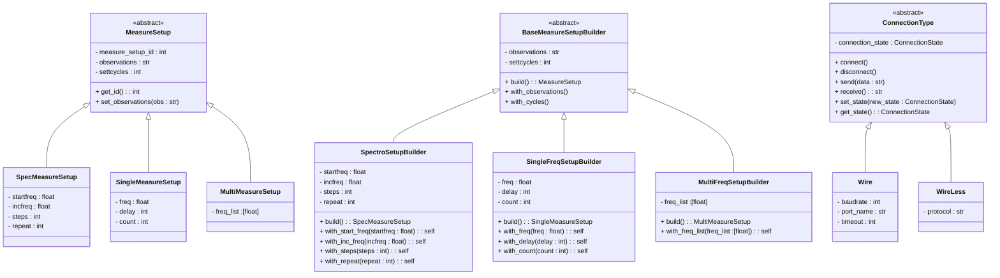

##### Patrón State

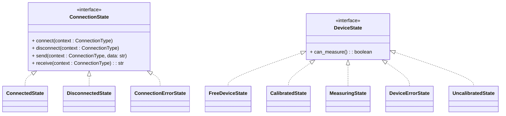

##### Patrón Adapter

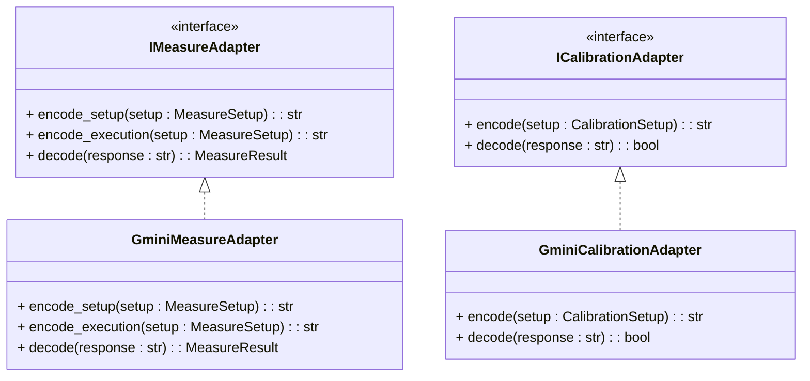

##### Patrón Observer

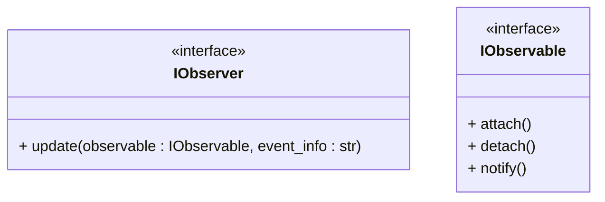

##### Patrón Factory

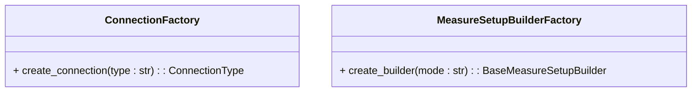

##### Clases del Dominio

```mermaid
classDiagram
%% mediciones
class Measure {
	- measure_id : int
	- measureSetup : MeasureSetup
	- date : DateTime
	- file_name : str
	- state : ['EXECUTING', 'COMPLETE', 'ERROR']
	- device_id : int
	- device_temp : float
	- result : MeasureResult
	- observations : str
	- loop_group_id : str
	- iteration_number : int

	%% getters
	+ get_device_id() : int
	+ get_measure_result() : MeasureResult
	+ get_file_name() : str
	+ get_observations() : str
	+ get_measure_setup() : MeasureSetup

	+ get_state() : str
	+ set_default_name()

	%% setters
	+ set_file_name(new_name : name)
	+ set_observations(obs : str)
	+ set_state(new_state : str)

}

class MeasureResult{
	- m_resul_id : int
	- frequencies : [float]
	- amplitudes : [float]
	- phases : [float]
	- impedances : [complex]
	+ measure_mean() : [float]
	+ measure_std() : [float]
}

class AutoSequence {
	- sequence_id : int
	- measure_setups : [MeasureSetup]
	- delay : float
	- repeat : int
	- observations : str
	+ get_id() : int
	+ get_setups() : [MeasureSetup]
	+ set_observations(obs : str)
}

class ExperimentalSession {
	- session_id : int
	- created_at : DateTime
	- measures : [Measure]
	- observations : str
	+ get_id() : int
	+ get_measures() : [Measure]
	+ add_measure(measure : Measure)
	+ set_observations(obs : str)
}

%% usuario
class User {
	- user_id : int
	- user_name : str
	- email : str
	- password : str
	- root_directory : str
	%% getters
	+ get_id() : int
	+ get_root_directory() : str

	%% setters
	+ set_user_id(id : int)
	+ set_root_directory(path : str)
}

class Token {
	- user_id : int
	- token_string : str
	- created_at : DateTime
}

%% conexion y calibracion
class CalibrationSetup{
	- cal_setup_id : int
	- observations : str
	- channel : ["RCAL1":0, "RCAL2":1, "Other":2/3]
	- z_calc_value_real : float
	- z_calc_value_imag : float
	- exitation_voltage : float
	- gain : float
	- rfbvalue : float
	- mux_channel : [0, 1, 2, 3]
	%% getters
	+ get_id() : int

	%% setters
	+ set_observations(obs : str)
}

class Device{
	- device_id : int
	- device_state : DeviceState
	+ set_state(new_state : DeviceState)
	+ get_state() : DeviceState
}
```

##### Servicios de Mediciones, Análisis y Calibración

```mermaid
classDiagram
%% mediciones, analisis y conexion
class MeasureService{
	+ execute_measure(measure : Measure)
	+ finish_measure() : [MeasureResult]
	+ execute_loop(device : Device, base_setup : MeasureSetup, iterations : int, delay : float)
	+ execute_sequence(device : Device, sequence : AutoSequence)
	+ stop_sequence()
	- update_progress()
}

class AnalysisService{
	- measures : [Measure]
	+ apply_debye_model(measure : Measure)
}

class ConnectionService{
	+ active_conections : [device : connection_type]
	+ connect(device : Device, connection_type : ConnectionType)
	+ disconnect(device : Device)
	+ send(device : Device, command : str)
	+ receive(device : Device) : str
}

class CalibrationService{
	+ calibrate_device(device : Device, cal_setup : CalibrationSetup)
}
```

##### Servicios de Usuario y Autenticación

```mermaid
classDiagram
%% usuario
class AuthService{
	+ user_token_file_path : str
	+ login(user_name, password) : Token
	+ logout()
	+ register(user_name, email, password)
	+ restore_session(token : str)
	+ verify_password(password : str)
	+ generate_token() : str
	- rehash_password(password : str) : str
}

class SessionManager{
	- current_user : User
	- active_token : Token
	- active_ExpSession : ExperimentalSession
	+ get_active_ExpSession : ExperimentalSession
	+ set_active_ExpSession : ExperimentalSession
	+ get_current_user() : User
	+ set_current_user(user : User)
	+ get_active_token() : Token
	+ set_active_token(token : Token)
}
```

##### Servicios de Persistencia

```mermaid
classDiagram

%% persistencia
class LocalService{
	%% operaciones en archivos
	+ load_measure(path : str) : Measure
	+ load_calibration_setup(path : str) : CalibrationSetup
	+ load_setup(path : str) : MeasureSetup
	+ load_auto_sequence(path : str) : AutoSequence
	+ load_experimental_session(path : str) : ExperimentalSession
	+ load_user_token(path : str) : Token
	+ export_setup_to_file(path : str, setup : MeasureSetup)
	+ export_calibration_setup_to_file(path : str, setup : CalibrationSetup)
	+ export_measure_to_file(path : str, measure : Measure)
	+ export_auto_sequence_to_file(path : str, sequence : AutoSequence)
	+ export_experimental_session_to_file(path : str, exp_session : ExperimentalSession)
	+ export_user_token(path : str, token : Token)
	+ export_plot(path : str, figure : Figure)
	+ delete_token()
}
class DataBaseService{
	- db_root : str
	%% operaciones en db
	+ save_user(user : User)
	+ save_measure(user_id : int, measure : Measure)
	+ save_calibration_setup(user_id : int, cal_setup : CalibrationSetup)
	+ save_measure_setup(user_id : int, m_setup : MeasureSetup)
	+ save_auto_sequence(user_id : int, sequence : AutoSequence)
	+ save_experimental_session(user_id : int, exp_session : ExperimentalSession)
	+ get_user_by_id(user_id : int): User
	+ get_user_by_email(email : str): User
	+ get_user_by_name(user_name : str): User
	+ get_measures_by_user(user_id : int) : [Measure]
	+ get_calibration_setups_by_user(user_id : int) : [CalibrationSetup]
	+ get_measure_setups_by_user(user_id : int) : [MeasureSetup]
	+ get_auto_sequences_by_user(user_id : int) : [AutoSequence]
	+ get_experimental_sessions_by_user(user_id : int) : [ExperimentalSession]
	+ update_user_directory(user_id : int, path : str)
}
```

#### Diagramas de Clases

###### Subsistema 1: Comunicación e Interacción con el Hardware

###### Módulo 1: Conectividad y Estado

```mermaid
classDiagram

%% jerarquias
ConnectionType <|-- Wire
ConnectionType <|-- WireLess

%% clases

class ConnectionType {
	<<abstract>>
	- connection_state : ConnectionState
	+ connect()
	+ disconnect()
	+ send(data : str)
	+ receive() : str
	+ set_state(new_state : ConnectionState)
	+ get_state() : ConnectionState
}
class Wire{
	- baudrate : int
	- port_name : str
	- timeout : int
}
class WireLess{
	- protocol : str
}

class Device{
	- device_id : int
	- device_state : DeviceState
	+ set_state(new_state : DeviceState)
	+ get_state() : DeviceState
}

%% state patern

class ConnectionState{
		<<interface>>
		+ connect(context : ConnectionType)
		+ disconnect(context : ConnectionType)
		+ send(context : ConnectionType, data: str)
		+ receive(context : ConnectionType) : str
	}
class ConnectedState
class DisconnectedState
class ConnectionErrorState

class DeviceState{
		<<interface>>
		+ can_measure() : boolean
	}
	class FreeDeviceState
	class CalibratedState
	class MeasuringState
	class DeviceErrorState
	class UncalibratedState

%% observer patern
class IObserver{
	<<interface>>
	+ update(observable : IObservable, event_info : str)
}

class IObservable{
	<<interface>>
	+ attach()
	+ detach()
	+ notify()
}

%% servicios

class ConnectionService{
	+ active_conections : [device : connection_type]
	+ connect(device : Device, connection_type : ConnectionType)
	+ disconnect(device : Device)
	+ send(device : Device, command : str)
	+ receive(device : Device) : str
}

%% factory method
class ConnectionFactory{
	+ create_connection(type : str) : ConnectionType
}

%% relaciones

ConnectionService ..|> IObserver : implementa
ConnectionService ..|> IObservable : implementa
ConnectionType ..|> IObservable : implementa

DeviceState <|.. FreeDeviceState : implementa
DeviceState <|.. CalibratedState : implementa
DeviceState <|.. MeasuringState : implementa
DeviceState <|.. DeviceErrorState : implementa
DeviceState <|.. UncalibratedState : implementa

ConnectionState <|.. ConnectedState : implementa
ConnectionState <|.. DisconnectedState : implementa
ConnectionState <|.. ConnectionErrorState : implementa

ConnectionFactory --> ConnectionType : crea

ConnectionType o-- ConnectionState
Device o-- DeviceState

ConnectionService --> ConnectionType : establece conexión
ConnectionService --> Device : establece conexión
ConnectionService --> ConnectionType : observa
```

###### Módulo 2: Calibración del Dispositivo

```mermaid
classDiagram
DeviceState <|.. FreeDeviceState : implementa
DeviceState <|.. CalibratedState : implementa
DeviceState <|.. MeasuringState : implementa
DeviceState <|.. DeviceErrorState : implementa
DeviceState <|.. UncalibratedState : implementa
IObservable <|.. SessionManager : implementa

%% clases
class IObservable{
	<<interface>>
	+ attach()
	+ detach()
	+ notify()
}

class User {
	- user_id : int
	- user_name : str
	- email : str
	- password : str
	- root_directory : str
	%% getters
	+ get_id() : int
	+ get_root_directory() : str

	%% setters
	+ set_user_id(id : int)
	+ set_root_directory(path : str)
}

class CalibrationSetup{
	- cal_setup_id : int
	- observations : str
	- channel : ["RCAL1":0, "RCAL2":1, "Other":2/3]
	- z_calc_value_real : float
	- z_calc_value_imag : float
	- exitation_voltage : float
	- gain : float
	- rfbvalue : float
	- mux_channel : [0, 1, 2, 3]
	%% getters
	+ get_id() : int

	%% setters
	+ set_observations(obs : str)
}

class Device{
	- device_id : int
	- device_state : DeviceState
	+ set_state(new_state : DeviceState)
	+ get_state() : DeviceState
}

class DeviceState{
		<<interface>>
		+ can_measure() : boolean
	}
	class FreeDeviceState
	class CalibratedState
	class MeasuringState
	class DeviceErrorState
	class UncalibratedState

class CalibrationService{
	+ calibrate_device(device : Device, cal_setup : CalibrationSetup)
}

class SessionManager{
	- current_user : User
	- active_token : Token
	- active_ExpSession : ExperimentalSession
	+ get_active_ExpSession : ExperimentalSession
	+ set_active_ExpSession : ExperimentalSession
	+ get_current_user() : User
	+ set_current_user(user : User)
	+ get_active_token() : Token
	+ set_active_token(token : Token)
}

class ConnectionService{
	+ active_conections : [device : connection_type]
	+ connect(device : Device, connection_type : ConnectionType)
	+ disconnect(device : Device)
	+ send(device : Device, command : str)
	+ receive(device : Device) : str
}

class Token {
	- user_id : int
	- token_string : str
	- created_at : DateTime
}

%% patron adapter
class ICalibrationAdapter{
	<<interface>>
	+ encode(setup : CalibrationSetup) : str
	+ decode(response : str) : bool
}

class GminiCalibrationAdapter{
	+ encode(setup : CalibrationSetup) : str
	+ decode(response : str) : bool
}

%% relaciones

Device "1"*--"1" DeviceState

SessionManager "1"o--"0..1" Token
SessionManager "1"o--"0..1" User

ICalibrationAdapter <|.. GminiCalibrationAdapter : implementa

CalibrationService ..> ConnectionService : envía comandos y espera devolución
CalibrationService ..> Device : establece calibración
CalibrationService ..> CalibrationSetup : crea setup
CalibrationService ..> SessionManager : verifica usuario
CalibrationService ..> ICalibrationAdapter : envía objetos y espera comandos
```

##### Subsistema 2: Configuración y Toma de Mediciones

###### Módulo 1: Tipos y Estrategias de Medición

```mermaid
classDiagram

MeasureSetup <|-- SpecMeasureSetup
MeasureSetup <|-- SingleMeasureSetup
MeasureSetup <|-- MultiMeasureSetup

BaseMeasureSetupBuilder <|-- SpectroSetupBuilder
BaseMeasureSetupBuilder <|-- SingleFreqSetupBuilder
BaseMeasureSetupBuilder <|-- MultiFreqSetupBuilder

DeviceState <|.. FreeDeviceState : implementa
DeviceState <|.. CalibratedState : implementa
DeviceState <|.. MeasuringState : implementa
DeviceState <|.. DeviceErrorState : implementa
DeviceState <|.. UncalibratedState : implementa

ConnectionService ..|> IObservable : implementa

MeasureService ..|> IObserver : implementa
MeasureService ..|> IObservable : implementa

IObservable <|.. SessionManager : implementa

%% clases
class User {
	- user_id : int
	- user_name : str
	- email : str
	- password : str
	- root_directory : str
	%% getters
	+ get_id() : int
	+ get_root_directory() : str

	%% setters
	+ set_user_id(id : int)
	+ set_root_directory(path : str)
}

class Device{
	- device_id : int
	- device_state : DeviceState
	+ set_state(new_state : DeviceState)
	+ get_state() : DeviceState
}

class DeviceState{
		<<interface>>
		+ can_measure() : boolean
	}
	class FreeDeviceState
	class CalibratedState
	class MeasuringState
	class DeviceErrorState
	class UncalibratedState

class Measure {
	- measure_id : int
	- measureSetup : MeasureSetup
	- date : DateTime
	- file_name : str
	- state : ['EXECUTING', 'COMPLETE', 'ERROR']
	- device_id : int
	- device_temp : float
	- result : MeasureResult
	- observations : str
	- loop_group_id : str
	- iteration_number : int

	%% getters
	+ get_device_id() : int
	+ get_measure_result() : MeasureResult
	+ get_file_name() : str
	+ get_observations() : str
	+ get_measure_setup() : MeasureSetup

	+ get_state() : str
	+ set_default_name()

	%% setters
	+ set_file_name(new_name : name)
	+ set_observations(obs : str)
	+ set_state(new_state : str)

}

class AutoSequence {
	- sequence_id : int
	- measure_setups : [MeasureSetup]
	- delay : float
	- repeat : int
	- observations : str
	+ get_id() : int
	+ get_setups() : [MeasureSetup]
	+ set_observations(obs : str)
}

class SessionManager{
	- current_user : User
	- active_token : Token
	- active_ExpSession : ExperimentalSession
	+ get_active_ExpSession : ExperimentalSession
	+ set_active_ExpSession : ExperimentalSession
	+ get_current_user() : User
	+ set_current_user(user : User)
	+ get_active_token() : Token
	+ set_active_token(token : Token)
}

class Token {
	- user_id : int
	- token_string : str
	- created_at : DateTime
}

class MeasureSetup {
	<<abstract>>
	- measure_setup_id : int
	- observations : str
	- settcycles : int

	%% getters
	+ get_id() : int

	%% setters
	+ set_observations(obs : str)
}
class SpecMeasureSetup{
	- startfreq : float
	- incfreq : float
	- steps : int
	- repeat : int
}
class SingleMeasureSetup{
	- freq : float
	- delay : int
	- count : int
}
class MultiMeasureSetup{
	- freq_list :[float]
}

class MeasureResult{
	- m_resul_id : int
	- frequencies : [float]
	- amplitudes : [float]
	- phases : [float]
	- impedances : [complex]
	+ measure_mean() : [float]
	+ measure_std() : [float]
}

class MeasureService{
	+ execute_measure(measure : Measure)
	+ finish_measure() : [MeasureResult]
	+ execute_loop(device : Device, base_setup : MeasureSetup, iterations : int, delay : float)
	+ execute_sequence(device : Device, sequence : AutoSequence)
	+ stop_sequence()
	- update_progress()
}

class ConnectionService{
	+ active_conections : [device : connection_type]
	+ connect(device : Device, connection_type : ConnectionType)
	+ disconnect(device : Device)
	+ send(device : Device, command : str)
	+ receive(device : Device) : str
}

class DataBaseService{
	- db_root : str
	%% operaciones en db
	+ save_user(user : User)
	+ save_measure(user_id : int, measure : Measure)
	+ save_calibration_setup(user_id : int, cal_setup : CalibrationSetup)
	+ save_measure_setup(user_id : int, m_setup : MeasureSetup)
	+ save_auto_sequence(user_id : int, sequence : AutoSequence)
	+ save_experimental_session(user_id : int, exp_session : ExperimentalSession)
	+ get_user_by_id(user_id : int): User
	+ get_user_by_email(email : str): User
	+ get_user_by_name(user_name : str): User
	+ get_measures_by_user(user_id : int) : [Measure]
	+ get_calibration_setups_by_user(user_id : int) : [CalibrationSetup]
	+ get_measure_setups_by_user(user_id : int) : [MeasureSetup]
	+ get_auto_sequences_by_user(user_id : int) : [AutoSequence]
	+ get_experimental_sessions_by_user(user_id : int) : [ExperimentalSession]
	+ update_user_directory(user_id : int, path : str)
}


%% builder patern
class BaseMeasureSetupBuilder{
	<<abstract>>
	- observations : str
	- settcycles : int
	+ build() : MeasureSetup
	+ with_observations()
	+ with_cycles()
}

class SpectroSetupBuilder{
	- startfreq : float
	- incfreq : float
	- steps : int
	- repeat : int
	+ build() : SpecMeasureSetup
	+ with_start_freq(startfreq : float) : self
	+ with_inc_freq(incfreq : float) : self
	+ with_steps(steps : int) : self
	+ with_repeat(repeat : int) : self
}

class SingleFreqSetupBuilder{
	- freq : float
	- delay : int
	- count : int
	+ build() : SingleMeasureSetup
	+ with_freq(freq : float) : self
	+ with_delay(delay : int) : self
	+ with_count(count : int) : self
}

class MultiFreqSetupBuilder{
	- freq_list :[float]
	+ build() : MultiMeasureSetup
	+ with_freq_list(freq_list :[float]) : self
}

%% observer patern
class IObserver{
	<<interface>>
	+ update(observable : IObservable, event_info : str)
}

class IObservable{
	<<interface>>
	+ attach()
	+ detach()
	+ notify()
}

%% factory method
class MeasureSetupBuilderFactory{
	+ create_builder(mode : str) : BaseMeasureSetupBuilder
}

%% adapter pattern
class IMeasureAdapter{
	<<interface>>
	+ encode_setup(setup : MeasureSetup) : str
	+ encode_execution(setup : MeasureSetup) : str
	+ decode(response : str) : MeasureResult
}

class GminiMeasureAdapter{
	+ encode_setup(setup : MeasureSetup) : str
	+ encode_execution(setup : MeasureSetup) : str
	+ decode(response : str) : MeasureResult
}

%% relaciones

MeasureSetupBuilderFactory ..> BaseMeasureSetupBuilder : construye

Measure "1"o--"1" MeasureSetup
Measure "1"*--"1" MeasureResult
Measure --> Device : conoce

AutoSequence "1"o--"1..*" MeasureSetup : contiene

BaseMeasureSetupBuilder ..> MeasureSetup : instancia

MeasureService ..> Measure : ejecuta medición
MeasureService ..> AutoSequence : ejecuta secuencia
MeasureService ..> SessionManager : verifica usuario
MeasureService ..> IMeasureAdapter : envía setups y recibe comandos
MeasureService --> ConnectionService : envía comandos y observa
MeasureService --> DataBaseService : invoca guardado de emergencia
MeasureService ..> Device : verifica y actualiza estado

SessionManager "1"o--"0..1" Token
SessionManager "1"o--"0..1" User

IMeasureAdapter <|.. GminiMeasureAdapter : implementa

Device "1"*--"1" DeviceState
```

##### Subsistema 3: Configuración y Gestión de Perfiles (Setups)

###### Módulo 1: Perfiles de Usuario y Gestión de Setups de Medición

```mermaid
classDiagram

%% jerarquias

MeasureSetup <|-- SpecMeasureSetup
MeasureSetup <|-- SingleMeasureSetup
MeasureSetup <|-- MultiMeasureSetup

BaseMeasureSetupBuilder <|-- SpectroSetupBuilder
BaseMeasureSetupBuilder <|-- SingleFreqSetupBuilder
BaseMeasureSetupBuilder <|-- MultiFreqSetupBuilder

IObservable <|.. SessionManager : implementa

class User {
	- user_id : int
	- user_name : str
	- email : str
	- password : str
	- root_directory : str
	%% getters
	+ get_id() : int
	+ get_root_directory() : str

	%% setters
	+ set_user_id(id : int)
	+ set_root_directory(path : str)
}

class AuthService{
	+ user_token_file_path : str
	+ login(user_name, password) : Token
	+ logout()
	+ register(user_name, email, password)
	+ restore_session(token : str)
	+ verify_password(password : str)
	+ generate_token() : str
	- rehash_password(password : str) : str
}

class Token {
	- user_id : int
	- token_string : str
	- created_at : DateTime
}

class ExperimentalSession {
	- session_id : int
	- created_at : DateTime
	- measures : [Measure]
	- observations : str
	+ get_id() : int
	+ get_measures() : [Measure]
	+ add_measure(measure : Measure)
	+ set_observations(obs : str)
}

class IObservable{
	<<interface>>
	+ attach()
	+ detach()
	+ notify()
}

class LocalService{
	%% operaciones en archivos
	+ load_measure(path : str) : Measure
	+ load_calibration_setup(path : str) : CalibrationSetup
	+ load_setup(path : str) : MeasureSetup
	+ load_auto_sequence(path : str) : AutoSequence
	+ load_experimental_session(path : str) : ExperimentalSession
	+ load_user_token(path : str) : Token
	+ export_setup_to_file(path : str, setup : MeasureSetup)
	+ export_calibration_setup_to_file(path : str, setup : CalibrationSetup)
	+ export_measure_to_file(path : str, measure : Measure)
	+ export_auto_sequence_to_file(path : str, sequence : AutoSequence)
	+ export_experimental_session_to_file(path : str, exp_session : ExperimentalSession)
	+ export_user_token(path : str, token : Token)
	+ export_plot(path : str, figure : Figure)
	+ delete_token()
}
class DataBaseService{
	- db_root : str
	%% operaciones en db
	+ save_user(user : User)
	+ save_measure(user_id : int, measure : Measure)
	+ save_calibration_setup(user_id : int, cal_setup : CalibrationSetup)
	+ save_measure_setup(user_id : int, m_setup : MeasureSetup)
	+ save_auto_sequence(user_id : int, sequence : AutoSequence)
	+ save_experimental_session(user_id : int, exp_session : ExperimentalSession)
	+ get_user_by_id(user_id : int): User
	+ get_user_by_email(email : str): User
	+ get_user_by_name(user_name : str): User
	+ get_measures_by_user(user_id : int) : [Measure]
	+ get_calibration_setups_by_user(user_id : int) : [CalibrationSetup]
	+ get_measure_setups_by_user(user_id : int) : [MeasureSetup]
	+ get_auto_sequences_by_user(user_id : int) : [AutoSequence]
	+ get_experimental_sessions_by_user(user_id : int) : [ExperimentalSession]
	+ update_user_directory(user_id : int, path : str)
}

class MeasureSetup {
	<<abstract>>
	- measure_setup_id : int
	- observations : str
	- settcycles : int

	%% getters
	+ get_id() : int

	%% setters
	+ set_observations(obs : str)
}
class SpecMeasureSetup{
	- startfreq : float
	- incfreq : float
	- steps : int
	- repeat : int
}
class SingleMeasureSetup{
	- freq : float
	- delay : int
	- count : int
}
class MultiMeasureSetup{
	- freq_list :[float]
}

class CalibrationSetup{
	- cal_setup_id : int
	- observations : str
	- channel : ["RCAL1":0, "RCAL2":1, "Other":2/3]
	- z_calc_value_real : float
	- z_calc_value_imag : float
	- exitation_voltage : float
	- gain : float
	- rfbvalue : float
	- mux_channel : [0, 1, 2, 3]
}

class SessionManager{
	- current_user : User
	- active_token : Token
	- active_ExpSession : ExperimentalSession
	+ get_active_ExpSession : ExperimentalSession
	+ set_active_ExpSession : ExperimentalSession
	+ get_current_user() : User
	+ set_current_user(user : User)
	+ get_active_token() : Token
	+ set_active_token(token : Token)
}

%% builder patern
class BaseMeasureSetupBuilder{
	<<abstract>>
	- observations : str
	- settcycles : int
	+ build() : MeasureSetup
	+ with_observations()
	+ with_cycles()
}

class SpectroSetupBuilder{
	- startfreq : float
	- incfreq : float
	- steps : int
	- repeat : int
	+ build() : SpecMeasureSetup
	+ with_start_freq(startfreq : float) : self
	+ with_inc_freq(incfreq : float) : self
	+ with_steps(steps : int) : self
	+ with_repeat(repeat : int) : self
}

class SingleFreqSetupBuilder{
	- freq : float
	- delay : int
	- count : int
	+ build() : SingleMeasureSetup
	+ with_freq(freq : float) : self
	+ with_delay(delay : int) : self
	+ with_count(count : int) : self
}

class MultiFreqSetupBuilder{
	- freq_list :[float]
	+ build() : MultiMeasureSetup
	+ with_freq_list(freq_list :[float]) : self
}

%% factory method
class MeasureSetupBuilderFactory{
	+ create_builder(mode : str) : BaseMeasureSetupBuilder
}

%% relaciones
BaseMeasureSetupBuilder ..> MeasureSetup : instancia

AuthService ..> User : crea usuario
AuthService ..> DataBaseService : guarda usuario
AuthService ..> SessionManager : establece usuario
AuthService ..> Token : crea
AuthService ..> LocalService : periste/recupera token

SessionManager "1"o--"0..1" Token
SessionManager "1"o--"0..1" User
SessionManager "1"o--"0..1" ExperimentalSession

LocalService ..> CalibrationSetup : exporta/importa
LocalService ..> MeasureSetup : exporta/importa
LocalService ..> ExperimentalSession : exporta/importa

MeasureSetupBuilderFactory ..> BaseMeasureSetupBuilder : construye
```

##### Subsistema 4: Procesamiento y Análisis de Datos

###### Módulo 2: Modelado y Análisis de Impedancia

```mermaid
classDiagram

class AnalysisService {
	- measures : [Measure]
	+ apply_debye_model(measure : Measure)
}

class Measure {
	- measure_id : int
	- measureSetup : MeasureSetup
	- date : DateTime
	- file_name : str
	- state : ['EXECUTING', 'COMPLETE', 'ERROR']
	- device_id : int
	- device_temp : float
	- result : MeasureResult
	- observations : str
	- loop_group_id : str
	- iteration_number : int
	+ get_measure_result() : MeasureResult
}

class MeasureResult {
	- m_resul_id : int
	- frequencies : [float]
	- amplitudes : [float]
	- phases : [float]
	- impedances : [complex]
	+ measure_mean() : [float]
	+ measure_std() : [float]
}

%% relaciones
AnalysisService "1" o-- "0..*" Measure : gestiona
AnalysisService ..> MeasureResult : opera sobre
Measure "1" *-- "1" MeasureResult : contiene
```

##### Subsistema 5: Persistencia

###### Módulo 1: Almacenamiento y Estructura de Datos

```mermaid
classDiagram

%% jerarquias
MeasureSetup <|-- SpecMeasureSetup
MeasureSetup <|-- SingleMeasureSetup
MeasureSetup <|-- MultiMeasureSetup

BaseMeasureSetupBuilder <|-- SpectroSetupBuilder
BaseMeasureSetupBuilder <|-- SingleFreqSetupBuilder
BaseMeasureSetupBuilder <|-- MultiFreqSetupBuilder

IObservable <|.. SessionManager : implementa

%% clases
class IObservable{
	<<interface>>
	+ attach()
	+ detach()
	+ notify()
}

class User {
	- user_id : int
	- user_name : str
	- email : str
	- password : str
	- root_directory : str
	%% getters
	+ get_id() : int
	+ get_root_directory() : str

	%% setters
	+ set_user_id(id : int)
	+ set_root_directory(path : str)
}

class Measure {
	- measure_id : int
	- measureSetup : MeasureSetup
	- date : DateTime
	- file_name : str
	- state : ['EXECUTING', 'COMPLETE', 'ERROR']
	- device_id : int
	- device_temp : float
	- result : MeasureResult
	- observations : str
	- loop_group_id : str
	- iteration_number : int

	%% getters
	+ get_device_id() : int
	+ get_measure_result() : MeasureResult
	+ get_file_name() : str
	+ get_observations() : str
	+ get_measure_setup() : MeasureSetup

	+ get_state() : str
	+ set_default_name()

	%% setters
	+ set_file_name(new_name : name)
	+ set_observations(obs : str)
	+ set_state(new_state : str)

}

class MeasureResult{
	- m_resul_id : int
	- frequencies : [float]
	- amplitudes : [float]
	- phases : [float]
	- impedances : [complex]
	+ measure_mean() : [float]
	+ measure_std() : [float]
}

class MeasureSetup {
	<<abstract>>
	- measure_setup_id : int
	- observations : str
	- settcycles : int

	%% getters
	+ get_id() : int

	%% setters
	+ set_observations(obs : str)
}
class SpecMeasureSetup{
	- startfreq : float
	- incfreq : float
	- steps : int
	- repeat : int
}
class SingleMeasureSetup{
	- freq : float
	- delay : int
	- count : int
}
class MultiMeasureSetup{
	- freq_list :[float]
}

class CalibrationSetup{
	- cal_setup_id : int
	- observations : str
	- channel : ["RCAL1":0, "RCAL2":1, "Other":2/3]
	- z_calc_value_real : float
	- z_calc_value_imag : float
	- exitation_voltage : float
	- gain : float
	- rfbvalue : float
	- mux_channel : [0, 1, 2, 3]
	%% getters
	+ get_id() : int

	%% setters
	+ set_observations(obs : str)
}

class AutoSequence {
	- sequence_id : int
	- measure_setups : [MeasureSetup]
	- delay : float
	- repeat : int
	- observations : str
	%% getters
	+ get_id() : int
	+ get_setups() : [MeasureSetup]
	%% setters
	+ set_observations(obs : str)
}

class ExperimentalSession {
	- session_id : int
	- created_at : DateTime
	- measures : [Measure]
	- observations : str
	%% getters
	+ get_id() : int
	+ get_measures() : [Measure]
	%% setters
	+ add_measure(measure : Measure)
	+ set_observations(obs : str)
}

class SessionManager{
	- current_user : User
	- active_token : Token
	- active_ExpSession : ExperimentalSession
	+ get_active_ExpSession : ExperimentalSession
	+ set_active_ExpSession : ExperimentalSession
	+ get_current_user() : User
	+ set_current_user(user : User)
	+ get_active_token() : Token
	+ set_active_token(token : Token)
}

class Token {
	- user_id : int
	- token_string : str
	- created_at : DateTime
}

class MeasureService{
	+ execute_measure(measure : Measure)
	+ finish_measure() : [MeasureResult]
	+ execute_loop(device : Device, base_setup : MeasureSetup, iterations : int, delay : float)
	+ execute_sequence(device : Device, sequence : AutoSequence)
	+ stop_sequence()
	- update_progress()
}

class CalibrationService{
	+ calibrate_device(device : Device, cal_setup : CalibrationSetup)
}

class DataBaseService{
	- db_root : str
	%% operaciones en db
	+ save_user(user : User)
	+ save_measure(user_id : int, measure : Measure)
	+ save_calibration_setup(user_id : int, cal_setup : CalibrationSetup)
	+ save_measure_setup(user_id : int, m_setup : MeasureSetup)
	+ save_auto_sequence(user_id : int, sequence : AutoSequence)
	+ save_experimental_session(user_id : int, exp_session : ExperimentalSession)
	+ get_user_by_id(user_id : int): User
	+ get_user_by_email(email : str): User
	+ get_user_by_name(user_name : str): User
	+ get_measures_by_user(user_id : int) : [Measure]
	+ get_calibration_setups_by_user(user_id : int) : [CalibrationSetup]
	+ get_measure_setups_by_user(user_id : int) : [MeasureSetup]
	+ get_auto_sequences_by_user(user_id : int) : [AutoSequence]
	+ get_experimental_sessions_by_user(user_id : int) : [ExperimentalSession]
	+ update_user_directory(user_id : int, path : str)
}

class LocalService{
	%% operaciones en archivos
	+ load_measure(path : str) : Measure
	+ load_calibration_setup(path : str) : CalibrationSetup
	+ load_setup(path : str) : MeasureSetup
	+ load_auto_sequence(path : str) : AutoSequence
	+ load_experimental_session(path : str) : ExperimentalSession
	+ load_user_token(path : str) : Token
	+ export_setup_to_file(path : str, setup : MeasureSetup)
	+ export_calibration_setup_to_file(path : str, setup : CalibrationSetup)
	+ export_measure_to_file(path : str, measure : Measure)
	+ export_auto_sequence_to_file(path : str, sequence : AutoSequence)
	+ export_experimental_session_to_file(path : str, exp_session : ExperimentalSession)
	+ export_user_token(path : str, token : Token)
	+ export_plot(path : str, figure : Figure)
	+ delete_token()
}

%% builder patern
class BaseMeasureSetupBuilder{
	<<abstract>>
	- observations : str
	- settcycles : int
	+ build() : MeasureSetup
	+ with_observations()
	+ with_cycles()
}

class SpectroSetupBuilder{
	- startfreq : float
	- incfreq : float
	- steps : int
	- repeat : int
	+ build() : SpecMeasureSetup
	+ with_start_freq(startfreq : float) : self
	+ with_inc_freq(incfreq : float) : self
	+ with_steps(steps : int) : self
	+ with_repeat(repeat : int) : self
}

class SingleFreqSetupBuilder{
	- freq : float
	- delay : int
	- count : int
	+ build() : SingleMeasureSetup
	+ with_freq(freq : float) : self
	+ with_delay(delay : int) : self
	+ with_count(count : int) : self
}

class MultiFreqSetupBuilder{
	- freq_list :[float]
	+ build() : MultiMeasureSetup
	+ with_freq_list(freq_list :[float]) : self
}

%% factory method
class MeasureSetupBuilderFactory{
	+ create_builder(mode : str) : BaseMeasureSetupBuilder
}

%% relaciones

MeasureSetupBuilderFactory ..> BaseMeasureSetupBuilder : construye

Measure "1"*--"1" MeasureResult
Measure "1"o--"1" MeasureSetup

AutoSequence "1"o--"1..*" MeasureSetup : contiene
ExperimentalSession "1"o--"0..*" Measure : agrupa

BaseMeasureSetupBuilder ..> MeasureSetup : instancia

CalibrationService ..> SessionManager : verifica usuario
CalibrationService ..> CalibrationSetup : modifica datos

MeasureService ..> SessionManager : verifica usuario
MeasureService ..> Measure : modifica datos
MeasureService ..> AutoSequence : ejecuta secuencia

SessionManager "1"o--"0..1" Token
SessionManager "1"o--"0..1" User

LocalService ..> Measure : importa/exporta la medición
LocalService ..> MeasureSetup : importa/exporta el setup
LocalService ..> CalibrationSetup : importa/exporta el setup
LocalService ..> AutoSequence : importa/exporta la secuencia
LocalService ..> ExperimentalSession : importa/exporta la sesión

DataBaseService ..> Measure : persiste la medición
DataBaseService ..> MeasureSetup : persiste el setup
DataBaseService ..> CalibrationSetup : persiste el setup
DataBaseService ..> AutoSequence : persiste la secuencia
DataBaseService ..> ExperimentalSession : persiste la sesión

MeasureService ..|> IObservable : implementa
```

### Base de Datos

#### Convenciones Gráficas

##### Entidades, Atributos y Claves
```mermaid
erDiagram
    ENTIDAD_EJEMPLO {
        tipo_dato clave_primaria PK "Identificador único (Primary Key)"
        tipo_dato clave_foranea FK "Referencia a otra tabla (Foreign Key)"
        tipo_dato atributo_comun "Campo estándar"
    }
```

##### Cardinalidad y Multiplicidad
```mermaid
erDiagram
    LADO_UNO ||--|{ LADO_MUCHOS : "Uno a Muchos (al menos 1)"
    LADO_UNO ||--o{ LADO_MUCHOS_OPCIONAL : "Uno a Muchos (0 a N)"
    ENTIDAD_A ||--|| ENTIDAD_B : "Uno a Uno estricto"
```

##### Representación de Herencia
```mermaid
erDiagram
    TABLA_PADRE o|--|| TABLA_HIJA_A : "es un (extiende)"
    TABLA_PADRE o|--|| TABLA_HIJA_B : "es un (extiende)"
```

#### Diagrama de Entidad Relacion
```mermaid
erDiagram

USER{
	int user_id PK
	string email
	string user_name
	string password
	string root_directory
}

CALIBRATION_SETUP{
	int cal_setup_id PK
	int user_id FK
	string observations
	string channel
	float z_calc_value_real
	float z_calc_value_imag
	float exitation_voltage
	float gain
	float rfbvalue
	int mux_channel
}

MEASURE{
	int measure_id PK
	int user_id FK
	int measure_setup FK
	int result FK
	int device_id FK
	int exp_session_id FK
	date date
	string state
	float device_temp
	string file_name
	string observations
	string loop_group_id
	int iteration_number
}

DEVICE{
	int device_id PK
	string device_name
}

MEASURE_RESULT{
	int result_id PK
	string frequencies
	string amplitudes
	string phases
	string impedances_real
	string impedances_imag
}

MEASURE_SETUP{
	int measure_setup_id PK
	int user_id FK
	string observations
	int settcycles
}

SPEC_MEASURE_SETUP{
	int spec_ms_id PK
	int m_setup FK
	float startfreq
	float incfreq
	int steps
	int repeat
}

SINGLE_MEASURE_SETUP{
	int single_ms_id PK
	int m_setup FK
	float freq
	int delay
	int count
}

MULTI_MEASURE_SETUP{
	int multi_ms_id PK
	int m_setup FK
	string frequencies_list
}

EXPERIMENTAL_SESSION{
	int exp_session_id PK
	int user_id FK
	date creation_date
}

AUTO_SEQUENCE{
	int auto_sequence_id PK
	float delay
	int repeat
}

USER ||--o{ EXPERIMENTAL_SESSION : tiene_sesion

EXPERIMENTAL_SESSION ||--o{ MEASURE : contiene

USER ||--o{ CALIBRATION_SETUP : crea

USER ||--o{ AUTO_SEQUENCE : utiliza

USER ||--o{ MEASURE_SETUP : configura

MEASURE ||--|| MEASURE_RESULT : arroja

MEASURE |{--|| MEASURE_SETUP : tiene

MEASURE o{--|| DEVICE : realiza

AUTO_SEQUENCE o{--|{ MEASURE_SETUP : contiene_setup

MEASURE_SETUP o|--|| SPEC_MEASURE_SETUP : es_un
MEASURE_SETUP o|--|| SINGLE_MEASURE_SETUP : es_un
MEASURE_SETUP o|--|| MULTI_MEASURE_SETUP : es_un
```


### Diagramas de Secuencia

### Subsistema 1: Comunicación e Interacción con el Hardware

#### Módulo 1: Conectividad y Estado

##### Establecer conexion con el dispositivo

```mermaid

sequenceDiagram
autonumber

actor U as Usuario
participant G as Interfaz (GUI)
participant CF as ConnectionFactory
participant CS as ConnectionService
participant Dev as Device

U->>G: Solicita conectar dispositivo (tipo, puerto/protocolo)
G->>CF: create_connection(type)

alt tipo == 'Alámbrica'
    create participant W as Wire
    CF->>W: new Wire(baudrate, port_name, timeout)
    W-->>CF: instancia (Wire)
    CF-->>G: connection_type
else tipo == 'Inalámbrica'
    create participant WL as WireLess
    CF->>WL: new WireLess(protocol)
    WL-->>CF: instancia (WireLess)
    CF-->>G: connection_type
end

G->>CS: connect(device, connection_type)
participant CT as ConnectionType
Note over CS, CT: connection_type es la instancia devuelta por la Factory
CS->>CT: connect()
Note over CT: Intenta establecer el enlace con la placa ESP32

alt Conexión Exitosa
    CT->>CT: set_state(ConnectedState)
    CS->>CS: active_conections[device] = connection_type
    CS->>Dev: set_state(UncalibratedState)
    CS->>CS: notify()
    CS-->>G: update(observable, event_info)
    CS-->>G: True
    G-->>U: Notifica visualmente el estado Activo de conexión
else Error de Conexión
    CT->>CT: set_state(ConnectionErrorState)
    CS->>CS: notify()
    CS-->>G: update(observable, event_info)
    CS-->>G: False / Exception
    G-->>U: Notifica visualmente el estado de Error de conexión
end

```

#### Modulo 2: Calibración del Dispositivo

##### Configurar calibración electrónica

```mermaid

sequenceDiagram
autonumber

actor U as Usuario
participant G as Interfaz (GUI)
participant session as SessionManager
participant dbs as DataBaseService
participant db as Base de Datos

U->>G: Solicita configurar calibración
G->>U: Despliega formulario de parámetros

U->>G: Ingresa parámetros (voltaje, ganancia, RFB, ciclos, canal, Z real/imag)
create participant C as CalibrationSetup
G->>C: new CalibrationSetup(voltage, gain, rfbvalue, cycles, channel, z_real, z_imag)
C-->>G: cal_setup (Instancia creada)

G->>G: set_active_calibration_setup(cal_setup)
Note right of G: El setup de calibración queda activo en memoria para ser aplicado a la placa

alt El usuario decide guardar el setup
    U->>G: Solicita guardar la configuración
    G->>session: get_current_user()
    session-->>G: User

    G->>U: Solicita observaciones (opcional)
    alt Ingresa observaciones
        U-->>G: observations
        G->>C: set_observations(observations)
    else Deja en blanco
        U-->>G: null
    end

    G->>dbs: save_calibration_setup(user_id, cal_setup)
    dbs->>db: INSERT INTO CALIBRATION_SETUP(user_id, observations, channel, voltage, gain, rfb, cycles, z_real, z_imag) VALUES(...)
    db-->>dbs: Confirmación de guardado
    dbs->>db: SELECT last_insert_rowid()
    db-->>dbs: cal_setup_id
    dbs->>C: set_id(cal_setup_id)
    dbs-->>G: True
    G-->>U: Configuración guardada y activa
else El usuario solo aplica sin guardar
    U->>G: Confirma uso temporal
    G-->>U: Configuración activa para la sesión actual
end

```

##### Ejecutar setup de calibracion

```mermaid

sequenceDiagram
autonumber

actor U as Usuario
participant G as Interfaz (GUI)
participant CS as CalibrationService
participant Dev as Device
participant Adp as GminiCalibrationAdapter
participant Conn as ConnectionService

U->>G: Solicita ejecutar calibración
G->>G: cal_setup = get_active_calibration_setup()
G->>CS: calibrate_device(device, cal_setup)

CS->>Adp: encode(cal_setup)
Adp-->>CS: command (ej. ajustar ganancia, RFB, canal y calibrar)

CS->>Conn: send(device, command)
CS->>Conn: receive(device)
Conn-->>CS: raw_response

CS->>Adp: decode(raw_response)
Adp-->>CS: success (bool)

alt success == True
    CS->>Dev: set_state(CalibratedState)
    CS-->>G: True
    G-->>U: Calibración ejecutada con éxito
else success == False
    CS->>Dev: set_state(UncalibratedState)
    CS-->>G: False / Exception
    G-->>U: Error en el proceso de calibración
end

```

### Subsistema 2: Configuración y Toma de Mediciones

#### Módulo 1: Tipos y Estrategias de Medición

##### Ejecutar medicion

```mermaid

sequenceDiagram
autonumber

actor U as Usuario
participant G as Interfaz (GUI)
participant MS as MeasureService
participant Dev as Device
participant M as Measure
participant Adp as GminiMeasureAdapter
participant CS as ConnectionService

U->>G: Solicita ejecutar medición
G->>MS: execute_measure(measure)

MS->>Dev: get_state().can_measure()
alt El dispositivo puede medir (Estado Calibrado)
    MS->>Dev: set_state(MeasuringState)
    MS->>M: setup = get_measure_setup()

    alt setup es SpecMeasureSetup (Espectroscopía)
        MS->>Adp: encode_execution(setup)
        Adp-->>MS: command (ej. "sweep...")
        MS->>CS: send(device, command)
        MS->>CS: receive(device)
        CS-->>MS: raw_response
        MS->>MS: notify() (Actualiza progreso GUI)

    else setup es SingleMeasureSetup (Monofrecuencia)
        MS->>Adp: encode_execution(setup)
        Adp-->>MS: command (ej. "singlefreq...")
        MS->>CS: send(device, command)
        MS->>CS: receive(device)
        CS-->>MS: raw_response

    else setup es MultiMeasureSetup (Multifrecuencia)
        loop Por cada frecuencia discreta en freq_list
            MS->>Adp: encode_execution(freq_setup_parcial)
            Adp-->>MS: command
            MS->>CS: send(device, command)
            MS->>CS: receive(device)
            CS-->>MS: raw_response_parcial
            MS->>MS: notify() (Actualiza progreso GUI)
        end
    end

    MS->>Adp: decode(raw_response)
    create participant MR as MeasureResult
    Adp->>MR: new MeasureResult(...)
    MR-->>Adp: Instancia creada
    Adp-->>MS: result

    MS->>M: set_measure_result(result)
    MS->>Dev: set_state(CalibratedState)

    MS-->>G: finish_measure() -> [MeasureResult]
    G-->>U: Visualiza resultados y renderiza gráficas

else El dispositivo NO puede medir (Descalibrado/Error)
    MS-->>G: Exception / Error
    G-->>U: Bloquea ejecución y notifica necesidad de calibración
end

```

##### Configurar Setup de Medicion

```mermaid
sequenceDiagram
autonumber

actor U as Usuario
participant G as Interfaz (GUI)
participant F as MeasureSetupBuilderFactory
participant B as BaseMeasureSetupBuilder

U->>G: Selecciona tipo de medición (modo)
G->>F: create_builder(modo)
F-->>G: builder (Instancia específica)

alt modo == 'Espectroscopía'
    U->>G: Ingresa parámetros de barrido espectral
    G->>B: with_start_freq(startfreq)
    G->>B: with_inc_freq(incfreq)
    G->>B: with_steps(steps)
    G->>B: with_repeat(repeat)
else modo == 'Monofrecuencia'
    U->>G: Ingresa parámetros de frecuencia fija
    G->>B: with_freq(freq)
    G->>B: with_delay(delay)
    G->>B: with_count(count)
else modo == 'Multifrecuencia'
    U->>G: Ingresa lista de frecuencias
    G->>B: with_freq_list(freq_list)
end

U->>G: Confirma la configuración
G->>B: build()
create participant MS as MeasureSetup
Note over B, MS: Instancia SpecMeasureSetup, SingleMeasureSetup o MultiMeasureSetup
B->>MS: new MeasureSetup(...)
MS-->>B: Instancia creada
B-->>G: measure_setup
G-->>U: Configuración completada

```

##### Ejecutar Auto Secuencia

```mermaid

sequenceDiagram
autonumber

actor U as Usuario
participant G as Interfaz (GUI)
participant MS as MeasureService
participant Dev as Device
participant Adp as GminiMeasureAdapter
participant CS as ConnectionService
participant dbs as DataBaseService

U->>G: Solicita ejecutar AutoSecuencia
G->>G: auto_sequence = get_active_auto_sequence()
G->>G: session_exp = get_selected_experimental_session()

G->>MS: execute_sequence(device, auto_sequence, session_exp)
MS->>Dev: get_state().can_measure()

alt El dispositivo puede medir (Estado Calibrado)
    MS->>Dev: set_state(MeasuringState)

    loop Repeticiones definidas por el usuario (o hasta cancelar)
        loop Por cada setup_medicion en auto_sequence

            MS->>Adp: encode_execution(setup_medicion)
            Adp-->>MS: command

            MS->>CS: send(device, command)
            MS->>CS: receive(device)
            CS-->>MS: raw_response

            MS->>Adp: decode(raw_response)
            create participant MR as MeasureResult
            Adp->>MR: new MeasureResult(...)
            MR-->>Adp: result

            create participant M as Measure
            MS->>M: new Measure(setup_medicion, result, ...)

            %% Persistencia inmediata para evitar pérdida de datos en ciclos largos
            MS->>dbs: save_measure(user_id, session_exp.get_id(), measure)
            Note over dbs: [REF] Guardar medición con sus resultados
            dbs-->>MS: True

            MS->>MS: notify() (Actualiza progreso y gráficas en GUI)

            alt setup_medicion tiene delay configurado
                MS->>MS: wait(delay_interno)
            end
        end

        alt auto_sequence tiene delay entre secuencias
            MS->>MS: wait(delay_secuencia)
        end
    end

    MS->>Dev: set_state(CalibratedState)
    MS-->>G: Secuencia finalizada con éxito
    G-->>U: Notifica finalización del proceso y resultados

else El dispositivo NO puede medir (Descalibrado/Error)
    MS-->>G: Exception / Error
    G-->>U: Bloquea ejecución y solicita realizar calibración previa
end

```

### Subsistema 3: Configuración y Gestión de Perfiles (Setups)

#### Módulo 1: Perfiles de Usuario y Gestión de Setups de Medición

##### Inicializar entorno de trabajo

```mermaid
sequenceDiagram
autonumber

actor U as Usuario
participant G as Interfaz (GUI)
participant local as LocalService
participant auth as AuthService
U->>G: Ingresa a la aplicación
G->>local: load_user_token()

alt El usuario tiene una sesión activa

	local-->>G: token = Token
	G->>auth: restore_session(token)

	auth-->>G: True
	G->>U: Muestra ventana principal

else El usuario no tiene una sesión activa

	local-->>G: null
	G->>U: Muestra ventana de Login
	Note over U, G: [REF] Ejecutar Iniciar Sesión

end
```

##### Crear Perfil de Usuario

```mermaid
sequenceDiagram
autonumber

actor U as Usuario
participant G as Interfaz (GUI)
participant auth as AuthService


U->>G: Solicitud de Registro
G->>auth: register(user_name, email, password)


participant dbs as DataBaseService
participant db as Base de Datos

auth->>dbs: get_user_by_email(email)
dbs->>db: SELECT * FROM USER WHERE email = @email_param
alt Usuario Inexistente
	db-->>dbs: NULL
	dbs-->>auth: null
	auth->>auth: hashed_password = rehash_password(password)
	create participant user as User
	auth->>user: new User(user_name, email, hashed_password, null)
	user-->>auth: Instancia creada
	auth->>dbs: save_user(user : User)
	dbs->>db: INSERT INTO USER (user_name, email, password, root_directory) VALUES(user_name, email, hashed_password, null)
	db-->>dbs: Confirmacion de Guardado
	dbs->>db: SELECT last_insert_rowid()
	db-->>dbs: user_id
	dbs->>user: set_user_id(user_id)
	dbs-->>auth: Confirmacion de Guardado
	auth-->>G: True
	G-->>U: Registro exitoso
else El usuario existe
	db-->>dbs: USER.user_name, USER.email, USER.password, USER.root_directory
	dbs-->>auth: User
	auth-->>G: False
	G-->>U: Registro cancelado
end
```

##### Iniciar Sesión

```mermaid
sequenceDiagram
autonumber

actor U as Usuario
participant G as Interfaz (GUI)
participant auth as AuthService

U->>G: Solicitud de Inicio de Sesión
G->>auth: login(user_name, password)
participant dbs as DataBaseService
participant db as Base de Datos
auth->>dbs: get_user_by_name(user_name)
dbs->>db: SELECT * FROM USER WHERE user_name = @user_name_param
alt Usuario Registrado
	db-->>dbs: USER.user_name, USER.email, USER.password, USER.root_directory
	dbs-->>auth: User
	auth->>auth: verify_password(password)
	alt Contraseña Correcta
		participant session as SessionManager
		auth->>session: set_current_user(user)
		auth->>auth: token_string = generate_token()
		create participant T as Token
		auth->>T: new Token(user_id, token_string, created_at)
		T-->>auth: Instancia Creada
		auth->>session: set_active_token(token)
		participant local as LocalService
		auth->>local: export_user_token(path, token)
		local-->>auth: Guardado exitoso
		auth-->>G: True
		G-->>U: Inicio de sesión exitoso

	else Contraseña Incorrecta
			auth-->>G: False
			G-->>U: Inicio de sesión rechazado
	end

else Usuario Inexistente
	db-->>dbs: NULL
	dbs-->>auth: null
	auth-->>G: False
	G-->>U: Inicio de sesión rechazado
end
```

##### Cerrar Sesión

```mermaid
sequenceDiagram
autonumber

actor U as Usuario
participant G as Interfaz (GUI)
participant auth as AuthService
participant session as SessionManager
participant local as LocalService

U->>G: Solicitud de Cierre de Sesión
G->>auth: logout()
auth->>local: delete_token()
local-->>auth: Eliminación exitosa
auth->>session: set_active_token(null)
auth->>session: set_current_user(null)
session->>session: notify()
session->>G: update(observable, event_info)
auth-->>G: True
G-->>U: Cierre de Sesión exitoso


```

##### Crear sesion Experimental

```mermaid
sequenceDiagram
autonumber

actor U as Usuario
participant G as Interfaz (GUI)
participant session as SessionManager
participant dbs as DataBaseService
participant db as Base de Datos

U->>G: Solicita crear sesión experimental (ingresa nombre, ej. "batería")
G->>session: get_current_user()
session-->>G: User

create participant ES as ExperimentalSession
G->>ES: new ExperimentalSession(user_id, session_name, date)
ES-->>G: Instancia creada

G->>dbs: save_experimental_session(user_id, experimental_session)
dbs->>db: INSERT INTO EXPERIMENTAL_SESSION(user_id, name, date) VALUES(...)
db-->>dbs: Confirmación de guardado

dbs->>db: SELECT last_insert_rowid()
db-->>dbs: session_id
dbs->>ES: set_session_id(session_id)

dbs-->>G: True
G-->>U: Sesión experimental creada con éxito

```

##### Importar AutoSecuencia

```mermaid

sequenceDiagram
autonumber

actor U as Usuario
participant G as Interfaz (GUI)
participant local as LocalService
participant session as SessionManager
participant dbs as DataBaseService
participant db as Base de Datos

U->>G: Solicita importar una AutoSecuencia
G->>U: Desplegar selector de archivos
alt Usuario Selecciona un archivo
	U-->>G: Seleccionar ruta
	G->>local: load_auto_sequence(path)
	create participant AS as AutoSequence
	local->>AS: new AutoSequence(...)
	AS-->>local: Instancia creada
	local-->>G: auto_sequence
	G->>session: get_current_user()
	session-->>G: User
	G->>dbs: save_auto_sequence(user_id, auto_sequence)
	Note over dbs, db: [REF] Guardar AutoSecuencia
	dbs-->>G: True
	G-->>U: Importación exitosa
else Usuario cancela
	U-->>G: Cancelar importación
	G-->>U: Importación cancelada
end

```

##### Exportar AutoSecuencia

```mermaid

sequenceDiagram
autonumber

actor U as Usuario
participant G as Interfaz (GUI)
participant local as LocalService

U->>G: Solicita exportar una AutoSecuencia
G->>U: Desplegar selector de directorios
alt Usuario Selecciona un directorio
	U-->>G: Seleccionar ruta
	G->>local: export_auto_sequence_to_file(path, AutoSequence)
	local-->>G: True
	G-->>U: Confirmación de guardado
else Usuario cancela
	U-->>G: Cancelar guardado
	G-->>U: Guardado cancelado
end

```

##### Importar Sesión Experimental

```mermaid

sequenceDiagram
autonumber

actor U as Usuario
participant G as Interfaz (GUI)
participant local as LocalService
participant session as SessionManager
participant dbs as DataBaseService
participant db as Base de Datos

U->>G: Solicita importar una Sesión Experimental
G->>U: Desplegar selector de archivos/directorios
alt Usuario Selecciona un archivo/directorio
	U-->>G: Seleccionar ruta
	G->>local: load_experimental_session(path)
	create participant ES as ExperimentalSession
	local->>ES: new ExperimentalSession(...)
	ES-->>local: Instancia creada
	local-->>G: experimental_session
	G->>session: get_current_user()
	session-->>G: User
	G->>dbs: save_experimental_session(user_id, experimental_session)
	Note over dbs, db: [REF] Guardar Sesión Experimental y sus mediciones
	dbs-->>G: True
	G-->>U: Importación exitosa
else Usuario cancela
	U-->>G: Cancelar importación
	G-->>U: Importación cancelada
end

```

##### Exportar Sesión Experimental

```mermaid

sequenceDiagram
autonumber

actor U as Usuario
participant G as Interfaz (GUI)
participant local as LocalService

U->>G: Solicita exportar una Sesión Experimental
G->>U: Desplegar selector de directorios
alt Usuario Selecciona un directorio
	U-->>G: Seleccionar ruta
	G->>local: export_experimental_session(path, ExperimentalSession)
	local-->>G: True
	G-->>U: Confirmación de guardado
else Usuario cancela
	U-->>G: Cancelar guardado
	G-->>U: Guardado cancelado
end

```

##### Exportar gráficas generadas

```mermaid
sequenceDiagram
autonumber

actor U as Usuario
participant G as Interfaz (GUI)
participant local as LocalService

U->>G: Solicita exportar gráficas generadas
G->>U: Desplegar selector de directorios
alt Usuario Selecciona un directorio
	U-->>G: Seleccionar ruta
	G->>local: export_plot(path, Figure)
	local-->>G: True
	G-->>U: Confirmación de guardado

else Usuario cancela
	U-->>G: Cancelar guardado
	G-->>U: Guardado de archivo cancelado
end
```

##### Exportar Medición

```mermaid
sequenceDiagram
autonumber

actor U as Usuario
participant G as Interfaz (GUI)
participant local as LocalService

U->>G: Solicita exportar datos
G->>U: Desplegar selector de directorios
alt Usuario Selecciona un directorio
	U-->>G: Seleccionar ruta
	G->>local: export_measure_to_file(path, Measure)
	local-->>G: True
	G-->>U: Confirmación de guardado
else Usuario cancela
	U-->>G: Cancelar guardado
	G-->>U: Guardado de archivo cancelado
end
```

##### Exportar Configuración

```mermaid
sequenceDiagram
autonumber

actor U as Usuario
participant G as Interfaz (GUI)
participant local as LocalService

U->>G: Solicita exportar datos
G->>U: Desplegar selector de directorios
alt Usuario Selecciona un directorio
	U-->>G: Seleccionar ruta
	alt La configuración es de calibración
		G->>local: export_calibration_setup_to_file(path, CalibrationSetup)
		local-->>G: True
		G-->>U: Confirmación de guardado
	else La configuración es de medición
		G->>local: export_setup_to_file(path, MeasureSetup)
		local-->>G: True
		G-->>U: Confirmación de guardado
	end
else Usuario cancela
	U-->>G: Cancelar guardado
	G-->>U: Guardado de archivo cancelado
end
```

##### Importar Configuración

```mermaid
sequenceDiagram
autonumber

actor U as Usuario
participant G as Interfaz (GUI)
participant local as LocalService
participant session as SessionManager
participant dbs as DataBaseService
participant db as Base de Datos

U->>G: Solicita importar una configuración
	alt Usuario Selecciona un directorio
	alt La configuración es de calibración
			G->>local: load_calibration_setup(path)
			create participant C as CalibrationSetup
			local->>C: cal_setup = new CalibrationSetup(...)
			C-->>local: Instancia creada
			local-->>G: cal_setup
			G->>session: get_current_user()
			session-->>G: User
			G->>dbs: save_calibration_setup(user_id, cal_setup)
			Note over dbs, db: [REF] Ejecutar guardar setup de calibración
			dbs-->>G: True
			G-->>U: Importación exitosa
	else La configuración es de medición
		G->>local: load_setup(path)
		alt El setup es de Espectroscopía
			create participant spec as SpecMeasureSetup
			local->>spec: m_setup = new SpecMeasureSetup(...)
			spec-->>local: Instancia creada
		else El setup es de Monofrecuencia
			create participant single as SingleMeasureSetup
			local->>single: m_setup = new SingleMeasureSetup(...)
			single-->>local: Instancia creada
		else El setup es de Multifrecuencia
			create participant multi as MultiMeasureSetup
			local->>multi: m_setup = new MultiMeasureSetup(...)
			multi-->>local: Instancia creada
		end
		local-->>G: m_setup
		G->>session: get_current_user()
		session-->>G: User
		G->>dbs: save_measure_setup(user_id, m_setup)
		Note over dbs, db: [REF] Ejecutar guardar setup de medición
		dbs-->>G: True
		G-->>U: Importación exitosa
	end
	else Usuario cancela
		U-->>G: Cancelar importación
		G-->>U: Importación de archivo cancelada
	end
```

##### Importar Medición

```mermaid
sequenceDiagram
autonumber

actor U as Usuario
participant G as Interfaz (GUI)
participant local as LocalService
participant session as SessionManager
participant dbs as DataBaseService
participant db as Base de Datos

U->>G: Solicita importar una medición

G->>U: Desplegar selector de directorios
	alt Usuario Selecciona un directorio
		U-->>G: Seleccionar ruta
		G->>local: load_measure(path)
		create participant M as Measure
		local->>M: new Measure(...)
		M-->>local: Instancia creada
		local-->>G: measure
		G->>session: get_current_user()
			session-->>G: User
			G->>dbs: save_measure(user_id, measure)
			Note over dbs, db: [REF] Ejecutar guardar medición con sus resultados
			dbs-->>G: True
			G-->>U: Importación exitosa
	else Usuario cancela
		U-->>G: Cancelar importación
		G-->>U: Importación de archivo cancelada
	end
```

#### Subsistema 5: Persistencia

##### Módulo 1: Almacenamiento y Estructura de Datos

##### Configurar directorio raíz

```mermaid
sequenceDiagram
autonumber

actor U as Usuario
participant G as Interfaz (GUI)
participant session as SessionManager
participant dbs as DataBaseService
participant db as Base de Datos
participant user as User

U->>G: Solicitud de cambio de directorio
G->>session: get_current_user()
session-->>G: User
G->>U: Desplegar selector de directorios
alt Usuario Confirma
	U-->>G: Seleccionar ruta
	G->>dbs: update_user_directory(user_id, path)
	dbs->>db: UPDATE USER SET root_directory = @param_root_directory WHERE user_id = @param_user_id
	db-->>dbs: Confirmación de actualización
	dbs-->>G: True
	G->>user: set_root_directory(path)
	G-->>U: Cambio de directorio exitoso
else Usuario Cancela
	U-->>G: Cancelar Cambio
	G-->>U: Cambio de directorio cancelado
end
```

##### Guardar mediciones con sus resultados

```mermaid
sequenceDiagram
autonumber

actor U as Usuario
participant G as Interfaz (GUI)
participant session as SessionManager
participant M as Measure

U->>G: Solicitud de Guardado de medición
G->>session: get_current_user()
session-->>G: User

%% NUEVO: Contexto de la Sesión Experimental
G->>G: session_exp = get_selected_experimental_session()
G-->>G: Referencia a la sesión experimental actual

G->>G: measure = get_selected_measure()
G-->>G: Referencia a la instancia

G->>U: Solicita nombre del archivo
alt El usuario mantiene el nombre por defecto
	U-->>G: null
else El usuario ingresa un nuevo nombre de archivo
	U-->>G: new_name
	G->>M: measure.set_file_name(new_name)
end

G->>U: Solicita observaciones
alt El usuario mantiene las observaciones en blanco
	U-->>G: null
else El usuario escribe sus observaciones
	U-->>G: observations
	G->>M: measure.set_observations(observations)
end

participant dbs as DataBaseService
participant db as Base de Datos

%% NUEVO: Se pasa el ID de la sesión al servicio
G->>dbs: save_measure(user_id, session_exp.get_id(), measure)
dbs->>dbs: result = measure.get_measure_result()
dbs->>dbs: device_id = measure.get_device_id()

dbs->>db: INSERT INTO MEASURE_RESULT(...) VALUES(...)
db-->>dbs: Confirmación de guardado
dbs->>db: SELECT last_insert_rowid()
db-->>dbs: result_id

dbs->>dbs: measure_setup = measure.get_measure_setup()
dbs->>dbs: setup_id = measure_setup.get_id()
alt El setup es nuevo
	Note over dbs, db: [REF] Ejecutar guardar Setups de medición
	dbs-->>dbs: measure_setup_id
else El setup ya existía
	dbs-->>dbs: int
end

%% NUEVO: Inserción incluyendo session_id
dbs->>db: INSERT INTO MEASURE(user_id, session_id, measure_setup, result, device_id, ..., file_name, observations) VALUES(user_id, session_exp.get_id(), setup_id, result_id, device_id, ..., measure.get_file_name(), measure.get_observations())
db-->>dbs: Confirmación de guardado
dbs-->>G: True
G-->>U: Medición guardada con éxito
```

##### Guardar Setups de calibración

```mermaid
sequenceDiagram
autonumber

actor U as Usuario
participant G as Interfaz (GUI)
participant session as SessionManager
participant C as CalibrationSetup

U->>G: Solicitud de Guardado de setup de calibración
G->>session: get_current_user()
session-->>G: User
G->>G: cal_setup = get_selected_calibration_setup()
G-->>G: Referencia a la instancia

G->>U: Solicita observaciones
alt El usuario mantiene las observaciones en blanco
	U-->>G: null
else El usuario escribe sus observaciones
	U-->>G: observations
	G->>C: cal_setup.set_observations(observations)
end

participant dbs as DataBaseService
participant db as Base de Datos

G->>dbs: save_calibration_setup(user_id, cal_setup)
dbs->>db: INSERT INTO CALIBRATION_SETUP(user_id,...) VALUES(user_id,...)
db-->>dbs: Confirmación de guardado
dbs-->>G: True
G-->>U: Setup de calibración guardado con éxito
```

##### Guardar Setups de medición

```mermaid
sequenceDiagram
autonumber

actor U as Usuario
participant G as Interfaz (GUI)
participant session as SessionManager
participant MS as MeasureSetup

U->>G: Solicitud de Guardado de setup de medición
G->>session: get_current_user()
session-->>G: User
G->>G: m_setup = get_selected_measure_setup()
G-->>G: Referencia a la instancia

G->>U: Solicita observaciones
alt El usuario mantiene las observaciones en blanco
	U-->>G: null
else El usuario escribe sus observaciones
	U-->>G: observations
	G->>MS: m_setup.set_observations(observations)
end

participant dbs as DataBaseService
participant db as Base de Datos

G->>dbs: save_measure_setup(user_id, m_setup)
dbs->>db: INSERT INTO MEASURE_SETUP(user_id,...) VALUES(user_id,...)
	db-->>dbs: Confirmación de guardado

	dbs->>db: SELECT last_insert_rowid()
	db-->>dbs: measure_setup_id

	alt El setup es de Espectroscopía
		dbs->>db: INSERT INTO SPEC_MEASURE_SETUP(m_setup,...) VALUES(m_setup,...)
		db-->>dbs: Confirmación de guardado
	else El setup es de Monofrecuencia
		dbs->>db: INSERT INTO SINGLE_MEASURE_SETUP(m_setup,...) VALUES(m_setup,...)
		db-->>dbs: Confirmación de guardado
	else El setup es de Multifrecuencia
		dbs->>db: INSERT INTO MULTI_MEASURE_SETUP(m_setup,...) VALUES(m_setup,...)
		db-->>dbs: Confirmación de guardado
	end
dbs-->>G: True
G-->>U: Setup de medición guardado con éxito
```


### Tabla de trazabilidad

##### Subsistema 1: Comunicación e Interacción con el Hardware

##### Módulo 1: Conectividad y Estado

| **Requisito** | Caso de uso                                          | Clase/servicio                                                                                                           | Persistencia |
| ------------- | ---------------------------------------------------- | ------------------------------------------------------------------------------------------------------------------------ | ------------ |
| **CON-01**    | Establecer conexión alámbrica                        | ConnectionService/ConnectionType/Wire                                                                                    | -            |
| **CON-02**    | Establecer conexión inalámbrica                      | ConnectionService/ConnectionType/Wireless                                                                                | -            |
| **CON-03**    | Traducir comandos de control                         | CalibrationService/ICalibrationAdapter/GminiCalibrationAdapter<br><br>MeasureService/IMeasureAdapter/GminiMeasureAdapter | -            |
| **CON-04**    | Notificar visualmente el estado activo de conexión   | ConnectionService/ConnectionState/ConnectedState                                                                         | -            |
| **CON-05**    | Notificar visualmente el estado Inactivo de conexión | ConnectionService/ConnectionState/DisconnectedState                                                                      | -            |
| **CON-06**    | Notificar visualmente el estado error de conexión    | ConnectionService/ConnectionState/ConnectionErrorState                                                                   | -            |

##### Módulo 2: Calibración del Dispositivo

| **Requisito** | Caso de uso                                              | Clase/servicio                       | Persistencia |
| ------------- | -------------------------------------------------------- | ------------------------------------ | ------------ |
| **CAL-01**    | Configurar la calibración electrónica del equipo         | CalibrationService/CalibrationSetup  | -            |
| **CAL-02**    | Ejecutar calibración electrónica del equipo              | CalibrationService                   | -            |
| **CAL-03**    | Bloquear ejecución por descalibración                    | Device/DeviceState/UncalibratedState | -            |
| **CAL-04**    | Limitar la configuración de calibración al Modo Avanzado | SessionManager                       | -            |

#### Subsistema 2: Configuración y Toma de Mediciones

##### Módulo 1: Tipos y Estrategias de Medición

| **Requisito** | Caso de uso                                                | Clase/servicio                  | Persistencia  |
| ------------- | ---------------------------------------------------------- | ------------------------------- | ------------- |
| **MED-01**    | Configurar apartados comunes a una medición                | MeasureSetup                    | -             |
| **MED-02**    | Configurar medición de una frecuencia (Monofrecuencia)     | MeasureSetup/SingleMeasureSetup | -             |
| **MED-03**    | Ejecutar medición de una frecuencia (Monofrecuencia)       | MeasureService                  | MeasureResult |
| **MED-04**    | Configurar medición por espectroscopía (Barrido espectral) | MeasureSetup/SpecMeasureSetup   | -             |
| **MED-05**    | Ejecutar medición por espectroscopía (Barrido espectral)   | MeasureService                  | MeasureResult |
| **MED-06**    | Configurar medición de multifrecuencia                     | MeasureSetup/MultiMeasureSetup  | -             |
| **MED-07**    | Ejecutar medición multifrecuencia                          | MeasureService                  | MeasureResult |
| **MED-08**    | Ejecutar mediciones en bucle                               | MeasureService                  | MeasureResult |
| **MED-09**    | Mostrar Progreso de la medición                            | MeasureService/IObservable/GUI  | -             |
| **MED-10**    | Mostrar resultados intermedios                             | MeasureService/IObservable/GUI  | -             |
| **MED-11**    | Calcular estadísticos descriptivos básicos                 | MeasureResult                   | -             |
| **MED-13**    | Limitar configuración de mediciones al Modo Avanzado       | SessionManager                  | -             |
| **MED-14**    | Persistir últimos datos generados ante un error            | MeasureService/DataBaseService  | MEASURE       |
| **MED-15**    | Renderizar gráficas a partir de los resultados             | GUI                             |               |

#### Subsistema 3: Configuración y Gestión de Perfiles (Setups)

##### Módulo 1: Perfiles de Usuario y Gestión de Setups de Medición

| **Requisito** | Caso de uso                                 | Clase/servicio                 | Persistencia                    |
| ------------- | ------------------------------------------- | ------------------------------ | ------------------------------- |
| **SET-01**    | Crear Perfil de Usuario                     | AuthService/DataBaseService    | USER                            |
| **SET-02**    | Iniciar Sesión                              | AuthService                    | -                               |
| **SET-03**    | Cerrar Sesión                               | AuthService                    | -                               |
| **SET-04**    | Habilitar Modos de Uso                      | SessionManager                 | -                               |
| **SET-05**    | Habilitar Modo Avanzado                     | SessionManager                 | -                               |
| **SET-06**    | Habilitar Modo Básico                       | SessionManager                 | -                               |
| **SET-07**    | Cambiar entre modos de uso                  | SessionManager                 | -                               |
| **SET-08**    | Advertir sobre cambio de modo               | SessionManager/IObservable/GUI | -                               |
| **SET-09**    | Aplicar configuraciones                     | DataBaseService                | -                               |
| **SET-10**    | Cargar configuraciones                      | DataBaseService                | CALIBRATION_SETUP/MEASURE_SETUP |
| **SET-11**    | Exportar configuraciones de medición        | LocalService                   | -                               |
| **SET-13**    | Mantener la sesión activa en el dispositivo | LocalService/Token             | -                               |

#### Subsistema 5: Persistencia

##### Módulo 1: Almacenamiento y Estructura de Datos

| **Requisito** | Caso de uso                                                      | Clase/servicio                                                       | Persistencia                           |
| ------------- | ---------------------------------------------------------------- | -------------------------------------------------------------------- | -------------------------------------- |
| **PER-01**    | Almacenar setups de medición y calibración en una Base de Datos  | DataBaseService/MeasureSetup<br><br>DataBaseService/CalibrationSetup | MEASURE_SETUP<br><br>CALIBRATION_SETUP |
| **PER-02**    | Almacenar mediciones y sus resultados en una Base de Datos       | DataBaseService/Measure<br><br>DataBaseService/MeasureResult<br><br> | MEASURE<br><br>MEASURE_RESULT          |
| **PER-03**    | Configurar directorios                                           | User                                                                 | -                                      |
| **PER-04**    | Generar nomenclatura predeterminada de archivos                  | Measure                                                              | MEASURE                                |
| **PER-05**    | Renombramiento manual de archivos                                | Measure                                                              | MEASURE                                |
| **PER-06**    | Estructurar cabeceras de metadatos integrados                    | Mesaure                                                              | MEASURE                                |
| **PER-07**    | Limitar el guardado de setups al Modo Avanzado                   | SessionManager                                                       | -                                      |
| **PER-08**    | Adjuntar metadatos y observaciones libres sobre mediciones       | Mesaure                                                              | MEASURE                                |
| **PER-09**    | Adjuntar metadatos y observaciones libres sobre setups           | MeasureSetup<br><br>CalibrationSetup                                 | MEASURE_SETUP<br><br>CALIBRATION_SETUP |
| **PER-10**    | Limitar la escritura de observaciones en setups al modo Avanzado | SessionManager                                                       | -                                      |
| **PER-11**    | Permitir exportación de gráficas generadas                       | LocalService                                                         | -                                      |

### Pantallas

#### Pantalla de Login

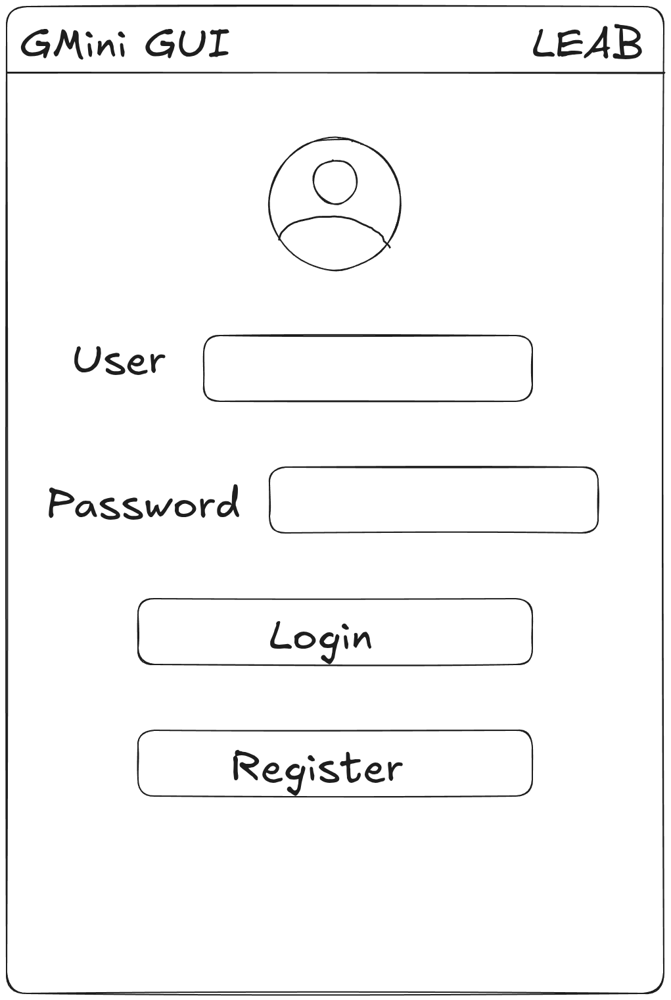

#### Pantalla de Registro

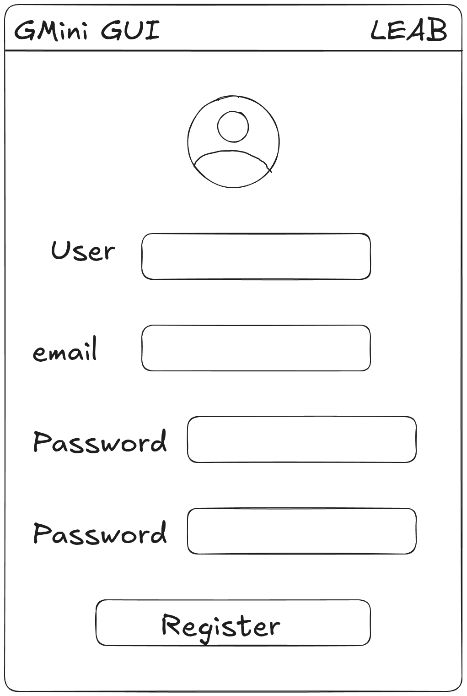

#### Pantalla Principal

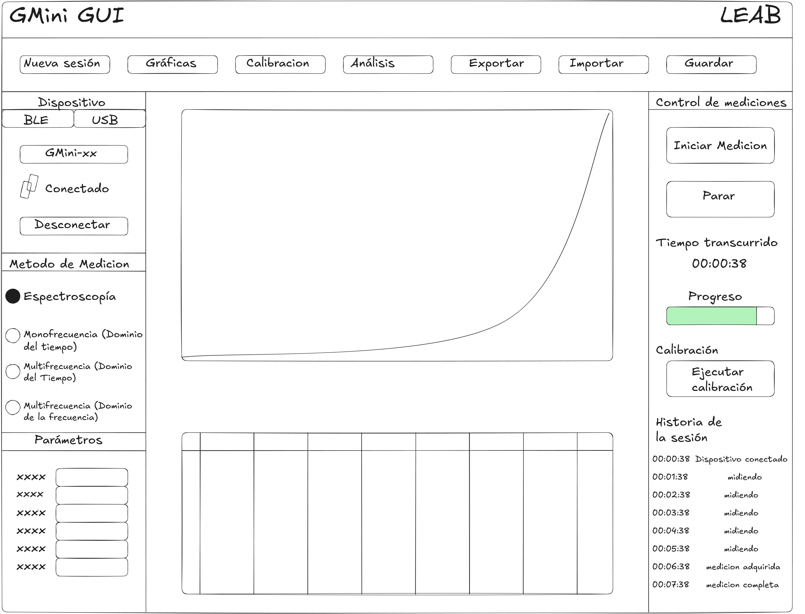
#### Pantalla de Mediciones y Setups de Usuario

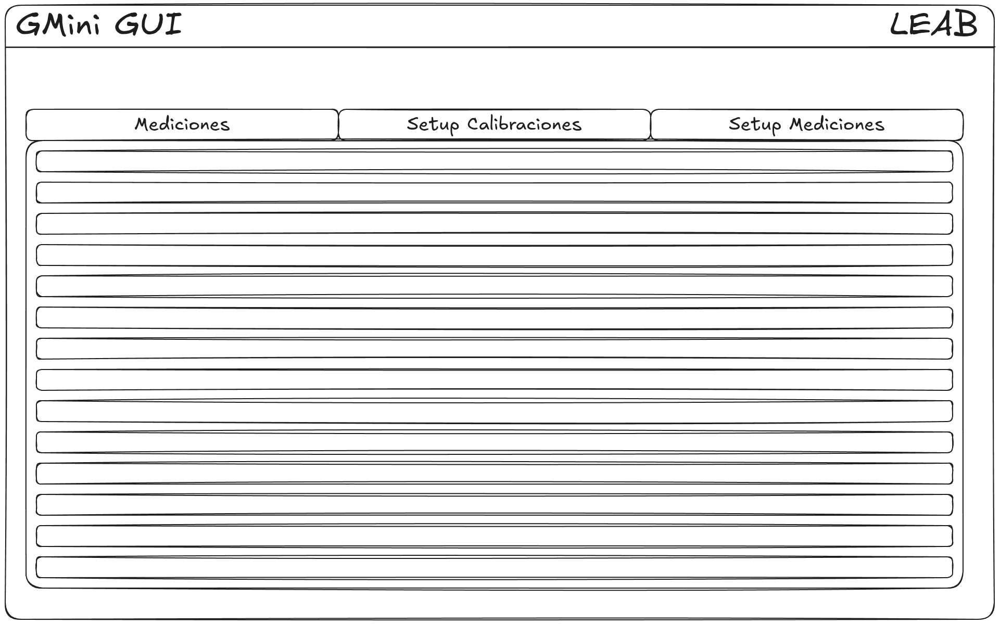

#### Pantalla de Perfil de Usuario

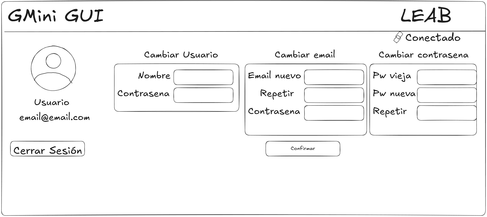

## HERRAMIENTAS UTILIZADAS

### Diagramas de Arquitectura de Software

#### Diagrama de Contexto

```mermaid
C4Context

title Diagrama de Contexto para el Sistema GMini GUI
Person(user, "Usuario registrado")

System(GMini-GUI, "Sistema Guanaco Mini", "Permite a los usuarios interactuar con el dispositivo Guanaco Mini.")

System_Ext(ESP32, "Placa GMini", "Dispositivo de Hardware que realiza mediciones de impedancia y bioimpedancia eléctrica.")

Rel(user, GMini-GUI, "Calibra el dispositivo y realiza mediciones")
Rel(GMini-GUI, ESP32, "Envía comandos de control al dispositivo y recolecta las respuestas")
```

#### Diagrama de Contenedores

```mermaid
C4Container

title Diagrama de Contenedores para el Sistema GMini GUI

Enterprise_Boundary(LEAB, "Entorno de Laboratorio") {

Person(user, "Usuario registrado")

System_Boundary(sys_gmini, "Sistema Guanaco Mini"){

Container(app, "Aplicación de Escritorio", "Python3 + PyQt6" ,"Provee la interfaz gráfica de usuario y la lógica de negocio para interactuar con el Hardware.")

ContainerDb(sqlite, "Base de Datos del Sistema", "SQLite3", "Base de Datos relacional donde se almacenan mediciones y setups de configuración.")

}

System_Ext(ESP32, "Placa GMini", "Dispositivo medidor de impedancia.")

}

Rel(user, app, "Calibra el dispositivo y realiza mediciones")
Rel(app, sqlite, "Persiste datos generados")
Rel(app, ESP32, "Envía comandos de control al dispositivo y recolecta las respuestas")
```

#### Diagrama de Componentes

```mermaid
C4Component
UpdateLayoutConfig($c4ShapeInRow="2", $c4BoundaryInRow="1")
title Diagrama de Componentes para el Sistema GMini GUI

Person(user, "Usuario registrado")

System_Boundary(GMini-GUI, "Sistema Guanaco Mini") {

Container_Boundary(app, "Aplicación de Escritorio"){

Component(UI, "Interfaz Gráfica", "PyQt6", "Maneja la interacción visual.")

Component(sesion, "Autenticación y Sesión", "Python 3", "Mantiene la sesión activa.")

Component(mediciones, "Mediciones y Config", "Python 3", "Orquesta las mediciones.")

Component(comunicacion, "Comunicación y HW", "Python 3", "Maneja el puerto serial/Bluetooth.")

Component(persistencia, "Persistencia", "Python 3", "Centraliza el acceso a datos.")
}

System_Boundary(externos, "Infraestructura Externa") {
ContainerDb(sqlite, "Base de Datos", "SQLite3", "Almacenamiento local.")
}

}

System_Ext(ESP32, "Placa GMini", "Dispositivo medidor de impedancia.")

Rel(user, UI, "Opera sistema")

Rel(UI, sesion, "Valida acceso")
Rel(UI, mediciones, "Inicia proceso")
Rel(UI, comunicacion, "Ajusta puerto")
Rel(UI, persistencia, "Exporta/Importa")

Rel(mediciones, comunicacion, "Delega comandos")
Rel(sesion, persistencia, "Consulta usuario")
Rel(mediciones, persistencia, "Guarda resultados")

Rel(comunicacion, ESP32, "I/O Hardware")
Rel(persistencia, sqlite, "Lee / Escribe")
```
